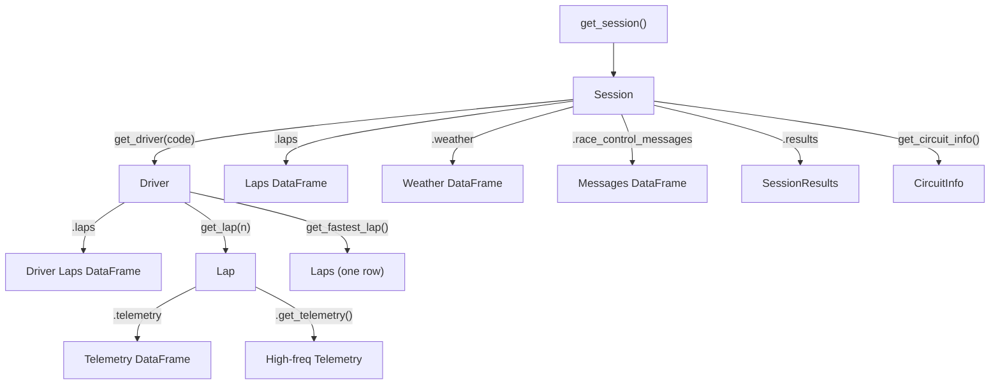

# API Overview

The `tif1` API is a modern Python library for Formula 1 data analysis, telemetry processing, and motorsport analytics. Performance is the primary focus of the design. `tif1` is a drop-in replacement for `fastf1` in most common use cases. Load times are faster than `fastf1` (author-measured; see the Introduction benchmarks). The speed comes from async operations, multi-layer caching, parallel HTTP fetching, and an opt-in Polars backend.

`tif1` serves data scientists, motorsport engineers, application developers, and racing enthusiasts. These users can work efficiently with Formula 1 data at scale.

## What Makes tif1 Different

`tif1` stands apart from other F1 data libraries through several key innovations:

- **Performance**: Every component, from HTTP fetching to DataFrame construction, is optimized for speed. Async operations run in parallel. Caching happens at multiple layers (memory + SQLite). The opt-in Polars backend gives memory-efficient processing for large datasets.

- **Production Architecture**: `tif1` is built for production use, not only for research. It includes circuit breakers, retry logic, connection pooling, and DNS-over-HTTPS support. Errors carry structured context. Loading falls back to the next CDN source when one source fails.

- **Developer Experience**: Type hints throughout the codebase enable IDE autocomplete and type checking. Clear error messages with structured context make debugging quick. Consistent naming conventions make the API predictable and easy to learn.

- **Flexible Data Access**: Load only the data that the task needs. Skip telemetry for faster lap time analysis. Load everything for full session exploration. The API adapts to each use case.

- **Modern Python Practices**: `tif1` supports Python 3.11 through 3.15. It uses modern type hints and async/await patterns. The codebase follows strict linting rules (Ruff) and maintains high test coverage.

## Design Philosophy

The `tif1` API is built on a foundation of carefully considered design principles that guide every architectural decision and implementation detail:

### Performance First

Performance is not just a feature—it is the core reason `tif1` exists. Every component has been profiled, optimized, and benchmarked:

- **Async Operations**: Network I/O uses `niquests`, a modern fork of `requests`, with async/await for parallel fetches. This enables parallel fetching of multiple data sources at the same time. `tif1` can fetch all data for a 20-driver race session in parallel.

- **Multi-Layer Caching**: An in-memory LRU cache holds hot data. A SQLite-backed persistent cache holds all fetched data. Cache hits return data in milliseconds rather than seconds. Cache keys are the payload paths, and cached payloads do not expire.

- **Parallel Fetching**: When loading session data, `tif1` fetches the per-driver lap files, weather, and race control messages in one parallel batch. Telemetry payloads are also fetched in parallel. The fetches use `asyncio.gather`.

- **Opt-in Polars Backend**: Polars is installed with `tif1`. The Polars backend serves large datasets, for example multiple seasons and comparative analysis. Polars is a columnar library built for fast, memory-efficient DataFrame operations. The backend is lazy-loaded and can be switched at runtime.

- **Optimized JSON Parsing**: `tif1` uses `orjson` (written in Rust) instead of Python's stdlib `json`. `orjson` parses JSON faster than the stdlib. The speed matters when processing megabytes of telemetry data.

- **Connection Pooling**: HTTP sessions use connection pooling to reuse TCP connections across requests. This avoids a new TCP and TLS handshake for each request.

### Simplicity and Ergonomics

Complex operations should stay simple. The API hides complexity behind consistent interfaces:

- **Minimal Entry Points**: Most users only need `get_session()` to start working with F1 data. Everything else is discoverable through the returned `Session` object via IDE autocomplete.

- **Sensible Defaults**: All optional parameters have sensible defaults. `session.load()` fetches laps, weather, messages, and all telemetry by default. Disable unneeded data sources for faster loading.

- **Fuzzy Matching**: Event names support aliases and fuzzy matching—"spa", "belgium", "Belgian Grand Prix", and "Spa-Francorchamps" all work. Session types accept both full names ("Qualifying") and short codes ("Q"). This reduces friction and makes the API more forgiving.

- **Progressive Disclosure**: Basic usage is simple, but advanced features are available when needed. Start with `session.laps` for quick analysis, then dive into `driver.get_lap(n).get_telemetry()` for detailed telemetry work.

- **Method Chaining**: Where appropriate, methods return objects that support further operations, enabling natural workflows like `session.get_driver("VER").get_fastest_lap().get_telemetry()`.

### Predictability and Consistency

The API should be easy to learn and remember:

- **Consistent Naming**: Methods follow clear patterns—`get_*` for retrieval operations, `load()` for data loading, `clear()` and `invalidate()` for cache operations. Attributes use snake_case, classes use PascalCase.

- **Clear Data Hierarchies**: The object model mirrors F1's structure: `Session` contains `Driver` objects, which contain `Lap` objects, which contain `Telemetry` data. This mental model matches how most users think about F1 data.

- **Type Hints**: Most public functions and methods include type hints. An IDE can show the expected parameters and the return values. This reduces the need to consult documentation.

- **Structured Errors**: Exceptions include structured context (not just error messages) for programmatic error handling. A `DataNotFoundError` includes the year, event, and session that were not found.

### Compatibility

Existing `fastf1` users should be able to migrate with minimal friction:

- **Drop-in Replacement**: The core API (`get_session()`, `Session.laps`, `Driver` objects) matches `fastf1`'s interface. Most `fastf1` code works with `tif1` by just changing the import.

- **Compatibility Layer**: The `tif1.fastf1_compat` module provides shims for `fastf1`-specific functions like `set_log_level()` and `Cache.enable_cache()`.

- **DataFrame Compatibility**: DataFrames returned by `tif1` use the `fastf1` column names. Most existing analysis code needs no changes.

- **Migration Path**: Both libraries can run side-by-side during migration. Validate the behavior of each piece of code, then move it to `tif1`.

### Extensibility and Customization

Advanced users should be able to customize behavior:

- **Configuration System**: Global configuration via `get_config()` tunes performance parameters (max workers, timeouts, validation). The same call switches backends (pandas/polars). It also controls behavior (ultra cold start mode, DNS-over-HTTPS).

- **Modular Architecture**: The library is split into focused modules (`http_session`, `async_fetch`, `cache`, `cdn`). Each module has one job and can be imported on its own.

- **Backend Abstraction**: pandas and polars sessions share the same entry points. The `lib` setting selects the backend.

- **Cache Management**: `get_cache()` exposes the cache location and tiers. Clear everything, invalidate one tier (memory, JSON, or telemetry), or disable caching per session for testing.

- **Retry and Circuit Breaker**: Configurable retry logic uses exponential backoff. Circuit breaker patterns handle transient network failures gracefully.

## Quick Start

Get started with `tif1` in seconds. The library handles all the complexity of data fetching, parsing, caching, and DataFrame construction behind a simple, consistent interface:

```python
import tif1

# Create the session handle, then fetch the data the analysis needs.
# load() fetches laps, weather, and race control messages here;
# telemetry stays lazy and loads per lap on first access.
session = tif1.get_session(2024, "Bahrain Grand Prix", "Race")
session.load(laps=True, telemetry=False, weather=True, messages=True)

# Access all laps from all drivers as one DataFrame
# Each row is one lap with timing, tire, and position data
laps = session.laps
print(f"Total laps: {len(laps)}")  # 1129 laps across all drivers
print(f"Drivers: {laps['Driver'].nunique()}")  # 20 drivers
print(f"Columns: {list(laps.columns)}")
# ['index', 'Time', 'Driver', 'DriverNumber', 'LapTime', 'LapNumber', 'Stint',
#  'PitOutTime', 'PitInTime', 'Sector1Time', ..., 'Compound', 'TyreLife', ...]

# Get a driver by three-letter code. Driver is a pandas Series of metadata.
driver = session.get_driver("VER")
print(f"Driver: {driver['FullName']}")      # Max Verstappen
print(f"Number: {driver['DriverNumber']}")  # 1
print(f"Team: {driver['TeamName']}")        # Red Bull Racing
print(f"Laps completed: {len(driver.laps)}")  # 57 laps

# Fastest-lap telemetry: speed, RPM, throttle, brake, gear, DRS, position
# Time is lap-relative; samples arrive at roughly 7-9 Hz
telemetry = driver.get_fastest_lap_tel()
print(f"Max speed: {telemetry['Speed'].max():.1f} km/h")  # 301.0 km/h
print(f"Max RPM: {telemetry['RPM'].max():.0f}")  # 12036
print(f"Data points: {len(telemetry)}")  # 703 samples
lap_seconds = driver.get_fastest_lap()["LapTime"].iloc[0].total_seconds()
print(f"Sampling rate: {len(telemetry) / lap_seconds:.1f} Hz")  # 7.6 Hz

# Tire strategy: group the driver's laps by stint
for stint_num, stint in driver.laps.groupby("Stint"):
    compound = stint["Compound"].iloc[0]
    print(f"Stint {int(stint_num)}: {compound} - {len(stint)} laps")
    print(f"  Average lap time: {stint['LapTimeSeconds'].mean():.3f}s")
# Stint 1: SOFT - 17 laps / Stint 2: HARD - 20 laps / Stint 3: SOFT - 20 laps

# Compare fastest laps between drivers. LapTime is a timedelta.
ver_fastest = session.get_driver("VER").get_fastest_lap()
ham_fastest = session.get_driver("HAM").get_fastest_lap()
delta = ver_fastest["LapTime"].iloc[0] - ham_fastest["LapTime"].iloc[0]
print(f"Fastest lap delta: {delta.total_seconds():.3f}s")  # -2.114s

# Weather samples through the session (Time is a timedelta)
weather = session.weather
print(f"Weather samples: {len(weather)}")
print(f"Temperature range: {weather['AirTemp'].min():.1f}°C - {weather['AirTemp'].max():.1f}°C")
print(f"Track temp range: {weather['TrackTemp'].min():.1f}°C - {weather['TrackTemp'].max():.1f}°C")
print(f"Rainfall: {weather['Rainfall'].any()}")

# Race control messages (flags, penalties, safety cars)
messages = session.race_control_messages
safety_cars = messages[messages["Message"].str.contains("SAFETY CAR", case=False, na=False)]
print(f"Safety car messages: {len(safety_cars)}")

# Classification: one row per driver, in finishing order
results = session.results
print(results[["Position", "Abbreviation", "TeamName", "Status", "Laps"]].head(3))
print(f"Winner: {results.iloc[0]['FullName']}")  # Max Verstappen

# Fastest lap of the session (a Lap series; LapTimeSeconds is a float)
fastest = laps.pick_fastest()
print(f"Fastest lap: {fastest['LapTimeSeconds']:.3f}s by {fastest['Driver']}")  # 92.608s by VER
```

### What Happens Behind the Scenes

`get_session()` resolves the names and returns a `Session` handle without a fetch. The first data access, or `session.load()`, runs the remaining steps:

1. **Input Validation and Normalization**
   - Validates that the year is 2018 or later
   - Resolves the event name: exact name first, then the circuit, city, and country alias table, then fuzzy matching
   - Normalizes the session name (accepts "Race", "R", "race", "RACE", etc.)
   - Raises `ValueError` if validation fails

2. **Schedule Lookup**
   - Reads the season schedule. Past seasons use the vendored files in `src/tif1/data/schedules/f1schedule/`
   - The current and future seasons use the live `f1schedule` file, cached for `schedule_ttl_hours` (default 6), with the vendored file as fallback
   - Retrieves event metadata: official name, location, date, session times
   - Determines available sessions for the event (standard vs sprint weekend format)
   - Validates the requested session exists for this event

3. **Cache Check (SQLite)**
   - Builds the cache key from the payload path (year, event, session, file name)
   - Queries the SQLite cache database in tif1's OS-dependent cache directory by default
   - Cached payloads do not expire; only "missing payload" verdicts (`missing_payloads_ttl_days`) and the live season schedule row (`schedule_ttl_hours`) expire
   - On a cache hit, parses the stored payload or loads a stored DataFrame without network I/O
   - On a cache miss, proceeds to fetch from the CDN

4. **CDN URL Construction**
   - Builds URLs for all requested data sources (laps, telemetry, weather, messages)
   - Uses a three-source CDN chain (jsDelivr primary, Hugging Face buckets fallback, StaticDelivr backup) pointing to TracingInsights GitHub data repositories
   - Constructs fallback URLs in case primary CDN fails

5. **Parallel Async Fetching**
   - Creates async tasks for each data source and runs them with `asyncio.gather`
   - Fetches all data sources in parallel (not sequential) using `niquests`
   - Uses connection pooling to reuse TCP connections
   - Implements retry logic with exponential backoff for transient failures
   - Falls back to alternative CDN sources if primary fails

6. **JSON Parsing**
   - Parses JSON responses using `orjson` (Rust-based)
   - Checks that each payload is a JSON object
   - Raises `InvalidDataError` if data is corrupted or malformed
   - Extracts nested data structures (lap arrays, telemetry points, etc.)

7. **DataFrame Construction**
   - Converts parsed JSON into pandas or Polars DataFrames based on config
   - Applies column renaming to match `fastf1` conventions
   - Sets data types: on pandas, times are `timedelta64[ns]` and `LapNumber` is float64; on Polars, times are `Duration("ns")`
   - Uses the `category` dtype on pandas for `Driver`, `Team`, `Compound`, and `TrackStatus`
   - Reorders columns to standard layout
   - Adds computed columns (`LapTimeSeconds`, per-lap weather columns, etc.)
   - Fills missing values with NaN or NaT

8. **Payload Validation (Optional)**
   - Runs on each payload fetched from the CDN, before DataFrame construction and caching
   - `validate_data` covers weather and race control messages, `validate_lap_times` the lap files, and `validate_telemetry` the telemetry files
   - Checks structure, field aliases, and array lengths with pydantic-free fast paths
   - Off by default (all three keys are `False`), and ultra-cold loads skip it

9. **Cache Storage**
   - Stores raw JSON payloads in SQLite, compressed with zstd (zlib without a zstd binding)
   - Stores built DataFrames as pickled blobs, compressed with lz4 (zstd without `lz4`)
   - Writes telemetry payloads to a separate telemetry table

10. **Object Construction**
    - `get_session()` returns the `Session` handle before any fetch
    - Data properties (`laps`, `weather`, `race_control_messages`, ...) fetch their data on first access
    - `get_driver()` and `get_lap()` build `Driver` and `Lap` objects on request
    - Telemetry loads per lap on first access (Session → Driver → Lap → Telemetry)

Cached data loads without network I/O. A cold load spends most of its time on the network.

### Performance Characteristics

Use this performance profile to optimize workflows:

- **Cache Hit (Warm)**: No network I/O
  - Data loaded from SQLite cache
  - DataFrame deserialization from binary format
  - No network I/O

- **Cache Miss (Cold)**: Network-bound
  - Parallel async fetching of all data sources
  - JSON parsing and DataFrame construction
  - Cache storage for future use
  - Dominated by network latency, not CPU

- **Partial Cache Hit**: Only the missing payloads cost network time
  - Some data sources cached, others fetched
  - Only missing data sources are fetched
  - Faster than full cold start

- **Ultra Cold Start Mode**: On by default (`ultra_cold_start=True`)
  - Applies to sessions that are not in the cache yet
  - Skips cache reads, payload validation, and retry delays
  - Still writes the fetched payloads to the cache for the next load
  - Disable with `config.set("ultra_cold_start", False)`

- **Polars Backend**: Columnar DataFrames
  - Time columns are `Duration` instead of `timedelta64`; the frames are `PolarsLaps` and `PolarsTelemetry`
  - Enable with `config.set("lib", "polars")`, or `lib="polars"` for one session

---

## Entry Points

The `tif1` API exposes five primary entry points that serve as the foundation for all data access, configuration, and cache management. For most use cases, these functions are the only imports needed:

| Function | Purpose | Return Type | Typical Use Case | Documentation |
| :--- | :--- | :--- | :--- | :--- |
| `get_session()` | Load data for a specific GP session (Practice, Qualifying, Sprint, Race) | `Session` | Primary data access for analysis | [Core API](/api-reference/core#get_session) |
| `get_events()` | List all available Grand Prix events for a given year with metadata | `EventSchedule` | Event discovery and schedule planning | [Events API](/api-reference/events#get_events) |
| `get_sessions()` | List all available sessions for a specific event ("Practice 1", "Sprint", "Race", ...) | `list[str]` | Session discovery for event | [Events API](/api-reference/events#get_sessions) |
| `get_config()` | Access and modify global configuration (backend, cache, performance) | `Config` | Performance tuning and customization | [Config API](/api-reference/config#get_config) |
| `get_cache()` | Access cache management for clearing, inspecting, and optimizing storage | `Cache` | Cache maintenance and debugging | [Cache API](/api-reference/cache#get_cache) |

### Detailed Entry Point Usage

#### `get_session(year, gp, session, enable_cache=None, lib=None)`

The primary entry point for loading Formula 1 session data. The function accepts multiple input formats. It returns a `Session` handle; `session.load(...)` selects which data gets fetched.

**Function Signature:**
```python
def get_session(
    year: int,
    gp: str | int,
    session: str | int,
    enable_cache: bool | None = None,
    lib: Literal["pandas", "polars"] | None = None,
) -> Session:
    """
    Create a Session handle. Data loads lazily or through Session.load().

    Args:
        year: Championship year (2018 or later)
        gp: Event name (supports fuzzy matching) or round number
        session: Session name ("Race", "R", "Qualifying", "Q", "FP1", ...)
            or a 1-based index into get_sessions(year, gp)
        enable_cache: Override the global cache setting (None = use config)
        lib: Override the global DataFrame backend ("pandas" or "polars")

    Returns:
        Session object; attributes fetch data on first access

    Raises:
        ValueError: Invalid year, event, or session parameters
    """


class Session:
    def load(self, laps=True, telemetry=True, weather=True, messages=True) -> "Session":
        """
        Fetch the selected data eagerly and return the session.

        Args:
            laps: Fetch lap timing data (forced to True when telemetry=True)
            telemetry: Fetch telemetry for every lap of every driver (slow)
            weather: Fetch weather samples
            messages: Fetch race control messages

        Raises:
            DataNotFoundError: Event or session has no data on any CDN
            NetworkError: All CDN sources failed
            InvalidDataError: Data corruption detected
        """
```

**Basic Usage Examples:**

```python
import tif1

# Standard usage with full names
session = tif1.get_session(2021, "Belgian Grand Prix", "Race")

# Fuzzy matching for event names (case-insensitive, partial matches)
session = tif1.get_session(2021, "belgium", "race")  # Works!
session = tif1.get_session(2021, "Belgian", "R")  # Short session codes work too
session = tif1.get_session(2021, "BELGIAN", "RACE")  # Case insensitive
session = tif1.get_session(2021, "Spa-Francorchamps", "Race")  # Circuit name works
session = tif1.get_session(2021, 12, 5)  # Round number and 1-based session index

# Session type flexibility - all of these are equivalent:
session = tif1.get_session(2021, "Monaco", "Qualifying")
session = tif1.get_session(2021, "Monaco", "Q")
session = tif1.get_session(2021, "Monaco", "qualifying")
session = tif1.get_session(2021, "Monaco", "QUALIFYING")

# Practice sessions
session = tif1.get_session(2024, "Bahrain", "Practice 1")  # or "FP1"
session = tif1.get_session(2024, "Bahrain", "Practice 2")  # or "FP2"
session = tif1.get_session(2024, "Bahrain", "Practice 3")  # or "FP3"

# Sprint weekends have different session structure
session = tif1.get_session(2024, "Austria", "Sprint Qualifying")  # or "SQ"
session = tif1.get_session(2024, "Austria", "Sprint")  # or "S"
```

**Selective Data Loading:**

Control exactly what data gets loaded to optimize performance for each specific use case:

```python
# Load everything (default behavior of load())
session = tif1.get_session(2021, "Belgian Grand Prix", "Race")
session.load(
    laps=True,        # Lap timing data
    telemetry=True,   # Telemetry for every lap (slowest option)
    weather=True,     # Weather conditions
    messages=True     # Race control messages
)

# Load only lap times for quick analysis (fastest)
# Useful for: lap time analysis, strategy analysis, position tracking
session = tif1.get_session(2021, "Belgian Grand Prix", "Race")
session.load(
    laps=True,
    telemetry=False,  # Skip the bulk telemetry fetch
    weather=False,    # Skip weather
    messages=False    # Skip messages
)

# Laps only, then telemetry for the laps the analysis needs
# Useful for: corner analysis, speed traces, driving style comparison
session = tif1.get_session(2021, "Belgian Grand Prix", "Qualifying")
session.load(laps=True, telemetry=False, weather=False, messages=False)
tel = session.get_driver("VER").get_fastest_lap_tel()  # Fetched on demand

# Load everything except telemetry for strategy analysis
# Useful for: tire strategy, pit stop analysis, race pace
session = tif1.get_session(2021, "Belgian Grand Prix", "Race")
session.load(
    laps=True,
    telemetry=False,  # Telemetry not needed for strategy
    weather=True,     # Weather affects tire choice
    messages=True     # Safety cars affect strategy
)
```

**Advanced Usage:**

```python
# Bypass the SQLite cache for one session
# Useful for: getting the latest data, debugging cache issues
session = tif1.get_session(
    2024, "Monaco", "Race",
    enable_cache=False  # Fetches from the CDN; nothing is written to the cache
)

# Override the backend for a specific session
# Useful for: testing backends, optimizing specific workflows
session = tif1.get_session(
    2021, "Belgian Grand Prix", "Race",
    lib="polars"  # Use Polars even if the global config is pandas
)

# Combine options, then select the data to fetch
session = tif1.get_session(2024, "Bahrain", "Race", lib="polars", enable_cache=True)
session.load(laps=True, telemetry=False, weather=False, messages=False)
```

**Parameters Deep Dive:**

- **`year` (int)**: Championship year, 2018 or later
  - 2018 onwards: Historical data as published by TracingInsights
  - 1950 onwards: Ergast results, lap times, pit stops and standings (the TracingInsights Stats repository, Jolpica as fallback)
  - Current season: Partial data (as events occur)
  - Earlier years: Not supported (`ValueError`)

- **`gp` (str | int)**: Event name with flexible matching, or the round number
  - Official names: "Monaco Grand Prix", "British Grand Prix"
  - Circuit names: "Silverstone", "Spa-Francorchamps", "Monza"
  - Location names: "Monaco", "Belgium"
  - Partial matches: "monaco", "belgian"
  - Case insensitive: "MONACO", "Monaco", "monaco" all work
  - Round numbers: `12` resolves through the schedule for that year
  - Circuit, city, and country aliases resolve per season ("Spa", "Interlagos", "USA")
  - An alias for an event that is not on that season's calendar raises `ValueError` ("Suzuka" in 2021)

- **`session` (str | int)**: Session name with multiple formats, or a 1-based index
  - Full names: "Practice 1", "Practice 2", "Practice 3", "Qualifying", "Sprint", "Race"
  - Short codes: "FP1", "FP2", "FP3", "Q", "S", "R"
  - Sprint weekends: "Sprint Qualifying" or "SQ", "Sprint Shootout" or "SS"
  - Case insensitive: "race", "RACE", "Race" all work
  - Normalized internally to the canonical form

- **`enable_cache` (bool | None)**: SQLite cache for this session
  - `None`: Use the global config setting (default)
  - `True`: Read and write the cache
  - `False`: Fetch from the CDN; nothing is written to the cache
  - Useful for: debugging, getting the latest data, cache corruption

- **`lib` (Literal["pandas", "polars"] | None)**: DataFrame backend
  - `None`: Use the global config setting (default)
  - `"pandas"`: Use pandas DataFrames (more compatible, more features)
  - `"polars"`: Use Polars DataFrames (faster, more memory efficient)
  - Can be changed per session without affecting the global config

The data selection flags belong to `session.load(laps, telemetry, weather, messages)`:

- **`laps` (bool)**: Fetch lap timing data
  - Includes: lap times, sector times, tire compounds, tire life, positions, pit stops
  - Forced to `True` when `telemetry=True`
  - Required for: almost all analysis workflows

- **`telemetry` (bool)**: Fetch telemetry for every lap of every driver
  - Includes: speed, RPM, throttle, brake, gear, DRS, position (X/Y/Z)
  - Sampling rate: roughly 7-9 samples per second
  - Slowest option: one payload per driver lap
  - Leave `False` and call `driver.get_lap(n).telemetry` to fetch single laps on demand

- **`weather` (bool)**: Fetch weather conditions
  - Includes: air temp, track temp, humidity, pressure, wind speed/direction, rainfall
  - Sampling rate: ~1 sample per minute
  - Required for: understanding tire performance, strategy decisions

- **`messages` (bool)**: Fetch race control messages
  - Includes: flags (yellow, red, green), safety cars, penalties, DRS status
  - Required for: understanding race incidents, strategy impacts

**Return Value:**

Returns a `Session` object with the following key attributes and methods:

```python
session = tif1.get_session(2021, "Belgian Grand Prix", "Race")
code = "VER"

# Attributes
session.laps                    # Laps: All laps from all drivers
session.weather                 # DataFrame: Weather conditions
session.race_control_messages   # DataFrame: Race control messages
session.results                 # SessionResults: Classification, one row per driver
session.drivers                 # list[str]: Driver numbers in finishing order ['33', '63', '44', ...]
session.drivers_df              # DataFrame: Driver codes, teams, numbers
session.session_info            # dict: fastf1's layout ('Meeting', 'Type', 'Name', 'StartDate', ...)
session.event                   # Event: Schedule row (name, location, country, dates)
session.date                    # pd.Timestamp: Session start date and time
session.name                    # str: Session name ("Race")
session.event_name              # str: "Belgian Grand Prix" (session.gp is URL-encoded)
session.session_name            # str: "Race"

# Methods
session.get_driver(code)                    # Get a Driver object
session.get_fastest_laps(by_driver=True)    # Fastest lap per driver (Laps)
session.get_fastest_lap_tel()               # Telemetry of the overall fastest lap
session.get_circuit_info()                  # CircuitInfo: corners, rotation
session.laps.pick_driver(code)              # All laps for one driver
session.load(telemetry=False)               # Fetch laps, weather, and messages now
```

**Exception Handling:**

```python
from tif1.exceptions import DataNotFoundError, NetworkError, InvalidDataError

try:
    session = tif1.get_session(2021, "Belgian Grand Prix", "Race")
    session.load(laps=True, telemetry=False)
    lap = session.get_driver("VER").get_lap(999)  # raises LapNotFoundError

except DataNotFoundError as e:
    # Session, driver, or lap does not exist (DriverNotFoundError and
    # LapNotFoundError are subclasses)
    print(f"Data not found: {e.message}")
    print(f"Context: {e.context}")
    # {'lap_number': 999, 'driver': 'VER', 'year': 2021, 'event': ..., 'session': 'Race'}
    # Suggestion: Check available events with get_events(year)

except NetworkError as e:
    # All CDN sources failed
    print(f"Network error: {e.message}")
    print(f"URL: {e.context.get('url')}")
    print(f"Status code: {e.context.get('status_code')}")
    # Suggestion: Check internet connection, try again later

except InvalidDataError as e:
    # Data corruption detected
    print(f"Invalid data: {e.message}")
    print(f"Context: {e.context}")
    # Suggestion: Try enable_cache=False to fetch fresh data

except ValueError as e:
    # Invalid year, event, or session name
    print(f"Invalid parameter: {e}")
    # Suggestion: Check parameter types and values
```

**Performance Tips:**

1. **Load only the needed data**: Disable unused data sources
   ```python
   # Much faster than load() with telemetry=True
   session = tif1.get_session(2021, "Monaco", "Race")
   session.load(laps=True, telemetry=False, weather=False, messages=False)
   ```

2. **Use the cache**: Keep `enable_cache` at its default unless necessary
   ```python
   # Cache hit: milliseconds, cache miss: seconds
   session = tif1.get_session(2021, "Monaco", "Race")  # Uses cache
   ```

3. **Consider Polars for large datasets**: Polars is built for memory-efficient work
   ```python
   session = tif1.get_session(2021, "Monaco", "Race", lib="polars")
   ```

4. **Batch load sessions**: Run blocking loads in threads for parallel loading
   ```python
   import asyncio

   def load_race(year, gp):
       session = tif1.get_session(year, gp, "Race")
       session.load(laps=True, telemetry=False)
       return session

   async def load_multiple():
       sessions = await asyncio.gather(
           asyncio.to_thread(load_race, 2021, "Monaco Grand Prix"),
           asyncio.to_thread(load_race, 2021, "British Grand Prix"),
           asyncio.to_thread(load_race, 2021, "Belgian Grand Prix"),
       )
       return sessions

   sessions = asyncio.run(load_multiple())
   ```

#### `get_events(year)`

Retrieve the complete event schedule for a championship year. The schedule includes all Grand Prix events with metadata, dates, locations, and session structures.

**Function Signature:**
```python
def get_events(year: int) -> EventSchedule:
    """
    Get all Formula 1 events for a specific championship year.

    Args:
        year: Championship year (2018 or later)

    Returns:
        EventSchedule (a pandas DataFrame subclass) with event schedule and
        metadata. Pre-season testing rows have RoundNumber 0; use
        get_event_schedule(year, include_testing=False) to drop them.
        A year without schedule data returns an empty schedule (no exception).
    """
```

**Basic Usage:**

```python
import tif1

# Get all events for 2024 season
events = tif1.get_events(2024)

# Inspect the structure
print(f"Events in 2024: {len(events)}")
print(f"Columns: {list(events.columns)}")
# ['RoundNumber', 'Country', 'Location', 'OfficialEventName', 'EventDate',
#  'EventName', 'EventFormat', 'Session1', 'Session1Date', 'Session1DateUtc',
#  'Session2', 'Session2Date', 'Session2DateUtc', 'Session3', 'Session3Date',
#  'Session3DateUtc', 'Session4', 'Session4Date', 'Session4DateUtc',
#  'Session5', 'Session5Date', 'Session5DateUtc', 'F1ApiSupport', 'GmtOffset']

# View the first race weekends (testing rows come last, with RoundNumber 0)
print(events[['RoundNumber', 'EventName', 'Location', 'EventDate']].head())
#    RoundNumber                 EventName   Location  EventDate
# 0            1        Bahrain Grand Prix     Sakhir 2024-03-02
# 1            2  Saudi Arabian Grand Prix     Jeddah 2024-03-09
# 2            3     Australian Grand Prix  Melbourne 2024-03-24
# 3            4       Japanese Grand Prix     Suzuka 2024-04-07
# 4            5        Chinese Grand Prix   Shanghai 2024-04-21
```

**Filtering and Analysis:**

```python
# Filter to specific events
monaco = events[events['EventName'] == 'Monaco Grand Prix']
print(f"Monaco date: {monaco['EventDate'].iloc[0]}")
print(f"Monaco location: {monaco['Location'].iloc[0]}")

# Find events by country (the schedule spells it "Great Britain" or "United Kingdom")
uk_events = events[events['Country'].isin(['Great Britain', 'United Kingdom'])]
print(f"UK events: {uk_events['EventName'].tolist()}")

# Check event format: "conventional", "sprint_qualifying" (sprint weekend), "testing"
sprint_events = events[events['EventFormat'].str.startswith('sprint')]
print(f"Sprint weekends in 2024: {len(sprint_events)}")
print(sprint_events[['EventName', 'Location', 'EventDate']])

standard_events = events[events['EventFormat'] == 'conventional']
print(f"Conventional weekends in 2024: {len(standard_events)}")

# Find events by date range
import pandas as pd
events['EventDate'] = pd.to_datetime(events['EventDate'])
summer_events = events[
    (events['EventDate'] >= '2024-06-01') &
    (events['EventDate'] <= '2024-08-31')
]
print(f"Summer events: {summer_events['EventName'].tolist()}")

# Get events in chronological order
events_sorted = events.sort_values('EventDate')
print("Season calendar:")
for _, event in events_sorted.iterrows():
    print(f"{event['EventDate'].strftime('%Y-%m-%d')}: {event['EventName']} ({event['Location']})")
```

**Session Structure Analysis:**

```python
# Examine session structure for a conventional weekend
standard = events[events['EventFormat'] == 'conventional'].iloc[0]
print(f"Standard weekend: {standard['EventName']}")
print(f"  {standard['Session1']} - {standard['Session1Date']}")  # Practice 1
print(f"  {standard['Session2']} - {standard['Session2Date']}")  # Practice 2
print(f"  {standard['Session3']} - {standard['Session3Date']}")  # Practice 3
print(f"  {standard['Session4']} - {standard['Session4Date']}")  # Qualifying
print(f"  {standard['Session5']} - {standard['Session5Date']}")  # Race

# Examine session structure for a sprint weekend
sprint = events[events['EventFormat'].str.startswith('sprint')].iloc[0]
print(f"Sprint weekend: {sprint['EventName']}")
print(f"  {sprint['Session1']} - {sprint['Session1Date']}")  # Practice 1
print(f"  {sprint['Session2']} - {sprint['Session2Date']}")  # Sprint Qualifying
print(f"  {sprint['Session3']} - {sprint['Session3Date']}")  # Sprint
print(f"  {sprint['Session4']} - {sprint['Session4Date']}")  # Qualifying
print(f"  {sprint['Session5']} - {sprint['Session5Date']}")  # Race
```

**DataFrame Columns Explained:**

- `RoundNumber` (int): Round number in the championship (0 for pre-season testing)
- `EventName` (str): Short event name (for example, "Monaco Grand Prix")
- `OfficialEventName` (str): Full official name (for example, "FORMULA 1 GRAND PRIX DE MONACO 2024")
- `Location` (str): Circuit location or city (for example, "Monaco", "Silverstone")
- `Country` (str): Country name (for example, "Monaco", "United Kingdom")
- `EventDate` (datetime64): Date of the main race
- `EventFormat` (str): "conventional", "sprint_qualifying" (sprint weekends), or "testing"
- `Session1-5` (str): Session names ("Practice 1", "Qualifying", "Race", etc.)
- `Session1-5Date` (datetime): Local date and time for each session, with the UTC offset
- `Session1-5DateUtc` (datetime64): Session start in UTC, without a timezone (for example, 13:00 for a 15:00+02:00 local start)
- `F1ApiSupport` (bool): Whether F1 official API supports this event
- `GmtOffset` (str): UTC offset of the circuit

**Use Cases:**

```python
# Build a season calendar application (race weekends only)
def print_season_calendar(year):
    events = tif1.get_event_schedule(year, include_testing=False)
    print(f"\n{year} Formula 1 World Championship Calendar\n")
    print(f"{'Round':<6} {'Date':<12} {'Event':<30} {'Location':<20} {'Format':<18}")
    print("-" * 90)
    for _, event in events.iterrows():
        print(f"{event['RoundNumber']:<6} {event['EventDate']:%Y-%m-%d}   "
              f"{event['EventName']:<30} {event['Location']:<20} {event['EventFormat']:<18}")

print_season_calendar(2024)

# Find next upcoming event
from datetime import datetime
events = tif1.get_event_schedule(2024, include_testing=False)
events['EventDate'] = pd.to_datetime(events['EventDate'])
now = datetime.now()
upcoming = events[events['EventDate'] >= now].sort_values('EventDate')
if len(upcoming) > 0:
    next_event = upcoming.iloc[0]
    print(f"Next event: {next_event['EventName']}")
    print(f"Location: {next_event['Location']}")
    print(f"Date: {next_event['EventDate'].strftime('%Y-%m-%d')}")
    days_until = (next_event['EventDate'] - now).days
    print(f"Days until: {days_until}")
else:
    print("Season complete")

# Compare season lengths across years
for year in range(2018, 2026):
    events = tif1.get_event_schedule(year, include_testing=False)
    sprint_count = len(events[events['EventFormat'].str.startswith('sprint')])
    print(f"{year}: {len(events)} events ({sprint_count} sprint weekends)")
```

**Performance Notes:**

- Schedule files for 2018-2026 ship with the package. Past seasons load from them without network I/O
- The current and future seasons use the live `f1schedule` file, cached for `schedule_ttl_hours` (default 6). The vendored file is the fallback

See [Events API](/api-reference/events) for complete documentation.

#### `get_sessions(year, event)`

List all available sessions for a specific event, accounting for standard vs sprint weekend formats.

**Function Signature:**
```python
def get_sessions(
    year: int,
    event: str,
) -> list[str]:
    """
    Get list of available sessions for a specific event.

    Args:
        year: Championship year
        event: Event name, resolved like get_session(): exact name,
            then the alias table, then fuzzy matching

    Returns:
        List of session names. A name that does not resolve returns the
        conventional list (FP1-FP3, Qualifying, Race) without an error.
    """
```

**Usage Examples:**

```python
import tif1

# Get all sessions for a standard weekend
sessions = tif1.get_sessions(2024, "Monaco Grand Prix")
print(sessions)
# ['Practice 1', 'Practice 2', 'Practice 3', 'Qualifying', 'Race']

# Sprint weekend has different structure
sessions = tif1.get_sessions(2024, "Austrian Grand Prix")
print(sessions)
# ['Practice 1', 'Sprint Qualifying', 'Sprint', 'Qualifying', 'Race']

# get_sessions() resolves names like get_session(): "austria" is the Austrian GP
sessions = tif1.get_sessions(2024, "austria")
# ['Practice 1', 'Sprint Qualifying', 'Sprint', 'Qualifying', 'Race']

# Iterate through all sessions
for session_name in tif1.get_sessions(2024, "Monaco Grand Prix"):
    print(f"Loading {session_name}...")
    session = tif1.get_session(2024, "Monaco", session_name)
    print(f"  Drivers: {len(session.drivers)}")
    print(f"  Laps: {len(session.laps)}")

# Check if specific session exists
event_name = "Monaco Grand Prix"
sessions = tif1.get_sessions(2024, event_name)
if "Practice 3" in sessions:
    print("Practice 3 available")
    session = tif1.get_session(2024, event_name, "Practice 3")
else:
    print("No Practice 3 (might be sprint weekend)")

# Load all sessions for an event
def load_all_sessions(year, event):
    sessions_data = {}
    for session_name in tif1.get_sessions(year, event):
        print(f"Loading {session_name}...")
        sessions_data[session_name] = tif1.get_session(year, event, session_name)
    return sessions_data

weekend_data = load_all_sessions(2024, "Monaco Grand Prix")
print(f"Loaded {len(weekend_data)} sessions")
```

**Use Cases:**

- Validate session existence before loading
- Build UI dropdowns for session selection
- Iterate through all sessions in an event
- Handle standard vs sprint weekend differences

See [Events API](/api-reference/events) for complete documentation.

#### `get_config()`

Access global configuration singleton:

```python
config = tif1.get_config()

# View current settings
print(config.get("lib"))            # 'pandas' or 'polars'
print(config.get("enable_cache"))   # True/False
print(config.get("max_workers"))    # Worker and HTTP pool size (default 20)

# Modify settings
config.set("lib", "polars")              # Switch to Polars backend
config.set("ultra_cold_start", True)     # The default: fast loads of uncached sessions
config.set("max_workers", 100)           # Increase parallelism
config.set("validate_data", False)       # Default: skip payload validation

# Persist configuration
config.save()  # Saves to ~/.tif1rc

# The examples below use pandas: switch back for this process
config.set("lib", "pandas")
```

See [Config API](/api-reference/config) for all available settings.

#### `get_cache()`

Manage the SQLite-backed cache:

```python
cache = tif1.get_cache()

# Inspect the cache location
print(f"Cache directory: {cache.cache_dir}")
print(f"Database: {cache.db_path}")

# Check whether a session has cached payloads. Cache keys use the
# URL-encoded names, so pass session.gp and session.session
session = tif1.get_session(2021, "Belgian Grand Prix", "Race")
print(cache.has_session_data(session.year, session.gp, session.session))

# Drop one tier: "memory", "json", or "telemetry"
cache.invalidate("telemetry")

# Clear everything (equivalent to cache.invalidate("all"))
cache.clear()
```

See [Cache API](/api-reference/cache) for complete cache management.

---

## Core Objects

The `tif1` API is built around a clear object hierarchy that mirrors the structure of Formula 1 data. Understanding this hierarchy is key to effective use of the library.



### Primary Objects

These are the main objects that `tif1` users interact with:

#### Session

The `Session` object represents an entire Formula 1 session (Practice, Qualifying, Sprint, or Race). It is the primary container for all session data.

**Key Attributes:**
- `session.laps` - All lap timing data from all drivers as a DataFrame
- `session.weather` - Weather conditions throughout the session
- `session.race_control_messages` - Official race control messages and flags
- `session.results` - Classification table, one row per driver in finishing order
- `session.drivers` - List of driver numbers in finishing order (for example, ['33', '63', '44'])
- `session.drivers_df` - DataFrame with driver codes, teams, and numbers
- `session.session_info` - Session metadata in the fastf1 layout (`Meeting`, `Type`, `Name`, `StartDate`, `EndDate`, `GmtOffset`)
- `session.track_status`, `session.session_status` - Track and session status changes, derived from the race control messages
- `session.car_data`, `session.pos_data` - Lazy dict of each driver's telemetry for the whole session, keyed by driver number
- `session.event_name`, `session.session_name` - Plain event and session names (`session.gp` and `session.session` are URL-encoded)
- `session.event` - Schedule row for the event (location, country, dates)
- `session.date` - Session start as a `pd.Timestamp`

**Key Methods:**
- `get_driver(code)` - Get a Driver object for a specific driver
- `get_fastest_laps(by_driver=True)` - Fastest lap per driver, or the overall fastest lap
- `get_circuit_info()` - Corner positions, marshal lights and sectors, and the track rotation
- `laps.pick_driver(code)` - All laps for a specific driver
- `load()` - Explicitly load data (usually called automatically)

**Example:**
```python
session = tif1.get_session(2021, "Belgian Grand Prix", "Race")

# Access session-level data
print(f"Session: {session.session_info['Name']}")
print(f"Event: {session.event['EventName']}")
print(f"Date: {session.date}")
circuit = session.get_circuit_info()
print(f"Corners: {len(circuit.corners)}")
print(f"Rotation: {circuit.rotation} degrees")

# Get all laps
all_laps = session.laps
print(f"Total laps: {len(all_laps)}")
print(f"Columns: {list(all_laps.columns)}")
# ['index', 'Time', 'Driver', 'DriverNumber', 'LapTime', 'LapNumber', 'Stint',
#  'PitOutTime', 'PitInTime', 'Sector1Time', ..., 'Compound', 'TyreLife', ...]

# Get fastest laps per driver
fastest = session.get_fastest_laps(by_driver=True)
print(fastest[['Driver', 'LapTime', 'Compound']].head())
```

See [Session API](/api-reference/core#session) for complete documentation.

#### Driver

The `Driver` object represents a specific driver within a session and provides convenient access to driver-specific data and operations.

**Key Attributes** (a `Driver` is a pandas Series; read fields with `driver[...]`):
- `driver['Abbreviation']` - Three-letter driver code (for example, 'VER')
- `driver['FullName']` - Full driver name (for example, 'Max Verstappen')
- `driver['TeamName']` - Team name (for example, 'Red Bull Racing')
- `driver['DriverNumber']` - Racing number as a string (for example, '1')
- `driver.laps` - All laps completed by this driver as a `Laps` DataFrame

**Key Methods:**
- `get_lap(lap_number)` - Get a specific lap by number
- `get_fastest_lap()` - Get the driver's fastest lap (one-row `Laps` frame)
- `get_fastest_lap_tel()` - Get telemetry for the fastest lap
- `get_lap(lap_number).telemetry` - Get telemetry for a specific lap

**Example:**
```python
session = tif1.get_session(2021, "Belgian Grand Prix", "Race")
driver = session.get_driver("VER")

# Driver information (Driver is a pandas Series)
print(f"Driver: {driver['FullName']}")
print(f"Number: {driver['DriverNumber']}")
print(f"Team: {driver['TeamName']}")

# Lap analysis (LapTime is a timedelta; LapTimeSeconds is a float)
laps = driver.laps
print(f"Laps completed: {len(laps)}")
print(f"Average lap time: {laps['LapTimeSeconds'].mean():.3f}s")

# Get fastest lap (a one-row Laps frame)
fastest = driver.get_fastest_lap()
print(f"Fastest lap: {fastest['LapTime'].iloc[0].total_seconds():.3f}s")
print(f"Lap number: {int(fastest['LapNumber'].iloc[0])}")
print(f"Tire compound: {fastest['Compound'].iloc[0]}")

# Telemetry analysis
tel = driver.get_fastest_lap_tel()
print(f"Max speed: {tel['Speed'].max():.1f} km/h")
print(f"Max RPM: {tel['RPM'].max():.0f}")
print(f"Telemetry samples: {len(tel)}")
```

See [Driver API](/api-reference/core#driver) for complete documentation.

#### Lap

The `Lap` object represents a single lap by a driver and provides access to high-frequency telemetry data for that specific lap.

**Key Attributes** (a `Lap` is a pandas Series; read columns with `lap[...]`):
- `lap.lap_number` - Lap number in the session
- `lap.driver` - Three-letter driver code
- `lap['LapTime']` - Total lap time as a timedelta; `lap['LapTimeSeconds']` as float seconds
- `lap['Sector1Time']`, `lap['Sector2Time']`, `lap['Sector3Time']` - Sector times (timedeltas)
- `lap['Compound']` - Tire compound used
- `lap.telemetry` - Telemetry DataFrame for this lap (fetched on first access)

**Key Methods:**
- `get_telemetry()` - Load telemetry data for this lap
- `get_car_data()`, `get_pos_data()` - `fastf1`-compatible aliases; both return the full telemetry frame. `pad` adds samples of the neighbouring laps

The lap row also carries a weather sample that the source data matched to the lap (`lap['AirTemp']`, `lap['TrackTemp']`, `lap['Rainfall']`, ...). That match is misaligned for many laps. `lap.get_weather_data()` picks the sample from `session.weather_data` with the fastf1 rule.

**Example:**
```python
session = tif1.get_session(2021, "Belgian Grand Prix", "Qualifying")
driver = session.get_driver("VER")
lap = driver.get_lap(5)

# Lap information (a Lap is a pandas Series; sector times are timedeltas)
print(f"Lap {int(lap.lap_number)}")
print(f"Time: {lap['LapTimeSeconds']:.3f}s")
print(f"S1: {lap['Sector1Time'].total_seconds():.3f}s")
print(f"S2: {lap['Sector2Time'].total_seconds():.3f}s")
print(f"S3: {lap['Sector3Time'].total_seconds():.3f}s")

# Telemetry analysis
tel = lap.get_telemetry()
print(f"Telemetry points: {len(tel)}")
print(f"Columns: {list(tel.columns)}")
# ['Time', 'RPM', 'Speed', 'nGear', 'Throttle', 'Brake', 'DRS', 'Distance',
#  'RelativeDistance', 'DriverAhead', 'DistanceToDriverAhead', 'AccelerationX',
#  'AccelerationY', 'AccelerationZ', 'X', 'Y', 'Z', 'Driver', 'LapNumber']

# Speed analysis
print(f"Max speed: {tel['Speed'].max():.1f} km/h")
print(f"Min speed: {tel['Speed'].min():.1f} km/h")
print(f"Avg speed: {tel['Speed'].mean():.1f} km/h")

# Low-speed samples (slow corners)
slow = tel[tel['Speed'] < 100]
print(f"Samples below 100 km/h: {len(slow)}")
```

See [Lap API](/api-reference/core#lap) for complete documentation.

### Data Models

These objects represent structured data returned by the API:

#### Laps

A DataFrame containing lap timing data with rich filtering and analysis methods.

**Columns:**
- `Driver` - Driver code
- `LapNumber` - Sequential lap number
- `LapTime` - Total lap time (`timedelta64[ns]` on pandas, `Duration` on polars)
- `LapTimeSeconds` - Total lap time as float seconds on both backends
- `Sector1Time`, `Sector2Time`, `Sector3Time` - Sector times (same dtype as `LapTime`)
- `Compound` - Tire compound (SOFT, MEDIUM, HARD, INTERMEDIATE, WET)
- `TyreLife` - Age of tires in laps
- `IsPersonalBest` - Boolean flag for personal best lap
- `Position` - Track position at lap completion
- `PitInTime`, `PitOutTime` - Pit stop timing
- `TrackStatus` - Track condition flags

**Methods:**
- `pick_driver(code)` - Filter to specific driver
- `pick_fastest()` - Get fastest lap
- `pick_compounds(compounds)` - Filter by tire compound
- `pick_track_status(status, how="equals")` - Filter by the lap's track status codes (`how` is `equals`, `contains`, `excludes`, `any`, or `none`)

See [Laps Model](/api-reference/models#laps) for complete documentation.

#### Telemetry

A DataFrame of telemetry samples, at about 7-9 Hz. `Time` is relative to the lap start.

**Columns:**
- `Date`, `SessionTime` - Wall-clock date and session time of the sample
- `Distance` - Distance along track (meters)
- `Speed` - Speed (km/h)
- `RPM` - Engine RPM
- `Throttle` - Throttle position (0-100%)
- `Brake` - Brake applied (boolean on both backends)
- `DRS` - DRS status (0=closed, 1=open)
- `nGear` - Current gear (1-8)
- `X`, `Y`, `Z` - 3D position coordinates

**Usage:**
```python
tel = driver.get_fastest_lap_tel()

# Speed analysis
max_speed = tel['Speed'].max()
speed_at_1km = tel[tel['Distance'] >= 1000]['Speed'].iloc[0]

# Throttle analysis
full_throttle_pct = (tel['Throttle'] == 100).sum() / len(tel) * 100
print(f"Full throttle: {full_throttle_pct:.1f}% of lap")

# DRS analysis
drs_zones = tel[tel['DRS'] == 1]
print(f"DRS active for {len(drs_zones)} samples")
```

See [Telemetry Model](/api-reference/models#telemetry) for complete documentation.

#### SessionResults

The session classification from `session.results`, one row per driver in finishing order. On pandas it is a `SessionResults` indexed by driver number. On polars it is a `PolarsSessionResults`, with `DriverNumber` as a column.

**Columns:**
- `DriverNumber`, `Abbreviation` - Racing number (string) and three-letter code
- `FirstName`, `LastName`, `FullName` - Driver names
- `TeamName`, `TeamColor` - Team name and hex color without `#` (for example, "3671C6")
- `HeadshotUrl` - Driver photo URL
- `Position` (float, 1 to N) and `ClassifiedPosition` (string, "1" to "N") - Finishing position
- `Status` - The official status (for example "Finished", "Retired") for races and sprints; "Finished" for practice and qualifying
- `Laps` - Laps completed (float)
- `GridPosition`, `Points` - From the official Ergast classification of races and sprints. NaN in every other session
- `Q1` to `Q3`, `Time` - From the official Ergast classification (Race, Sprint, and Qualifying). Practice is classified from the laps, as in fastf1: `Time` is the best lap that is not deleted. Sprint Qualifying and Sprint Shootout fill `Q1` to `Q3` from the best accurate lap of each segment

<Note>
Where the upstream driver list is only sorted by car number, `tif1` rebuilds the order from the laps. The rebuilt order of a race or sprint uses laps completed, then the position on the last lap. Practice uses the best lap. Sprint Qualifying and Sprint Shootout always rank by `Q3`, then `Q2`, then `Q1`.
A post-race penalty does not show in lap data, so this order can differ from the official result.
</Note>

See [SessionResults Model](/api-reference/models#sessionresults) for complete documentation.

#### CircuitInfo

Track markers and orientation, from `session.get_circuit_info()`.

**Attributes:**
- `corners` - DataFrame of corner markers (`X`, `Y`, `Number`, `Letter`, `Angle`, `Distance`)
- `marshal_lights`, `marshal_sectors` - DataFrames with the same columns (from `corners.json`, or from the MultiViewer API for older seasons)
- `rotation` - Track map rotation in degrees (float)
- `add_marker_distance(reference_lap)` - Fill the `Distance` column of the markers from a lap's telemetry

See [CircuitInfo Model](/api-reference/models#circuitinfo) for complete documentation.

---

## API Categories

### Core data access

Essential APIs for loading and working with F1 data:

- **[Core API](/api-reference/core)** - Session, Driver, Lap classes and data loading
- **[Models](/api-reference/models)** - Data model classes and structures
- **[Events](/api-reference/events)** - Event and session discovery
- **[Schedule](/api-reference/schedule)** - Schedule validation and schema

### Data Pipeline

Internal data transformation and fetching:

- **[Async Fetch](/api-reference/async-fetch)** - Parallel HTTP fetching with niquests
- **[HTTP](/api-reference/http)** - HTTP session and networking
- **[HTTP Session](/api-reference/http-session)** - Connection pooling and DoH support
- **[CDN](/api-reference/cdn)** - Multi-source CDN management with fallback

### Configuration & Cache

Performance and reliability management:

- **[Config](/api-reference/config)** - Global configuration management
- **[Cache](/api-reference/cache)** - SQLite-backed caching system
- **[Retry](/api-reference/retry)** - Circuit breaker and retry logic

### Visualization & Tools

User-facing utilities:

- **[Plotting](/api-reference/plotting)** - F1-themed visualization utilities
- **[CLI](/api-reference/cli)** - Command-line interface
- **[Jupyter](/api-reference/jupyter)** - Notebook integration and rich displays

### Utilities & Helpers

Supporting functionality:

- **[Utils](/api-reference/utils)** - General utility functions
- **[Utilities](/api-reference/utilities)** - Helper functions for configuration and logging
- **[Core Utils](/api-reference/core-utils)** - Internal utilities for DataFrame operations
- **[Types](/api-reference/types)** - Type definitions and hints
- **[Validation](/api-reference/validation)** - Pydantic models and data validation
- **[Fuzzy](/api-reference/fuzzy)** - Fuzzy string matching for event/session names

### Compatibility & Errors

Integration and error handling:

- **[FastF1 Compat](/api-reference/fastf1-compat)** - FastF1 compatibility layer
- **[Exceptions](/api-reference/exceptions)** - Exception hierarchy and error handling

---

## Common Workflows

### Load and explore session

```python
import tif1

# Load session
session = tif1.get_session(2021, "Belgian Grand Prix", "Race")

# Explore drivers: car numbers in finishing order (codes are in session.drivers_df)
print(f"Drivers: {session.drivers}")  # ['33', '63', '44', ...]

# Get all laps
laps = session.laps
print(f"Total laps: {len(laps)}")

# Get fastest laps per driver
fastest = session.get_fastest_laps(by_driver=True)
print(fastest[["Driver", "LapTime", "Compound"]].head())
```

### Analyze driver performance

```python
import tif1

session = tif1.get_session(2021, "Belgian Grand Prix", "Race")

# Get specific driver
ver = session.get_driver("VER")

# Get driver's laps
ver_laps = ver.laps
print(f"Laps completed: {len(ver_laps)}")

# Get fastest lap
fastest = ver.get_fastest_lap()
print(f"Fastest: {fastest['LapTime'].iloc[0].total_seconds():.3f}s")

# Get telemetry
tel = ver.get_fastest_lap_tel()
print(f"Max speed: {tel['Speed'].max():.1f} km/h")
```

### Parallel data loading

```python
import asyncio
import tif1

async def load_session():
    session = tif1.get_session(2021, "Belgian Grand Prix", "Race")

    # Load laps in parallel
    laps = await session.laps_async()

    # Get telemetry for multiple drivers in parallel
    tels = await session.get_fastest_laps_tels_async(
        by_driver=True,
        drivers=["VER", "HAM", "RUS"]
    )

    # One DataFrame with a Driver column, not a dict
    for driver, tel in tels.groupby("Driver"):
        print(f"{driver}: {tel['Speed'].max():.1f} km/h")

asyncio.run(load_session())
```

### Configuration and Optimization

```python
import tif1

# Get config
config = tif1.get_config()

# Use the polars lib for large datasets
config.set("lib", "polars")

# Ultra-cold start for uncached sessions (the default)
config.set("ultra_cold_start", True)

# Increase concurrency
config.set("max_workers", 100)

# Save configuration
config.save()

# The examples below use pandas: switch back for this process
config.set("lib", "pandas")
```

---

## Error Handling

`tif1` uses a hierarchy of specific exceptions. These exceptions help with common issues:

### Exception Hierarchy

```text
TIF1Error (base)
├── DataNotFoundError
│   ├── DriverNotFoundError
│   └── LapNotFoundError
├── NetworkError
│   └── CircuitBreakerOpenError
├── InvalidDataError
├── CacheError
└── SessionNotLoadedError

ValueError (built-in)
└── EventNotFoundError
    └── EventNotInSeasonError
```

### Common Exceptions

- **`DataNotFoundError`**: No CDN has data for the requested session, driver, or lap
- **`NetworkError`**: All CDN sources failed or timed out
- **`InvalidDataError`**: The data fetched from the CDN was corrupted
- **`DriverNotFoundError`**: The driver code provided is not in this session
- **`LapNotFoundError`**: The requested lap number does not exist for this driver
- **`CacheError`**: Reserved for cache failures. `tif1` logs cache failures and does not raise it at present
- **`SessionNotLoadedError`**: Reserved for data access before a load. `tif1` loads data lazily and does not raise it at present

A year before 2018 or an unknown session name raises `ValueError` from `get_session()`, not `DataNotFoundError`.
An event name that matches no event raises `EventNotFoundError`, a `ValueError` subclass. A fuzzy match needs a score of at least 70.
An alias for an event that is not on that season's calendar raises `EventNotInSeasonError`, a subclass of `EventNotFoundError`.
A typo such as "Monacco" resolves to the closest event, and `tif1` logs the correction. Check `session.event_name` when the input is uncertain.

### Error handling example

```python
import tif1
from tif1.exceptions import DataNotFoundError, NetworkError, DriverNotFoundError

try:
    session = tif1.get_session(2021, "Belgian Grand Prix", "Race")
    driver = session.get_driver("VER")
    lap = driver.get_lap(1)

# Catch the subclass first: DriverNotFoundError is a DataNotFoundError
except DriverNotFoundError as e:
    print(f"Driver not found: {e.message}")
    print(f"Available drivers: {session.drivers_df['Driver'].tolist()}")

except DataNotFoundError as e:
    print(f"Data not found: {e.message}")
    print(f"Context: {e.context}")

except NetworkError as e:
    print(f"Network error: {e.message}")
    print(f"URL: {e.context.get('url')}")
```

See [Exceptions API](/api-reference/exceptions) for complete documentation.

---

## Performance Tips

1. **Use async methods for parallel loading**: Several loads can run at the same time
   ```python
   import asyncio

   async def main():
       return await session.laps_async()

   laps = asyncio.run(main())
   ```

2. **Keep ultra-cold start on for first loads**: It is the default
   ```python
   config.set("ultra_cold_start", True)
   ```

3. **Use polars lib for large datasets**: Select it per session or with `config.set("lib", "polars")`
   ```python
   session = tif1.get_session(2021, "Belgian Grand Prix", "Race", lib="polars")
   ```

4. **Keep validation off in production**: `validate_data` is `False` by default. Turn it on only to debug a payload
   ```python
   config.set("validate_data", False)
   ```

5. **Increase concurrency for bulk operations**: Faster parallel fetching
   ```python
   config.set("max_workers", 100)
   ```

See [Best Practices](/guides/best-practices) for more optimization tips.

---

## Type Hints

Most public APIs include type hints for IDE support:

```python
import pandas as pd
import tif1
from tif1 import Driver, Session
from tif1.core import Lap

session: Session = tif1.get_session(2021, "Belgian Grand Prix", "Race")
driver: Driver = session.get_driver("VER")
lap: Lap = driver.get_lap(1)
laps: pd.DataFrame = session.laps
telemetry: pd.DataFrame = lap.telemetry
```

See [Types API](/api-reference/types) for complete type definitions.

---

## Next Steps

- **[Core API](/api-reference/core)** - Start with Session, Driver, and Lap classes
- **[Tutorials](/tutorials/race-analysis)** - Learn through practical examples
- **[Best Practices](/guides/best-practices)** - Optimize analysis code
- **[FAQ](/reference/faq)** - Common questions and answers

---

## Related Pages

<CardGroup cols={2}>
  <Card title="Core API" href="/api-reference/core">
    Session, Driver, Lap
  </Card>
  <Card title="Models" href="/api-reference/models">
    Data models
  </Card>
  <Card title="Events" href="/api-reference/events">
    Event discovery
  </Card>
  <Card title="Examples" href="/examples">
    Code examples
  </Card>
</CardGroup>
