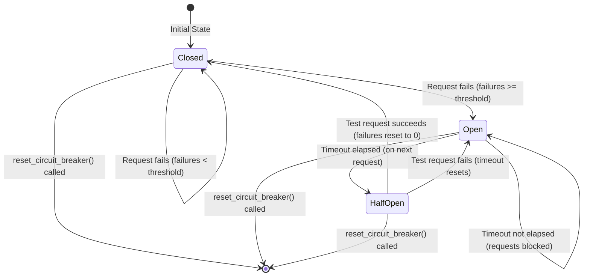

The retry module provides reliability patterns to handle transient network failures, prevent cascading errors, and support reliable data fetching. The module implements circuit breakers, exponential backoff with jitter, and automatic retry. These mechanisms make F1 data applications resilient to network instability, API rate limits, and temporary service disruptions.

All components in this module are thread-safe, with atomic state transitions. Monotonic time-based calculations are immune to system clock adjustments. The implementation is tested in concurrent environments and provides predictable behavior under high load.

## Overview

Network operations are inherently unreliable in distributed systems. CDN endpoints can experience temporary outages, rate limiting, connection timeouts, DNS resolution failures, or intermittent network partitions. Without reliability mechanisms, these transient failures can cascade through an application. The result is poor user experience, wasted resources, and system instability.

The retry module provides a multi-layered defense strategy that addresses these challenges:

### Core Reliability Mechanisms

1. **Circuit Breaker Pattern**: Temporarily blocks requests to a failing service after repeated failures. The pause gives the service time to recover. This is the first line of defense against cascading failures and resource exhaustion.

2. **Exponential Backoff**: Progressively increases the wait time between retries with an exponential function (2^attempt by default). The increasing waits protect a struggling service during recovery from overload conditions.

3. **Jitter**: Adds controlled randomization to retry timing to prevent thundering herd problems when multiple clients retry simultaneously. Without jitter, all clients would retry at exactly the same intervals, potentially overwhelming the service again.

4. **Thread Safety**: All operations are thread-safe with atomic state transitions using reentrant locks (`threading.RLock`). Multiple threads can safely interact with the circuit breaker concurrently without race conditions or data corruption.

5. **Monotonic Time**: Uses `time.monotonic()` for all timeout calculations. This makes the system immune to system clock adjustments, NTP synchronization, and daylight saving time changes.

6. **Configurable Thresholds**: Fine-tune behavior for a specific use case, network conditions, and service SLAs. Use global configuration or per-function parameters.

### How These Patterns Work Together

These patterns work together to provide defense in depth:

- The **retry decorator** handles individual request failures with exponential backoff and jitter, giving transient errors a chance to resolve
- The **circuit breaker** provides system-wide protection against cascading failures by detecting persistent problems and failing fast
- **Thread safety** ensures correct behavior in concurrent applications where multiple threads are making requests simultaneously
- **Monotonic time** guarantees reliable timeout behavior regardless of system clock changes

This layered approach lets an application handle brief network interruptions gracefully. It also protects against prolonged outages that would otherwise waste resources and degrade user experience.

### When to Use This Module

Use the retry module in these cases:

- Fetching data from external APIs or CDN endpoints
- Making network requests that might experience transient failures
- Building applications that need to be resilient to service outages
- Implementing systems that must handle rate limiting gracefully
- Protecting downstream services from being overwhelmed during incidents
- Building concurrent applications where multiple threads make network requests

The retry module is automatically integrated into `tif1`'s data fetching pipeline. These reliability benefits work out of the box. The patterns also work directly in application code for custom network operations or external API integrations.

## Circuit Breaker Pattern

The circuit breaker pattern is a reliability mechanism. It prevents an application from repeatedly attempting operations that are likely to fail. The pattern is named after electrical circuit breakers. Electrical breakers cut power when current exceeds safe levels. This software pattern "opens" (blocks requests) when a service has problems. This gives the service time to recover before the pattern allows requests through again.

### The Problem: Cascading Failures

Without a circuit breaker, an application faces several critical problems when a downstream service fails:

**Resource Exhaustion**: The application continues to make requests that fail. These requests waste CPU cycles, memory, network bandwidth, and connection pool resources. In a high-traffic system, this can quickly exhaust available resources and bring down the entire application.

**Slow Failure**: Each failed request must wait for the full timeout period before it fails. At hundreds of requests per second, these timeouts accumulate. The result is high latency, and the application appears frozen to users.

**Overwhelming the Failing Service**: Continued requests to an already struggling service prevent it from recovering. The service needs time to clear its queues, restart processes, or scale up capacity. Constant incoming requests make recovery impossible.

**Cascading Failures**: When one service fails and the application keeps sending requests, the failure cascades upstream. The application's thread pool fills with blocked requests. Its memory fills with queued operations. The application eventually fails too. It can take down other services that depend on it.

**Poor User Experience**: Users experience long waits followed by errors, often repeatedly. The application keeps trying operations that cannot succeed. This creates frustration and erodes trust in the application.

### The Solution: Circuit Breaker

The circuit breaker solves these problems. It detects failure patterns and fails fast when a service is known to be down:

**Fast Failure**: When the circuit is open, requests fail immediately with a clear error message. The requests do not wait for timeouts. This provides instant feedback and prevents resource waste.

**Automatic Recovery Testing**: The circuit breaker automatically transitions to a half-open state after a timeout period. A single test request then checks if the service has recovered. This eliminates the need for manual intervention.

**Resource Protection**: The circuit breaker blocks requests to a failing service. This prevents wasting CPU, memory, network bandwidth, and connection pool resources on operations that fail.

**Graceful Degradation**: The immediate failure response lets the application use cached data, fallback strategies, or alternative services. The application does not just hang.

**System Stability**: The circuit breaker prevents cascading failures. It keeps one failing service from bringing down the entire application or other dependent services.

**Observability**: The circuit breaker's state (closed, open, half-open) and failure count provide clear signals about system health. Monitor these signals, set alerts on them, and use them for debugging.

### Circuit Breaker States

The circuit breaker operates as a finite state machine with three distinct states. Each state serves a specific purpose in the failure detection and recovery cycle. Understanding these states and their transitions is crucial to use and debug circuit breaker behavior.

#### Closed State (Normal Operation)

The Closed state is the default, healthy operating mode where everything is working correctly.

**Behavior**:
- All requests are allowed through to the downstream service without any blocking
- The circuit breaker acts as a passive observer, monitoring each request's outcome
- A successful request resets the failure counter to 0
- Failed requests increment the failure counter atomically

**Monitoring**:
- Tracks the failure count for each request using thread-safe atomic operations
- The failure counter counts consecutive failures: it accumulates until a request succeeds
- The `last_failure_time` attribute records when the most recent failure occurred

**Transition Conditions**:
- Remains in Closed state as long as the failure count stays below the configured threshold
- Transitions to Open state immediately when the failure count reaches or exceeds the threshold
- The transition is atomic and thread-safe, preventing race conditions in concurrent environments

**Use Case**: This is the state during normal, healthy operation when the downstream service is responding successfully. The circuit breaker adds minimal overhead in this state, simply counting failures without blocking any requests.

**Example Scenario**: The application fetches F1 lap data from the CDN. The CDN is healthy and responding quickly. The circuit breaker stays in Closed state, allowing all requests through while monitoring for any failures. A few requests may fail because of transient network issues. If the count stays below the threshold, the circuit remains closed. Requests continue to flow normally.

#### Open State (Failure Mode)

The Open state is the circuit breaker's protective mode, activated when the failure threshold is reached.

**Behavior**:
- All requests are immediately blocked without attempting to contact the downstream service
- No network calls are made, no timeouts are waited for, and no resources are consumed
- Requests fail instantly with `CircuitBreakerOpenError`, a `NetworkError` subclass whose message is "Circuit breaker is open"
- The circuit breaker starts a timeout timer using monotonic time

**Duration**:
- Remains in Open state for the configured timeout period (default: 60 seconds)
- The timeout is calculated using `time.monotonic()`, making it immune to system clock changes
- The timeout period gives the failing service breathing room to recover

**Transition Conditions**:
- Remains in Open state until the timeout period elapses
- Automatically transitions to Half-Open state after the timeout expires
- The transition check happens on the next request after timeout expiration
- Cannot transition back to Closed state directly; must go through Half-Open first

**Error Handling**:
- Raises `CircuitBreakerOpenError` ("Circuit breaker is open") immediately for all requests
- The exception subclasses `NetworkError`, so transport-error handlers catch it too; check `isinstance(e, CircuitBreakerOpenError)` to handle it differently
- The immediate failure prevents resource waste and provides fast feedback

**Use Case**: This state protects both the application and the failing service. The application avoids wasting resources on requests that fail. The failing service gets time to recover without new requests. Users get immediate error responses instead of waiting for timeouts.

**Example Scenario**: The CDN experiences an outage and 5 consecutive requests fail (assuming threshold=5). The circuit breaker opens immediately. For the next 60 seconds, all requests fail instantly with "Circuit breaker is open" instead of waiting for 30-second timeouts. This saves the application from wasting 30 seconds per request and prevents overwhelming the CDN. After 60 seconds, the circuit breaker automatically transitions to Half-Open to test if the CDN has recovered.

#### Half-Open State (Recovery Testing)

The Half-Open state is the circuit breaker's recovery mechanism, cautiously testing whether the service has recovered.

**Behavior**:
- Lets requests through to the downstream service again
- The next request acts as a "canary" to check service health
- `CircuitBreaker` does not limit the number of requests in this state: concurrent calls also go through
- Each outcome moves the state: a success closes the circuit, a failure opens it again

**Success Path**:
- If the test request succeeds, the circuit breaker transitions to Closed state
- The failure counter is reset to zero atomically
- Normal operation resumes immediately
- All subsequent requests are allowed through

**Failure Path**:
- If the test request fails, the circuit breaker immediately returns to Open state
- The timeout timer is reset, starting a new timeout period
- The failure counter is incremented
- The circuit breaker will try again after another timeout period

**Thread Safety**:
- Only one thread moves the state from Open to Half-Open
- Requests from other threads are not blocked in Half-Open state
- The state transition (Half-Open → Closed or Half-Open → Open) is atomic
- To send only one probe request, serialize the calls in application code

**Use Case**: This state automatically tests service recovery without manual intervention. The first outcome decides if normal operation resumes or if the circuit opens again.

**Example Scenario**: After 60 seconds in Open state, the circuit breaker transitions to Half-Open. The next request is allowed through as a test. If the CDN responds successfully, the circuit closes and normal operation resumes. If the CDN is still down, the circuit opens again for another 60 seconds. This continues automatically until the service recovers, with no manual intervention required.

### State Transition Diagram

The following diagram illustrates all possible state transitions in the circuit breaker's finite state machine:



**Key Transition Rules**:

1. **Closed → Closed (Success)**: When a request succeeds in Closed state, the failure counter resets to 0. The circuit remains closed.

2. **Closed → Closed (Failure Below Threshold)**: A request fails, but the count stays below the threshold. The counter increments, and the circuit remains closed.

3. **Closed → Open (Threshold Reached)**: A request fails, and the count reaches or exceeds the threshold. The circuit immediately opens and starts the timeout timer.

4. **Open → Open (Timeout Not Elapsed)**: In Open state, the timeout has not elapsed. All requests are blocked immediately, and the circuit remains open.

5. **Open → Half-Open (Timeout Elapsed)**: When the timeout elapses, the circuit transitions to Half-Open on the next request. The circuit then lets requests through again.

6. **Half-Open → Closed (Test Success)**: If the test request succeeds, the circuit closes. It resets the failure counter to 0 and resumes normal operation.

7. **Half-Open → Open (Test Failure)**: If the test request fails, the circuit immediately opens again. It resets the timeout timer and increments the failure counter.

8. **Any State → Initial (Manual Reset)**: Calling `reset_circuit_breaker()` creates a new circuit breaker instance in Closed state. The new instance has zero failures, regardless of the current state.

**Important Notes**:

- All state transitions are atomic and thread-safe, protected by a reentrant lock
- The timeout is calculated using monotonic time, immune to system clock changes
- The Half-Open → Open transition resets the timeout, so the circuit will try again after another full timeout period
- Multiple concurrent threads can safely interact with the circuit breaker without race conditions
- The failure counter only resets to 0 on successful requests in Closed or Half-Open states, not in Open state

### Thread Safety and Atomic Operations

The `CircuitBreaker` implementation is fully thread-safe and uses atomic operations for all state transitions and counter updates. This is critical for production applications where multiple threads make requests simultaneously. It ensures correct behavior under high concurrency, without race conditions or data corruption.

#### Thread Safety Mechanisms

**Reentrant Lock (`threading.RLock`)**:
- All state transitions and counter operations are protected by a reentrant lock
- Reentrant means the same thread can acquire the lock multiple times without deadlocking
- This allows nested calls within the same thread while still providing mutual exclusion across threads
- The lock is acquired for the minimum time necessary to perform atomic operations

**Atomic Counter Operations**:
- The failure counter increments are protected by the lock, ensuring no lost updates
- Multiple threads incrementing the counter concurrently will see correct, sequential values
- The counter read and write operations happen atomically within the same lock acquisition
- No race conditions occur between reading the counter and checking the threshold

**Monotonic Time for Timeouts**:
- Uses `time.monotonic()` instead of `time.time()` for all timeout calculations
- Monotonic time is guaranteed to always move forward, never backward
- Immune to system clock adjustments, NTP synchronization, or daylight saving time changes
- Ensures timeout periods are accurate and predictable regardless of system time changes

**State Consistency**:
- All state transitions happen atomically within the lock
- State checks and updates are performed in the same critical section
- No race conditions between checking the state and updating it
- The state machine maintains consistency even under high concurrency

**Compare-and-Swap Pattern**:
- The `call()` method uses a compare-and-swap pattern for state transitions
- Captures the pre-call state before executing the function
- Uses the captured state to determine the correct post-call transition
- Prevents race conditions where the state changes between check and update

#### Thread Safety Guarantees

The circuit breaker provides these concrete guarantees in concurrent environments:

1. **No Lost Updates**: If multiple threads increment the failure counter simultaneously, all increments are recorded. No updates are lost.

2. **Consistent State Transitions**: State transitions are atomic. Partial transitions and inconsistent state combinations never occur.

3. **Accurate Failure Counting**: The failure count always reflects the number of failures. This holds true even with concurrent failures from multiple threads.

4. **Single Open to Half-Open Transition**: Only one thread moves the state to Half-Open, even under concurrent load.

5. **No Deadlocks**: The reentrant lock prevents deadlocks from nested calls within the same thread.

6. **Memory Visibility**: All state changes are immediately visible to all threads due to the lock's memory barrier semantics.

#### Concurrency Example

Here's an example demonstrating thread-safe behavior with multiple concurrent threads:

```python
import threading
from tif1.retry import CircuitBreaker
import time

# A private instance: the failures injected below must not open the global
# breaker that tif1's own CDN fetches share (get_circuit_breaker()).
cb = CircuitBreaker(threshold=5, timeout=60)

def worker(worker_id):
    """Simulate concurrent requests from multiple threads."""
    try:
        result = cb.call(fetch_data, f"https://example.com/data-{worker_id}.json")
        print(f"Worker {worker_id}: Success! State={cb.state}, Failures={cb.failures}")
        return result
    except Exception as e:
        print(f"Worker {worker_id}: Failed! State={cb.state}, Failures={cb.failures}, Error={e}")
        return None

def fetch_data(url):
    """Simulate a network request that might fail."""
    # Simulate some work
    time.sleep(0.1)
    # Randomly fail to trigger circuit breaker
    import random
    if random.random() < 0.3:  # 30% failure rate
        raise Exception(f"Network error fetching {url}")
    return {"url": url, "data": "success"}

# Spawn 20 concurrent threads making requests
threads = []
for i in range(20):
    t = threading.Thread(target=worker, args=(i,))
    threads.append(t)
    t.start()

# Wait for all threads to complete
for t in threads:
    t.join()

# Check final state
print(f"\nFinal state: {cb.state}")
print(f"Final failures: {cb.failures}")
if cb.last_failure_time:
    print(f"Last failure: {cb.last_failure_time}")
```

In this example:
- 20 threads make concurrent requests through the circuit breaker
- The failure counter is incremented atomically for each failure
- State transitions happen correctly even with concurrent failures
- No race conditions occur, and the final state is consistent
- If the threshold is reached, the circuit opens and subsequent requests fail immediately

#### Performance Considerations

**Lock Contention**:
- The lock is held for minimal time, only during state checks and updates
- The actual function execution happens outside the lock to avoid holding it during I/O
- This minimizes lock contention and allows high concurrency

**Locked Reads**:
- The `state` and `failures` properties use the lock for reads to ensure memory visibility
- This adds minimal overhead compared to lock-free reads but guarantees correctness
- In practice, the overhead is negligible compared to network I/O times

**Scalability**:
- The circuit breaker scales well to hundreds of concurrent threads
- Lock contention is minimal because critical sections are very short
- The monotonic time check is fast and does not require system calls

**Memory Overhead**:
- The circuit breaker maintains minimal state: failure count, timestamps, and state
- Memory overhead is constant regardless of the number of threads
- No per-thread state is maintained, keeping memory usage low

---

### `CircuitBreaker`

Thread-safe circuit breaker implementation with atomic state transitions and monotonic time-based timeout tracking. This class provides the core circuit breaker functionality. Instantiate it directly for custom use cases. Alternatively, access the global instance through `get_circuit_breaker()`.

```python
class CircuitBreaker:
    def __init__(
        self,
        threshold: int = 5,
        timeout: int = 60
    )
```

**Parameters:**

<ParamField path="threshold" type="int" default={5}>
  Number of consecutive failures required before the circuit breaker opens. The constructor does not check the value. The global instance clamps it to at least 1.

  **Choosing the right threshold:**
  - **Lower values (1-3)**: More sensitive, opens quickly. Use for critical services where fast failure detection is important. Also use when good fallback strategies exist.
  - **Medium values (4-7)**: Balanced approach. Good default for most use cases. Tolerates brief transient errors while still detecting persistent problems.
  - **Higher values (8-15)**: More tolerant, slower to open. Use for services with expected intermittent failures. Also use to avoid false positives from brief network interruptions.

  **Trade-offs:**
  - Higher thresholds make the circuit breaker more tolerant of transient failures but slower to detect persistent problems
  - Lower thresholds provide faster failure detection but may open prematurely on brief network interruptions
  - Consider the service's typical failure patterns and SLAs when choosing a threshold

  **Example scenarios:**
  - Threshold=2 for a critical payment API where failures are rare and fast detection is crucial
  - Threshold=5 (default) for general CDN requests with occasional transient failures
  - Threshold=10 for a less reliable third-party API where intermittent failures are expected
</ParamField>

<ParamField path="timeout" type="int" default={60}>
  Number of seconds the circuit breaker remains open before transitioning to half-open state to test recovery. The constructor does not check the value. The global instance clamps it to at least 1.

  **Choosing the right timeout:**
  - **Short timeouts (10-30s)**: Quick recovery testing. Use when services typically recover quickly. Also use to minimize downtime.
  - **Medium timeouts (60-120s)**: Balanced approach. Good default for most services. Gives services adequate time to recover without excessive waiting.
  - **Long timeouts (180-300s)**: Patient recovery. Use for services that need significant time to recover (for example, database failovers, service restarts).

  **Trade-offs:**
  - Shorter timeouts mean faster recovery when the service comes back online
  - Longer timeouts give the failing service more time to recover fully
  - A timeout that is too short tests recovery before the service is ready. The circuit then opens again.
  - A timeout that is too long causes unnecessary waiting if the service recovers quickly

  **Example scenarios:**
  - Timeout=30 for a CDN that typically recovers from transient issues quickly
  - Timeout=60 (default) for general API services with moderate recovery times
  - Timeout=180 for a database that might need time for failover and connection pool rebuilding
</ParamField>

**Properties:**

<ResponseField name="state" type="str">
  Current circuit breaker state - one of `"closed"`, `"open"`, or `"half-open"`.

  This is a read-only property that is thread-safe. The state reflects the current operational mode:
  - `"closed"`: Normal operation, all requests allowed through
  - `"open"`: Failure mode, all requests blocked immediately
  - `"half-open"`: Recovery testing, requests allowed through, the next outcome decides the state

  **Usage:**
  ```python
  from tif1.retry import get_circuit_breaker

  cb = get_circuit_breaker()
  if cb.state == "open":
      print("Circuit breaker is open: use cached data")
  elif cb.state == "half-open":
      print("Circuit breaker is testing recovery")
  else:
      print("Circuit breaker is closed: requests go through")
  ```
</ResponseField>

<ResponseField name="failures" type="int">
  Current count of consecutive failures. Resets to 0 on successful request or when circuit closes.

  This property is thread-safe with atomic operations. The failure count accumulates across requests:
  - Increments by 1 for each failed request
  - Resets to 0 when a request succeeds in Closed or Half-Open state
  - Does NOT reset in Open state (only resets when transitioning to Closed via Half-Open)
  - When it reaches the threshold, the circuit opens

  **Usage:**
  ```python
  import logging

  from tif1.retry import get_circuit_breaker

  logger = logging.getLogger(__name__)

  cb = get_circuit_breaker()
  print(f"Current failures: {cb.failures}/{cb.threshold}")

  # Monitor failure rate
  if cb.failures > cb.threshold * 0.8:
      logger.warning(f"Circuit breaker approaching threshold: {cb.failures}/{cb.threshold}")
  ```
</ResponseField>

<ResponseField name="last_failure_time" type="datetime | None">
  Timestamp of the most recent failure using `datetime.now()`. Useful for logging, monitoring, and debugging. A plain attribute, not a locked property.

  This attribute is `None` if no failures have occurred since the circuit breaker was created or reset. The timestamp uses wall-clock time (not monotonic time) for human readability.

  **Usage:**
  ```python
  import logging
  from datetime import datetime

  from tif1.retry import get_circuit_breaker

  logger = logging.getLogger(__name__)

  cb = get_circuit_breaker()
  if cb.last_failure_time:
      elapsed = datetime.now() - cb.last_failure_time
      print(f"Last failure was {elapsed.total_seconds():.1f} seconds ago")

      # Alert if failures are recent
      if elapsed.total_seconds() < 60:
          logger.error("Recent failures detected in circuit breaker")
  else:
      print("No failures recorded")
  ```
</ResponseField>

**Internal Properties:**

<ResponseField name="_last_failure_monotonic" type="float | None">
  Monotonic time of last failure used for timeout calculations. Immune to system clock adjustments.

  This internal property uses `time.monotonic()` for accurate timeout calculations that are not affected by:
  - System clock adjustments (manual or automatic)
  - NTP synchronization
  - Daylight saving time changes
  - Leap seconds

  Applications typically do not need to access this property directly. The library uses it internally for timeout calculations.
</ResponseField>

<ResponseField name="_lock" type="threading.RLock">
  Reentrant lock protecting all state transitions and counter operations.

  This internal lock ensures thread safety:
  - Allows nested calls from the same thread without deadlocking
  - Provides mutual exclusion across different threads
  - Protects all reads and writes to state and counters
  - Held for minimal time to reduce contention

  Applications typically do not need to access this property directly. The library uses it internally for synchronization.
</ResponseField>

**Thread Safety Guarantees:**

The `CircuitBreaker` class provides these concrete guarantees in concurrent environments:

- **All state transitions are atomic**: No partial transitions or inconsistent states
- **Failure counter increments are protected by lock**: No lost updates from concurrent failures
- **Multiple threads can safely call any method concurrently**: Full thread safety without race conditions
- **No race conditions between state checks and updates**: Compare-and-swap pattern ensures consistency
- **Reentrant lock allows nested calls from same thread**: No deadlocks from recursive calls

**Example - Basic Usage:**

```python
import niquests

from tif1.retry import CircuitBreaker

# Create circuit breaker with custom thresholds
cb = CircuitBreaker(threshold=3, timeout=30)

URL = "https://cdn.jsdelivr.net/gh/TracingInsights/2025@main/Bahrain%20Grand%20Prix/Race/drivers.json"

def fetch_data(url):
    """Fetch data from URL."""
    response = niquests.get(url, timeout=10)
    response.raise_for_status()
    return response.json()

# Use circuit breaker to protect requests
try:
    result = cb.call(fetch_data, URL)
    print(f"Success: {len(result['drivers'])} drivers")
except Exception as e:
    print(f"Failed: {e}")
    print(f"Circuit breaker state: {cb.state}")
    print(f"Failure count: {cb.failures}")
    if cb.last_failure_time:
        print(f"Last failure: {cb.last_failure_time}")
```

**Example - Monitoring State Changes:**

```python
from tif1.retry import CircuitBreaker
import time

cb = CircuitBreaker(threshold=2, timeout=5)

def failing_operation():
    """Operation that always fails."""
    raise Exception("Service unavailable")

# Trigger failures to open circuit
print("Triggering failures...")
for i in range(3):
    try:
        cb.call(failing_operation)
    except Exception:
        print(f"Attempt {i+1}: State={cb.state}, Failures={cb.failures}")

print(f"\nCircuit opened! State: {cb.state}")
print(f"Waiting {cb.timeout} seconds for timeout...")

# Wait for timeout
time.sleep(cb.timeout + 1)

# Check state transition to half-open
should_proceed, state = cb.check_and_update_state()
print(f"After timeout: State={state}, Should proceed={should_proceed}")
```

**Example - Custom Threshold for Different Services:**

```python
from tif1.retry import CircuitBreaker

# Strict circuit breaker for critical service
# Opens after just 2 failures, waits 2 minutes before testing recovery
critical_cb = CircuitBreaker(threshold=2, timeout=120)

# Lenient circuit breaker for less reliable service
# Opens after 10 failures, waits only 30 seconds before testing recovery
lenient_cb = CircuitBreaker(threshold=10, timeout=30)

# Stand-ins for application functions
def fetch_from_critical_service():
    return {"source": "critical"}

def fetch_from_optional_service():
    raise ConnectionError("optional service unavailable")

def load_from_cache():
    return {"source": "cache"}

def fetch_critical_data():
    """Fetch from highly reliable service."""
    return critical_cb.call(fetch_from_critical_service)

def fetch_optional_data():
    """Fetch from less reliable service."""
    return lenient_cb.call(fetch_from_optional_service)

# Critical service: fast failure detection, patient recovery
try:
    data = fetch_critical_data()
except Exception:
    # Use fallback immediately
    data = load_from_cache()
print(f"Critical data: {data}")

# Optional service: tolerant of failures, quick recovery testing
try:
    data = fetch_optional_data()
except Exception:
    # Can skip this data if unavailable
    data = None
print(f"Optional data: {data} (failures: {lenient_cb.failures}/{lenient_cb.threshold})")
```

**Example - Integration with Logging:**

`call()` records each outcome through internal methods, not through `record_failure()` or `record_success()`. To observe the state changes that `call()` makes, override `call()`.

```python
import logging

from tif1.retry import CircuitBreaker

logging.basicConfig(level=logging.INFO)
logger = logging.getLogger(__name__)

class MonitoredCircuitBreaker(CircuitBreaker):
    """Circuit breaker that logs every state change made by call()."""

    def call(self, func, *args, **kwargs):
        old_state = self.state
        try:
            return super().call(func, *args, **kwargs)
        finally:
            if self.state != old_state:
                logger.warning(
                    f"Circuit breaker {old_state} -> {self.state} "
                    f"(failures={self.failures}/{self.threshold})"
                )

# Use monitored circuit breaker
cb = MonitoredCircuitBreaker(threshold=2, timeout=60)
for _ in range(2):
    try:
        cb.call(lambda: 1 / 0)
    except ZeroDivisionError:
        pass
print(f"State: {cb.state}")
```

---

### `get_circuit_breaker`

Get the global circuit breaker instance used by `tif1` for all internal network operations.

```python
def get_circuit_breaker() -> CircuitBreaker
```

**Returns:**

<ResponseField name="CircuitBreaker" type="CircuitBreaker">
  The global `CircuitBreaker` instance that the `tif1` payload fetches share.

  This is a singleton instance that is shared across the entire application. Two fetch paths use it:
  - The batch fetch path (lap and telemetry batches) calls `check_and_update_state()` before each attempt. It records one success or failure per attempt. When the circuit is open, the fetch fails with `NetworkError` and no request is sent.
  - The single-payload path with retries sends each CDN request through `retry_with_backoff`, which calls `call()`. There, every exception counts as a failure, except a missing file (404), a refused file (403) and a malformed payload (`InvalidDataError`).

  The single-payload path without retries (`ultra_cold_skip_retries`) and the live schedule download do not use the circuit breaker.
</ResponseField>

**When to Use:**

Use `get_circuit_breaker()` for these purposes:
- Monitor the current state of the circuit breaker
- Check the failure count to understand system health
- Implement custom logic based on circuit breaker state
- Use the same circuit breaker for custom network operations
- Debug network issues by inspecting circuit breaker state

**Example - Basic Monitoring:**

```python
from tif1.retry import get_circuit_breaker

cb = get_circuit_breaker()
print(f"State: {cb.state}")
print(f"Failures: {cb.failures}/{cb.threshold}")

if cb.last_failure_time:
    from datetime import datetime
    elapsed = datetime.now() - cb.last_failure_time
    print(f"Last failure: {elapsed.total_seconds():.1f} seconds ago")
```

**Example - Health Check Endpoint:**

```python
from tif1.retry import get_circuit_breaker

def health_check() -> tuple[dict, int]:
    """Health payload and HTTP status for a /health route of any web framework."""
    cb = get_circuit_breaker()

    health_status = {
        "status": "healthy" if cb.state == "closed" else "degraded",
        "circuit_breaker": {
            "state": cb.state,
            "failures": cb.failures,
            "threshold": cb.threshold,
            "timeout": cb.timeout
        }
    }

    if cb.last_failure_time:
        health_status["circuit_breaker"]["last_failure"] = cb.last_failure_time.isoformat()

    status_code = 200 if cb.state == "closed" else 503
    return health_status, status_code

payload, status = health_check()
print(status, payload["status"])
```

**Example - Conditional Logic Based on State:**

```python
from tif1.retry import get_circuit_breaker
import tif1

def load_session_intelligently(year, gp, session_name):
    """Load session with intelligent fallback based on circuit breaker state."""
    cb = get_circuit_breaker()

    if cb.state == "open":
        # Circuit is open, don't even try network requests
        print("Circuit breaker is open, using cache-only mode")
        return load_from_cache(year, gp, session_name)  # application-defined fallback

    elif cb.state == "half-open":
        # Circuit is testing recovery, be cautious
        print("Circuit breaker is testing recovery")
        return tif1.get_session(year, gp, session_name)

    else:  # closed
        # Normal operation
        return tif1.get_session(year, gp, session_name)
```

**Example - Metrics Collection:**

```python
from tif1.retry import get_circuit_breaker
import time

class CircuitBreakerMetrics:
    """Collect metrics about circuit breaker behavior."""

    def __init__(self):
        self.state_changes = []
        self.last_state = None

    def collect(self):
        """Collect current metrics."""
        cb = get_circuit_breaker()
        current_state = cb.state

        # Detect state changes
        if current_state != self.last_state:
            self.state_changes.append({
                "timestamp": time.time(),
                "from_state": self.last_state,
                "to_state": current_state,
                "failures": cb.failures
            })
            self.last_state = current_state

        return {
            "state": current_state,
            "failures": cb.failures,
            "threshold": cb.threshold,
            "last_failure_time": cb.last_failure_time,
            "state_changes": len(self.state_changes)
        }

# Usage: sample the state three times, one second apart
# (a monitoring service runs this loop for as long as it runs)
metrics = CircuitBreakerMetrics()
for _ in range(3):
    data = metrics.collect()
    print(f"Circuit breaker: {data['state']}, failures: {data['failures']}")
    time.sleep(1)
```

---

### `reset_circuit_breaker`

Reset the global circuit breaker to closed state with zero failures. This creates a new circuit breaker instance, completely clearing all failure history and state.

```python
def reset_circuit_breaker() -> None
```

**When to Use:**

Call `reset_circuit_breaker()` when:
- The underlying issue is manually fixed, and normal operation must resume immediately
- Tests need a clean circuit breaker state between test cases
- A fix is deployed, and the failure history must be cleared
- The application switches to a different CDN or service endpoint
- The circuit breaker must give the service another chance

**Important Notes:**

- This function creates a completely new `CircuitBreaker` instance, not just resetting the state
- All failure history is lost, including the failure count and last failure time
- The new circuit breaker uses the current configuration values from `get_config()`
- This is a global operation that affects all code using the circuit breaker
- Use with caution in production; it is better to let the circuit breaker recover naturally in most cases

**Example - Basic Reset:**

```python
from tif1.retry import reset_circuit_breaker, get_circuit_breaker

# Check current state
cb = get_circuit_breaker()
print(f"Before reset: State={cb.state}, Failures={cb.failures}")

# Reset the circuit breaker
reset_circuit_breaker()

# Check new state
cb = get_circuit_breaker()
print(f"After reset: State={cb.state}, Failures={cb.failures}")
```

**Example - Reset After Fixing Issues:**

```python
from tif1.retry import reset_circuit_breaker, get_circuit_breaker
import tif1

def recover_from_outage():
    """Recover from a CDN outage after manual intervention."""
    cb = get_circuit_breaker()

    if cb.state == "open":
        print(f"Circuit breaker is open with {cb.failures} failures")
        print("Waiting for manual confirmation that service is back...")

        # Wait for user confirmation
        input("Press Enter when service is back online...")

        # Reset the circuit breaker
        print("Resetting circuit breaker...")
        reset_circuit_breaker()

        # Verify reset
        cb = get_circuit_breaker()
        print(f"Circuit breaker reset: State={cb.state}, Failures={cb.failures}")

        # Try loading data
        try:
            session = tif1.get_session(2021, "Belgian Grand Prix", "Race")
            print("Successfully loaded data after reset!")
        except Exception as e:
            print(f"Still failing: {e}")
```

**Example - Test Fixture:**

```python
import pytest
from tif1.retry import reset_circuit_breaker

@pytest.fixture(autouse=True)
def reset_circuit_breaker_between_tests():
    """Automatically reset circuit breaker between tests."""
    # Reset before test
    reset_circuit_breaker()

    yield

    # Reset after test
    reset_circuit_breaker()

def test_circuit_breaker_opens_on_failures():
    """Test that circuit breaker opens after threshold failures."""
    from tif1.retry import get_circuit_breaker

    cb = get_circuit_breaker()
    assert cb.state == "closed"
    assert cb.failures == 0

    # Test logic here...
```

**Example - Configuration Change:**

```python
from tif1.retry import reset_circuit_breaker, get_circuit_breaker
import tif1

def update_circuit_breaker_config(threshold, timeout):
    """Update circuit breaker configuration and reset."""
    config = tif1.get_config()

    # Update configuration
    config.set("circuit_breaker_threshold", threshold)
    config.set("circuit_breaker_timeout", timeout)

    # Reset to apply new configuration
    reset_circuit_breaker()

    # Verify new configuration
    cb = get_circuit_breaker()
    print(f"New configuration: threshold={cb.threshold}, timeout={cb.timeout}")

# Usage
update_circuit_breaker_config(threshold=10, timeout=120)
```

---

## Circuit Breaker Methods

### `call(func, *args, **kwargs)`

Execute a function with circuit breaker protection using atomic state transitions. This is the primary method for using the circuit breaker to protect application operations.

```python
def call(
    func: Callable[..., T],
    *args,
    **kwargs
) -> T
```

**Parameters:**

<ParamField path="func" type="Callable[..., T]" required>
  The function to execute with circuit breaker protection. This can be any callable (function, lambda, method, etc.) that might fail and needs protection.

  The function runs outside the circuit breaker's lock. This prevents lock holding during I/O operations, which could cause deadlocks or performance issues.
</ParamField>

<ParamField path="*args" type="Any">
  Positional arguments to pass to the function. These are forwarded directly to `func` when it is called.
</ParamField>

<ParamField path="**kwargs" type="Any">
  Keyword arguments to pass to the function. These are forwarded directly to `func` when it is called.
</ParamField>

**Returns:**

<ResponseField name="result" type="T">
  The return value from the executed function. The type matches whatever `func` returns.
</ResponseField>

**Raises:**

<ResponseField name="CircuitBreakerOpenError" type="NetworkError">
  Raises `CircuitBreakerOpenError` if the circuit breaker is in Open state and the timeout has not elapsed. The error is a `NetworkError` subclass with the message "Circuit breaker is open".

  Also raises any exception that `func` raises during execution. These exceptions are propagated after recording the failure in the circuit breaker.
</ResponseField>

**Behavior:**

1. **State Check (Atomic)**: Checks the current circuit breaker state within a lock
2. **Open State Handling**: If open and timeout has not elapsed, raises immediately
3. **Half-Open Transition**: If open and timeout has elapsed, transitions to half-open
4. **Function Execution**: Executes the function outside the lock (prevents deadlocks during I/O)
5. **Success Handling**: On success, resets failure counter and closes circuit if in half-open state
6. **Failure Handling**: On failure, increments failure counter and opens circuit if threshold reached

**Thread Safety:**

- All state checks and updates are atomic
- Function execution happens outside the lock
- Multiple threads can safely call this method concurrently
- In half-open state, every call goes through: a success closes the circuit, a failure opens it again

**Example - Basic Usage:**

```python
from tif1.retry import get_circuit_breaker
import niquests

cb = get_circuit_breaker()

URL = "https://cdn.jsdelivr.net/gh/TracingInsights/2025@main/Bahrain%20Grand%20Prix/Race/drivers.json"

def fetch_data(url):
    """Fetch data from URL."""
    response = niquests.get(url, timeout=10)
    response.raise_for_status()
    return response.json()

def load_from_cache():
    """Application fallback (stand-in)."""
    return {"drivers": []}

try:
    result = cb.call(fetch_data, URL)
    print(f"Success: {len(result['drivers'])} drivers")
except Exception as e:
    if "Circuit breaker is open" in str(e):
        print("Circuit breaker is open, service unavailable")
        # Use fallback strategy
        result = load_from_cache()
    else:
        print(f"Request failed: {e}")
        raise
```

**Example - With Multiple Arguments:**

```python
from tif1.retry import get_circuit_breaker

cb = get_circuit_breaker()

def fetch_with_auth(url, api_key, timeout=30):
    """Fetch data with authentication."""
    import niquests
    headers = {"Authorization": f"Bearer {api_key}"}
    response = niquests.get(url, headers=headers, timeout=timeout)
    response.raise_for_status()
    return response.json()

# Call with positional and keyword arguments
try:
    result = cb.call(
        fetch_with_auth,
        "https://api.example.com/data",
        "my-api-key-123",
        timeout=60
    )
    print(f"Success: {result}")
except Exception as e:
    print(f"Failed: {e}")
```

**Example - Lambda Functions:**

```python
from tif1.retry import get_circuit_breaker
import niquests

cb = get_circuit_breaker()

URL = "https://cdn.jsdelivr.net/gh/TracingInsights/2025@main/Bahrain%20Grand%20Prix/Race/drivers.json"

# Use lambda for simple operations
try:
    result = cb.call(lambda: niquests.get(URL, timeout=10).json())
    print(f"Success: {len(result['drivers'])} drivers")
except Exception as e:
    print(f"Failed: {e}")
```

**Example - Method Calls:**

```python
from tif1.retry import get_circuit_breaker

cb = get_circuit_breaker()

class DataFetcher:
    def __init__(self, base_url):
        self.base_url = base_url

    def fetch(self, endpoint):
        """Fetch data from endpoint."""
        import niquests
        url = f"{self.base_url}/{endpoint}"
        response = niquests.get(url, timeout=10)
        response.raise_for_status()
        return response.json()

fetcher = DataFetcher("https://api.example.com")

# Call instance method with circuit breaker protection
try:
    result = cb.call(fetcher.fetch, "users/123")
    print(f"Success: {result}")
except Exception as e:
    print(f"Failed: {e}")
```

**Example - Error Handling by State:**

```python
from tif1.retry import get_circuit_breaker

cb = get_circuit_breaker()

# fetch_data and load_from_cache are application functions
def fetch_with_state_aware_handling(url):
    """Fetch data with state-aware error handling."""
    try:
        result = cb.call(fetch_data, url)
        return result
    except Exception as e:
        if "Circuit breaker is open" in str(e):
            # Circuit is open, use cached data
            print(f"Circuit open, using cache (failures: {cb.failures})")
            return load_from_cache(url)
        else:
            # Actual request failure
            print(f"Request failed: {e}")
            if cb.state == "open":
                print("Failure opened the circuit (threshold reached or recovery test failed)")
            elif cb.failures >= cb.threshold - 1:
                print(f"Warning: One more failure will open the circuit")
            raise
```

---

### `record_success()`

Manually record a successful operation.

```python
def record_success() -> None
```

**Example:**
```python
from tif1.retry import get_circuit_breaker

cb = get_circuit_breaker()

def fetch_data():
    """Stand-in for an operation that runs outside cb.call()."""
    return {"status": "ok"}

try:
    result = fetch_data()
    cb.record_success()
except Exception:
    cb.record_failure()

print(f"State: {cb.state}, failures: {cb.failures}")
```

---

### `record_failure()`

Manually record a failed operation.

```python
def record_failure() -> None
```

**Example:**
```python
from tif1.exceptions import NetworkError
from tif1.retry import CircuitBreaker

cb = CircuitBreaker(threshold=3, timeout=30)

def fetch_data():
    """Stand-in for a request that fails."""
    raise NetworkError(url="https://example.com/data.json", status_code=503)

try:
    result = fetch_data()
    cb.record_success()
except NetworkError as e:
    cb.record_failure()
    print(f"{e.message} (failures: {cb.failures}/{cb.threshold})")
```

---

### `check_and_update_state()`

Check current state and update if timeout elapsed.

```python
def check_and_update_state() -> tuple[bool, str]
```

**Returns:**
- Tuple of (should_proceed, current_state)

**Example:**
```python
from tif1.retry import get_circuit_breaker

cb = get_circuit_breaker()

should_proceed, state = cb.check_and_update_state()
if should_proceed:
    # Make request
    print(f"Circuit breaker is {state}, request allowed")
else:
    print(f"Circuit breaker is {state}, request blocked")
```

---

## Retry Decorator

### `retry_with_backoff`

Decorator for automatic retry with exponential backoff and jitter.

```python
def retry_with_backoff(
    max_retries: int = 3,
    backoff_factor: float = 2.0,
    jitter: bool = True,
    exceptions: tuple = (Exception,)
)
```

**Parameters:**
- `max_retries`: Total number of attempts, including the first call (default: 3). A value below 1 makes one attempt
- `backoff_factor`: Exponential backoff multiplier (default: 2.0)
- `jitter`: Add random jitter to backoff (default: True)
- `exceptions`: Tuple of exceptions to catch (default: all exceptions)

Each call that the decorator makes goes through the global circuit breaker (`get_circuit_breaker()`). Failures in decorated functions also count toward the breaker that `tif1` uses for its own CDN requests. The decorator does not read the `retry_*` configuration keys: pass the values as arguments.

**Backoff Formula:**
```python
import random

backoff_factor = 2.0
jitter = True
max_retries = 3

# Sleep before attempt n + 1 (no sleep after the last attempt)
for attempt in range(max_retries - 1):
    wait_time = backoff_factor**attempt
    if jitter:
        wait_time *= 0.5 + random.random()  # 50% to 150% of the base delay
    print(f"After attempt {attempt + 1}: wait {wait_time:.2f}s")
```

**Example:**
```python
import niquests

from tif1.retry import retry_with_backoff

URL = "https://cdn.jsdelivr.net/gh/TracingInsights/2025@main/Bahrain%20Grand%20Prix/Race/drivers.json"

@retry_with_backoff(max_retries=5, backoff_factor=2.0)
def fetch_data(url):
    # Network request that might fail
    response = niquests.get(url, timeout=10)
    response.raise_for_status()
    return response.json()

# Makes up to 5 attempts, with exponential backoff between them
data = fetch_data(URL)
print(f"{len(data['drivers'])} drivers")
```

---

### Custom exception handling

```python
import niquests

from tif1.exceptions import DataNotFoundError, NetworkError
from tif1.retry import retry_with_backoff

BASE = "https://cdn.jsdelivr.net/gh/TracingInsights/2025@main/Bahrain%20Grand%20Prix/Race"

@retry_with_backoff(
    max_retries=3,
    exceptions=(NetworkError,)  # Only retry network errors
)
def fetch_data(url):
    try:
        response = niquests.get(url, timeout=10)
        response.raise_for_status()
        return response.json()
    except niquests.HTTPError as e:
        if e.response.status_code == 404:
            raise DataNotFoundError(url=url) from e
        raise NetworkError(url=url, status_code=e.response.status_code) from e
    except niquests.RequestException as e:
        raise NetworkError(url=url) from e

# Retries on NetworkError, fails immediately on DataNotFoundError
data = fetch_data(f"{BASE}/drivers.json")
print(f"{len(data['drivers'])} drivers")

try:
    fetch_data(f"{BASE}/missing.json")
except DataNotFoundError as e:
    print(f"Not retried: {e.context['url']}")
```

---

## Configuration

Configure the global circuit breaker and the retry behavior of `tif1` data fetches through the global config. The global circuit breaker reads its settings when it is created, so call `reset_circuit_breaker()` to apply new values:

```python
import tif1
from tif1.retry import reset_circuit_breaker

config = tif1.get_config()

# Set circuit breaker threshold
config.set("circuit_breaker_threshold", 10)

# Set circuit breaker timeout
config.set("circuit_breaker_timeout", 120)

# Apply the circuit breaker settings (the global instance reads them when it is created)
reset_circuit_breaker()

# Set retry backoff factor
config.set("retry_backoff_factor", 1.5)

# Enable/disable retry jitter
config.set("retry_jitter", True)

# Save configuration to file
config.save()
```

**Configuration Keys:**

| Key | Type | Default | Description |
| :--- | :--- | :--- | :--- |
| `circuit_breaker_threshold` | `int` | `5` | Failures before opening circuit |
| `circuit_breaker_timeout` | `int` | `60` | Seconds before testing recovery |
| `retry_backoff_factor` | `float` | `2.0` | Exponential backoff multiplier |
| `retry_jitter` | `bool` | `True` | Add random jitter to backoff |
| `retry_jitter_max` | `float` | `0.0` | Maximum jitter in seconds in the batch fetch path (`0.0` adds none) |
| `max_retry_delay` | `float` | `60.0` | Maximum retry delay in seconds in the batch fetch path |
| `max_retries` | `int` | `3` | Attempts for each payload fetch, the first included (`0` or `1`: no retries) |

The single-payload path wraps each CDN request in `retry_with_backoff` with `max_retries`, `retry_backoff_factor` and `retry_jitter`. The batch fetch path waits `min(retry_backoff_factor ** attempt, max_retry_delay)` seconds between attempts. With `retry_jitter` on, it adds a random `0` to `retry_jitter_max` seconds.

---

## Complete Examples

### Monitor circuit breaker

```python
import tif1
from tif1.retry import get_circuit_breaker
import time

def monitor_circuit_breaker():
    """Monitor circuit breaker state during operations."""
    cb = get_circuit_breaker()

    print(f"Initial state: {cb.state}")
    print(f"Failures: {cb.failures}")

    try:
        session = tif1.get_session(2021, "Belgian Grand Prix", "Race")
        laps = session.laps
        print(f"Success! State: {cb.state}")
    except Exception as e:
        print(f"Error: {e}")
        print(f"State: {cb.state}")
        print(f"Failures: {cb.failures}")

        if cb.state == "open":
            print(f"Circuit breaker opened, waiting {cb.timeout}s...")
            time.sleep(cb.timeout)
            print("Retrying...")

monitor_circuit_breaker()
```

---

### Custom retry logic

```python
from tif1.retry import retry_with_backoff, get_circuit_breaker
from tif1.exceptions import NetworkError
import logging
import niquests

logging.basicConfig(level=logging.INFO)
logger = logging.getLogger(__name__)

URL = "https://cdn.jsdelivr.net/gh/TracingInsights/2025@main/Bahrain%20Grand%20Prix/Race/drivers.json"

@retry_with_backoff(
    max_retries=5,
    backoff_factor=1.5,
    jitter=True,
    exceptions=(NetworkError,)
)
def fetch_with_logging(url):
    """Fetch data with detailed logging."""
    cb = get_circuit_breaker()
    logger.info(f"Fetching {url} (CB state: {cb.state})")

    try:
        response = niquests.get(url, timeout=30)
        response.raise_for_status()
        logger.info(f"Success! (CB failures: {cb.failures})")
        return response.json()
    except niquests.RequestException as e:
        logger.warning(f"Request failed: {e}")
        raise NetworkError(url=url) from e

# Usage
data = fetch_with_logging(URL)
```

---

### Graceful Degradation

```python
import tif1
from tif1.retry import get_circuit_breaker
from tif1.exceptions import NetworkError

def load_session_with_fallback(year, gp, session_name):
    """Load session with fallback to cached data."""
    cb = get_circuit_breaker()

    # Check circuit breaker state
    if cb.state == "open":
        print("Circuit breaker open, using cached data only")
        return load_from_cache_only(year, gp, session_name)

    try:
        session = tif1.get_session(year, gp, session_name)
        return session
    except NetworkError as e:
        print(f"Network error: {e.message}")

        if cb.state == "open":
            print("Circuit breaker opened, falling back to cache")
            return load_from_cache_only(year, gp, session_name)

        raise

def load_from_cache_only(year, gp, session_name):
    """Load a session only when the cache already holds its data."""
    cache = tif1.get_cache()

    # has_session_data() accepts plain or URL-encoded names
    if not cache.has_session_data(year, gp, session_name):
        raise ValueError("No cached data available")

    # Cached payloads load without network requests
    session = tif1.get_session(year, gp, session_name)
    return session

# Usage
try:
    session = load_session_with_fallback(2021, "Belgian Grand Prix", "Race")
    print(f"Loaded session: {session.event_name} - {session.session_name}")
except Exception as e:
    print(f"Failed to load session: {e}")
```

---

### Retry with Progress

```python
from tif1.retry import retry_with_backoff
from tif1.exceptions import NetworkError
import time

class RetryProgress:
    """Track retry attempts with progress reporting."""

    def __init__(self, max_retries=3):
        self.max_retries = max_retries
        self.attempt = 0

    def __call__(self, func):
        @retry_with_backoff(
            max_retries=self.max_retries,
            exceptions=(NetworkError,)
        )
        def wrapper(*args, **kwargs):
            self.attempt += 1
            print(f"Attempt {self.attempt}/{self.max_retries}")
            try:
                result = func(*args, **kwargs)
                print(f"Success on attempt {self.attempt}")
                return result
            except Exception as e:
                if self.attempt < self.max_retries:
                    print(f"Failed, retrying...")
                else:
                    print(f"Failed after {self.max_retries} attempts")
                raise
        return wrapper

# Usage
@RetryProgress(max_retries=5)
def fetch_data(url):
    # Fetch logic goes here
    pass

data = fetch_data("https://example.com/data.json")
```

---

## Best Practices

1. **Monitor circuit breaker state**: Check before critical operations.

```python
from tif1.retry import get_circuit_breaker

cb = get_circuit_breaker()
if cb.state == "open":
    # Use fallback or wait
    pass
```

2. **Reset after fixing issues**: Do not wait for the timeout when the service is back.

```python
from tif1.retry import reset_circuit_breaker

reset_circuit_breaker()
```

3. **Use appropriate thresholds**: Higher for transient errors, lower for persistent failures.

```python
import tif1
from tif1.retry import reset_circuit_breaker

config = tif1.get_config()
config.set("circuit_breaker_threshold", 10)  # More tolerant
reset_circuit_breaker()  # Apply the new threshold
```

4. **Add jitter to retries**: Prevents thundering herd problem.

```python
from tif1.retry import retry_with_backoff

@retry_with_backoff(jitter=True)
def fetch_data():
    pass
```

5. **Log retries**: Helps diagnose network issues.

```python
import logging
logging.basicConfig(level=logging.WARNING)
```

6. **Catch specific exceptions**: Do not retry on client errors (4xx).

```python
from tif1.exceptions import NetworkError
from tif1.retry import retry_with_backoff

@retry_with_backoff(exceptions=(NetworkError,))
def fetch_data():
    pass
```

7. **Implement fallbacks**: Use cached data when circuit breaker opens.

8. **Test circuit breaker behavior**: Verify it works as expected.

```python
from tif1.retry import CircuitBreaker

def test_circuit_breaker():
    cb = CircuitBreaker(threshold=2, timeout=5)

    # Trigger failures
    for i in range(3):
        try:
            cb.call(lambda: 1/0)
        except Exception:
            pass

    assert cb.state == "open"
    print("Circuit breaker test passed")

test_circuit_breaker()
```

---

## Troubleshooting

### Circuit breaker stuck open

```python
from tif1.retry import get_circuit_breaker, reset_circuit_breaker

cb = get_circuit_breaker()
print(f"State: {cb.state}")
print(f"Failures: {cb.failures}")

if cb.state == "open":
    # Wait for timeout or reset manually
    reset_circuit_breaker()
```

### Too many retries

Adjust the `max_retries` parameter when using the `@retry_with_backoff` decorator:

```python
from tif1.retry import retry_with_backoff

@retry_with_backoff(max_retries=2)  # Reduce from default of 3
def fetch_data():
    pass
```

### Slow retries

Reduce the backoff factor globally or per-function:

```python
import tif1
from tif1.retry import retry_with_backoff

# Global configuration (tif1 data fetches)
config = tif1.get_config()
config.set("retry_backoff_factor", 1.5)

# Or per-function
@retry_with_backoff(backoff_factor=1.5)  # Instead of 2.0
def fetch_data():
    pass
```

### Circuit breaker too sensitive

```python
import tif1
from tif1.retry import reset_circuit_breaker

# Increase threshold
config = tif1.get_config()
config.set("circuit_breaker_threshold", 10)
reset_circuit_breaker()  # Apply the new threshold
```
