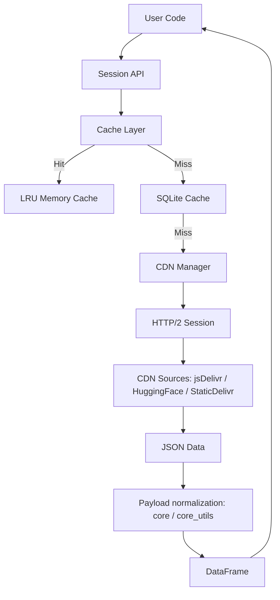
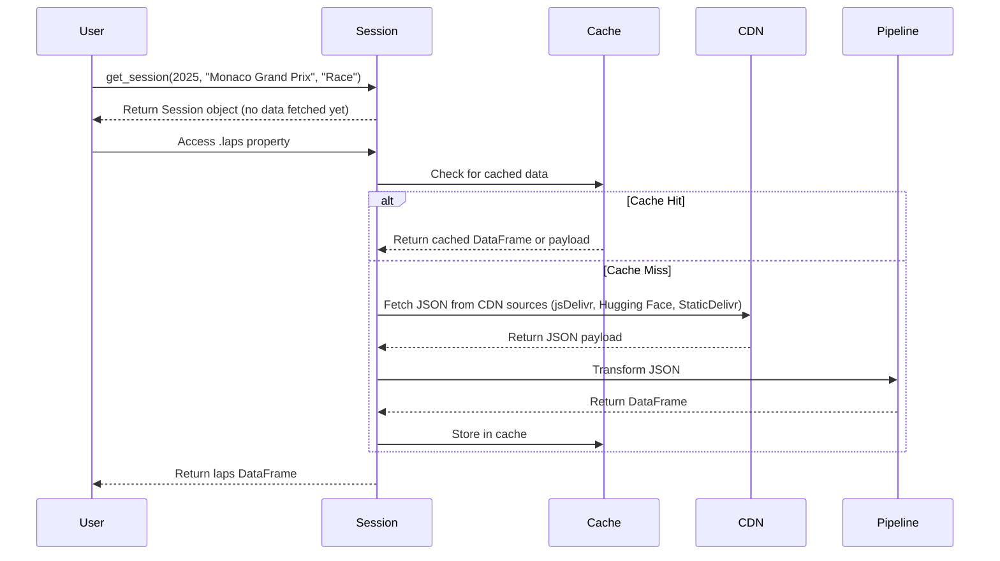

tif1 is built with a modular architecture focused on performance, reliability, and maintainability. Each module has a clear responsibility and well-defined boundaries.

## System Overview

## Module Ownership

The package is `src/tif1/`. Every module below exists in that directory. The former `io_pipeline.py` and `lap_ops.py` modules were removed; their helpers are in `core.py` and `core_utils/`.

### Session and models

- `tif1.core`: owns `Session` and `get_session`, plus the lap, telemetry, weather, and race-control parsing. It re-exports the model family for backward compatibility (`tif1.core.Laps` is `tif1.models.Laps`).
- `tif1.session`: thin re-export of `Session` and `get_session` from `tif1.core`.
- `tif1.models`: canonical dataframe-backed domain models (`Laps`, `Lap`, `Telemetry`, `Driver`, `SessionResults`, `DriverResult`, `CircuitInfo`, `LazyTelemetryDict`) and the `TelemetryProvider` protocol that the models consume. It never imports `tif1.core` at runtime.
- `tif1.core_utils`: shared helpers used by the loading paths: `constants` (column names, rename maps), `helpers` (payload normalization, lap-number/time coercion, DataFrame construction), `json_utils` (orjson parsing), `backend_conversion` (pandas/polars), and `resource_manager`.
- `tif1.types`: TypedDicts (`LapDataDict`, `TelemetryDataDict`, ...) and Literals (`SessionType`, `BackendType`, `CompoundType`).

### Loading and transport

- `tif1.payload_loader`: single payload-loading pipeline (memo → cache → CDN fetch → validate → write-back). The pipeline runs behind an injectable `HttpTransport` seam (`NiquestsTransport` in production, `InMemoryTransport` in tests).
- `tif1.cdn`: `CDNManager` and the source chain (jsDelivr primary, Hugging Face buckets, StaticDelivr last), with the fallback loops `try_sources` / `try_sources_async` shared by the sync and async paths. `raw.githubusercontent.com` is never a data source.
- `tif1.http_session`: owner of the shared niquests HTTP session, its lifecycle, and the connection metrics.
- `tif1.async_fetch`: async parallel fetching and executor lifecycle.
- `tif1.retry`: retry with exponential backoff and the circuit breaker.
- `tif1.validation`: pydantic payload models and the `validate_*` functions.
- `tif1.exceptions`: the exception hierarchy rooted at `TIF1Error`, plus `EventNotFoundError` and its subclass `EventNotInSeasonError` (both `ValueError` subclasses).

### Caching and configuration

- `tif1.cache`: every cache tier: `LRUCache`, the SQLite `Cache` (payload, frame, and negative-verdict tables), the process-global backend lap caches, and the per-session `SessionMemo`.
- `tif1.config`: the `Config` singleton (defaults, environment variables, `.tif1rc`).

### Schedules and lookup

- `tif1.events`: event and session lookup from the packaged JSON schedules, plus the live `f1schedule` fetch for the current and future seasons.
- `tif1.schedule_schema`: schema validation for schedule assets.
- `tif1.fuzzy`: fuzzy event-name matching, the last step of event resolution. `events.py` accepts a fuzzy match only at a score of 70 or more and otherwise raises `EventNotFoundError`.

### User-facing layers

- `tif1.cli`: the `tif1` command (typer + rich).
- `tif1.jupyter`: HTML cards for `Session`, `Driver`, and `Lap`, and an HTML DataFrame summary.
- `tif1.plotting` and `tif1.plotting_constants`: FastF1-compatible plotting helpers, and the team, driver, and compound colors per season.
- `tif1.charts`: the native `plot_*` chart functions, re-exported at the top level of `tif1`.
- `tif1.assets`: packaged car images, tyre images, and fonts under `src/tif1/assets/`.
- `tif1.fastf1_compat`: the FastF1-compatible `Cache` facade and `set_log_level`.
- `tif1.utils`: small FastF1-style helpers such as `delta_time`.

## Data Flow

The data pipeline transforms raw JSON from the CDN into structured DataFrames:

### Data transformation steps

1. **CDN Fetch**: Parallel HTTP/2 requests to the CDN source chain (jsDelivr primary, Hugging Face and StaticDelivr fallbacks)
2. **JSON Parse**: Fast parsing with orjson
3. **DataFrame Construction**: Column mapping and type conversion
4. **Enrichment**: Add the `Driver` and `Team` columns from the driver list and the derived `LapTimeSeconds` column
5. **Caching**: Store in SQLite and the in-memory LRU tiers
6. **Return**: Pandas or Polars DataFrame

## Loading sequence

1. `get_session(...)` resolves event and session aliases and creates a `Session`. No session data is fetched yet.
2. `Session` properties and methods load JSON payloads through `payload_loader` (memo, SQLite cache, CDN fetch, validation).
3. `core_utils` helpers normalize payloads into pandas or polars dataframes.
4. `cache` stores and retrieves JSON payloads, telemetry batches, and materialized frames.
5. `models` expose dataframe-centric APIs for lap/driver/telemetry access.

## Schedule System

- Static schedules are packaged as JSON files in `src/tif1/data/schedules/f1schedule/` (one file per year: `schedule_2018.json`, `schedule_2019.json`, etc.).
- `events.py` reads these assets through `importlib.resources` and converts them to the internal format.
- `schedule_schema.validate_schedule_payload` enforces structure and schema versioning.
- The current and future seasons, and years without a packaged file, come from the `theOehrly/f1schedule` repository on `raw.githubusercontent.com`. This is the file FastF1 reads, with a 5-minute edge cache.
- The raw file is cached in the SQLite `json` tier under `f1schedule/schedule_{year}.json` for `schedule_ttl_hours` (default 6, `TIF1_SCHEDULE_TTL_HOURS`).
- When the fetch fails or `offline_mode` is on, a stale cached row is served, then the packaged file. A past season with a packaged file never uses the network.
- This is the one sanctioned `raw.githubusercontent.com` URL: one small file per season, never the data repositories.

## Design Rules

- FastF1 compatibility covers `fastf1_compat` (the `Cache` facade, `set_log_level`), the model classes, the `events` schedule objects, `plotting`, and `utils`. There are no shims for other FastF1 namespaces.
- Shared network session ownership stays in `http_session`. The sync payload pipeline sends HTTP through the injectable `HttpTransport` seam of `payload_loader`.
- Data payloads come from jsDelivr, Hugging Face buckets, or StaticDelivr only, never `raw.githubusercontent.com`.
- Performance benchmarks live under `tests/benchmarks` and are excluded from default pytest runs.
