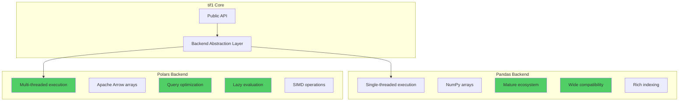
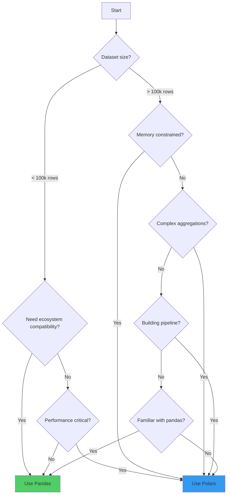

# Data Backends in tif1

tif1 supports two DataFrame libraries: **pandas** (default) and **polars** (installed with tif1, selected with `lib="polars"`). This design balances familiarity, ecosystem compatibility, and raw performance for each use case.

The backend system is integrated into the tif1 core architecture. When tif1 loads session data, telemetry, or lap data, it constructs DataFrames with the selected backend. All subsequent operations then use the strengths of that backend. This abstraction enables a backend switch with minimal code changes and a large performance gain.

## Why Multiple Backends?

The Formula 1 data analysis landscape presents unique challenges:

- **Volume**: A single race session can generate over 1,200 laps. Telemetry sampled at 10-60Hz results in millions of data points.
- **Velocity**: Real-time analysis during sessions requires fast data processing
- **Variety**: Different analysis tasks have different requirements. Exploratory analysis benefits from the pandas ecosystem, while production pipelines need polars speed.
- **Compatibility**: Many existing tools and libraries in the Python ecosystem expect pandas DataFrames

By supporting both backends, tif1 allows optimization for specific constraints without loss of functionality.

---

## Backend Architecture Overview



The backend abstraction layer in tif1 handles the complexity of supporting multiple DataFrame libraries. When code calls `get_session()` or reads session attributes like `.laps` or `.weather`, tif1 runs these steps internally.

1. **Fetches data** from the CDN or cache (backend-agnostic)
2. **Parses JSON** using orjson (backend-agnostic)
3. **Constructs DataFrames** using the specified backend
4. **Applies transformations** (column renaming, type casting) using backend-specific code
5. **Returns typed objects** with the appropriate DataFrame type

This architecture applies backend-specific optimizations at the lowest level and keeps the high-level API consistent.

---

## Backend Comparison Matrix

| Feature | Pandas | Polars | Notes |
| :--- | :--- | :--- | :--- |
| **Execution Model** | Single-threaded | Multi-threaded | Polars uses all CPU cores by default |
| **Memory Backend** | NumPy arrays | Apache Arrow | Arrow enables zero-copy operations |
| **Query Optimization** | ❌ No | ✅ Yes | Polars optimizes query plans before execution |
| **Lazy Evaluation** | ❌ No | ✅ Yes | Defer computation until `.collect()` |
| **SIMD Vectorization** | Partial | ✅ Full | Polars leverages CPU SIMD instructions |
| **Null Handling** | NaN/None mix | Proper nulls | Arrow has native null support |
| **String Performance** | Moderate | Fast | Polars has optimized string kernels |
| **Ecosystem Size** | Very Large | Growing | Pandas has 15+ years of libraries |
| **Learning Curve** | Gentle | Moderate | Polars API is more explicit |
| **Memory Efficiency** | Baseline | 2-3x better | Polars uses less memory per operation |
| **Typical Speedup** | 1x | 2-5x | Varies by operation and data size |
| **Installation Size** | ~50MB | ~30MB | Polars is more compact |
| **Python Version** | >=3.11 | >=3.11 | `tif1` requires 3.11 or later on either backend |

---

## Pandas Backend (Default)

Pandas is the default backend in tif1 and provides maximum compatibility with the Python data science ecosystem. Pandas has been the de facto standard for tabular data in Python since 2008. Its ecosystem of tools, libraries, and community knowledge is large.

### Architecture and Design

Pandas is built on top of NumPy arrays and provides a rich, high-level API for data manipulation. Key architectural characteristics:

- **Index-based operations**: Every DataFrame has an index (row labels) that enables powerful alignment and joining
- **Single-threaded execution**: Operations run on a single CPU core, making behavior predictable but potentially slower
- **Eager evaluation**: Operations execute immediately when called
- **Object dtype flexibility**: Can store mixed types in a single column (though this impacts performance)
- **NaN for missing data**: Uses NumPy's NaN for numeric missing values, None for objects

### When to Use Pandas

Pandas is the right choice when:

- **Learning tif1**: The pandas API is more forgiving and has extensive documentation.
- **Ecosystem compatibility**: Libraries like matplotlib, seaborn, scikit-learn, and statsmodels expect pandas DataFrames.
- **Exploratory analysis**: The pandas API and Jupyter integration suit interactive work.
- **Small to medium datasets**: For datasets under 1 million rows, pandas performance is typically sufficient.
- **The complete pandas API**: Some advanced pandas features (MultiIndex, time series resampling, etc.) are not available in polars.
- **Integration with existing code**: When a codebase already uses pandas, staying consistent reduces friction.
- **Stability**: Pandas has a stable API with strong backward compatibility guarantees.

### Performance Characteristics

Pandas performance varies significantly by operation type:

- **Fast operations**: Vectorized numeric operations, boolean indexing, simple aggregations
- **Moderate operations**: String operations, groupby with multiple aggregations, merges
- **Slow operations**: Apply with Python functions, iteration, complex string parsing

Typical tif1 workloads include filtering laps, computing statistics, and grouping by driver. Pandas performs well on these workloads up to about 10,000 laps, roughly 5-8 race sessions.

### Example Usage

```python
import tif1

# Pandas is the default - no need to specify
session = tif1.get_session(2025, "Monaco Grand Prix", "Race")
laps = session.laps  # Returns pandas DataFrame

# Standard pandas operations work. LapTime is timedelta64; LapTimeSeconds is float
fastest = laps.nsmallest(5, "LapTime")
by_driver = laps.groupby("Driver")["LapTime"].mean()

# Rich pandas API available
verstappen = laps[laps["Driver"] == "VER"]
verstappen_stats = verstappen["LapTime"].describe()

# Pandas indexing and selection
lap_15 = laps[laps["LapNumber"] == 15]
columns_of_interest = laps[["Driver", "LapTime", "Compound", "TyreLife"]]

# Time arithmetic: LapTime is a timedelta (LapTimeSeconds already holds float seconds)
laps["LapTime_seconds"] = laps["LapTime"].dt.total_seconds()

# Chaining operations
result = (
    laps
    .query("Compound == 'SOFT'")
    .groupby("Driver")
    .agg({"LapTime": ["mean", "std", "count"]})
    .sort_values(("LapTime", "mean"))
)
```

### Pandas-Specific Features in tif1

When using the pandas backend, tif1 provides additional functionality:

- **Categorical dtypes**: Driver names and compounds are stored as categoricals for memory efficiency
- **Timedelta columns**: Lap times are proper timedelta objects, enabling time arithmetic
- **Index**: laps keep a `RangeIndex` plus the FastF1 `index` column
- **Method chaining**: All tif1 DataFrame operations support pandas method chaining

---

## Polars Backend (High-Performance)

Polars is a fast DataFrame library written in Rust and designed for performance and memory efficiency. It incorporates lessons learned from pandas and uses modern hardware capabilities.

### Architecture and Design

Polars is built on Apache Arrow and uses a fundamentally different execution model:

- **Multi-threaded execution**: Automatically parallelizes operations across all CPU cores
- **Apache Arrow memory format**: Columnar, cache-friendly layout with zero-copy operations
- **Query optimization**: Analyzes and optimizes query plans before execution (in lazy mode)
- **SIMD vectorization**: Uses CPU SIMD instructions for 4-8x faster operations
- **Proper null handling**: Native null support without NaN confusion
- **Rust implementation**: Memory-safe, no GIL limitations, predictable performance

### When to Use Polars

Polars is the right choice when:

- **Large datasets**: For datasets over 1 million rows, polars parallelization performs best.
- **Performance is critical**: Production pipelines need maximum throughput.
- **Memory is constrained**: Polars uses 50-70% less memory than pandas for equivalent operations.
- **Data pipelines**: Lazy evaluation enables query optimization.
- **Heavy aggregations**: Groupby operations run 3-5x faster than pandas.
- **String work**: Polars has highly optimized string kernels.
- **Predictable performance**: The Rust implementation eliminates GIL and memory management issues.
- **A different API**: The polars API is more explicit but requires learning.

### Performance Characteristics

Polars performs well in every operation type and shows the largest gains in these areas:

- **Fastest operations**: Groupby aggregations, joins, sorting, filtering large datasets
- **Strong operations**: String operations, window functions, complex expressions
- **Good operations**: Simple selections, arithmetic, type conversions

For tif1 workloads, polars typically provides:
- **2-3x speedup** for single-session analysis
- **3-5x speedup** for multi-session aggregations
- **4-8x speedup** for complex groupby operations
- **2x memory reduction** for typical race data

### Installation

Polars (`polars>=2.0.0,<3`) is installed with `tif1`. If it is missing, for example after a manual uninstall, reinstall it alongside tif1:

```bash
# A normal install already includes polars
pip install tif1

# Restore polars if it was removed from the environment
pip install "polars>=2.0.0,<3"

# Verify installation
python -c "import polars as pl; print(pl.__version__)"
```

<Note>
  `tif1` requires Python 3.11 or later (3.11 through 3.15 are tested in CI), which satisfies the Polars requirement. The library is distributed as pre-built wheels for all major platforms (Linux, macOS, Windows) and architectures (x86_64, ARM64).
</Note>

### Example Usage

```python
import tif1
import polars as pl

# Explicitly specify polars backend
session = tif1.get_session(
    2025,
    "Monaco Grand Prix",
    "Race",
    lib="polars"
)
laps = session.laps  # Returns polars DataFrame (LapTime is Float64 seconds)

# Polars operations (similar but more explicit than pandas)
fastest = laps.sort("LapTime").head(5)
by_driver = laps.group_by("Driver").agg(pl.col("LapTime").mean())

# Polars expression API (powerful and composable)
verstappen = laps.filter(pl.col("Driver") == "VER")
verstappen_stats = verstappen.select([
    pl.col("LapTime").mean().alias("avg_time"),
    pl.col("LapTime").std().alias("std_time"),
    pl.col("LapTime").min().alias("min_time"),
    pl.col("LapTime").max().alias("max_time"),
])

# Complex aggregations with expressions
result = (
    laps
    .filter(pl.col("Compound") == "SOFT")
    .group_by("Driver")
    .agg([
        pl.col("LapTime").mean().alias("mean_time"),
        pl.col("LapTime").std().alias("std_time"),
        pl.col("LapTime").count().alias("lap_count"),
        (pl.col("LapTime") < pl.col("LapTime").quantile(0.25)).sum().alias("fast_laps")
    ])
    .sort("mean_time")
)

# Window functions (running calculations)
laps_with_rolling = laps.with_columns([
    pl.col("LapTime").rolling_mean(window_size=3).over("Driver").alias("rolling_avg"),
    pl.col("LapTime").rank().over("Driver").alias("lap_rank")
])
```

### Polars 2 notes

tif1 requires polars 2.x. tif1 returns eager `DataFrame` objects. Most polars 2.0 changes do not affect code that only reads them. The changes below matter for code that builds on the returned frames:

| Change in polars 2.0 | Effect on code that uses tif1 frames |
| :--- | :--- |
| `LazyFrame.collect()` runs on the streaming engine by default | Row order after `group_by`, joins, and `unpivot` is not guaranteed in lazy queries. Add `.sort(...)` or pass `maintain_order`. Eager frames are not affected. |
| String to `Date`, `Datetime`, and `Time` casts are removed | Use `pl.col("LapStartDate").str.to_datetime()` instead of `.cast(pl.Datetime)`. |
| `pl.concat(..., how="horizontal")` requires equal heights | Use `how="horizontal_extend"` to pad a shorter frame with nulls. |
| `is_in()` no longer coerces types with loss | Cast both sides to one type first. `pl.col("LapNumber").is_in([1.0, 2.0])` raises because `LapNumber` is `Int64`; use `[1, 2]`. |
| Removed APIs: `melt`, `with_row_count`, `GroupBy.count()`, `collect(streaming=True)`, `join(how="outer")`, `pl.NUMERIC_DTYPES` | Use `unpivot`, `with_row_index`, `len()`, `collect(engine="streaming")`, `join(how="full")`, and `pl.selectors.numeric()`. The `AttributeRemovedError` message names the replacement. |
| `pl.Categorical(ordering=...)` is removed; categoricals always sort by string value | `TIF1_POLARS_LAP_CATEGORICAL=true` works as before. |

The complete list is in the [polars 2.0 upgrade guide](https://docs.pola.rs/releases/upgrade/2/). Telemetry frames that polars 1.x wrote to the cache load unchanged under polars 2.x. The same release changes the telemetry dtypes for `DistanceToDriverAhead` and `DriverAhead`, so tif1 rebuilds its cached telemetry frames once. It rebuilds them from the cached payloads, without a network fetch.

### Polars-Specific Features in tif1

When using the polars backend, tif1 uses these polars capabilities:

- **Lazy evaluation**: Call `.lazy()` on a polars frame to build an optimized query plan
- **Parallel execution**: All operations automatically use available CPU cores
- **Expression API**: Complex calculations can be expressed as optimized expressions
- **Efficient string operations**: Driver name filtering and compound matching are faster
- **Native Arrow**: Zero-copy interop with other Arrow-based tools

---

## Detailed Performance Comparison

Performance varies by operation type, data size, and hardware. The benchmarks below were measured on a modern 8-core CPU with a full race session dataset.

### Benchmark Methodology

- **Hardware**: Intel i7-12700K (8P+4E cores), 32GB DDR5 RAM
- **Dataset**: 2024 Abu Dhabi GP Race session (20 drivers, 1,142 laps, full telemetry)
- **Data size**: ~450MB in pandas, ~220MB in polars
- **Measurement**: Median of 10 runs, cold cache
- **Python**: 3.12, pandas 3.0.5, polars 1.43.2 (measured before the move to polars 2; treat the figures as indicative)

### Operation-Level Benchmarks

| Operation | Pandas | Polars | Speedup | Notes |
| :--- | :--- | :--- | :--- | :--- |
| **Data Loading** |
| Load session (no telemetry) | 1.2s | 0.8s | **1.5x** | JSON parsing dominates |
| Load session (with telemetry) | 2.5s | 1.2s | **2.1x** | Polars parallelizes construction |
| Load from cache | 0.3s | 0.15s | **2.0x** | Deserialization speedup |
| **Filtering** |
| Simple filter (Driver == "VER") | 45ms | 12ms | **3.8x** | Polars uses SIMD |
| Complex filter (3 conditions) | 78ms | 18ms | **4.3x** | Query optimization helps |
| String contains | 120ms | 35ms | **3.4x** | Polars string kernels |
| **Aggregation** |
| Single column mean | 15ms | 8ms | **1.9x** | Both are vectorized |
| GroupBy single agg | 120ms | 35ms | **3.4x** | Polars parallelizes groups |
| GroupBy multiple aggs | 280ms | 65ms | **4.3x** | Larger benefit with complexity |
| **Sorting** |
| Sort by single column | 80ms | 25ms | **3.2x** | Polars uses parallel sort |
| Sort by multiple columns | 145ms | 42ms | **3.5x** | Consistent speedup |
| **Joining** |
| Inner join (1k rows) | 25ms | 18ms | **1.4x** | Small joins are fast in both |
| Inner join (100k rows) | 450ms | 95ms | **4.7x** | Polars scales better |
| **String Operations** |
| String upper/lower | 85ms | 22ms | **3.9x** | Optimized string kernels |
| String split | 180ms | 45ms | **4.0x** | Parallel string processing |
| Regex match | 320ms | 110ms | **2.9x** | Rust regex engine |
| **Window Functions** |
| Rolling mean (window=3) | 250ms | 70ms | **3.6x** | Polars optimizes windows |
| Rank within groups | 180ms | 55ms | **3.3x** | Parallel ranking |
| **Memory Usage** |
| DataFrame in memory | 450MB | 220MB | **2.0x** | Arrow is more compact |
| Peak during groupby | 680MB | 310MB | **2.2x** | Less intermediate copies |

<Note>
  Benchmarks are representative but vary with hardware, data characteristics, and specific operations. Always profile the actual workloads.
</Note>

### Real-World Use Case Benchmarks

These benchmarks represent complete analysis workflows:

#### Use Case 1: Single Session Analysis

```python
import tif1

# Load session, filter to one driver, compute statistics (pandas shown;
# the polars run used filter / group_by on the same session)
session = tif1.get_session(2024, "Monaco Grand Prix", "Race", lib="pandas")
driver_laps = session.laps[session.laps["Driver"] == "VER"]
stats = driver_laps.groupby("Compound").agg({"LapTimeSeconds": ["mean", "std", "count"]})
```

- **Pandas**: 2.8s total (2.5s load, 0.3s analysis)
- **Polars**: 1.4s total (1.2s load, 0.2s analysis)
- **Speedup**: 2.0x

#### Use Case 2: Multi-Session Aggregation

```python
import pandas as pd
import tif1

# Load all 2024 races, compute fastest lap per driver per race
results = []
for event in tif1.get_event_schedule(2024, include_testing=False)["EventName"]:
    session = tif1.get_session(2024, event, "Race", lib="pandas")
    fastest = session.get_fastest_laps(by_driver=True)
    results.append(fastest)
combined = pd.concat(results, ignore_index=True)
```

- **Pandas**: 68s total (24 races × ~2.8s)
- **Polars**: 22s total (24 races × ~0.9s)
- **Speedup**: 3.1x

#### Use Case 3: Telemetry Analysis

```python
import tif1

# Load fastest-lap telemetry, compute speed statistics per track segment
session = tif1.get_session(2024, "Belgian Grand Prix", "Race", lib="pandas")
telemetry = session.get_driver("VER").get_fastest_lap_tel()
segment = (telemetry["Distance"] // 500).astype(int)  # 500 m segments; swap in a corner map
segment_stats = telemetry.groupby(segment)["Speed"].agg(["mean", "max", "std"])
```

- **Pandas**: 8.5s total (2.5s load, 6.0s analysis)
- **Polars**: 3.2s total (1.2s load, 2.0s analysis)
- **Speedup**: 2.7x

### Scaling Characteristics

How performance scales with data size:

| Dataset Size | Pandas Time | Polars Time | Speedup |
| :--- | :--- | :--- | :--- |
| 1k rows | 50ms | 45ms | 1.1x |
| 10k rows | 180ms | 85ms | 2.1x |
| 100k rows | 1.8s | 520ms | 3.5x |
| 1M rows | 18s | 4.2s | 4.3x |
| 10M rows | 195s | 38s | 5.1x |

<Tip>
  Polars' advantage grows with dataset size due to better parallelization and memory efficiency. For small datasets (< 10k rows), the difference is minimal.
</Tip>

---

## Data Contract by Backend

tif1 loads the same payloads on both backends and then applies a dtype contract per backend. The contract decides how time values, text, and missing values are represented. Read this section before writing code that runs on both backends.

### Column types by backend

The tables list the types as loaded for the 2025 Bahrain Grand Prix race. Columns not listed have the same type on both backends: `Float64` for speeds and weather readings, `String` for text.

**Laps** (`session.laps`)

| Column | pandas | polars |
| :--- | :--- | :--- |
| `LapTime`, `Sector1Time` to `Sector3Time`, `Sector1SessionTime` to `Sector3SessionTime`, `PitInTime`, `PitOutTime`, `LapStartTime`, `Time`, `WeatherTime` | `timedelta64[ns]` | `Float64` (seconds) |
| `LapTimeSeconds` | `float64` | `Float64` |
| `LapNumber`, `Stint`, `TyreLife`, `Position` | `float64` | `Int64` |
| `Driver`, `Team`, `Compound`, `TrackStatus` | `category` | `String` |
| `IsPersonalBest`, `FreshTyre`, `IsAccurate`, `FastF1Generated`, `Rainfall` | `bool` | `Boolean` |
| `Deleted` | `boolean` (nullable) | `Boolean` |
| `LapStartDate` | `datetime64[ns]` | `String` (ISO 8601) |
| `WindDirection` | `Int64` (nullable) | `Int64` |
| `index` | `int64`, first column (FastF1 compatibility) | not present |

Set `TIF1_POLARS_LAP_CATEGORICAL=true` to get `Categorical` for the text columns on polars. See [Environment variables](/reference/environment-variables).

**Weather** (`session.weather`)

| Column | pandas | polars |
| :--- | :--- | :--- |
| `Time` | `timedelta64[ns]` | `Duration("ms")` |
| `AirTemp`, `Humidity`, `Pressure`, `TrackTemp`, `WindSpeed` | `float64` | `Float64` |
| `WindDirection` | `Int64` (nullable) | `Int64` |
| `Rainfall` | `boolean` (nullable) | `Boolean` |

**Race control messages** (`session.race_control_messages`)

| Column | pandas | polars |
| :--- | :--- | :--- |
| `Time` | `datetime64[ns]` | `Datetime("ns")` |
| `Category`, `Message`, `Status`, `Flag`, `Scope`, `RacingNumber` | `object` (`None` when missing) | `String` (`null` when missing) |
| `Sector` | `float64` | `Float64` |
| `Lap` | `int64` (`0` when the message has no lap) | `Int64` (`null` when the message has no lap) |

**Telemetry** (`lap.telemetry`, `session.get_fastest_lap_tel()`)

| Column | pandas | polars |
| :--- | :--- | :--- |
| `Time` | `timedelta64[ns]` | `Float64` (seconds) |
| `Brake` | `bool` | `Int64` (`0` or `1`) |
| `nGear`, `DRS` (`DRS` is a `0` or `1` flag) | `Int64` (nullable) | `Int64` |
| `LapNumber` | `Int64` | `Int32` |
| `Speed`, `RPM`, `Throttle`, `Distance`, `RelativeDistance`, `AccelerationX` to `AccelerationZ`, `X`, `Y`, `Z` | `float64` | `Float64` |
| `DistanceToDriverAhead` | `float64` (`NaN` when nobody is ahead) | `Float64` (`null` when nobody is ahead) |
| `DriverAhead` | `str` with driver numbers, missing when nobody is ahead (`object` when every sample is missing) | `String` (`null` when nobody is ahead) |
| `Driver` | `object` | `String` |

`DriverAhead` holds driver numbers such as `"12"`, not driver codes. To find the samples with nobody ahead, use `isna()` on pandas or `is_null()` on polars. The column never holds the string `"None"`.

For code that runs on both backends, use `LapTimeSeconds` for lap times. Compare `Driver`, `Team`, and `Compound` as strings. Both work without a cast on either backend.

### Missing values and sentinels

The upstream payloads encode a missing value in two ways: JSON `null`, and the literal string `"None"`. The string form appears in 2026 lap data and in the `Lap` column of race control messages for every non-race session. It also appears in telemetry when nobody is ahead. tif1 normalizes both forms on both backends before it applies the dtype contract:

- Laps: the strings `"None"`, `"none"`, `"null"`, `"nan"`, and `""` become a missing value. The replacement runs only when a payload contains one of these tokens.
- Weather and race control messages: the same tokens become a missing value. On polars the replacement runs before the frame is built. A column with one sentinel then keeps its `Boolean`, `Float64`, or `Int64` type instead of becoming `String`. On pandas the replacement runs before the `astype` and `to_numeric` passes.
- Telemetry: the same tokens become `NaN` on pandas and `null` on polars. `DistanceToDriverAhead` and the other numeric channels stay `float64` or `Float64`. `DriverAhead` stays a text column of driver numbers.
- Casts are non-strict on both backends. A value that cannot be parsed becomes a missing value; it does not raise.

The representation of a missing value follows the backend. polars uses `null` for every type. pandas uses `NaT` for time columns, `NaN` for floats, `<NA>` for nullable integers and booleans, and `None` for text columns. One difference is intentional. The race control `Lap` column is a plain `int64` on pandas (FastF1 convention). A message without a lap has `Lap == 0` on pandas and `null` on polars.

### Empty weather or race control tables

Weather and race control messages are optional tables. When a payload cannot be converted to the dtype contract, tif1 logs a warning. It returns an empty DataFrame for that table instead of raising. `session.load()`, `session.laps`, and telemetry are not affected. The behaviour is the same on both backends.

The warning names the table and the session, then gives the error. The event name is URL-encoded, as in `session.gp`:

```text
Failed to load weather for 2025/Bahrain%20Grand%20Prix/Race: <error>
```

Enable logging to see it, and test for an empty table before plotting:

```python
import logging

import tif1

tif1.setup_logging(logging.WARNING)
session = tif1.get_session(2025, "Bahrain Grand Prix", "Race")
weather = session.weather
if len(weather) == 0:
    print("no weather table for this session")
```

A session that has no weather file at all logs `No weather in session` at `INFO` level and also returns an empty DataFrame.

---

## Comprehensive API Differences

While tif1 abstracts many differences, the API variations still matter for idiomatic code in each backend. This section compares common operations.

### Data Selection and Filtering

<CodeGroup>
```python Pandas
# Boolean indexing (most common). LapTime is a timedelta, so compare the
# float LapTimeSeconds column (or a pd.Timedelta) to a number of seconds
fast_laps = laps[laps["LapTimeSeconds"] < 100]

# Multiple conditions with & and |
verstappen_fast = laps[(laps["Driver"] == "VER") & (laps["LapTimeSeconds"] < 97)]

# Query method (string-based, convenient)
fast_laps = laps.query("LapTimeSeconds < 100")
verstappen_fast = laps.query("Driver == 'VER' and LapTimeSeconds < 97")

# isin for multiple values
soft_medium = laps[laps["Compound"].isin(["SOFT", "MEDIUM"])]

# String methods
mercedes = laps[laps["Team"].str.contains("Mercedes")]

# loc and iloc
lap_15 = laps.loc[laps["LapNumber"] == 15]
first_10 = laps.iloc[:10]
```

```python Polars
# Filter method (primary approach). LapTime is already Float64 seconds on
# polars; LapTimeSeconds works on both backends
fast_laps = laps.filter(pl.col("LapTimeSeconds") < 100)

# Multiple conditions with & and |
verstappen_fast = laps.filter(
    (pl.col("Driver") == "VER") & (pl.col("LapTimeSeconds") < 97)
)

# Chained filters (often clearer)
verstappen_fast = (
    laps
    .filter(pl.col("Driver") == "VER")
    .filter(pl.col("LapTimeSeconds") < 97)
)

# is_in for multiple values
soft_medium = laps.filter(pl.col("Compound").is_in(["SOFT", "MEDIUM"]))

# String methods
mercedes = laps.filter(pl.col("Team").str.contains("Mercedes"))

# Row slicing (no loc/iloc)
first_10 = laps.head(10)
last_10 = laps.tail(10)
rows_10_to_20 = laps.slice(10, 10)

# No boolean-mask indexing: polars reads laps[mask] as a column selector,
# so it raises (or picks columns when the lengths happen to match). Use filter.
lap_15 = laps.filter(pl.col("LapNumber") == 15)
```
</CodeGroup>

### Column Selection and Manipulation

<CodeGroup>
```python Pandas
import numpy as np

# Select columns
subset = laps[["Driver", "LapTime", "Compound"]]

# Select by type
numeric_cols = laps.select_dtypes(include=[np.number])

# Add new columns (speeds are km/h; there is no Speed column in laps)
laps["LapTime_seconds"] = laps["LapTime"].dt.total_seconds()
laps["SpeedST_mph"] = laps["SpeedST"] / 1.60934

# Rename columns (a "Time" column already exists, so pick a new name)
laps = laps.rename(columns={"LapTime": "LapDuration", "Driver": "DriverCode"})

# Drop columns
laps = laps.drop(columns=["Deleted", "DeletedReason"])

# Column operations (LapTimeSeconds is float; LapDuration is a timedelta)
laps["LapTime_normalized"] = (
    (laps["LapTimeSeconds"] - laps["LapTimeSeconds"].mean()) / laps["LapTimeSeconds"].std()
)
```

```python Polars
# Select columns
subset = laps.select(["Driver", "LapTime", "Compound"])

# Select by type
numeric_cols = laps.select(pl.selectors.numeric())

# Add new columns (with_columns is preferred). The polars backend stores
# LapTime as Float64 seconds, so build a Duration from it rather than the reverse
laps = laps.with_columns([
    (pl.col("LapTime") * 1000).cast(pl.Duration("ms")).alias("LapTime_duration"),
    (pl.col("SpeedST") / 1.60934).alias("SpeedST_mph")
])

# Rename columns (a "Time" column already exists; renaming onto it raises DuplicateError)
laps = laps.rename({"LapTime": "LapDuration", "Driver": "DriverCode"})

# Drop columns
laps = laps.drop(["Deleted", "DeletedReason"])

# Column operations (expressions are composable)
laps = laps.with_columns([
    ((pl.col("LapTimeSeconds") - pl.col("LapTimeSeconds").mean()) / pl.col("LapTimeSeconds").std())
    .alias("LapTime_normalized")
])
```
</CodeGroup>

### Grouping and Aggregation

<CodeGroup>
```python Pandas
# Simple groupby
by_driver = laps.groupby("Driver")["LapTime"].mean()

# Multiple aggregations
stats = laps.groupby("Driver").agg({
    "LapTime": ["mean", "min", "max", "std", "count"]
})

# Named aggregations (pandas 0.25+)
stats = laps.groupby("Driver").agg(
    mean_time=("LapTime", "mean"),
    min_time=("LapTime", "min"),
    lap_count=("LapTime", "count")
)

# Multiple grouping columns
by_driver_compound = laps.groupby(["Driver", "Compound"])["LapTime"].mean()

# Custom aggregation functions
def lap_time_range(x):
    return x.max() - x.min()

ranges = laps.groupby("Driver")["LapTime"].agg(lap_time_range)

# Transform (keep original shape)
laps["LapTime_vs_driver_mean"] = laps.groupby("Driver")["LapTime"].transform(
    lambda x: x - x.mean()
)
```

```python Polars
# Simple groupby
by_driver = laps.group_by("Driver").agg(pl.col("LapTime").mean())

# Multiple aggregations (explicit expressions)
stats = laps.group_by("Driver").agg([
    pl.col("LapTime").mean().alias("mean_time"),
    pl.col("LapTime").min().alias("min_time"),
    pl.col("LapTime").max().alias("max_time"),
    pl.col("LapTime").std().alias("std_time"),
    pl.col("LapTime").count().alias("lap_count")
])

# Multiple grouping columns
by_driver_compound = laps.group_by(["Driver", "Compound"]).agg(
    pl.col("LapTime").mean().alias("mean_time")
)

# Custom aggregations: compose expressions where possible
ranges = laps.group_by("Driver").agg(
    (pl.col("LapTime").max() - pl.col("LapTime").min()).alias("time_range")
)

# A Python function receives each group as a Series through map_batches
# (map_elements would call it once per value, not once per group)
def lap_time_range(s: pl.Series) -> float:
    return s.max() - s.min()

ranges = laps.group_by("Driver").agg(
    pl.col("LapTime")
    .map_batches(lap_time_range, return_dtype=pl.Float64, returns_scalar=True)
    .alias("time_range")
)

# Transform with over (window function)
laps = laps.with_columns([
    (pl.col("LapTime") - pl.col("LapTime").mean().over("Driver"))
    .alias("LapTime_vs_driver_mean")
])
```
</CodeGroup>

### Sorting

<CodeGroup>
```python Pandas
# Sort by single column
sorted_laps = laps.sort_values("LapTime")

# Sort descending
sorted_laps = laps.sort_values("LapTime", ascending=False)

# Sort by multiple columns
sorted_laps = laps.sort_values(["Driver", "LapNumber"])

# Sort with nulls
sorted_laps = laps.sort_values("LapTime", na_position="first")

# Sort index
sorted_laps = laps.sort_index()
```

```python Polars
# Sort by single column
sorted_laps = laps.sort("LapTime")

# Sort descending
sorted_laps = laps.sort("LapTime", descending=True)

# Sort by multiple columns
sorted_laps = laps.sort(["Driver", "LapNumber"])

# Sort with nulls
sorted_laps = laps.sort("LapTime", nulls_last=False)

# Sort by expression
sorted_laps = laps.sort(pl.col("LapTime").abs())
```
</CodeGroup>

### Joining and Merging

<CodeGroup>
```python Pandas
import pandas as pd

# Inner join: attach each driver's best lap time to every lap
best = session.get_fastest_laps()[["Driver", "LapTime"]].rename(columns={"LapTime": "BestLapTime"})
merged = laps.merge(best, on="Driver", how="inner")

# Left join
merged = laps.merge(best, on="Driver", how="left")

# Join on different column names
merged = laps.merge(
    session.results[["Abbreviation", "FullName"]],
    left_on="Driver",
    right_on="Abbreviation",
    how="left"
)

# Join on index (same row order)
ranks = laps[["LapTimeSeconds"]].rank().rename(columns={"LapTimeSeconds": "LapTimeRank"})
merged = laps.merge(ranks, left_index=True, right_index=True)

# Nearest-time join: weather has no LapNumber column, so match on session time.
# The laps already carry per-lap weather columns; this shows the technique.
merged = pd.merge_asof(
    laps.sort_values("Time"),
    weather.sort_values("Time").rename(columns={"Time": "WeatherSampleTime"}),
    left_on="Time",
    right_on="WeatherSampleTime",
    suffixes=("", "_weather"),
)

# Concatenate vertically (laps from two sessions)
race1_laps = tif1.get_session(2025, "Bahrain Grand Prix", "Race").laps
race2_laps = tif1.get_session(2025, "Saudi Arabian Grand Prix", "Race").laps
all_laps = pd.concat([race1_laps, race2_laps], ignore_index=True)

# Concatenate horizontally (same row count, distinct column names)
combined = pd.concat([laps, ranks], axis=1)
```

```python Polars
# Inner join: attach each driver's best lap time to every lap
best = session.get_fastest_laps().select(["Driver", pl.col("LapTime").alias("BestLapTime")])
merged = laps.join(best, on="Driver", how="inner")

# Left join
merged = laps.join(best, on="Driver", how="left")

# Join on different column names (results is always a pandas frame)
merged = laps.join(
    pl.from_pandas(session.results[["Abbreviation", "FullName"]]),
    left_on="Driver",
    right_on="Abbreviation",
    how="left"
)

# Nearest-time join: weather.Time is Duration(ms), laps.Time is Float64 seconds
weather_s = weather.with_columns((pl.col("Time").dt.total_milliseconds() / 1000).alias("Time"))
merged = laps.sort("Time").join_asof(
    weather_s.sort("Time").rename({"Time": "WeatherSampleTime"}),
    left_on="Time",
    right_on="WeatherSampleTime",
    suffix="_weather",
)

# Concatenate vertically (laps from two sessions)
race1_laps = tif1.get_session(2025, "Bahrain Grand Prix", "Race", lib="polars").laps
race2_laps = tif1.get_session(2025, "Saudi Arabian Grand Prix", "Race", lib="polars").laps
all_laps = pl.concat([race1_laps, race2_laps])

# Concatenate horizontally (same height, distinct column names;
# how="horizontal_extend" pads a shorter frame with nulls instead of raising)
ranks = laps.select(pl.col("LapTimeSeconds").rank().alias("LapTimeRank"))
combined = pl.concat([laps, ranks], how="horizontal")

# Cross join (Cartesian product)
cross = laps.join(weather, how="cross")
```
</CodeGroup>

### Missing Data Handling

<CodeGroup>
```python Pandas
# Check for missing values (LapTime is NaT for a lap without a time)
has_nulls = laps["LapTime"].isna()
null_count = laps["LapTime"].isna().sum()

# Drop rows with a missing lap time. A bare dropna() is too aggressive:
# most laps have a null PitInTime or PitOutTime, so it drops nearly everything.
clean_laps = laps.dropna(subset=["LapTime"])

# Fill missing values. LapTime is timedelta64, so fill it with a Timedelta;
# LapTimeSeconds holds the same value as float seconds.
filled = laps["LapTime"].fillna(pd.Timedelta(0))
filled = laps["LapTime"].ffill()  # Forward fill (fillna(method=...) was removed in pandas 3)
filled = laps["LapTimeSeconds"].fillna(laps["LapTimeSeconds"].mean())

# Interpolate
filled = laps["LapTime"].interpolate()
```

```python Polars
# Check for missing values (LapTime is null for a lap without a time)
has_nulls = laps["LapTime"].is_null()
null_count = laps["LapTime"].null_count()

# Drop rows with a missing lap time (a bare drop_nulls() drops nearly
# everything, because most laps have a null PitInTime or PitOutTime)
clean_laps = laps.drop_nulls(subset=["LapTime"])

# Fill missing values (LapTime is Float64 seconds in the polars backend)
filled = laps.with_columns(pl.col("LapTime").fill_null(0.0))
filled = laps.with_columns(pl.col("LapTime").forward_fill())  # Forward fill
filled = laps.with_columns(pl.col("LapTime").fill_null(pl.col("LapTime").mean()))

# Interpolate
filled = laps.with_columns(pl.col("LapTime").interpolate())
```
</CodeGroup>

### String Operations

<CodeGroup>
```python Pandas
# String methods (via .str accessor)
upper = laps["Driver"].str.upper()
lower = laps["Driver"].str.lower()
contains = laps["Team"].str.contains("Red Bull")
starts = laps["Driver"].str.startswith("V")
split = laps["Driver"].str.split("_", expand=True)
replace = laps["Team"].str.replace("Racing", "F1")
strip = laps["Driver"].str.strip()
length = laps["Driver"].str.len()

# Regex operations
pattern_match = laps["Driver"].str.match(r"^[A-Z]{3}$")
extract = laps["Driver"].str.extract(r"([A-Z]{3})")
```

```python Polars
# String methods (via .str namespace)
upper = laps.select(pl.col("Driver").str.to_uppercase())
lower = laps.select(pl.col("Driver").str.to_lowercase())
contains = laps.filter(pl.col("Team").str.contains("Red Bull"))
starts = laps.filter(pl.col("Driver").str.starts_with("V"))
split = laps.select(pl.col("Driver").str.split("_"))
replace = laps.select(pl.col("Team").str.replace("Racing", "F1"))
strip = laps.select(pl.col("Driver").str.strip_chars())
length = laps.select(pl.col("Driver").str.len_chars())

# Regex operations
pattern_match = laps.filter(pl.col("Driver").str.contains(r"^[A-Z]{3}$"))
extract = laps.select(pl.col("Driver").str.extract(r"([A-Z]{3})", 1))
```
</CodeGroup>

### Window Functions

<CodeGroup>
```python Pandas
# Rolling window (rolling/expanding need a numeric column: use LapTimeSeconds)
rolling_avg = laps.groupby("Driver")["LapTimeSeconds"].rolling(window=3).mean()

# Expanding window
expanding_min = laps.groupby("Driver")["LapTimeSeconds"].expanding().min()

# Rank within groups
laps["Rank"] = laps.groupby("Driver")["LapTime"].rank()

# Cumulative operations
laps["CumulativeTime"] = laps.groupby("Driver")["LapTime"].cumsum()

# Shift (lag/lead)
laps["PrevLapTime"] = laps.groupby("Driver")["LapTime"].shift(1)
laps["NextLapTime"] = laps.groupby("Driver")["LapTime"].shift(-1)

# Percent change
laps["LapTime_pct_change"] = laps.groupby("Driver")["LapTime"].pct_change()
```

```python Polars
# Rolling window
rolling_avg = laps.with_columns([
    pl.col("LapTime").rolling_mean(window_size=3).over("Driver").alias("rolling_avg")
])

# Expanding window (cumulative)
expanding_min = laps.with_columns([
    pl.col("LapTime").cum_min().over("Driver").alias("expanding_min")
])

# Rank within groups
laps = laps.with_columns([
    pl.col("LapTime").rank().over("Driver").alias("Rank")
])

# Cumulative operations
laps = laps.with_columns([
    pl.col("LapTime").cum_sum().over("Driver").alias("CumulativeTime")
])

# Shift (lag/lead)
laps = laps.with_columns([
    pl.col("LapTime").shift(1).over("Driver").alias("PrevLapTime"),
    pl.col("LapTime").shift(-1).over("Driver").alias("NextLapTime")
])

# Percent change
laps = laps.with_columns([
    pl.col("LapTime").pct_change().over("Driver").alias("LapTime_pct_change")
])
```
</CodeGroup>

### Type Conversion

<CodeGroup>
```python Pandas
# Convert types. LapTime is timedelta64 in the pandas backend: convert it
# with .dt.total_seconds(), not astype(float) or to_datetime (both raise).
laps["LapNumber"] = laps["LapNumber"].astype("Int64")   # float64 → nullable integer
laps["Driver"] = laps["Driver"].astype("category")      # already category in tif1
seconds = laps["LapTime"].dt.total_seconds()            # timedelta → float seconds
as_timedelta = pd.to_timedelta(laps["LapTimeSeconds"], unit="s")  # the reverse

# Convert to numeric (coerce errors): unparseable values become NaN
laps["SpeedST"] = pd.to_numeric(laps["SpeedST"], errors="coerce")
```

```python Polars
# Convert types. LapTime is Float64 seconds in the polars backend: build a
# Duration from it; a String → Datetime cast is not supported in polars 2.
laps = laps.with_columns([
    pl.col("LapNumber").cast(pl.Int32),
    pl.col("Driver").cast(pl.Categorical),
    (pl.col("LapTime") * 1000).cast(pl.Duration("ms")).alias("LapTimeDuration"),
])

# Strict casting (raises on failure)
laps = laps.with_columns(pl.col("SpeedST").cast(pl.Float64, strict=True))

# Non-strict casting (nulls on failure)
laps = laps.with_columns(pl.col("SpeedST").cast(pl.Float64, strict=False))

# Parse an ISO 8601 string column (LapStartDate stays a String on polars)
laps = laps.with_columns(pl.col("LapStartDate").str.to_datetime().alias("LapStart"))
```
</CodeGroup>

---

## Converting Between Backends

tif1 converts DataFrames between backends. This lets different parts of a workflow use the strengths of each library.

### Basic Conversion

<CodeGroup>
```python Polars to Pandas
# Start with polars
session = tif1.get_session(2025, "Monaco", "Race", lib="polars")
laps_polars = session.laps

# Convert to pandas for compatibility
laps_pandas = laps_polars.to_pandas()

# pandas-only libraries work on the converted frame (LapTime stays float seconds)
import seaborn as sns
sns.violinplot(data=laps_pandas, x="Driver", y="LapTime")
```

```python Pandas to Polars
# Start with pandas
session = tif1.get_session(2025, "Monaco", "Race", lib="pandas")
laps_pandas = session.laps

# Convert to polars for performance
import polars as pl
laps_polars = pl.from_pandas(laps_pandas)

# Polars operations on the converted frame. LapTime arrives as Duration(ns)
# here (unlike a native tif1 polars frame, where it is Float64 seconds), so
# aggregate the float LapTimeSeconds column and give each output a name
result = laps_polars.group_by("Driver").agg([
    pl.col("LapTimeSeconds").mean().alias("mean_time"),
    pl.col("LapTimeSeconds").std().alias("std_time")
])
```
</CodeGroup>

### Conversion Performance

Conversion between backends has a cost, so use it strategically:

| Conversion | Time (1k rows) | Time (100k rows) | Time (1M rows) |
| :--- | :--- | :--- | :--- |
| Polars → Pandas | 2ms | 45ms | 480ms |
| Pandas → Polars | 3ms | 65ms | 720ms |

<Warning>
  Frequent conversions can negate the performance benefits of using polars. Design the workflow to minimize backend switches.
</Warning>

### Zero-Copy Conversion (Arrow)

For maximum efficiency, use Apache Arrow as an intermediate format. `pyarrow` is not a `tif1` dependency; install it with `pip install pyarrow` first:

```python
import pyarrow as pa
import polars as pl

# Pandas → Arrow → Polars (zero-copy when possible)
laps_pandas = tif1.get_session(2025, "Monaco", "Race").laps  # pandas DataFrame
arrow_table = pa.Table.from_pandas(laps_pandas)
laps_polars = pl.from_arrow(arrow_table)

# Polars → Arrow → Pandas (zero-copy when possible)
arrow_table = laps_polars.to_arrow()
laps_pandas = arrow_table.to_pandas()
```

<Tip>
  Zero-copy conversions avoid memory duplication and are much faster for large datasets. These conversions require compatible data types.
</Tip>

### Hybrid Workflows

Combine backends strategically for optimal performance:

```python
import tif1
import polars as pl
import matplotlib.pyplot as plt

# Use polars for heavy data processing
session = tif1.get_session(2024, "Spa", "Race", lib="polars")

# Process with polars (fast)
driver_stats = (
    session.laps
    .filter(pl.col("Compound") == "SOFT")
    .group_by("Driver")
    .agg([
        pl.col("LapTime").mean().alias("avg_time"),
        pl.col("LapTime").std().alias("std_time"),
        pl.col("LapTime").count().alias("lap_count")
    ])
    .sort("avg_time")
)

# Convert to pandas for plotting (matplotlib expects pandas)
driver_stats_pd = driver_stats.to_pandas()

# Plot with pandas/matplotlib
fig, ax = plt.subplots(figsize=(12, 6))
driver_stats_pd.plot(x="Driver", y="avg_time", kind="bar", ax=ax)
plt.show()
```

### Preserving Data Types

Some data types do not convert exactly between backends:

| Type | Pandas | Polars | Conversion Notes |
| :--- | :--- | :--- | :--- |
| Integers | int64 | Int64 | ✅ Perfect |
| Floats | float64 | Float64 | ✅ Perfect |
| Strings | str | String | ✅ Perfect |
| Categoricals | category | Categorical | ✅ Perfect |
| Datetimes | datetime64[ns] | Datetime | ✅ Perfect |
| Timedeltas | timedelta64[ns] | Duration | ✅ Perfect (native tif1 polars frames use Float64 seconds instead) |
| Nullable ints | Int64 | Int64 | ✅ Perfect |
| Mixed types | object | ⚠️ Varies | May need explicit casting |

```python
# Handle type preservation explicitly
laps_pandas = tif1.get_session(2025, "Monaco", "Race").laps
laps_polars = pl.from_pandas(
    laps_pandas,
    schema_overrides={
        "Driver": pl.Categorical,
        "LapNumber": pl.Int32,
        "LapTime": pl.Duration(time_unit="ms")
    }
)
```

---

## Setting Default Backend

Configure tif1 to use a preferred backend by default. This avoids the need to specify `lib=` on every call.

### Via Configuration File

Create or edit `~/.tif1rc` (JSON format):

```json
{
  "lib": "polars",
  "enable_cache": true,
  "cache_dir": "/path/to/tif1-cache"
}
```

After this setting, all sessions use polars by default:

```python
import tif1

# Uses polars automatically
session = tif1.get_session(2025, "Monaco", "Race")
print(type(session.laps))  # <class 'polars.dataframe.frame.DataFrame'>
```

### Via Environment Variable

Set the `TIF1_LIB` environment variable:

<CodeGroup>
```bash Linux/macOS
export TIF1_LIB=polars
python your_script.py
```

```powershell Windows PowerShell
$env:TIF1_LIB = "polars"
python your_script.py
```

```cmd Windows CMD
set TIF1_LIB=polars
python your_script.py
```
</CodeGroup>

Environment variables take precedence over the config file.

### Programmatically

Set the backend at runtime using the config API:

```python
import tif1

# Get config instance
config = tif1.get_config()

# Set backend
config.set("lib", "polars")

# Optionally save to config file
config.save()

# All subsequent calls use polars
session = tif1.get_session(2025, "Monaco", "Race")
```

### Per-Session Override

Override the default on a per-session basis at any time:

```python
import tif1

# Set default to polars
config = tif1.get_config()
config.set("lib", "polars")

# Most sessions use polars
session1 = tif1.get_session(2024, "Spa", "Race")  # Uses polars

# But you can override for specific sessions
session2 = tif1.get_session(2024, "Monaco", "Race", lib="pandas")  # Uses pandas
```

### Configuration Precedence

When multiple configuration sources are present, tif1 uses this precedence order (highest to lowest):

1. **Explicit parameter**: `lib="polars"` in function call
2. **Runtime call**: `config.set("lib", "polars")` after import
3. **Environment variable**: `TIF1_LIB=polars`, read once when the config loads
4. **Config file**: `~/.tif1rc` setting
5. **Default**: `pandas`

```python
# Example showing precedence
import tif1

config = tif1.get_config()
print(config.get("lib"))  # TIF1_LIB, then ~/.tif1rc, then the default "pandas"

# A runtime set() replaces the value loaded from the environment or the file
config.set("lib", "polars")

# Explicit parameter overrides everything
session = tif1.get_session(2024, "Monaco", "Race", lib="pandas")
print(session.lib)  # pandas (explicit parameter wins)
```

---

## Backend-Specific Features and Capabilities

Each backend has unique features for specific use cases.

### Pandas-Exclusive Features

#### MultiIndex (Hierarchical Indexing)

```python
# Create hierarchical index
laps_indexed = laps.set_index(["Driver", "LapNumber"])

# Access data with MultiIndex
verstappen_lap_10 = laps_indexed.loc[("VER", 10)]

# Aggregate at different levels (pick numeric columns; the frame also holds text)
by_driver = laps_indexed.groupby(level="Driver")[["LapTimeSeconds", "SpeedST"]].mean()
```

#### Time Series Functionality

```python
# Resample time series data (Time is a lap-relative timedelta)
telemetry = session.get_fastest_lap_tel()
telemetry_resampled = telemetry.set_index("Time").resample("1s").mean(numeric_only=True)

# Time-based rolling windows
rolling_speed = telemetry.set_index("Time")["Speed"].rolling("5s").mean()

# Business day calculations
race_dates = pd.bdate_range("2024-01-01", "2024-12-31")
```

#### Flexible Indexing

```python
# Label-based indexing
verstappen = laps.loc[laps["Driver"] == "VER"]

# Position-based indexing
first_10_laps = laps.iloc[:10]

# Boolean indexing with loc (LapTimeSeconds is float; LapTime is a timedelta)
fast_verstappen = laps.loc[(laps["Driver"] == "VER") & (laps["LapTimeSeconds"] < 97)]
```

#### Rich Ecosystem Integration

```python
# Seaborn for statistical visualization (plot float seconds, not the timedelta)
import seaborn as sns
sns.violinplot(data=laps, x="Compound", y="LapTimeSeconds")

# Scikit-learn for machine learning (needs float targets and no missing values)
from sklearn.ensemble import RandomForestRegressor
features = laps[["TyreLife", "TrackTemp", "AirTemp", "LapTimeSeconds"]].dropna()
X = features[["TyreLife", "TrackTemp", "AirTemp"]]
y = features["LapTimeSeconds"]
model = RandomForestRegressor().fit(X, y)

# Statsmodels for statistical analysis
import statsmodels.api as sm
model = sm.OLS(y, sm.add_constant(X)).fit()
print(model.summary())
```

### Polars-Exclusive Features

#### Lazy Evaluation and Query Optimization

The Parquet examples on this page read a file written once with `session.laps.write_parquet("race_data.parquet")`.

```python
import polars as pl

# Create lazy frame (doesn't execute immediately)
laps_lazy = pl.scan_parquet("race_data.parquet")

# Build complex query (still not executed)
result_lazy = (
    laps_lazy
    .filter(pl.col("Driver") == "VER")
    .select(["LapNumber", "LapTime", "Compound"])
    .with_columns([
        (pl.col("LapTime") - pl.col("LapTime").mean()).alias("LapTime_delta")
    ])
    .sort("LapTime")
    .head(10)
)

# Execute optimized query
result = result_lazy.collect()

# View query plan
print(result_lazy.explain())
```

<Tip>
  Lazy evaluation allows polars to optimize the entire query plan, potentially eliminating unnecessary operations and reducing memory usage.
</Tip>

#### Expression API

```python
# Complex expressions in a single pass
result = laps.with_columns([
    # Conditional logic
    pl.when(pl.col("Compound") == "SOFT")
      .then(pl.col("LapTime") * 0.98)
      .otherwise(pl.col("LapTime"))
      .alias("adjusted_time"),

    # String operations
    pl.col("Driver").str.to_lowercase().alias("driver_lower"),

    # Mathematical operations (speed-trap column; laps have no Speed column)
    (pl.col("SpeedST") / 1.60934).alias("speed_trap_mph"),

    # Aggregations over windows
    pl.col("LapTime").mean().over("Driver").alias("driver_avg"),

    # Rank within groups
    pl.col("LapTime").rank().over("Driver").alias("lap_rank")
])
```

#### Parallel String Operations

```python
# Fast string processing (parallelized)
result = laps.with_columns([
    pl.col("Team").str.to_uppercase(),
    pl.col("Driver").str.to_lowercase().alias("driver_lower"),
    pl.col("Team").str.contains("Red Bull").alias("is_red_bull"),
    pl.col("Team").str.split(" ").list.get(0).alias("team_first_word")
])
```

#### Native Arrow Integration

```python
# Export to Arrow for interop with other tools
arrow_table = laps.to_arrow()

# Use with PyArrow compute functions
import pyarrow.compute as pc
filtered = arrow_table.filter(pc.field("LapTimeSeconds") < 100)

# Use with DuckDB for SQL queries (third-party: pip install duckdb)
import duckdb
result = duckdb.query("SELECT Driver, AVG(LapTime) FROM laps GROUP BY Driver").pl()
```

#### Streaming Mode (Out-of-Core Processing)

```python
# Process data larger than RAM. huge_telemetry_data.parquet stands for telemetry
# saved earlier with write_parquet (for example many laps of get_fastest_lap_tel())
result = (
    pl.scan_parquet("huge_telemetry_data.parquet")
    .filter(pl.col("Speed") > 300)
    .group_by("Driver")
    .agg(pl.col("Speed").mean())
    .collect(engine="streaming")  # Process in chunks
)
```

### Feature Comparison Table

| Feature | Pandas | Polars | Best For |
| :--- | :--- | :--- | :--- |
| **Lazy Evaluation** | ❌ | ✅ | Query optimization |
| **MultiIndex** | ✅ | ❌ | Hierarchical data |
| **Time Series** | ✅ | ⚠️ Partial | Financial/temporal analysis |
| **Parallel Execution** | ❌ | ✅ | Large datasets |
| **Query Optimization** | ❌ | ✅ | Complex pipelines |
| **Ecosystem Size** | ✅ Large | ⚠️ Growing | Integration needs |
| **SIMD Operations** | ⚠️ Partial | ✅ Full | Numeric performance |
| **String Performance** | ⚠️ Moderate | ✅ Fast | Text processing |
| **Memory Efficiency** | Baseline | ✅ 2-3x better | Memory-constrained |
| **Streaming** | ❌ | ✅ | Out-of-core processing |
| **Arrow Native** | ⚠️ Via PyArrow | ✅ Native | Interoperability |

---

## Lazy Evaluation Deep Dive (Polars)

Lazy evaluation is a key polars feature. It enables query optimization that can improve performance by a large factor.

### Understanding Lazy vs Eager Execution

<CodeGroup>
```python Eager (Default)
import polars as pl

# Each operation executes immediately
laps = pl.read_parquet("race_data.parquet")  # Loads entire file
filtered = laps.filter(pl.col("Driver") == "VER")  # Scans all data
selected = filtered.select(["LapNumber", "LapTime"])  # Creates new DataFrame
sorted_result = selected.sort("LapTime")  # Sorts data

# Multiple passes through data, intermediate DataFrames created
```

```python Lazy (Optimized)
import polars as pl

# Build query plan (no execution yet)
result_lazy = (
    pl.scan_parquet("race_data.parquet")  # Doesn't load yet
    .filter(pl.col("Driver") == "VER")  # Adds to plan
    .select(["LapNumber", "LapTime"])  # Adds to plan
    .sort("LapTime")  # Adds to plan
)

# Execute optimized plan (single pass, minimal memory)
result = result_lazy.collect()

# Polars optimizes: predicate pushdown, projection pushdown, etc.
```
</CodeGroup>

<Note>
In polars 2.x, `LazyFrame.collect()` runs on the streaming engine by default. The streaming engine does not keep row order after `group_by`, joins, or `unpivot`. Add `.sort(...)`, or pass `maintain_order` (for example `join(..., maintain_order="left")`), when the order matters. Call `collect(engine="in-memory")` to use the in-memory engine. Eager `DataFrame` operations, which `tif1` returns, are not affected.
</Note>

### Query Optimization Techniques

Polars applies several optimizations automatically:

#### 1. Predicate Pushdown

Filters are pushed down to the data source, reading only necessary rows:

```python
# Without optimization: Read all data, then filter
laps = pl.read_parquet("race_data.parquet")
verstappen = laps.filter(pl.col("Driver") == "VER")

# With optimization: Filter while reading (much faster)
verstappen = (
    pl.scan_parquet("race_data.parquet")
    .filter(pl.col("Driver") == "VER")
    .collect()
)
# Only reads Verstappen's rows from disk!
```

#### 2. Projection Pushdown

Only requested columns are read from storage:

```python
# Without optimization: Read all columns, then select
laps = pl.read_parquet("race_data.parquet")  # Reads every column
subset = laps.select(["Driver", "LapTime"])

# With optimization: Read only needed columns
subset = (
    pl.scan_parquet("race_data.parquet")
    .select(["Driver", "LapTime"])
    .collect()
)
# Only reads 2 columns from disk!
```

#### 3. Common Subexpression Elimination

Repeated calculations are computed once:

```python
laps_lazy = pl.scan_parquet("race_data.parquet")

result = (
    laps_lazy
    .with_columns([
        (pl.col("LapTime").mean().over("Driver")).alias("driver_avg"),
        (pl.col("LapTime") - pl.col("LapTime").mean().over("Driver")).alias("delta")
    ])
    .collect()
)
# "LapTime.mean().over('Driver')" computed only once
```

#### 4. Filter Reordering

Cheap filters run before expensive ones:

```python
laps_lazy = pl.scan_parquet("race_data.parquet")

result = (
    laps_lazy
    .filter(pl.col("Team").str.contains("Red Bull"))  # Expensive string op
    .filter(pl.col("LapNumber") > 10)  # Cheap numeric comparison
    .collect()
)
# Polars reorders: numeric filter first, then string filter
```

### Viewing Query Plans

Examine what polars plans to do before execution:

```python
query = (
    pl.scan_parquet("race_data.parquet")
    .filter(pl.col("Driver") == "VER")
    .select(["LapNumber", "LapTime", "Compound"])
    .sort("LapTime")
    .head(10)
)

# View optimized plan
print(query.explain())
```

Output with polars 2.0 (the exact plan text depends on the polars version):
```text
SORT BY [slice: (0, 10, dynamic_pred: ...)] [col("LapTime")]
  simple π 3/3 ["LapNumber", "LapTime", ... 1 other column]
    Parquet SCAN [race_data.parquet]
    PROJECT 4/45 COLUMNS
    SELECTION: (col("Driver") == "VER") & col("LapTime").dynamic_predicate()
    ESTIMATED ROWS: 1128
```

The plan shows predicate pushdown (`SELECTION`) and projection pushdown (`PROJECT 4/45 COLUMNS`). The scan reads only the rows and columns that the query needs.

### When to Use Lazy Evaluation

Use lazy evaluation when:

- **Reading from files**: Parquet, CSV, JSON (use `scan_*` instead of `read_*`)
- **Complex queries**: Multiple filters, joins, aggregations
- **Large datasets**: When data does not fit comfortably in memory
- **Production pipelines**: Consistent performance is critical

Do not use lazy evaluation when:

- **Interactive exploration**: Eager mode gives immediate feedback
- **Small datasets**: The optimization overhead exceeds the gain.
- **Simple operations**: Single filter or selection is already fast

### Lazy Evaluation Patterns

#### Pattern 1: ETL Pipeline

```python
def process_race_data(race_file: str, output_file: str):
    """Extract, transform, load with lazy evaluation."""
    result = (
        pl.scan_parquet(race_file)
        # Extract: Read only needed columns
        .select(["Driver", "LapNumber", "LapTime", "Compound", "TyreLife"])
        # Transform: Clean and compute
        .filter(pl.col("LapTime").is_not_null())
        .with_columns([
            (pl.col("LapTime") - pl.col("LapTime").mean().over("Driver"))
            .alias("LapTime_delta"),
            (pl.col("TyreLife") / pl.col("TyreLife").max().over(["Driver", "Compound"]))
            .alias("TyreLife_pct")
        ])
        # Load: Write optimized result
        .collect()
    )
    result.write_parquet(output_file)
```

#### Pattern 2: Multi-File Aggregation

```python
def aggregate_season(year: int):
    """Aggregate data across all races in a season."""
    race_files = [f"data/{year}/race_{i:02d}.parquet" for i in range(1, 25)]

    # Process each file lazily
    lazy_frames = [
        pl.scan_parquet(f)
        .filter(pl.col("LapTime").is_not_null())
        .group_by("Driver")
        .agg([
            pl.col("LapTime").mean().alias("avg_time"),
            pl.col("LapTime").count().alias("lap_count")
        ])
        for f in race_files
    ]

    # Concatenate and aggregate (still lazy)
    season_stats = (
        pl.concat(lazy_frames)
        .group_by("Driver")
        .agg([
            pl.col("avg_time").mean().alias("season_avg"),
            pl.col("lap_count").sum().alias("total_laps")
        ])
        .collect()
    )

    return season_stats
```

#### Pattern 3: Streaming for Huge Datasets

```python
def analyze_huge_telemetry(telemetry_file: str):
    """Process telemetry data larger than RAM."""
    result = (
        pl.scan_parquet(telemetry_file)
        .filter(pl.col("Speed") > 300)
        .group_by(["Driver", "LapNumber"])
        .agg([
            pl.col("Speed").mean().alias("avg_speed"),
            pl.col("Speed").max().alias("max_speed"),
            pl.col("Throttle").mean().alias("avg_throttle")
        ])
        .collect(engine="streaming")  # Process in chunks
    )
    return result
```

### Performance Impact of Lazy Evaluation

| Query Type | Eager Time | Lazy Time | Speedup |
| :--- | :--- | :--- | :--- |
| Filter + Select | 450ms | 180ms | 2.5x |
| Multi-filter | 680ms | 220ms | 3.1x |
| Filter + GroupBy | 1.2s | 420ms | 2.9x |
| Join + Aggregate | 2.8s | 950ms | 2.9x |
| Multi-file read | 8.5s | 2.1s | 4.0x |

<Note>
  Lazy evaluation benefits increase with query complexity and data size. Simple operations may see minimal improvement.
</Note>

---

## Decision Framework: Choosing the Right Backend

Use this decision tree to select the best backend for a given use case:



### Quick Reference Guide

| Your Situation | Recommended Backend | Reason |
| :--- | :--- | :--- |
| Learning tif1 | **Pandas** | Gentler learning curve, more resources |
| Exploratory analysis | **Pandas** | Rich Jupyter integration, familiar API |
| Production pipeline | **Polars** | Predictable performance, optimization |
| Large datasets (> 1M rows) | **Polars** | Better parallelization, memory efficiency |
| Memory constrained | **Polars** | 50-70% less memory usage |
| Need matplotlib/seaborn | **Pandas** | Direct compatibility |
| Need scikit-learn | **Pandas** | Expects pandas DataFrames |
| Heavy string processing | **Polars** | 3-4x faster string operations |
| Complex groupby operations | **Polars** | 3-5x faster aggregations |
| Multi-file processing | **Polars** | Lazy evaluation, streaming |
| Time series analysis | **Pandas** | Richer time series functionality |
| Need MultiIndex | **Pandas** | Polars doesn't support hierarchical indices |
| Building data pipeline | **Polars** | Query optimization, consistent performance |
| Integrating with existing pandas code | **Pandas** | Avoid conversion overhead |

### Detailed Decision Criteria

#### Choose Pandas When:

1. **Ecosystem Integration is Critical**
   - The analysis uses libraries that require pandas (seaborn, scikit-learn, statsmodels)
   - The team standardizes on pandas
   - Existing pandas code needs maintenance

2. **Dataset is Small to Medium**
   - Under 100,000 rows: Performance difference is negligible
   - Under 1,000,000 rows: Pandas is still performant enough

3. **Specific Pandas Features**
   - MultiIndex for hierarchical data
   - Advanced time series resampling
   - Flexible indexing with loc/iloc
   - Pandas-specific methods that the code depends on

4. **Learning and Exploration**
   - Data analysis in Python is new work
   - The work is interactive exploration in Jupyter
   - Stack Overflow coverage is a priority

#### Choose Polars When:

1. **Performance is Critical**
   - Data processing runs in production
   - Consistent, predictable performance is required
   - Time constraints are tight

2. **Dataset is Large**
   - Over 1,000,000 rows: Polars parallelization performs best
   - Over 10,000,000 rows: Polars may be 5-10x faster
   - Data does not fit comfortably in RAM: Use streaming

3. **Memory is Constrained**
   - Running on limited hardware
   - Processing multiple datasets simultaneously
   - Need to minimize cloud computing costs

4. **Building Data Pipelines**
   - ETL workflows benefit from lazy evaluation
   - Query optimization reduces complexity
   - Consistent performance is more important than peak performance

5. **Heavy Aggregations or String Operations**
   - Complex groupby with multiple aggregations
   - Extensive string parsing or manipulation
   - Window functions over large groups

### Hybrid Approach

One backend is not required for the whole project. Use both strategically:

```python
import tif1
import polars as pl

# Use polars for heavy lifting
session = tif1.get_session(2024, "Spa", "Race", lib="polars")

# Process with polars (fast)
driver_stats = (
    session.laps
    .filter(pl.col("Compound").is_in(["SOFT", "MEDIUM"]))
    .group_by(["Driver", "Compound"])
    .agg([
        pl.col("LapTime").mean().alias("avg_time"),
        pl.col("LapTime").std().alias("std_time"),
        pl.col("LapTime").count().alias("lap_count")
    ])
    .sort("avg_time")
)

# Convert to pandas for visualization
driver_stats_pd = driver_stats.to_pandas()

# Use pandas ecosystem for plotting
import seaborn as sns
import matplotlib.pyplot as plt

fig, ax = plt.subplots(figsize=(14, 8))
sns.barplot(data=driver_stats_pd, x="Driver", y="avg_time", hue="Compound", ax=ax)
plt.xticks(rotation=45)
plt.title("Average Lap Time by Driver and Compound")
plt.tight_layout()
plt.show()
```

---

## Advanced Patterns and Best Practices

### Pattern 1: Processing Multiple Sessions Efficiently

When analyzing multiple sessions, backend choice significantly impacts performance:

<CodeGroup>
```python Pandas Approach
import tif1
import pandas as pd

# Process all 2024 races (the schedule is a DataFrame; loop over its EventName column)
results = []
for event in tif1.get_event_schedule(2024, include_testing=False)["EventName"]:
    session = tif1.get_session(2024, event, "Race", lib="pandas")

    # Get fastest lap per driver (drop laps without a time first: a driver
    # who retires on lap 1 has no timed lap, and idxmin raises on that group)
    timed = session.laps.dropna(subset=["LapTimeSeconds"])
    fastest = timed.loc[
        timed.groupby("Driver", observed=True)["LapTimeSeconds"].idxmin(),
        ["Driver", "LapTime", "Compound"],
    ]
    fastest["Event"] = event
    results.append(fastest)

# Combine results
all_fastest = pd.concat(results, ignore_index=True)

# Time: ~68 seconds for 24 races
```

```python Polars Approach (3x faster)
import tif1
import polars as pl

# Process all 2024 races
results = []
for event in tif1.get_event_schedule(2024, include_testing=False)["EventName"]:
    session = tif1.get_session(2024, event, "Race", lib="polars")

    # Get fastest lap per driver (Compound of that same lap)
    fastest = (
        session.laps
        .filter(pl.col("LapTime").is_not_null())
        .group_by("Driver")
        .agg([
            pl.col("LapTime").min().alias("LapTime"),
            pl.col("Compound").sort_by("LapTime").first().alias("Compound")
        ])
        .with_columns(pl.lit(event).alias("Event"))
    )
    results.append(fastest)

# Combine results
all_fastest = pl.concat(results)

# Time: ~22 seconds for 24 races
```
</CodeGroup>

### Pattern 2: Memory-Efficient Telemetry Analysis

Telemetry data can be very large. This pattern handles it efficiently:

```python
import tif1
import polars as pl

def analyze_telemetry_efficiently(year: int, event: str, driver: str):
    """Analyze telemetry without loading everything into memory."""

    # Use polars for memory efficiency
    session = tif1.get_session(year, event, "Race", lib="polars")
    driver_obj = session.get_driver(driver)

    # Get the driver's fastest-lap telemetry (polars uses ~50% less memory)
    telemetry = driver_obj.get_fastest_lap_tel()

    # Process in chunks using lazy evaluation
    corner_analysis = (
        telemetry
        .lazy()  # Convert to lazy frame
        .with_columns([
            # Identify braking zones
            (pl.col("Brake") > 0).alias("is_braking"),
            # Identify acceleration zones
            (pl.col("Throttle") > 80).alias("is_accelerating"),
            # Speed categories
            pl.when(pl.col("Speed") > 300).then(pl.lit("high_speed"))
              .when(pl.col("Speed") > 200).then(pl.lit("medium_speed"))
              .otherwise(pl.lit("low_speed"))
              .alias("speed_category")
        ])
        .group_by("speed_category")
        .agg([
            pl.col("Speed").mean().alias("avg_speed"),
            pl.col("Throttle").mean().alias("avg_throttle"),
            pl.col("Brake").mean().alias("avg_brake"),
            pl.col("Speed").count().alias("sample_count")
        ])
        .collect()  # Execute optimized query
    )

    return corner_analysis

# Memory usage: ~220MB with polars vs ~450MB with pandas
result = analyze_telemetry_efficiently(2024, "Monaco", "VER")
```

### Pattern 3: Incremental Data Processing

Build results incrementally without loading everything at once:

```python
import tif1
import polars as pl
from pathlib import Path

def process_season_incrementally(year: int, output_dir: Path):
    """Process each race and save results incrementally."""

    output_dir.mkdir(exist_ok=True)

    for event in tif1.get_event_schedule(year, include_testing=False)["EventName"]:
        print(f"Processing {event}...")

        # Load session with polars
        session = tif1.get_session(year, event, "Race", lib="polars")

        # Process and compute statistics
        stats = (
            session.laps
            .group_by("Driver")
            .agg([
                pl.col("LapTime").mean().alias("avg_time"),
                pl.col("LapTime").min().alias("best_time"),
                pl.col("LapTime").std().alias("consistency"),
                pl.col("LapTime").count().alias("laps_completed")
            ])
            .with_columns(pl.lit(event).alias("event"))
        )

        # Save to parquet (efficient format)
        output_file = output_dir / f"{event.replace(' ', '_')}.parquet"
        stats.write_parquet(output_file)

        # Memory is freed after each iteration

    # Later: combine all results lazily
    all_stats = pl.scan_parquet(output_dir / "*.parquet").collect()
    return all_stats

# Process entire season without memory issues
season_stats = process_season_incrementally(2024, Path("./race_stats"))
```

### Pattern 4: Optimizing Groupby Operations

Groupby operations are common in F1 analysis. Optimize them:

<CodeGroup>
```python Pandas (Slower)
# Multiple passes through data
avg_time = laps.groupby("Driver")["LapTime"].mean()
std_time = laps.groupby("Driver")["LapTime"].std()
lap_count = laps.groupby("Driver")["LapTime"].count()

# Combine results
stats = pd.DataFrame({
    "avg_time": avg_time,
    "std_time": std_time,
    "lap_count": lap_count
})

# Time: ~280ms for 1200 laps
```

```python Polars (3-4x Faster)
# Single pass through data
stats = laps.group_by("Driver").agg([
    pl.col("LapTime").mean().alias("avg_time"),
    pl.col("LapTime").std().alias("std_time"),
    pl.col("LapTime").count().alias("lap_count")
])

# Time: ~65ms for 1200 laps
```
</CodeGroup>

### Pattern 5: Efficient Filtering

Apply filters efficiently to minimize data scanned:

```python
import polars as pl

# ❌ Inefficient: Multiple filters create intermediate DataFrames
result = laps.filter(pl.col("Driver") == "VER")
result = result.filter(pl.col("Compound") == "SOFT")
result = result.filter(pl.col("LapTime") < 85)

# ✅ Efficient: Single filter with combined condition
result = laps.filter(
    (pl.col("Driver") == "VER") &
    (pl.col("Compound") == "SOFT") &
    (pl.col("LapTime") < 85)
)

# ✅ Also efficient: Chained filters (polars optimizes automatically)
result = (
    laps
    .filter(pl.col("Driver") == "VER")
    .filter(pl.col("Compound") == "SOFT")
    .filter(pl.col("LapTime") < 85)
)
```

### Pattern 6: Caching Expensive Computations

Cache results of expensive operations:

```python
import tif1
import polars as pl
from functools import lru_cache

@lru_cache(maxsize=32)
def get_driver_statistics(year: int, event: str, driver: str):
    """Get driver statistics with caching."""
    session = tif1.get_session(year, event, "Race", lib="polars")
    driver_obj = session.get_driver(driver)

    stats = (
        driver_obj.laps
        .select([
            pl.col("LapTime").mean().alias("avg_time"),
            pl.col("LapTime").std().alias("std_time"),
            pl.col("LapTime").min().alias("best_time"),
            pl.col("LapTime").count().alias("lap_count")
        ])
    )

    return stats

# First call: computes and caches
stats1 = get_driver_statistics(2024, "Monaco", "VER")

# Second call: returns cached result (instant)
stats2 = get_driver_statistics(2024, "Monaco", "VER")
```

### Best Practices Summary

<AccordionGroup>
  <Accordion title="Memory Management">
    - Use polars for large datasets (50-70% less memory)
    - Process data incrementally when possible
    - Use lazy evaluation for multi-step operations
    - Free memory explicitly with `del` when done with large objects
    - Monitor memory usage with `memory_profiler` or similar tools
  </Accordion>

  <Accordion title="Performance Optimization">
    - Profile before optimizing (use `cProfile` or `line_profiler`)
    - Use polars for operations on > 100k rows
    - Combine multiple aggregations in single groupby
    - Use lazy evaluation for complex queries
    - Avoid Python loops over rows (use vectorized operations)
    - Cache expensive computations with `@lru_cache`
  </Accordion>

  <Accordion title="Code Organization">
    - Set default backend in config file for consistency
    - Document backend choice in function docstrings
    - Use type hints: `pd.DataFrame` or `pl.DataFrame`
    - Create backend-agnostic interfaces when possible
    - Test with both backends if supporting both
  </Accordion>

  <Accordion title="Data Pipeline Design">
    - Use polars for ETL pipelines
    - Save intermediate results to Parquet format
    - Use lazy evaluation for multi-file processing
    - Implement streaming for datasets larger than RAM
    - Monitor pipeline performance with logging
  </Accordion>

  <Accordion title="Debugging and Testing">
    - Use `.explain()` to understand polars query plans
    - Compare results between backends for validation
    - Use `.describe()` to check data distributions
    - Profile memory usage with both backends
    - Test edge cases (empty DataFrames, single row, nulls)
  </Accordion>
</AccordionGroup>

---

## Troubleshooting and Common Issues

### Issue 1: Polars Removed From the Environment

**Symptom**: `import polars` raises `ModuleNotFoundError: No module named 'polars'`. A session requested with `lib="polars"` logs `Polars not available, falling back to pandas` and returns pandas frames. Polars ships with `tif1`, so this means it was uninstalled or the environment is broken.

**Solution**:
```bash
# Restore the polars version tif1 declares
pip install "polars>=2.0.0,<3"

# Verify installation
python -c "import polars as pl; print(pl.__version__)"
```

### Issue 2: Type Errors After Backend Switch

**Symptom**: Code works with pandas but fails with polars (or vice versa)

**Solution**: Check for backend-specific API usage

```python
# ❌ Pandas-specific (fails with polars)
result = laps.loc[laps["Driver"] == "VER"]

# ❌ Looks portable, but polars reads the mask as a column selector:
#    it raises, or picks columns when the mask length matches the column count
result = laps[laps["Driver"] == "VER"]

# ❌ Polars-specific (fails with pandas)
result = laps.filter(pl.col("Driver") == "VER")

# ✅ Backend-agnostic wrapper; session.lib names the active backend
def filter_driver(laps, driver, lib="pandas"):
    if lib == "polars":
        import polars as pl
        return laps.filter(pl.col("Driver") == driver)
    return laps[laps["Driver"] == driver]

result = filter_driver(session.laps, "VER", lib=session.lib)
```

### Issue 3: Memory Issues with Pandas

**Symptom**: `MemoryError` or system slowdown with large datasets

**Solution**: Switch to polars or use chunking

```python
# Option 1: Switch to polars (uses 50-70% less memory)
session = tif1.get_session(2024, "Monaco", "Race", lib="polars")

# Option 2: Process in chunks with pandas
def process_in_chunks(laps, chunk_size=10000):
    results = []
    for i in range(0, len(laps), chunk_size):
        chunk = laps.iloc[i:i+chunk_size]
        result = chunk.groupby("Driver")["LapTime"].mean()
        results.append(result)
    return pd.concat(results)
```

### Issue 4: Slow Groupby Operations

**Symptom**: Groupby takes several seconds with pandas

**Solution**: Use polars for 3-5x speedup

```python
# Before (pandas, slow)
stats = laps.groupby("Driver").agg({
    "LapTime": ["mean", "std", "min", "max", "count"]
})
# Time: ~280ms

# After (polars, fast)
import polars as pl
laps_pl = tif1.get_session(2024, "Monaco", "Race", lib="polars").laps
stats = laps_pl.group_by("Driver").agg([
    pl.col("LapTime").mean().alias("mean"),
    pl.col("LapTime").std().alias("std"),
    pl.col("LapTime").min().alias("min"),
    pl.col("LapTime").max().alias("max"),
    pl.col("LapTime").count().alias("count")
])
# Time: ~65ms
```

### Issue 5: Conversion Overhead

**Symptom**: Frequent conversions between backends slow down code

**Solution**: Minimize conversions, do them once

```python
# ❌ Bad: Convert back and forth
session = tif1.get_session(2024, "Monaco", "Race", lib="polars")
laps_polars = session.laps
laps_pandas = laps_polars.to_pandas()  # Conversion 1
result_pandas = laps_pandas.groupby("Driver")["LapTime"].mean()
result_polars = pl.from_pandas(result_pandas)  # Conversion 2

# ✅ Good: Stay in one backend
session = tif1.get_session(2024, "Monaco", "Race", lib="polars")
laps = session.laps
result = laps.group_by("Driver").agg(pl.col("LapTime").mean())
# Convert once at the end if needed
result_pandas = result.to_pandas()
```

### Issue 6: Lazy Evaluation Confusion

**Symptom**: A polars lazy query does not return data

**Solution**: Remember to call `.collect()`

```python
# ❌ Forgot to collect
result = (
    pl.scan_parquet("race_data.parquet")
    .filter(pl.col("Driver") == "VER")
)
print(result)  # Prints query plan, not data

# ✅ Collect to execute
result = (
    pl.scan_parquet("race_data.parquet")
    .filter(pl.col("Driver") == "VER")
    .collect()  # Execute and return DataFrame
)
print(result)  # Prints actual data
```

### Issue 7: Incompatible Library Expectations

**Symptom**: Library expects pandas DataFrame but receives polars

**Solution**: Convert before passing to library

```python
import seaborn as sns
import polars as pl

# Get data with polars
session = tif1.get_session(2024, "Monaco", "Race", lib="polars")
laps = session.laps

# Convert for seaborn (expects pandas)
laps_pd = laps.to_pandas()
sns.violinplot(data=laps_pd, x="Driver", y="LapTime")
```

### Issue 8: Column Name Conflicts

**Symptom**: Errors with column names containing spaces or special characters

**Solution**: Select such columns by string; `query()` and attribute access need valid identifiers

```python
# Both backends accept any column name through string selection
laps_pd = tif1.get_session(2024, "Monaco", "Race", lib="pandas").laps
laps_pd["Lap Time"] = laps_pd["LapTimeSeconds"]
fast = laps_pd.query("`Lap Time` < 100")   # backticks in query()
fast = laps_pd[laps_pd["Lap Time"] < 100]   # laps_pd.Lap Time is a syntax error

laps_pl = tif1.get_session(2024, "Monaco", "Race", lib="polars").laps
laps_pl = laps_pl.with_columns(pl.col("LapTimeSeconds").alias("Lap Time"))
fast = laps_pl.filter(pl.col("Lap Time") < 100)

# ✅ Prefer underscores for new columns; tif1 column names are PascalCase
```

### Issue 9: Performance Not Improving with Polars

**Symptom**: Polars is not faster than pandas for the given use case

**Possible Causes**:
1. Dataset is too small (< 10k rows)
2. Using eager mode instead of lazy
3. Bottleneck is I/O, not computation
4. Single-threaded operations (some string ops)

**Solution**: Profile and optimize

```python
import time

# Profile pandas
start = time.time()
session_pd = tif1.get_session(2024, "Monaco", "Race", lib="pandas")
result_pd = session_pd.laps.groupby("Driver")["LapTime"].mean()
pandas_time = time.time() - start

# Profile polars
start = time.time()
session_pl = tif1.get_session(2024, "Monaco", "Race", lib="polars")
result_pl = session_pl.laps.group_by("Driver").agg(pl.col("LapTime").mean())
polars_time = time.time() - start

print(f"Pandas: {pandas_time:.3f}s")
print(f"Polars: {polars_time:.3f}s")
print(f"Speedup: {pandas_time/polars_time:.2f}x")
```

### Issue 10: Type Inference Differences

**Symptom**: The same column has a different type on each backend. `LapTime` is `timedelta64[ns]` on pandas and `Float64` seconds on polars; `Driver` is `category` on pandas and `String` on polars. See [Column types by backend](#column-types-by-backend) for the full table.

**Solution**: Use the columns that have the same type on both backends; `LapTimeSeconds` is a float on both. Alternatively, normalise once after loading:

```python
if session.lib == "polars":
    laps = laps.with_columns([
        pl.col("LapNumber").cast(pl.Int32),
        pl.col("Driver").cast(pl.Categorical),
    ])
    seconds = laps["LapTime"]  # already Float64 seconds
else:  # pandas
    laps["LapNumber"] = laps["LapNumber"].astype("Int32")
    laps["Driver"] = laps["Driver"].astype("category")
    seconds = laps["LapTime"].dt.total_seconds()  # astype("float64") raises on timedelta

# Backend-neutral: LapTimeSeconds is Float64 on both backends
seconds = laps["LapTimeSeconds"]
```

---

## Related Pages

<CardGroup cols={2}>
  <Card title="Common Use Cases" href="/guides/common-use-cases">
    Performance guide.
  </Card>
  <Card title="Performance" href="/guides/best-practices">
    Optimization.
  </Card>
  <Card title="Installation" href="/installation">
    Install tif1 (polars included).
  </Card>
</CardGroup>

## Summary and Key Takeaways

### Quick Summary

- **Pandas**: Default backend, maximum compatibility, gentle learning curve
- **Polars**: High-performance backend, 2-5x faster, 50-70% less memory
- **Choice**: Depends on dataset size, performance needs, and ecosystem requirements
- **Flexibility**: Use both in the same project, convert as needed
- **Recommendation**: Start with pandas, migrate to polars for performance-critical code

### Key Performance Insights

1. **Polars performs best with large datasets**: 3-5x speedup for > 100k rows
2. **Memory efficiency matters**: Polars uses 50-70% less memory
3. **Lazy evaluation improves speed**: Query optimization can double performance
4. **Conversion has cost**: Minimize backend switches
5. **Ecosystem compatibility**: Pandas still dominates for visualization and ML

### When to Use Each Backend

**Use Pandas for:**
- Learning and exploration
- Small to medium datasets (< 100k rows)
- Ecosystem integration (seaborn, scikit-learn)
- Time series analysis
- Hierarchical data (MultiIndex)

**Use Polars for:**
- Large datasets (> 100k rows)
- Production pipelines
- Memory-constrained environments
- Heavy aggregations
- String-intensive operations

### Best Practices Checklist

<Checklist>
  - [ ] Set default backend in `~/.tif1rc` for consistency
  - [ ] Profile code before optimizing
  - [ ] Use polars for data processing, pandas for visualization
  - [ ] Minimize conversions between backends
  - [ ] Use lazy evaluation for complex polars queries
  - [ ] Cache expensive computations
  - [ ] Test with both backends if supporting both
  - [ ] Document backend choice in code comments
  - [ ] Monitor memory usage for large datasets
  - [ ] Use type hints for DataFrame types
</Checklist>

### Next Steps

<Steps>
  <Step title="Experiment">
    Try both backends with typical workloads to measure the actual performance differences.
  </Step>
  <Step title="Profile">
    Use profiling tools to identify bottlenecks in the code.
  </Step>
  <Step title="Optimize">
    Apply backend-specific optimizations (lazy evaluation, vectorization).
  </Step>
  <Step title="Monitor">
    Track performance and memory usage in production.
  </Step>
  <Step title="Iterate">
    Continuously refine the backend choice based on real-world results.
  </Step>
</Steps>

---

## Related Documentation

<CardGroup cols={3}>
  <Card title="Installation Guide" icon="download" href="/installation">
    Install tif1; polars is included.
  </Card>
  <Card title="Performance Guide" icon="gauge-high" href="/guides/best-practices">
    Optimization techniques and best practices.
  </Card>
  <Card title="API Reference" icon="code" href="/api-reference/utilities">
    Complete API documentation.
  </Card>
  <Card title="Data Flow" icon="diagram-project" href="/concepts/data-flow">
    The tif1 data architecture.
  </Card>
  <Card title="Caching Strategy" icon="database" href="/concepts/caching-strategy">
    How tif1 caches data efficiently.
  </Card>
  <Card title="Common Use Cases" icon="lightbulb" href="/guides/common-use-cases">
    Real-world examples and patterns.
  </Card>
</CardGroup>

---

## Additional Resources

### External Documentation

- [Pandas Documentation](https://pandas.pydata.org/docs/) - Official pandas documentation
- [Polars Documentation](https://pola-rs.github.io/polars/) - Official polars documentation
- [Polars User Guide](https://pola-rs.github.io/polars-book/) - Complete polars guide
- [Apache Arrow](https://arrow.apache.org/) - Arrow format specification

### Performance Benchmarks

- [Polars vs Pandas Benchmarks](https://www.pola.rs/benchmarks.html) - Official polars benchmarks
- [H2O.ai Database-like Ops Benchmark](https://h2oai.github.io/db-benchmark/) - Independent benchmarks

### Community Resources

- [Polars Discord](https://discord.gg/4UfP5cfBE7) - Active polars community
- [Pandas Discourse](https://discuss.pandas.pydata.org/) - Pandas community forum
- [Stack Overflow](https://stackoverflow.com/questions/tagged/polars+or+pandas) - Q&A for both libraries

---

<Note>
  This documentation is maintained as part of the tif1 project. For questions or suggestions, please open an issue on [GitHub](https://github.com/TracingInsights/tif1).
</Note>
