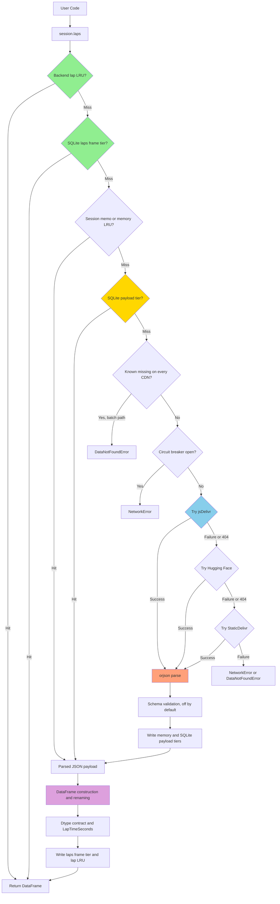

This document explains how data moves through tif1, from the first CDN request to the final DataFrame delivery. It covers caching mechanisms, network protocols, data transformations, and performance optimizations. These details help with performance tuning, troubleshooting, and data loading decisions.

tif1 treats performance as its core principle. The multi-tier caching system, HTTP/2 multiplexing, and async parallel fetching all minimize latency and maximize throughput. Each section explains what happens, why it happens, and how to use these systems.

## System Architecture Overview

The tif1 architecture follows three core principles:

1. **Performance First**: Every component is optimized for speed, from HTTP/2 multiplexing to orjson parsing to categorical data types.
2. **Resilience**: Multi-tier caching, circuit breakers, and retry logic ensure reliability even under adverse network conditions.
3. **Transparency**: Logging and monitoring show what happens at each stage.

### High-Level Architecture Diagram



A session with no cached data skips the cache reads (`ultra_cold_start`, on by default). It also fetches each payload with a single attempt per CDN (`ultra_cold_skip_retries`). The fetched payloads still go to the cache, so the next load is warm.

### Component Responsibilities

**Session Object (`core.py`)**
- Entry point for all data access
- Manages lazy loading of laps, telemetry, weather, and race control data
- Coordinates between cache layers and CDN fetching
- Handles backend selection (pandas vs polars)

**Memory LRU Cache (`cache.py`)**
- In-memory `LRUCache` built on `collections.OrderedDict`
- Stores raw JSON bytes plus a parsed-object front tier (not DataFrames)
- DataFrames live in the per-session `SessionMemo` and the backend lap LRU (`get_backend_lap_cache`)
- Default capacity: 1024 JSON payloads (`TIF1_MEMORY_CACHE_MAX_ITEMS`) and 2048 telemetry payloads (`TIF1_MEMORY_TELEMETRY_CACHE_MAX_ITEMS`)
- Eviction policy: Least Recently Used (LRU)
- Lifetime: Process duration only

**SQLite Persistent Cache (`cache.py`)**
- Disk-based cache using SQLite database
- Location: OS-dependent tif1 cache directory (configurable via `TIF1_CACHE_DIR`); see the platform defaults in the configuration reference
- Stores JSON payloads (compressed when 4096 bytes or larger) and pickled laps and telemetry frames
- Tables: `cache`, `telemetry_cache`, `laps_frames`, `laps_frames_pl`, `telemetry_frames`, `telemetry_frames_pl`, `missing_payloads`
- No expiry: entries persist until `clear()` or `invalidate()`
- Only negative "missing on every CDN" verdicts expire, after 7 days
- Thread-safe: one shared connection guarded by a lock, WAL journal mode

**CDN Manager (`cdn.py`)**
- Manages multiple CDN sources with automatic fallback
- Primary: jsDelivr CDN (`cdn.jsdelivr.net/gh/TracingInsights/{year}@main`)
- Fallback: Hugging Face buckets (`huggingface.co/buckets/tracinginsights/{year}/resolve`)
- Backup: StaticDelivr CDN (`cdn.staticdelivr.com/gh/TracingInsights/{year}/main`)
- Tracks failure counts per CDN source
- Automatically disables failing sources after 3 consecutive failures
- A 404 from one CDN falls through to the next, because mirrors can be stale
- A 403 from one CDN also falls through. jsDelivr answers 403 ("Package size exceeded the configured limit of 50 MB") for a file its edge has not cached yet
- A 403 or 404 says nothing about the health of the mirror, so it does not count towards disabling it
- tif1 raises `DataNotFoundError` when every CDN refuses the file with a 4xx error other than 408 or 429 (404 and 403 included)
- A 408 or 429 means "try again later", so it keeps the retryable `NetworkError`. tif1 does not record it as a missing payload
- Requests for files missing everywhere never burn the retry/backoff budget
- 5xx and transport errors keep the retryable `NetworkError`
- Handles URL encoding and path construction
- Never uses `raw.githubusercontent.com` for session data (strict rate limits)
- The only raw GitHub request is `schedule_{year}.json` of a live season in `events.py`, cached for `schedule_ttl_hours`

**Async HTTP Fetcher (`async_fetch.py`)**
- Parallel HTTP requests using `niquests` (HTTP/2 support)
- Connection pooling and keep-alive
- Retries a payload with exponential backoff when every CDN fails
- Timeout management (default: 30s per request)
- Concurrency cap: `max_concurrent_requests` (default 22)

**Circuit Breaker (`retry.py`)**
- Prevents cascading failures during network issues
- States: `"closed"` (normal), `"open"` (failing), `"half-open"` (testing recovery)
- Failure threshold: 5 consecutive failures
- Recovery timeout: 60 seconds
- Automatic state transitions

**JSON Parser (`orjson`)**
- High-performance JSON parsing (3x to 7x faster than stdlib `json` on tif1 payloads)
- Direct bytes-to-Python object conversion

**Schema Validator (`validation.py`)**
- Pydantic-based validation of JSON structure (off by default; turn it on with the `validate_data`, `validate_lap_times`, and `validate_telemetry` config keys)
- Ensures data integrity before DataFrame construction
- Type coercion and default value handling
- Detailed error messages for debugging

**DataFrame Constructor (`core.py` / `core_utils`)**
- Converts the columnar JSON payloads (one list per field) to pandas/polars DataFrames
- Renames the short upstream keys (`time`, `s1`, `sesT`, `wAT`, ...) to FastF1 names
- Example: `s1` becomes `Sector1Time`, and `wAT` becomes `AirTemp`
- Column order follows FastF1, plus the tif1 columns at the end
- pandas laps keep a `RangeIndex` (no `LapNumber` index)

**Data Enrichment (`core.py`)**
- Adds the computed `LapTimeSeconds` column (float seconds on both backends)
- Keeps the per-lap weather fields of the payload as `WeatherTime`, `AirTemp`, ..., `WindSpeed`
- Takes `Stint`, `IsPersonalBest`, and `DriverNumber` from the payload as delivered
- Takes `Driver` and `Team` from `drivers.json`; the payload keys `drv` and `team` stay as extra columns

**Type Optimizer (`core_utils/helpers.py`)**
- Applies the dtype contract of each backend (see [Column types by backend](/concepts/backends#column-types-by-backend))
- pandas: converts time columns to `timedelta64[ns]` and `Driver`, `Team`, `Compound`, `TrackStatus` to `category`
- polars: converts time columns to `Duration("ns")`, `LapStartDate` to `Datetime("ns")`, and keeps text columns as `String`
- Replaces sentinel strings such as `"None"` with missing values; numeric columns stay 64-bit (no `float32` downcast)

## Complete Data Loading Pipeline

The data loading pipeline consists of eight distinct stages. Each stage has specific responsibilities and performance characteristics. These details help with code optimization and troubleshooting.

### Stage 1: Request Initiation

When code accesses data through a Session object, tif1 initiates the loading pipeline. This stage involves property access, lazy evaluation, and request routing.

```python
import tif1

# Create session (no data loaded yet)
session = tif1.get_session(2025, "Monaco Grand Prix", "Race")

# Access laps property - triggers loading pipeline
laps = session.laps  # Returns pandas/polars DataFrame

# Access specific driver data
verstappen = session.get_driver("VER")
verstappen_laps = verstappen.laps  # Filtered from session.laps, no additional loading

# Access telemetry (separate loading pipeline). pandas shown; on polars,
# get_fastest_lap() returns a plain DataFrame, so call verstappen.get_fastest_lap_tel()
fastest_lap = verstappen.get_fastest_lap()
telemetry = fastest_lap.get_telemetry()  # Triggers telemetry loading
```

**What Happens Internally:**

1. Property access runs the `Session.laps` property
2. Session checks if data is already loaded (`self._laps is not None`)
3. If not loaded, the property checks the process-wide backend lap LRU under the key `f"{year}_{gp}_{session}_laps"`
4. On a miss, the property runs `Session.laps_async()` (public, for async code) with `asyncio.run()`
5. `laps_async()` checks the SQLite laps frame tier, then loads `drivers.json`, `f"{year}/{gp}/{session}/session_laptimes.json"` and the requested `weather.json` / `rcm.json` in one concurrent wave through the cache layer

**Performance Characteristics:**
- A repeated `session.laps` access returns the stored frame in about 1 µs
- No network I/O at this stage

**Configuration Options:**

```python
# Control what data gets loaded: get_session() only selects the session;
# session.load() picks the tables
session = tif1.get_session(2025, "Monaco", "Race")
session.load(
    laps=True,        # Load lap data
    telemetry=False,  # Skip telemetry (faster)
    weather=True,     # Load weather data
    messages=False    # Skip race control messages
)

# Choose backend
session = tif1.get_session(2025, "Monaco", "Race", lib="polars")  # Use polars
session = tif1.get_session(2025, "Monaco", "Race", lib="pandas")  # Use pandas (default)
```

### Stage 2: Multi-Tier Cache Lookup

The JSON payloads have a two-tier cache: memory and SQLite. The built DataFrames have their own tiers: the per-session memo, the process-wide backend lap LRU (100 sessions per backend), and the SQLite frame tables. This section explains the payload tiers first.

#### Tier 1: Memory LRU Cache (L1 Cache)

The memory cache is the fastest tier, holding raw JSON payloads and their parsed objects in RAM.

**Technical Specifications:**
- Implementation: `LRUCache` built on `collections.OrderedDict` (`cache.py`)
- Storage: In-process memory (heap)
- Data format: orjson bytes, plus a parsed-dict front tier that skips re-parsing on repeat hits
- DataFrames: held only by the per-session `SessionMemo`, the backend lap LRU, and the SQLite frame tier
- Capacity: 1024 JSON payloads (`TIF1_MEMORY_CACHE_MAX_ITEMS`), 2048 telemetry payloads (`TIF1_MEMORY_TELEMETRY_CACHE_MAX_ITEMS`)
- Eviction: Least Recently Used (LRU) algorithm, maintained through writes only
- Access time: about 3 µs for a parsed hit (measured on a 343 KB payload)
- Thread safety: `LRUCache.set` takes a lock; hot-path reads are lock-free
- Persistence: None (cleared on process exit)

**Cache Key Structure:**
```python
# gp and session are URL-encoded, as in session.gp and session.session
year, gp, session, driver, lap = 2025, "Monaco%20Grand%20Prix", "Race", "VER", 10

# JSON tier: "{year}/{gp}/{session}/{path}" (payload_loader.PayloadLoader.cache_key)
key = f"{year}/{gp}/{session}/session_laptimes.json"
# Other paths: drivers.json, rcm.json, weather.json, corners.json,
#              f"{driver}/laptimes.json", f"{driver}/{lap}_tel.json"

# Telemetry tier: tuple key
key = (year, gp, session, driver, lap)

# Backend lap LRU (get_backend_lap_cache): assembled lap DataFrames
key = f"{year}_{gp}_{session}_laps"
```

**Memory Usage Estimation:**
```python
# Typical JSON payload sizes (2025 Bahrain Grand Prix race):
# - session_laptimes.json (20 drivers, 1128 laps): ~340 KB
# - {driver}/{lap}_tel.json (one lap, 700-800 samples): ~150 KB
# - weather.json (158 samples): ~7 KB
# - rcm.json (91 messages): ~13 KB

# The telemetry payloads dominate: 2048 cached laps x ~150 KB ≈ 300 MB
# One loaded session adds about 370 KB in four JSON payloads
```

**Cache Hit Rate Optimization:**
```python
# Best: Reuse session objects
session = tif1.get_session(2025, "Monaco", "Race")
for analysis in range(10):
    laps = session.laps  # Stored on the session after the first access
    # ... analysis code

# Also served from memory, but each loop pays for get_session() again
for analysis in range(10):
    session = tif1.get_session(2025, "Monaco", "Race")
    laps = session.laps  # Backend lap LRU hit: the same frame object as before
```

#### Tier 2: SQLite Persistent Cache (L2 Cache)

The SQLite cache provides persistent storage that survives process restarts.

**Technical Specifications:**
- Implementation: `sqlite3` with one shared connection (`check_same_thread=False`)
- Storage: Disk-based database file (`cache.sqlite`)
- Location: OS-dependent tif1 cache directory (configurable via `TIF1_CACHE_DIR`); see the platform defaults in the configuration reference
- Data format: Compressed JSON (zstd level 1; legacy zlib rows stay readable). Python 3.14+ uses the standard-library `compression.zstd` binding, 3.11-3.13 use the `zstandard` package; both write identical frames
- Capacity: Unlimited (constrained by disk space)
- Access time: about 2 ms to read, decompress, and parse a 343 KB payload (measured)
- Thread safety: every SQLite call runs under `Cache._sqlite_lock`
- Write batching: writes commit every `cache_commit_interval` (default 100) operations
- Pragmas: `journal_mode=WAL`, `synchronous=NORMAL`, 64 MB page cache
- Persistence: Permanent (until `clear()` or `invalidate()`; nothing expires)

**Database Schema:**
```sql
-- Session JSON payloads, keyed "{year}/{gp}/{session}/{path}".
-- `data` holds plain JSON text, or a compressed blob for rows >= 4096 bytes.
CREATE TABLE IF NOT EXISTS cache (key TEXT PRIMARY KEY, data TEXT);

-- Per-lap telemetry payloads (same encoding as `cache.data`).
CREATE TABLE IF NOT EXISTS telemetry_cache (
    year INTEGER, gp TEXT, session TEXT, driver TEXT, lap INTEGER,
    data TEXT,
    PRIMARY KEY (year, gp, session, driver, lap)
);

-- Materialized telemetry DataFrames (pickle protocol 5, lz4-compressed).
-- `telemetry_frames` holds pandas frames; `telemetry_frames_pl` holds polars frames.
CREATE TABLE IF NOT EXISTS telemetry_frames (
    year INTEGER, gp TEXT, session TEXT, driver TEXT, lap INTEGER,
    frame BLOB,
    PRIMARY KEY (year, gp, session, driver, lap)
);
CREATE TABLE IF NOT EXISTS telemetry_frames_pl (
    year INTEGER, gp TEXT, session TEXT, driver TEXT, lap INTEGER,
    frame BLOB,
    PRIMARY KEY (year, gp, session, driver, lap)
);

-- Materialized laps DataFrames, one row per session (same blob format).
-- `laps_frames` holds pandas frames; `laps_frames_pl` holds polars frames.
CREATE TABLE IF NOT EXISTS laps_frames (
    year INTEGER, gp TEXT, session TEXT,
    frame BLOB,
    PRIMARY KEY (year, gp, session)
);
CREATE TABLE IF NOT EXISTS laps_frames_pl (
    year INTEGER, gp TEXT, session TEXT,
    frame BLOB,
    PRIMARY KEY (year, gp, session)
);

-- Negative tier: payloads that every CDN refused with a 4xx other than 408 or 429.
CREATE TABLE IF NOT EXISTS missing_payloads (key TEXT PRIMARY KEY, recorded_at REAL);
```

The primary keys are the only indexes; there are no secondary indexes. `PRAGMA user_version` stores the schema version of the telemetry frame tables. When it is older than the library expects, tif1 drops those tables once and rebuilds the frames from the payload tier.

**Compression Strategy:**
```python
import orjson

# Python 3.14+ ships zstd in the standard library (PEP 784); older
# interpreters use the `zstandard` package. Same libzstd, same frames.
try:
    from compression import zstd
except ImportError:
    import zstandard as zstd

# A payload in the upstream layout (one list per field)
data = {"lap": list(range(1, 58)), "time": [95.0 + i / 10 for i in range(57)]}

# Serialization (write to cache)
json_bytes = orjson.dumps(data)
if len(json_bytes) >= 4096:
    stored = zstd.compress(json_bytes, 1)  # compressed BLOB row
else:
    stored = json_bytes.decode("utf-8")   # small rows stay plain TEXT
# Measured ratio in a tif1 cache: about 6:1 for lap payloads, 2.5:1 for telemetry
# (slightly better than zlib-3, and zstd-1 compresses about 4.5x faster)
# zlib level 3 is the fallback only when no zstd binding imports.

# Deserialization (read from cache)
json_bytes = zstd.decompress(stored) if isinstance(stored, bytes) else stored
data = orjson.loads(json_bytes)
```

Materialized laps and telemetry DataFrames (the frame tiers) use lz4 instead. These tiers are
write-once/read-many, and lz4 halves both compress and decompress time.
zstd is the fallback when lz4 is unavailable, for example on Python 3.15 where
lz4 publishes no wheels yet. Each row carries its codec's magic prefix, so
both kinds of row stay readable regardless of which codec wrote them.

**Expiry:**

Cached payloads and frames never expire. Session data is immutable once published, so a
cached row stays valid until `cache.clear()` or `cache.invalidate(scope)` removes it.

The only time-to-live applies to the negative tier. When every CDN refuses a file in the
async batch path (laps and telemetry), tif1 records the key in `missing_payloads`. Later
batch lookups skip the network for that key until the verdict is older than
`TIF1_MISSING_PAYLOADS_TTL_DAYS` (default 7.0). A successful write for the same key drops
the verdict immediately.

```python
# Negative-tier TTL (the only TTL in the cache)
# Configurable via TIF1_MISSING_PAYLOADS_TTL_DAYS (default: 7.0 days)
import time
cutoff = time.time() - 7.0 * 86400
# Verdicts with recorded_at <= cutoff are ignored on load
```

**Cache Inspection:**
```python
cache = tif1.get_cache()  # tif1.cache.Cache

# Get cache information
print(f"Cache directory: {cache.cache_dir}")
size_mb = cache.db_path.stat().st_size / (1024 * 1024)
print(f"Cache size: {size_mb:.2f} MB")
# Accepts the URL-encoded form (session.gp) and the plain name
print(f"Monaco cached: {cache.has_session_data(2025, 'Monaco Grand Prix', 'Race')}")

# Clear cache
cache.clear()                   # Remove every tier (memory + SQLite)
cache.invalidate("memory")      # Drop the in-memory LRU tiers only
cache.invalidate("json")        # Drop session JSON payloads (memory + SQLite)
cache.invalidate("telemetry")   # Drop telemetry payloads and frames
```

`tif1.get_cache()` returns the `tif1.cache.Cache` instance. `tif1.Cache` is the separate
FastF1-compatibility helper in `fastf1_compat.py`.

#### Cache Lookup Flow

```python
def get_data(key):
    """Simplified cache lookup logic."""

    # Step 1: Check memory cache (L1)
    if key in memory_cache:
        logger.debug(f"Memory cache hit: {key}")
        return memory_cache[key]

    logger.debug(f"Memory cache miss: {key}")

    # Step 2: Check SQLite cache (L2)
    sqlite_data = sqlite_cache.get(key)
    if sqlite_data is not None:
        logger.debug(f"SQLite cache hit: {key}")

        # Decompress (if a compressed row) and parse JSON with orjson
        json_bytes = decode_sqlite_value(sqlite_data)
        data = orjson.loads(json_bytes)

        # Promote to memory cache (L1): raw bytes plus parsed object
        memory_cache[key] = json_bytes
        parsed_cache[key] = data

        return data

    logger.debug(f"SQLite cache miss: {key}")

    # Step 3: Fetch from CDN (cache miss)
    data = fetch_from_cdn(key)

    # Step 4: Save to both cache tiers (memory first, then SQLite)
    json_bytes = orjson.dumps(data)
    memory_cache[key] = json_bytes
    sqlite_cache.set(key, encode_sqlite_value(json_bytes))

    return data
```

**Performance Comparison:**

Measured for the 343 KB `session_laptimes.json` of a race (Intel Core i9-13900HX, Python 3.14):

| Scenario | Memory Cache | SQLite Cache | CDN Fetch |
|----------|--------------|--------------|-----------|
| Access Time | about 3 µs | about 2 ms | Depends on the network |
| Persistence | No | Yes | N/A |
| Capacity | Limited (RAM) | Unlimited (disk) | N/A |
| Thread Safety | Yes (lock-free reads, locked writes) | Yes (shared connection + lock) | N/A |

**Cache Warming Strategies:**

```python
import logging

import tif1

logger = logging.getLogger(__name__)

# Strategy 1: Pre-warm on application startup
def warm_cache_for_season(year):
    """Load all race data for a season into cache."""
    events = tif1.get_event_schedule(year, include_testing=False)["EventName"]
    for event in events:
        for session_type in ["Practice 1", "Practice 2", "Practice 3", "Qualifying", "Race"]:
            try:
                session = tif1.get_session(year, event, session_type)
                _ = session.laps  # Trigger load
                logger.info(f"Cached: {year} {event} {session_type}")
            except (tif1.DataNotFoundError, ValueError):
                # ValueError: the event has no such session (sprint weekends have no FP2/FP3)
                continue

# Strategy 2: Background cache warming
import threading

def warm_cache_background(year):
    """Warm cache in background thread."""
    thread = threading.Thread(target=warm_cache_for_season, args=(year,))
    thread.daemon = True
    thread.start()

# Strategy 3: Selective warming (only races)
def warm_cache_races_only(year):
    """Load only race sessions (fastest to load)."""
    events = tif1.get_event_schedule(year, include_testing=False)["EventName"]
    for event in events:
        session = tif1.get_session(year, event, "Race")
        _ = session.laps
```

**Cache Invalidation:**

```python
# Manual invalidation by scope (there is no per-key invalidation)
cache = tif1.get_cache()
cache.invalidate("memory")     # In-memory LRU tiers only; SQLite persists
cache.invalidate("json")       # Session JSON payloads, memory + SQLite
cache.invalidate("telemetry")  # Telemetry payloads and frames, memory + SQLite
cache.invalidate("all")        # Everything (same as cache.clear())

# No automatic invalidation: cached payloads never expire

# Bypass the cache for one session (no per-call force_refresh flag exists)
fresh = tif1.get_session(2025, "Monaco", "Race", enable_cache=False)

# For a whole process, set TIF1_ENABLE_CACHE=false before Python starts:
# the config reads the environment once, when tif1 is first used
```

### Stage 3: CDN Fetching with Fallback Strategy

When both cache tiers miss, tif1 fetches data from the CDN. The fetch uses a multi-source strategy with automatic fallback.

#### CDN Architecture

**Primary Source: jsDelivr CDN**
- URL Pattern: `https://cdn.jsdelivr.net/gh/TracingInsights/{year}@main/{path}`
- Serves the TracingInsights GitHub data repos from a global CDN

**Fallback Source: Hugging Face Buckets**
- URL Pattern: `https://huggingface.co/buckets/tracinginsights/{year}/resolve/{path}`
- Mirrors the TracingInsights GitHub data repos with the same layout (no branch segment)
- Used when jsDelivr fails, returns 403 or 404, or is unavailable

**Backup Source: StaticDelivr CDN**
- URL Pattern: `https://cdn.staticdelivr.com/gh/TracingInsights/{year}/main/{path}`
- Used when both jsDelivr and Hugging Face fail or are unavailable

**Forbidden Source: raw.githubusercontent.com**
- Never used for session payloads due to strict rate limits
- The one exception is the live event schedule. For the current season, `events.py` fetches `theOehrly/f1schedule/master/schedule_{year}.json`, where calendar changes land first
- That one small file is cached for `schedule_ttl_hours` (default 6)
- When all three sources fail, tif1 raises `NetworkError` instead of trying it. When every source refused the file with a 4xx other than 408 or 429, it raises `DataNotFoundError`

#### URL Construction

```python
from urllib.parse import quote

# Every payload lives under {year}/{event name}/{session name}/ in the season repo.
# The event and session names are URL-encoded, not normalized.
year = 2025
gp = quote("Monaco Grand Prix")  # "Monaco%20Grand%20Prix"
session_name = quote("Race")
driver = "VER"
lap_number = 10

# Primary URL (jsDelivr)
base_url = f"https://cdn.jsdelivr.net/gh/TracingInsights/{year}@main/{gp}/{session_name}"
session_laps_url = f"{base_url}/session_laptimes.json"  # Laps of all drivers
driver_laps_url = f"{base_url}/{driver}/laptimes.json"  # Laps of one driver
# Result: https://cdn.jsdelivr.net/gh/TracingInsights/2025@main/Monaco%20Grand%20Prix/Race/VER/laptimes.json

# Telemetry URL (one file per lap)
telemetry_url = f"{base_url}/{driver}/{lap_number}_tel.json"

# Session tables
drivers_url = f"{base_url}/drivers.json"
weather_url = f"{base_url}/weather.json"
messages_url = f"{base_url}/rcm.json"  # Race control messages

# The fallbacks use the same path after their own prefix:
# https://huggingface.co/buckets/tracinginsights/2025/resolve/Monaco%20Grand%20Prix/Race/...
# https://cdn.staticdelivr.com/gh/TracingInsights/2025/main/Monaco%20Grand%20Prix/Race/...
```

#### Fallback Logic

```python
async def fetch_with_fallback(url_path):
    """Fetch data with automatic CDN fallback."""

    # Attempt 1: jsDelivr CDN (primary)
    try:
        jsdelivr_url = f"https://cdn.jsdelivr.net/gh/TracingInsights/{year}@main/{url_path}"
        response = await http_client.get(jsdelivr_url, timeout=30)
        if response.status_code == 200:
            logger.info(f"jsDelivr success: {url_path}")
            return response.content
        logger.warning(f"jsDelivr returned {response.status_code}")
    except Exception as e:
        logger.warning(f"jsDelivr failed: {e}")

    # Attempt 2: Hugging Face bucket (fallback)
    try:
        hf_url = f"https://huggingface.co/buckets/tracinginsights/{year}/resolve/{url_path}"
        response = await http_client.get(hf_url, timeout=30)
        if response.status_code == 200:
            logger.info(f"Hugging Face success: {url_path}")
            return response.content
        logger.warning(f"Hugging Face returned {response.status_code}")
    except Exception as e:
        logger.warning(f"Hugging Face failed: {e}")

    # Attempt 3: StaticDelivr CDN (last-resort backup)
    try:
        staticdelivr_url = f"https://cdn.staticdelivr.com/gh/TracingInsights/{year}/main/{url_path}"
        response = await http_client.get(staticdelivr_url, timeout=30)
        if response.status_code == 200:
            logger.info(f"StaticDelivr success: {url_path}")
            return response.content
        logger.warning(f"StaticDelivr returned {response.status_code}")
    except Exception as e:
        logger.warning(f"StaticDelivr failed: {e}")

    # All sources failed (NetworkError takes the URL and extra context keys).
    # tif1 raises DataNotFoundError instead when every source refused the
    # file with a 4xx other than 408 or 429, such as 403 or 404
    raise tif1.NetworkError(url=url_path, attempts=3)
```

In the async batch path, a 404 from one source starts the remaining sources at the same time. A missing file then costs one round trip, not three.

#### Circuit Breaker Pattern

tif1 implements a circuit breaker to prevent cascading failures during network issues.

**Circuit Breaker States:**

1. **`"closed"` (Normal Operation)**
   - All requests pass through
   - Failures are counted
   - Threshold: 5 consecutive failures (`circuit_breaker_threshold`)

2. **`"open"` (Failing)**
   - Requests fail immediately, without a network call
   - Prevents overload of the failing service
   - Duration: 60 seconds (`circuit_breaker_timeout`)

3. **`"half-open"` (Testing Recovery)**
   - Requests are allowed through again
   - Success → transition to `"closed"`
   - Failure → transition back to `"open"`

The breaker is shared by the process. The async batch path (laps, telemetry) records one failure when every CDN fails in an attempt. The synchronous path (`drivers.json`, `weather.json`, `rcm.json`) records each failed request. Any success resets the count.

A missing, refused (403 or 404), or malformed payload is an answer from a healthy server. It does not count as a failure on either path.

When the breaker is open, the synchronous path raises `CircuitBreakerOpenError` and the async batch path raises `NetworkError`.

The block below is a simplified, single-threaded copy of `tif1.retry.CircuitBreaker`. The real class adds a lock. Read the live instance with `tif1.get_circuit_breaker()`.

```python
import time

from tif1.exceptions import (
    CircuitBreakerOpenError,
    DataNotFoundError,
    InvalidDataError,
    NetworkError,
)


def is_server_answer(error):
    """A missing, refused, or malformed payload: the server answered."""
    if isinstance(error, (DataNotFoundError, InvalidDataError)):
        return True
    return isinstance(error, NetworkError) and error.context.get("status_code") in (403, 404)


class CircuitBreaker:
    """Circuit breaker for network requests (simplified)."""

    def __init__(self, threshold=5, timeout=60):
        self.threshold = threshold  # Failures before the breaker opens
        self.timeout = timeout  # Seconds the breaker stays open
        self.failures = 0
        self.opened_at = None
        self.state = "closed"

    def call(self, func, *args, **kwargs):
        """Execute function with circuit breaker protection."""

        # Check if circuit is open
        if self.state == "open":
            if time.monotonic() - self.opened_at > self.timeout:
                self.state = "half-open"
            else:
                # CircuitBreakerOpenError is a NetworkError subclass
                raise CircuitBreakerOpenError

        # Attempt request
        try:
            result = func(*args, **kwargs)
        except Exception as error:
            if is_server_answer(error):
                raise  # Not a network failure: the count does not change
            # Failure - increment count
            self.failures += 1
            self.opened_at = time.monotonic()
            if self.failures >= self.threshold:
                self.state = "open"
            raise

        # Success - close the breaker and reset the failure count
        self.state = "closed"
        self.failures = 0
        return result
```

#### Retry Strategy

tif1 has one retry loop per fetch path:

- **Synchronous path** (`PayloadLoader.fetch_from_cdn`; `drivers.json`, `weather.json`, `rcm.json`): each CDN source gets its own retry loop (`tif1.retry.retry_with_backoff`, wrapped around the circuit breaker). Only `NetworkError` is retried. A 403 or 404 moves on to the next source at once.
- **Async batch path** (`fetch_json_async`; laps and telemetry): each attempt walks all CDN sources once. tif1 waits and walks again only when every source failed. The wait is `min(retry_backoff_factor ** attempt, max_retry_delay)` seconds, plus up to `retry_jitter_max` seconds of jitter (default 0).

The block below is a simplified copy of the synchronous loop:

```python
import logging
import random
import time

from tif1 import NetworkError

logger = logging.getLogger(__name__)


def fetch_with_retry(fetch_from_url, url, max_retries=3, backoff_factor=2.0):
    """Exponential backoff with jitter (sync, per CDN source)."""
    # max_retries: TIF1_MAX_RETRIES; backoff_factor: TIF1_RETRY_BACKOFF_FACTOR
    attempts = max(1, max_retries)  # max_retries=0 still makes one attempt
    for attempt in range(attempts):
        try:
            return fetch_from_url(url)  # Goes through the circuit breaker
        except NetworkError as e:
            refused = e.context.get("status_code") in (403, 404)
            if attempt == attempts - 1 or refused:
                raise  # try_sources moves on to the next CDN

            # 1s, 2s, 4s ... multiplied by a random factor between 0.5 and 1.5
            backoff = backoff_factor ** attempt
            backoff *= 0.5 + random.random()  # TIF1_RETRY_JITTER=false turns this off

            logger.warning(f"Retry {attempt + 1}/{attempts} after {backoff:.2f}s: {e}")
            time.sleep(backoff)
```

#### Request Timeout Management

tif1 uses one timeout value in seconds for every request (`timeout`, default 30). There are no separate connect, read, or total timeouts.

```python
import tif1

config = tif1.get_config()
print(config.get("timeout"))  # 30 (seconds per request)

# Raise it for a slow link (or set TIF1_TIMEOUT=60 in the environment)
config.set("timeout", 60)
```

### Stage 4: Async Parallel Fetching

tif1 fetches many payloads in parallel with asyncio, for example the telemetry files of many laps. The laps of a session come from one file, `session_laptimes.json`. tif1 fetches per-driver `laptimes.json` files in parallel only for drivers that this file does not cover.

#### Parallel Fetching

`async_fetch.py` runs the blocking requests of the shared `niquests.Session` in a thread pool. An `asyncio.Semaphore` caps the number of requests in flight (`max_concurrent_requests`, default 22). The block below is a simplified copy:

```python
import asyncio

from tif1.http_session import get_session as get_http_session


def construct_url(driver, year=2025, gp="Monaco%20Grand%20Prix", session="Race"):
    """jsDelivr URL of the laptimes.json file of one driver."""
    base = f"https://cdn.jsdelivr.net/gh/TracingInsights/{year}@main/{gp}/{session}"
    return f"{base}/{driver}/laptimes.json"


async def fetch_all_drivers(drivers, max_concurrent=22):
    """Fetch data for all drivers in parallel."""
    http = get_http_session()  # Shared niquests.Session (pooled, multiplexed)
    loop = asyncio.get_running_loop()
    semaphore = asyncio.Semaphore(max_concurrent)

    async def fetch_driver(driver):
        url = construct_url(driver)
        async with semaphore:
            response = await loop.run_in_executor(None, http.get, url)
        response.raise_for_status()
        return response.json()

    # Execute all tasks concurrently; a failure becomes an exception object
    tasks = [fetch_driver(driver) for driver in drivers]
    return await asyncio.gather(*tasks, return_exceptions=True)


results = asyncio.run(fetch_all_drivers(["VER", "LEC", "NOR"]))
```

#### HTTP/2 Multiplexing

tif1 uses the `niquests` library. `niquests` supports HTTP/2 and multiplexes requests over a single TCP connection.

**HTTP/1.1 Limitations:**
- One request at a time per TCP connection
- Multiple connections required for parallelism
- High overhead: TCP handshake + TLS handshake per connection
- Head-of-line blocking

**HTTP/2 Advantages:**
- Multiple requests over single TCP connection
- Binary framing for efficiency
- Header compression (HPACK)
- Stream prioritization

```python
# HTTP/2 connection reuse with niquests
import niquests

drivers = ["VER", "LEC", "NOR"]
with niquests.Session(multiplexed=True) as http:
    # One connection per host; HTTP/2 is negotiated when the server offers it
    responses = [http.get(construct_url(driver)) for driver in drivers]

    # multiplexed=True returns lazy responses: the requests share the
    # connection, and gather() waits for all of them
    http.gather()

print([response.status_code for response in responses])
```

tif1 builds this session once per process in `tif1.http_session` (`TIF1_HTTP_MULTIPLEXED`, default `true`).

#### Connection Pooling

`tif1.http_session.get_session()` mounts one `HTTPAdapter` for `https://` with these sizes:

```python
# Connection pool configuration (simplified from tif1.http_session)
import niquests

http = niquests.Session(multiplexed=True)
http.mount(
    "https://",
    niquests.adapters.HTTPAdapter(
        pool_connections=256,  # max(256, concurrency); TIF1_POOL_CONNECTIONS overrides
        pool_maxsize=1024,     # max(512, 4 x pool_connections); TIF1_POOL_MAXSIZE overrides
        pool_block=False,      # Do not block when the pool is full
    ),
)
http.trust_env = False  # Skip proxy and netrc lookups on every request

# Connection reuse
# First request: DNS + TCP + TLS handshake (160-800 ms measured against jsDelivr)
# Subsequent requests: no new handshake
```

The request timeout is not a session setting: tif1 passes `timeout` (default 30 seconds) to each request.

#### Error Handling in Parallel Fetching

`fetch_multiple_async()` in `tif1.async_fetch` returns one entry per request. A failed fetch becomes `None`, so one failure does not cancel the others. A file that every CDN reports as missing gives `None` silently. tif1 logs other failures at `WARNING`.

```python
import asyncio

from tif1.async_fetch import fetch_multiple_async

requests = [
    (2025, "Monaco%20Grand%20Prix", "Race", "drivers.json"),
    (2025, "Monaco%20Grand%20Prix", "Race", "weather.json"),
    (2025, "Monaco%20Grand%20Prix", "Race", "no_such_file.json"),
]
results = asyncio.run(fetch_multiple_async(requests))
print([type(result).__name__ for result in results])  # ['dict', 'dict', 'NoneType']
```

The requests run under the `max_concurrent_requests` semaphore, so a large batch needs no manual splitting.

### Stage 5: High-Performance JSON Parsing

After the CDN fetch, tif1 parses JSON with `orjson`. On tif1 payloads, this library parses 3x to 7x faster than the standard Python `json` module.

#### Why orjson?

**Performance Comparison** (median of 7 runs, Intel Core i9-13900HX, Python 3.14):

| Payload | `json` (stdlib) | `orjson` | Speedup |
|---------|-----------------|----------|---------|
| `session_laptimes.json` of a race (343 KB) | 1.9 ms | 0.6 ms | 3x |
| One lap of telemetry (154 KB) | 1.6 ms | 0.24 ms | 7x |

**Key Features:**
- Written in Rust
- Direct bytes-to-Python object conversion (no intermediate string)
- Native support for datetime, UUID, and other types when it serializes

#### Parsing Pipeline

The block below is a simplified copy of the checks in `async_fetch.py`. A body that is not valid JSON, or not a JSON object, raises `InvalidDataError`:

```python
import orjson

import tif1


def parse_json_response(response_bytes):
    """Parse a payload the way async_fetch.py does (simplified)."""
    try:
        data = orjson.loads(response_bytes)
    except orjson.JSONDecodeError as e:  # a ValueError subclass
        raise tif1.InvalidDataError(reason=f"JSON parsing failed: {e}")

    if not isinstance(data, dict):
        raise tif1.InvalidDataError(reason=f"Expected dict, got {type(data).__name__}")
    return data


print(parse_json_response(b'{"lap": [1, 2], "time": [95.1, 94.8]}')["lap"])  # [1, 2]
```

#### Data Structure Examples

Every payload is columnar: one JSON list per field, with the same length for every list. Missing values arrive as the string `"None"`, which tif1 turns into `NaN`, `NaT`, or `null`. The examples show the first two entries of each list, from the 2025 Bahrain Grand Prix race.

**Lap Data JSON Structure** (`{driver}/laptimes.json`; `session_laptimes.json` has the same fields for every driver):
```json
{
  "time": [103.877, 98.403],
  "lap": [1, 2],
  "compound": ["SOFT", "SOFT"],
  "stint": [1, 1],
  "s1": ["None", 31.183],
  "s2": [43.964, 42.971],
  "s3": [24.393, 24.249],
  "life": [4, 5],
  "pos": [8, 8],
  "status": ["1", "1"],
  "pb": [false, true],
  "sesT": [3439.011, 3537.414],
  "drv": ["VER", "VER"],
  "dNum": ["1", "1"],
  "pout": ["None", "None"],
  "pin": ["None", "None"],
  "vi1": [209.0, 229.0],
  "vst": [258.0, 296.0],
  "team": ["Red Bull Racing", "Red Bull Racing"],
  "lSD": ["2025-04-13T15:03:49.174000000", "2025-04-13T15:05:33.278000000"],
  "del": [false, false],
  "wAT": [27.2, 27.2],
  "wTT": [31.9, 31.9]
}
```

The payload has 42 fields. The fields not shown are `ms1` to `ms3` (mini-sector strings), `s1T` to `s3T`, `vi2`, `vfl`, `fresh`, `lST`, `delR`, `ff1G`, and `iacc`. The other per-lap weather fields are `wT`, `wH`, `wP`, `wR`, `wWD`, and `wWS`. Times are float seconds.

**Telemetry Data JSON Structure** (`{driver}/{lap}_tel.json`, one file per lap; `VER/10_tel.json` shown):
```json
{
  "tel": {
    "time": [0.0, 0.038],
    "rpm": [11226.47, 11245.0],
    "speed": [282.64, 283.0],
    "gear": [7, 7],
    "throttle": [100.0, 100.0],
    "brake": [0, 0],
    "drs": [0, 0],
    "distance": [0.22, 3.22],
    "rel_distance": [0.00004, 0.0006],
    "DriverAhead": ["None", "None"],
    "DistanceToDriverAhead": [101.165, 101.165],
    "acc_x": [1.68, 2.45],
    "acc_y": [-0.07, -0.09],
    "acc_z": [10.19, 12.74],
    "x": [-360.34, -359.04],
    "y": [1239.32, 1269.65],
    "z": [-160.66, -160.85],
    "dataKey": "2025-Bahrain Grand Prix-Race-VER-10"
  }
}
```

**Weather Data JSON Structure** (`weather.json`):
```json
{
  "wT": [14.542, 74.57],
  "wAT": [27.9, 27.8],
  "wH": [45.0, 45.0],
  "wP": [1007.9, 1007.9],
  "wR": [false, false],
  "wTT": [34.5, 34.4],
  "wWD": [29, 9],
  "wWS": [2.9, 2.9]
}
```

#### Payload Size

tif1 payloads are small: one telemetry file per lap is about 150 KB. tif1 parses each payload whole with orjson; it does not stream them.

#### Validation After Parsing

Validation is off by default (`validate_data`, `validate_lap_times`, `validate_telemetry`). When on, the models in `tif1.validation` check the columnar payload. Every non-empty list must have the same length. Stints must be 1 or more, and tyre life 0 or more. The block below is a cut-down version of `tif1.validation.LapData`:

```python
from pydantic import BaseModel, Field, ValidationError, field_validator, model_validator

import tif1


class LapData(BaseModel):
    """Columnar lap payload: one list per field (cut-down tif1.validation.LapData)."""

    time: list[float | None] = Field(..., min_length=1)
    lap: list[float | None] = Field(..., min_length=1)
    stint: list[int | None] = Field(..., min_length=1)
    life: list[int | None] = Field(..., min_length=1)
    session_time: list[float | None] = Field(default_factory=list, alias="sesT")

    model_config = {"populate_by_name": True}

    @field_validator("stint")
    @classmethod
    def validate_stint(cls, v):
        if any(s is not None and s < 1 for s in v):
            raise ValueError("Stint numbers must be >= 1")
        return v

    @model_validator(mode="after")
    def validate_consistent_lengths(self):
        lengths = {len(self.time), len(self.lap), len(self.stint), len(self.life)}
        if len(lengths) > 1:
            raise ValueError("Inconsistent lap data lengths")
        return self


def validate_lap_data(data):
    """Validate parsed lap data ("None" strings must already be None)."""
    try:
        return LapData(**data).model_dump()
    except ValidationError as e:
        raise tif1.InvalidDataError(f"Data validation failed: {e}", errors=e.errors())


payload = {"time": [103.877, 98.403], "lap": [1, 2], "stint": [1, 1], "life": [4, 5],
           "sesT": [3439.011, 3537.414]}
print(validate_lap_data(payload)["session_time"])  # [3439.011, 3537.414]
```

### Stage 6: DataFrame Construction and Transformation

After parsing and validating JSON, tif1 constructs DataFrames with optimized column names, types, and ordering.

#### DataFrame Construction Pipeline

The block below is a simplified view of `core_utils/helpers.py` (`_create_lap_df` and `_process_lap_df`):

```python
from tif1.core_utils.constants import LAP_RENAME_MAP


def construct_lap_dataframe(lap_data, lib="pandas"):
    """Construct a laps DataFrame from a columnar lap payload (simplified)."""

    # Step 0: The payload marks missing values with the string "None"
    lap_data = {
        key: [None if v == "None" else v for v in values]
        for key, values in lap_data.items()
        if isinstance(values, list)
    }

    # Step 1: Create the DataFrame straight from the lists (one column per key)
    if lib == "pandas":
        import pandas as pd
        df = pd.DataFrame(lap_data)
        # Step 2: Rename the short upstream keys to FastF1 names
        df = df.rename(columns=LAP_RENAME_MAP)
    else:
        import polars as pl
        df = pl.DataFrame(lap_data)
        df = df.rename({k: v for k, v in LAP_RENAME_MAP.items() if k in df.columns})

    # Step 3: Apply the dtype contract of the backend (see Type Optimization)
    # Step 4: Add LapTimeSeconds and reorder to the FastF1 column order
    # There is no index step: pandas laps keep a RangeIndex
    return df
```

#### Column Naming Convention

tif1 uses the FastF1 column names (PascalCase), so FastF1 code reads tif1 frames without changes.

**Rename Mapping** (an excerpt of `LAP_RENAME_MAP` in `core_utils/constants.py`):
```python
LAP_RENAME_MAP = {
    # Lap identification
    "lap": "LapNumber",
    "drv": "Driver",
    "dNum": "DriverNumber",
    "team": "Team",

    # Timing (float seconds in the payload)
    "time": "LapTime",
    "s1": "Sector1Time",
    "s2": "Sector2Time",
    "s3": "Sector3Time",
    "sesT": "Time",
    "pout": "PitOutTime",
    "pin": "PitInTime",

    # Speed traps
    "vi1": "SpeedI1",
    "vi2": "SpeedI2",
    "vfl": "SpeedFL",
    "vst": "SpeedST",

    # Tyre information
    "compound": "Compound",
    "life": "TyreLife",
    "stint": "Stint",
    "fresh": "FreshTyre",

    # Position and status
    "pos": "Position",
    "status": "TrackStatus",

    # Flags
    "pb": "IsPersonalBest",
    "iacc": "IsAccurate",
    "del": "Deleted",
    "delR": "DeletedReason",

    # Per-lap weather
    "wT": "WeatherTime",
    "wAT": "AirTemp",
    "wTT": "TrackTemp",
    # ... plus the long names ("speed_i1", "pit_out_time", ...) that validation produces
}
```

#### Type Optimization

tif1 applies a fixed dtype contract per backend. It does not downcast: numeric columns stay 64-bit.

**Pandas Type Optimization** (simplified from `_apply_laps_dtypes`):
```python
import pandas as pd


def apply_laps_dtypes_pandas(df):
    """Apply the pandas dtype contract to a renamed laps DataFrame (simplified)."""

    # "None" strings from the payload become missing values first
    df = df.replace("None", None)

    # Time columns: float seconds -> timedelta64[ns]
    for col in ["LapTime", "Time", "Sector1Time", "Sector2Time", "Sector3Time",
                "PitInTime", "PitOutTime", "LapStartTime", "WeatherTime"]:
        if col in df.columns:
            df[col] = pd.to_timedelta(pd.to_numeric(df[col], errors="coerce"), unit="s")
    df["LapTimeSeconds"] = df["LapTime"].dt.total_seconds()

    # Counters and speeds: float64 (FastF1 convention, NaN for missing)
    for col in ["LapNumber", "Stint", "TyreLife", "Position", "SpeedI1", "SpeedST"]:
        if col in df.columns:
            df[col] = pd.to_numeric(df[col], errors="coerce").astype("float64")

    # Flags: bool, and nullable boolean for Deleted
    for col in ["IsPersonalBest", "FreshTyre", "IsAccurate"]:
        if col in df.columns:
            df[col] = df[col].fillna(False).astype(bool)
    if "Deleted" in df.columns:
        df["Deleted"] = df["Deleted"].astype("boolean")

    # Low-cardinality text: category
    for col in ["Driver", "Team", "Compound", "TrackStatus"]:
        if col in df.columns:
            df[col] = df[col].astype("category")

    return df
```

The result matches the dtypes of `session.laps`:

```python
laps = session.laps  # pandas backend
print(laps.dtypes[["LapTime", "LapTimeSeconds", "LapNumber", "Driver", "IsPersonalBest", "Deleted"]])
# LapTime           timedelta64[ns]
# LapTimeSeconds            float64
# LapNumber                 float64
# Driver                   category
# IsPersonalBest               bool
# Deleted                   boolean
```

**Polars Type Optimization:**
```python
import polars as pl


def apply_laps_dtypes_polars(df):
    """Apply the polars dtype contract to a renamed laps DataFrame (simplified)."""

    # LapTimeSeconds keeps the float seconds of the payload
    df = df.with_columns(pl.col("LapTime").cast(pl.Float64, strict=False).alias("LapTimeSeconds"))

    # Time columns become Duration("ns"), LapStartDate a Datetime("ns")
    df = df.with_columns((pl.col("LapTime") * 1_000_000_000).cast(pl.Int64).cast(pl.Duration("ns")))

    # Counters stay Int64, flags Boolean, text String
    # Categorical text columns only with TIF1_POLARS_LAP_CATEGORICAL=true
    return df
```

#### Column Ordering

tif1 orders lap columns as FastF1 does (`FASTF1_LAPS_COLUMN_ORDER` in `core_utils/constants.py`). The tif1 columns `LapTimeSeconds` and `QualifyingSession` come after the FastF1 columns. Payload columns that keep their upstream names come last: `ms1` to `ms3`, `drv`, and `team`. `Driver` and `Team` come from `drivers.json`, so `drv` and `team` are not renamed:

```python
COLUMN_ORDER = [
    "index",  # pandas only (FastF1 compatibility column)
    "Time", "Driver", "DriverNumber", "LapTime", "LapNumber", "Stint",
    "PitOutTime", "PitInTime",
    "Sector1Time", "Sector2Time", "Sector3Time",
    "Sector1SessionTime", "Sector2SessionTime", "Sector3SessionTime",
    "SpeedI1", "SpeedI2", "SpeedFL", "SpeedST",
    "IsPersonalBest", "Compound", "TyreLife", "FreshTyre", "Team",
    "LapStartTime", "LapStartDate", "TrackStatus", "Position",
    "Deleted", "DeletedReason", "FastF1Generated", "IsAccurate",
    # Per-lap weather
    "WeatherTime", "AirTemp", "Humidity", "Pressure", "Rainfall",
    "TrackTemp", "WindDirection", "WindSpeed",
    # tif1 columns
    "LapTimeSeconds", "QualifyingSession",
]

def reorder_columns(df, column_order):
    """Reorder DataFrame columns."""
    # Only include columns that exist in the DataFrame
    ordered_cols = [col for col in column_order if col in df.columns]

    # Add any remaining columns not in the order list
    remaining_cols = [col for col in df.columns if col not in ordered_cols]

    return df[ordered_cols + remaining_cols]
```

#### Index Management

**Pandas Index Strategy:**
```python
df = session.laps  # pandas backend

# Option 1: LapNumber as index
by_lap = df.set_index("LapNumber")
# Pros: Fast lap lookup, natural ordering
# Cons: Loses LapNumber as regular column

# Option 2: MultiIndex (Driver + LapNumber)
by_driver_lap = df.set_index(["Driver", "LapNumber"])
# Pros: Fast driver + lap lookup, hierarchical grouping
# Cons: More complex indexing

# Option 3: RangeIndex
# Pros: Simple, fast integer indexing
# Cons: No semantic meaning

# tif1 uses Option 3: laps keep a RangeIndex, plus a FastF1-style "index" column.
# Set Option 1 or 2 yourself when the lookup pattern needs it.
```

**Polars Index Strategy:**
```python
import polars as pl

df = tif1.get_session(2025, "Monaco Grand Prix", "Race", lib="polars").laps

# Polars doesn't have traditional indexes
# Instead, use efficient filtering and sorting

# Fast lap lookup
lap_45 = df.filter(pl.col("LapNumber") == 45)

# Fast driver lookup
verstappen = df.filter(pl.col("Driver") == "VER")

# Combined lookup
verstappen_lap_45 = df.filter(
    (pl.col("Driver") == "VER") & (pl.col("LapNumber") == 45)
)
```

#### Missing Data Handling

```python
def handle_missing_data(df):
    """Handle missing data appropriately."""

    # Strategy 1: Fill with sentinel values (LapTime is a timedelta on pandas,
    # so fill the float LapTimeSeconds column instead)
    df["LapTimeSeconds"] = df["LapTimeSeconds"].fillna(-1.0)  # -1 indicates missing

    # Strategy 2: Forward fill (for cumulative data)
    df["Position"] = df["Position"].ffill()

    # Strategy 3: Interpolate (for continuous data)
    df["SpeedI1"] = df["SpeedI1"].interpolate(method="linear")

    # Strategy 4: Leave as NaN (for optional data)
    # DeletedReason can be NaN when Deleted=False

    return df
```

#### DataFrame Validation

```python
import logging

import pandas as pd
import tif1

logger = logging.getLogger(__name__)


def validate_dataframe(df):
    """Validate a pandas laps DataFrame (structure and content)."""

    # Check required columns
    required_columns = ["LapNumber", "Driver", "LapTime"]
    missing_columns = [col for col in required_columns if col not in df.columns]
    if missing_columns:
        raise tif1.InvalidDataError(
            f"Missing required columns: {missing_columns}",
            missing=missing_columns
        )

    # Check data ranges
    if (df["LapNumber"] < 1).any() or (df["LapNumber"] > 100).any():
        raise tif1.InvalidDataError("LapNumber out of valid range (1-100)")

    if (df["Position"] < 1).any() or (df["Position"] > 22).any():  # NaN passes both checks
        raise tif1.InvalidDataError("Position out of valid range (1-22)")

    # Check for duplicates
    duplicates = df.duplicated(subset=["Driver", "LapNumber"])
    if duplicates.any():
        dup_count = duplicates.sum()
        raise tif1.InvalidDataError(
            f"Found {dup_count} duplicate lap entries",
            duplicate_count=dup_count
        )

    # Check data consistency
    # Lap time should approximately equal sum of sectors (timedeltas on pandas)
    sector_sum = df["Sector1Time"] + df["Sector2Time"] + df["Sector3Time"]
    inconsistent = (df["LapTime"] - sector_sum).abs() > pd.Timedelta(seconds=0.5)
    if inconsistent.any():
        logger.warning(f"Found {inconsistent.sum()} laps with inconsistent sector times")

    return df
```

#### Performance Benchmarks

**DataFrame Construction Performance** (2025 Bahrain Grand Prix race, 1128 laps, Intel Core i9-13900HX):

| Operation | Pandas | Polars |
|-----------|--------|--------|
| Build `session.laps` from cached payloads (construction, renaming, dtype contract) | 30 ms | 16 ms |
| Load `session.laps` from the SQLite laps frame tier instead | 1.5 ms | 1.4 ms |

**Memory Usage** (2025 Bahrain Grand Prix race, as loaded; pandas `memory_usage(deep=True)`, polars `estimated_size()`):

| Data Type | pandas | polars |
|-----------|--------|--------|
| Lap data (1128 laps, 46 columns on pandas) | 0.46 MB | 0.35 MB |
| Telemetry (one lap, 710 samples) | 148 KB | 91 KB |
| Weather (158 samples) | 9.5 KB | 8.9 KB |

### Stage 7: Data Enrichment and Augmentation

After the dtype step, tif1 adds one computed column to the laps: `LapTimeSeconds`. The other analysis columns arrive with the payload. Examples are the per-lap weather columns, `Stint`, `IsPersonalBest`, and the telemetry channels `RelativeDistance`, `DriverAhead`, `DistanceToDriverAhead`, and `AccelerationX/Y/Z`.

The functions in this stage are recipes for extra columns that tif1 does not add. They run on the pandas backend: pass `session.laps` or a telemetry frame such as `session.get_fastest_lap_tel()`. On pandas, `LapTime` and the sector times are timedeltas, so the recipes use `LapTimeSeconds` for arithmetic with plain numbers.

#### Lap Data Enrichment

**Computed Time Columns:**
```python
def enrich_lap_times(df):
    """Add computed time columns (pandas laps)."""

    lap_s = df["LapTimeSeconds"]  # Float seconds; LapTime is a timedelta

    # Sector percentages (timedelta / timedelta gives a float)
    df["Sector1Percent"] = (df["Sector1Time"] / df["LapTime"]) * 100
    df["Sector2Percent"] = (df["Sector2Time"] / df["LapTime"]) * 100
    df["Sector3Percent"] = (df["Sector3Time"] / df["LapTime"]) * 100

    # Delta to personal best (seconds)
    personal_best = df.groupby("Driver", observed=True)["LapTimeSeconds"].transform("min")
    df["DeltaToPersonalBest"] = lap_s - personal_best

    # Delta to session best (seconds)
    df["DeltaToSessionBest"] = lap_s - lap_s.min()

    # Cumulative time (seconds)
    df["CumulativeTime"] = df.groupby("Driver", observed=True)["LapTimeSeconds"].cumsum()

    return df
```

**Position and Strategy Analysis:**
```python
def enrich_position_data(df):
    """Add position-related computed columns (run enrich_lap_times first)."""

    # Position changes
    by_driver = df.groupby("Driver", observed=True)["Position"]
    df["PositionChange"] = by_driver.diff()
    df["StartPosition"] = by_driver.transform("first")
    df["CurrentPositionChange"] = df["StartPosition"] - df["Position"]

    # Gaps in seconds (requires sorting by position within each lap)
    df = df.sort_values(["LapNumber", "Position"])
    df["GapToLeader"] = df.groupby("LapNumber")["CumulativeTime"].transform(
        lambda x: x - x.iloc[0]
    )
    df["GapToAhead"] = df.groupby("LapNumber")["CumulativeTime"].diff()

    return df
```

**Tyre Strategy Enrichment:**
```python
def enrich_tyre_data(df):
    """Add tyre strategy computed columns (Stint comes from the payload)."""

    by_stint = df.groupby(["Driver", "Stint"], observed=True)

    # Stint length so far
    df["StintLength"] = by_stint.cumcount() + 1

    # Compound history
    df["PreviousCompound"] = df.groupby("Driver", observed=True)["Compound"].shift()

    # Pit stop detection: the first lap of a new stint
    df["IsPitLap"] = df.groupby("Driver", observed=True)["Stint"].diff() == 1

    # Laps since pit
    df["LapsSincePit"] = by_stint.cumcount()

    return df
```

**Performance Flags:**
```python
def enrich_performance_flags(df):
    """Add performance-related boolean flags (LapTimeSeconds based)."""

    lap_s = df["LapTimeSeconds"]
    by_driver = df.groupby("Driver", observed=True)["LapTimeSeconds"]

    # Fastest lap of each driver (IsPersonalBest from the payload marks every
    # lap that was a personal best when it was set)
    df["IsDriverBest"] = lap_s == by_driver.transform("min")

    # Session best lap
    df["IsSessionBest"] = lap_s == lap_s.min()

    # Top 3 lap
    df["IsTop3Lap"] = lap_s <= lap_s.nsmallest(3).max()

    # Outlier detection (lap time > 3 std dev from the driver mean)
    mean_time = by_driver.transform("mean")
    std_time = by_driver.transform("std")
    df["IsOutlier"] = (lap_s - mean_time).abs() > (3 * std_time)

    # Consistent lap (within 0.5s of personal average)
    df["IsConsistent"] = (lap_s - mean_time).abs() < 0.5

    return df
```

#### Weather Data Integration

`session.laps` carries a weather sample that the source data matched to each lap (`WeatherTime`, `AirTemp`, ..., `WindSpeed`), but that match is misaligned for many laps. `laps.get_weather_data()` returns the sample of each lap with the fastf1 rule. To attach the nearest sample of `session.weather` to another time column, use `pd.merge_asof`. Both `LapStartTime` and the weather `Time` are timedeltas from the session start on pandas:

```python
import pandas as pd


def merge_weather_data(lap_df, weather_df):
    """Attach the nearest weather sample to each lap start (pandas)."""

    # merge_asof needs sorted keys without missing values
    laps_sorted = lap_df.dropna(subset=["LapStartTime"]).sort_values("LapStartTime")

    merged = pd.merge_asof(
        laps_sorted,
        weather_df.sort_values("Time"),
        left_on="LapStartTime",
        right_on="Time",
        direction="nearest",
        suffixes=("", "_weather"),  # AirTemp_weather, TrackTemp_weather, ...
    )

    # Add weather-related computed columns
    merged["TrackTempChange"] = merged.groupby("Driver", observed=True)["TrackTemp"].diff()
    merged["AirTempChange"] = merged.groupby("Driver", observed=True)["AirTemp"].diff()

    # Weather condition categories (Rainfall is a boolean)
    merged["WeatherCondition"] = "Dry"
    merged.loc[merged["Rainfall"], "WeatherCondition"] = "Wet"
    merged.loc[merged["TrackTemp"] < 20, "WeatherCondition"] = "Cold"
    merged.loc[merged["TrackTemp"] > 50, "WeatherCondition"] = "Hot"

    return merged
```

#### Telemetry Enrichment

**Acceleration Calculation:**
```python
def enrich_telemetry_acceleration(tel_df):
    """Calculate acceleration from speed data (pandas telemetry)."""

    # Time is a timedelta from the lap start on pandas (a Duration on polars)
    tel_df["TimeDelta"] = tel_df["Time"].dt.total_seconds().diff()

    # Speed delta, converted from km/h to m/s
    tel_df["SpeedDelta"] = tel_df["Speed"].diff() / 3.6

    # Longitudinal acceleration (m/s²) = (v2 - v1) / dt
    tel_df["Acceleration"] = tel_df["SpeedDelta"] / tel_df["TimeDelta"]

    # G-force (1g = 9.81 m/s²). tif1 also ships smoothed channels in m/s²:
    # AccelerationX (longitudinal), AccelerationY (lateral), AccelerationZ (vertical)
    tel_df["AccelerationG"] = tel_df["Acceleration"] / 9.81
    tel_df["LateralG"] = tel_df["AccelerationY"] / 9.81

    return tel_df
```

**Distance Normalization:**
```python
def normalize_telemetry_distance(tel_df):
    """Normalize distance to 0.0-1.0 range."""

    # Distance is in meters from the lap start. tif1 already provides the
    # 0-1 fraction as RelativeDistance; this recipe shows the calculation
    max_distance = tel_df["Distance"].max()
    tel_df["NormalizedDistance"] = tel_df["Distance"] / max_distance

    # Percentage through lap
    tel_df["LapPercentage"] = tel_df["NormalizedDistance"] * 100

    return tel_df
```

**Driver Ahead Information:**

tif1 telemetry already has `DriverAhead` (the car number of the car ahead, missing when no car is ahead) and `DistanceToDriverAhead` (meters). The recipe below adds the 3-letter code of the car ahead at the lap start, from the lap positions:

```python
def add_driver_ahead_code(tel_df, lap_df):
    """Add the code of the driver one position ahead on this lap (pandas)."""

    lap_number = tel_df["LapNumber"].iloc[0]
    driver = tel_df["Driver"].iloc[0]
    lap_rows = lap_df[lap_df["LapNumber"] == lap_number]

    position = lap_rows.loc[lap_rows["Driver"] == driver, "Position"].iloc[0]
    ahead = lap_rows.loc[lap_rows["Position"] == position - 1, "Driver"]

    tel_df["DriverAheadCode"] = ahead.iloc[0] if len(ahead) else None
    return tel_df
```

**Corner Detection:**
```python
def detect_corners(tel_df, speed_threshold=200):
    """Detect corners from speed and lateral G (run enrich_telemetry_acceleration first)."""

    # Corner = low speed + high lateral acceleration
    tel_df["IsCorner"] = (
        (tel_df["Speed"] < speed_threshold) &
        (tel_df["LateralG"].abs() > 1.5)
    )

    # Corner number (sequential numbering, a new corner starts on each False -> True step)
    corner_start = tel_df["IsCorner"] & ~tel_df["IsCorner"].shift(fill_value=False)
    tel_df["CornerNumber"] = corner_start.cumsum().astype("float64")

    # Only keep corner number where IsCorner=True
    tel_df.loc[~tel_df["IsCorner"], "CornerNumber"] = float("nan")

    return tel_df
```

`session.get_circuit_info().corners` lists the official corner numbers and their distances, which give a more reliable corner map than speed thresholds.

#### Enrichment Performance

The recipes are vectorized pandas operations. On a full race (about 1,100 laps) or one lap of telemetry, each recipe runs in milliseconds. The extra columns add memory in proportion to their count: each float64 column costs 8 bytes per row.

### Stage 8: Cache Storage and Finalization

The final stage saves processed data to both cache tiers and returns the DataFrame to the user.

#### Cache Storage Strategy

**Dual-Tier Write (memory first, then SQLite):**
```python
def save_to_cache(key, data):
    """Save a JSON payload to both cache tiers (mirrors Cache._store_json_blob)."""

    blob = orjson.dumps(data)

    # Step 1: Memory tier first (fast, < 1ms); stores the raw bytes
    memory_cache.set(key, blob)

    # Step 2: SQLite tier under the shared lock; compressed when >= 4096 bytes
    try:
        with sqlite_lock:
            conn.execute(
                "INSERT OR REPLACE INTO cache VALUES (?, ?)",
                (key, encode_sqlite_value(blob)),
            )
            pending_writes += 1
            if pending_writes >= 100:  # cache_commit_interval
                conn.commit()
    except sqlite3.Error:
        logger.debug(f"Cache write skipped: {key}")  # degrade to a cache miss later

    return data
```

A failed SQLite write is logged at DEBUG level and skipped; it never raises.

**Serialization for SQLite (payload tiers):**

The payload tiers store the CDN JSON, not DataFrames. DataFrames are rebuilt from the
payload on read, or served from the frame tier when one is materialized.

```python
import orjson
import zlib

COMPRESS_MIN_BYTES = 4096

def encode_sqlite_value(blob: bytes) -> bytes | str:
    """Encode an orjson payload for the `cache`/`telemetry_cache` tables."""
    if len(blob) >= COMPRESS_MIN_BYTES:
        if zstd_compress is not None:
            return zstd_compress(blob)          # zstd level 1 (preferred)
        return zlib.compress(blob, 3)           # fallback: no zstd binding importable
    return blob.decode("utf-8")                 # small rows stay plain TEXT
```

**Deserialization from SQLite (payload tiers):**
```python
ZSTD_MAGIC = b"\x28\xb5\x2f\xfd"

def decode_sqlite_value(stored: bytes | str) -> bytes | str:
    """Invert encode_sqlite_value; both zstd and legacy zlib rows stay readable."""
    if isinstance(stored, bytes):
        if stored[:4] == ZSTD_MAGIC:
            return zstd_decompress(stored)
        return zlib.decompress(stored)          # legacy zlib row
    return stored                               # plain TEXT row

data = orjson.loads(decode_sqlite_value(stored))
```

A corrupt compressed row raises `ValueError` inside the cache, which the read path logs
and turns into a cache miss.

**Serialization for SQLite (frame tier):**
```python
import pickle
from lz4 import frame as lz4_frame

def encode_frame(df) -> bytes:
    """Encode a materialized laps or telemetry DataFrame for a frame table."""
    blob = pickle.dumps(df, protocol=5)
    return lz4_frame.compress(blob, compression_level=0)  # zstd-1 when lz4 is missing
```

#### Cache Eviction Policies

**LRU Eviction (Memory Cache):**
```python
from collections import OrderedDict

class LRUCache:
    """LRU cache with size limit."""

    def __init__(self, max_size=1024):
        self.cache = OrderedDict()
        self.max_size = max_size

    def get(self, key):
        """Get item from cache."""
        if key not in self.cache:
            return None

        # Move to end (most recently used)
        self.cache.move_to_end(key)
        return self.cache[key]

    def set(self, key, value):
        """Set item in cache."""
        if key in self.cache:
            # Update existing item
            self.cache.move_to_end(key)
        else:
            # Add new item
            if len(self.cache) >= self.max_size:
                # Evict least recently used
                evicted_key, evicted_value = self.cache.popitem(last=False)
                logger.debug(f"Evicted from cache: {evicted_key}")

        self.cache[key] = value

    def clear(self):
        """Clear all items."""
        self.cache.clear()
```

**No Eviction (SQLite Cache):**

The SQLite tier has no time-based eviction and never runs `VACUUM`. Rows stay until a
caller removes them by scope:

```python
cache = tif1.get_cache()
cache.invalidate("json")        # DELETE FROM cache (+ missing_payloads, laps_frames, laps_frames_pl)
cache.invalidate("telemetry")   # DELETE FROM telemetry_cache and both telemetry and laps frame tables (+ missing_payloads)
cache.clear()                   # Every table
```

The negative tier is the one exception: `missing_payloads` verdicts older than
`TIF1_MISSING_PAYLOADS_TTL_DAYS` (default 7.0) are filtered out on load.

#### Cache Statistics and Monitoring

The cache keeps no hit or miss counters and exposes no statistics API. Measure cache effectiveness by timing a cold load against a warm one:

```python
import time

import tif1
from tif1.cache import clear_lap_cache

cache = tif1.get_cache()
cache.invalidate("memory")  # keep SQLite, drop the in-memory tiers
clear_lap_cache()  # the backend lap LRU lives outside Cache

t0 = time.perf_counter()
laps = tif1.get_session(2024, "Monaco", "Race").laps  # served from the SQLite laps frame tier
print(f"warm load: {time.perf_counter() - t0:.3f}s")

print(f"database size: {cache.db_path.stat().st_size / 1e6:.1f} MB")
```

Call `tif1.setup_logging(logging.DEBUG)` to see which tier answered each lookup.

#### Final Data Return

On pandas, the `laps` property wraps the frame in the `Laps` class and links it to its session. tif1 does not set `DataFrame.attrs`. On polars, `session.laps` is a `PolarsLaps`: a `pl.DataFrame` subclass with the same methods, linked to its session.

```python
laps = session.laps  # pandas backend

print(type(laps).__name__)     # Laps (a pd.DataFrame subclass)
print(laps.session is session)  # True: laps.pick_driver(...).get_telemetry() uses it
print(laps.attrs)               # {} (no metadata attributes)
print(sorted(session.session_info))  # fastf1's keys: ['ArchiveStatus', 'EndDate', 'GmtOffset', 'Key', 'Meeting', ...]
```

#### Complete Pipeline Timing

Measured for `session.laps` of the 2025 Bahrain Grand Prix race (Intel Core i9-13900HX, Python 3.14, pandas 3.0.6):

| Start state | What answers | Time |
|-------------|--------------|------|
| Cold (empty cache) | CDN fetch of `drivers.json` and `session_laptimes.json`, then construction | Depends on the network; the CDN round trips dominate |
| Warm, new process | SQLite laps frame tier | About 1.5 ms (plus about 10 ms for `get_session()`) |
| Warm, frame tier missing | SQLite payload tier, then construction | About 30 ms |
| Hot, same process | Session attribute or backend lap LRU | About 1 µs |

## Data Transformation Through the Pipeline

This section follows data through each transformation stage. The details help with debugging and performance optimization.

### Stage-by-Stage Data Evolution

#### Stage 1: Raw JSON (from CDN)

The examples follow `VER/laptimes.json` of the 2025 Bahrain Grand Prix race (57 laps). The payload is columnar: one list per field, one entry per lap.

```json
{
  "time": [103.877, 98.403, 98.475],
  "lap": [1, 2, 3],
  "compound": ["SOFT", "SOFT", "SOFT"],
  "s1": ["None", 31.183, 30.952],
  "s2": [43.964, 42.971, 43.091],
  "pb": [false, true, false],
  "drv": ["VER", "VER", "VER"]
}
```

**Characteristics:**
- Format: UTF-8 encoded JSON, one list per field (42 fields)
- Size: ~18 KB for one driver, ~340 KB for `session_laptimes.json` (all 20 drivers)
- Naming: short upstream keys (`s1`, `sesT`, `wAT`, ...)
- Types: Mixed (strings, numbers, booleans); missing values are the string `"None"`

#### Stage 2: Python Dictionary (after orjson parsing)
```python
{
    "time": [103.877, 98.403, 98.475],  # ... 57 entries
    "lap": [1, 2, 3],
    "s1": ["None", 31.183, 30.952],
    # ... (same structure as JSON)
}
```

**Characteristics:**
- Format: Native Python dict of lists
- Types: Python native (int, float, str, bool)
- Access: O(1) dictionary lookups

#### Stage 3: Initial DataFrame (after construction)
```python
import pandas as pd

from tif1.payload_loader import PayloadLoader

# The event and session names are URL-encoded, as in session.gp
payload = PayloadLoader(2025, "Bahrain%20Grand%20Prix", "Race").get("VER/laptimes.json")

df = pd.DataFrame(payload)  # One column per key
print(df[["lap", "time", "s1", "s2", "compound", "pb"]].head(3))
#    lap     time      s1      s2 compound     pb
# 0    1  103.877    None  43.964     SOFT  False
# 1    2   98.403  31.183  42.971     SOFT   True
# 2    3   98.475  30.952  43.091     SOFT  False

# Data types (before the dtype contract)
# lap           int64
# time        float64
# s1           object    # Floats mixed with the "None" string
# drv             str
# compound        str
# pb             bool
```

**Characteristics:**
- Format: pandas DataFrame
- Size: ~31 KB for one driver (57 laps)
- Column names: short upstream keys
- Types: Default pandas types; columns with `"None"` entries are `object`

#### Stage 4: Renamed DataFrame (after column renaming)
```python
from tif1.core_utils.constants import LAP_RENAME_MAP

df = df.rename(columns=LAP_RENAME_MAP)
print(df[["LapNumber", "LapTime", "Sector1Time", "Sector2Time", "Compound"]].head(3))
#    LapNumber  LapTime Sector1Time  Sector2Time Compound
# 0          1  103.877        None       43.964     SOFT
# 1          2   98.403      31.183       42.971     SOFT
# 2          3   98.475      30.952       43.091     SOFT
```

**Characteristics:**
- Format: pandas DataFrame
- Size: Same as Stage 3
- Column names: FastF1 names (PascalCase)
- Types: Still default types

#### Stage 5: Typed DataFrame (after the dtype contract)
```python
import tif1

session = tif1.get_session(2025, "Bahrain Grand Prix", "Race")
laps = session.laps.pick_driver("VER")
print(laps[["LapNumber", "LapTime", "Sector1Time", "LapTimeSeconds"]].head(3))
#      LapNumber                LapTime            Sector1Time  LapTimeSeconds
# 285        1.0 0 days 00:01:43.877000                    NaT         103.877
# 286        2.0 0 days 00:01:38.403000 0 days 00:00:31.183000          98.403
# 287        3.0 0 days 00:01:38.475000 0 days 00:00:30.952000          98.475

# Data types (pandas)
# LapNumber                 float64
# LapTime           timedelta64[ns]   # Float seconds converted
# Sector1Time       timedelta64[ns]   # "None" became NaT
# Driver                   category
# Compound                 category
# IsPersonalBest               bool
# LapTimeSeconds            float64   # The one computed column
```

The row labels (285, 286, ...) come from the full `session.laps` table, which has a `RangeIndex`. `pick_driver()` keeps them.

**Characteristics:**
- Format: `Laps` (pandas) or `pl.DataFrame` (polars)
- Size: ~25 KB for one driver (46 columns on pandas, including the FastF1 `index` column)
- Columns: FastF1 order, then `LapTimeSeconds` and the tif1 extras
- Ready for analysis

#### Stage 6: Final DataFrame (cached and returned)
```python
df = session.laps

# Access data
print(df.head())
print(df.describe())
df.info()  # pandas; on polars use df.glimpse()
```

**Characteristics:**
- Format: pandas/polars DataFrame
- Size: ~0.46 MB (pandas) or ~0.35 MB (polars) for the full race (1128 laps)
- Cached: the JSON payload (memory and SQLite tiers) and the built frame (backend lap LRU and SQLite laps frame tier)
- Ready: For immediate analysis

### Data Type Comparison: Pandas vs Polars

tif1 applies a dtype contract per backend after construction. The table lists the types of the main `laps` columns, as loaded for the 2025 Bahrain Grand Prix race.

| Column | pandas | polars |
| :--- | :--- | :--- |
| `LapTime`, `Sector1Time` to `Sector3Time`, `PitInTime`, `PitOutTime`, `LapStartTime`, `Time` | `timedelta64[ns]` | `Duration("ns")` |
| `LapTimeSeconds` | `float64` | `Float64` |
| `LapNumber`, `Stint`, `TyreLife`, `Position` | `float64` | `Int64` |
| `Driver`, `Team`, `Compound`, `TrackStatus` | `category` | `String` |
| `IsPersonalBest`, `FreshTyre`, `IsAccurate`, `FastF1Generated`, `Rainfall` | `bool` | `Boolean` |
| `Deleted` | `boolean` (nullable) | `Boolean` |
| `LapStartDate` | `datetime64[ns]` | `Datetime("ns")` |
| `WindDirection` | `Int64` (nullable) | `Int64` |
| `index` | `int64` (FastF1 compatibility column) | not present |

**Key Differences:**
- Time columns: pandas converts the upstream float seconds to `timedelta64[ns]`; polars converts them to `Duration("ns")`. `LapTimeSeconds` is a float on both backends.
- String columns: pandas uses `category`; polars uses `String`. Set `TIF1_POLARS_LAP_CATEGORICAL=true` to get `Categorical` on polars.
- Missing values: polars uses `null` for every type; pandas uses `NaN`, `NaT`, or `<NA>`, depending on the column type.
- Integer columns with no missing values are `Int64` on polars and `float64` on pandas (FastF1 convention).

See [Column types by backend](/concepts/backends#column-types-by-backend) for the weather, race control, and telemetry tables.

### Memory Usage Comparison

**Full Pipeline Memory Usage** (`session_laptimes.json` of the 2025 Bahrain Grand Prix race, 1128 laps):

| Stage | Pandas | Polars | Difference |
|-------|--------|--------|------------|
| Raw JSON | 343 KB | 343 KB | 0% |
| Initial DataFrame (default types) | 718 KB | 308 KB | -57% |
| Final `session.laps` | 462 KB | 348 KB | -25% |

On pandas, the dtype contract shrinks the frame: text columns become `category`, and the `"None"` strings leave the `object` columns. Polars stores the same data in about a quarter less memory.

## Advanced Performance Optimizations

tif1 implements many performance optimizations throughout the data pipeline. This section explains them for faster code and better architectural decisions.

### 1. HTTP/2 Multiplexing and Connection Reuse

#### HTTP Protocol Evolution

**HTTP/1.0 (Legacy):**
- One request per TCP connection
- Connection closed after each request
- High overhead: TCP handshake (3-way) + TLS handshake (2-3 round trips)

**HTTP/1.1 (Traditional):**
- Connection keep-alive (reuse connection)
- Pipelining (limited support)
- Head-of-line blocking (requests must complete in order)

**HTTP/2 (tif1):**
- Binary framing protocol (vs text-based HTTP/1.1)
- Multiplexing: Multiple requests over single connection
- Header compression (HPACK algorithm)
- Stream prioritization
- No head-of-line blocking at HTTP layer

#### Implementation in tif1

`tif1.http_session.get_session()` returns the process-wide session. It is built once, with the settings below:

```python
from tif1.http_session import get_session

http = get_session()  # Shared niquests.Session

# What tif1 configured on it (see the connection pooling section):
# - niquests.Session(multiplexed=True): HTTP/2 when the CDN offers it,
#   HTTP/1.1 otherwise; HTTP/3 is off unless TIF1_HTTP_DISABLE_HTTP3=false
#   (the switch is passed to the mounted adapter as well, which owns negotiation)
# - tif1.get_session() warms two connections once per process in daemon
#   threads (TIF1_CDN_PRECONNECT) when the session is not cached yet, before
#   it imports pandas or polars, so the first payload requests of a cold load
#   skip DNS and TLS
# - certificate revocation (OCSP) checks stay on; TIF1_HTTP_REVOCATION_CHECK=false skips them
# - DNS: the system resolver; DNS over HTTPS (Cloudflare, then Google) only
#   when a session with the system resolver cannot be created (TIF1_HTTP_RESOLVERS)
# - HTTPAdapter(pool_connections=256, pool_maxsize=1024, pool_block=False)
# - Keep-alive headers and trust_env=False

adapter = http.get_adapter("https://cdn.jsdelivr.net/")
print(type(adapter).__name__)  # HTTPAdapter

# The async pipeline (async_fetch.py) reuses this session from a thread pool,
# so every request shares the same connection pool
```

### 2. Lazy Loading and On-Demand Data Fetching

Lazy loading fetches data only when the code needs it. This reduces unnecessary network I/O and memory usage.

#### Implementation

The block below is a simplified view of `tif1.core.Session`. The attribute names match the real class; the `_build_*` helpers stand for the property bodies.

```python
class Session:
    """Session with lazy loading (simplified)."""

    def __init__(self, year, gp, session):
        self.year = year
        self.gp = gp            # URL-encoded event name
        self.session = session  # URL-encoded session name

        # Data not loaded yet
        self._laps = None
        self._weather = None
        self._race_control_messages = None
        self._car_data = None  # Lazy per-driver telemetry dict

    @property
    def laps(self):
        """Lazy load lap data."""
        if self._laps is None:
            self._laps = self._build_laps()
        return self._laps

    @property
    def weather(self):
        """Lazy load weather data."""
        if self._weather is None:
            self._weather = self._build_weather()
        return self._weather

    # Same pattern for race_control_messages and car_data.
    # Lap telemetry loads per lap on first access (lap.telemetry).
```

#### Performance Benefits

```python
# Only the laps table loads; no telemetry, weather, or messages
session = tif1.get_session(2025, "Monaco", "Race")
laps = session.laps

# Weather loads on its first access, not before
weather = session.weather

# session.load() with its defaults (telemetry=True) also fetches the telemetry
# of every lap: one file per lap, more than a thousand files for a race
```

### 3. Categorical Data Type Optimization

Converting string columns to categoricals gives large memory savings for columns with few distinct values.

#### Memory Comparison

```python
import pandas as pd

# Create sample data (1500 laps, 5 drivers)
drivers = ["VER", "HAM", "LEC", "NOR", "PIA"] * 300

# String column (pandas 3 "str" dtype)
df_string = pd.DataFrame({"Driver": drivers})
memory_string = df_string.memory_usage(deep=True).sum()
# Result: about 16 KB (pyarrow-backed "str" dtype)

# Categorical column
df_categorical = pd.DataFrame({"Driver": pd.Categorical(drivers)})
memory_categorical = df_categorical.memory_usage(deep=True).sum()
# Result: about 1.6 KB (strings stored once, integer codes for the values)

print(f"String: {memory_string / 1024:.1f} KB")
print(f"Categorical: {memory_categorical / 1024:.1f} KB")
print(f"Savings: {(1 - memory_categorical / memory_string) * 100:.1f}%")
```

#### Performance Comparison

```python
import time

import pandas as pd

drivers = ["VER", "HAM", "LEC", "NOR", "PIA"] * 300
df_string = pd.DataFrame({"Driver": drivers})
df_categorical = pd.DataFrame({"Driver": pd.Categorical(drivers)})

# Groupby performance
# String column
start = time.perf_counter()
df_string.groupby("Driver").size()
time_string = time.perf_counter() - start

# Categorical column
start = time.perf_counter()
df_categorical.groupby("Driver", observed=True).size()
time_categorical = time.perf_counter() - start

# On 1,500 rows both take well under a millisecond (median: categorical about 1.2x faster)
print(f"String groupby: {time_string * 1000:.2f}ms")
print(f"Categorical groupby: {time_categorical * 1000:.2f}ms")
```

#### Automatic Categorization in tif1

```python
# On the pandas backend, tif1 categorizes these lap columns
# (polars keeps them as String unless TIF1_POLARS_LAP_CATEGORICAL=true):
CATEGORICAL_COLUMNS = [
    "Driver",        # About 20 unique values
    "Team",          # 10 unique values
    "Compound",      # A few unique values (SOFT, MEDIUM, HARD, INTERMEDIATE, WET)
    "TrackStatus",   # Track status codes such as "1", "2", "4"
]

# Columns NOT categorized (too many unique values):
# - LapTime (every lap is different)
# - Sector times (every sector is different)
# - Speed traps (continuous values)
```

### 4. Backend Selection: Pandas vs Polars

Select the backend that matches the workload. [Data Backends](/concepts/backends#detailed-performance-comparison) lists measured times and memory for both backends. On the tables of one session, both backends finish common operations in about 1 ms. The polars frames use about 25% less memory for laps.

#### When to Use Each Backend

**Use Pandas When:**
- Compatibility with existing pandas code is required
- A library requires pandas (seaborn, scikit-learn, and others)
- Mutable DataFrames are required (in-place operations)
- Dataset is small (&lt;10k rows)
- The complete pandas ecosystem is required

**Use Polars When:**
- The datasets are large (>100k rows), such as the telemetry of many sessions
- Memory is constrained
- Lazy evaluation is required

#### Switching Backends

```python
# Load with pandas (default)
session_pandas = tif1.get_session(2025, "Monaco", "Race", lib="pandas")
laps_pandas = session_pandas.laps  # pandas DataFrame (tif1 Laps)

# Load with polars
session_polars = tif1.get_session(2025, "Monaco", "Race", lib="polars")
laps_polars = session_polars.laps  # polars DataFrame (tif1 PolarsLaps)

# Convert between backends (both directions use pyarrow, a tif1 dependency)
import polars as pl

# Pandas → Polars
laps_polars = pl.from_pandas(laps_pandas)

# Polars → Pandas
laps_pandas = laps_polars.to_pandas()
```

### 5. Async Parallel Fetching

See [Stage 4](#stage-4-async-parallel-fetching). Two settings control the parallelism:

- `max_concurrent_requests` (`TIF1_MAX_CONCURRENT_REQUESTS`, default 22): requests in flight for one batch
- `telemetry_prefetch_max_concurrent_requests` (`TIF1_TELEMETRY_PREFETCH_MAX_CONCURRENT_REQUESTS`, default 32): requests in flight for a telemetry prefetch

### 6. JSON Parsing Optimization

orjson parses tif1 payloads 3x to 7x faster than stdlib `json` (see [Stage 5](#stage-5-high-performance-json-parsing)).

#### Benchmark Comparison

```python
import json
import time

import orjson

from tif1.payload_loader import PayloadLoader

# A real payload: the session_laptimes.json of a race (about 340 KB)
loader = PayloadLoader(2025, "Bahrain%20Grand%20Prix", "Race")
json_bytes = orjson.dumps(loader.get("session_laptimes.json"))

# stdlib json
start = time.perf_counter()
data_json = json.loads(json_bytes.decode("utf-8"))
time_json = time.perf_counter() - start

# orjson
start = time.perf_counter()
data_orjson = orjson.loads(json_bytes)
time_orjson = time.perf_counter() - start

print(f"stdlib json: {time_json * 1000:.2f}ms")
print(f"orjson: {time_orjson * 1000:.2f}ms")
print(f"Speedup: {time_json / time_orjson:.1f}x")  # About 3x for this payload
```

### 7. Cache Optimization Strategies

#### Pre-warming Cache

```python
def warm_cache_intelligent(year):
    """Intelligently pre-warm cache."""

    events = tif1.get_event_schedule(year, include_testing=False)["EventName"]

    # Priority 1: Race sessions (most commonly accessed)
    for event in events:
        session = tif1.get_session(year, event, "Race")
        _ = session.laps

    # Priority 2: Qualifying sessions
    for event in events:
        session = tif1.get_session(year, event, "Qualifying")
        _ = session.laps

    # Priority 3: Practice sessions (if time permits)
    for event in events:
        for practice in ["Practice 1", "Practice 2", "Practice 3"]:
            try:
                session = tif1.get_session(year, event, practice)
                _ = session.laps
            except (tif1.DataNotFoundError, ValueError):  # ValueError: no such session
                continue
```

#### Cache Size Tuning

The config reads the environment once, when tif1 is first used, so set these variables before Python starts:

```bash
# Increase memory cache capacity for a better hit rate
export TIF1_MEMORY_CACHE_MAX_ITEMS=2048            # Default: 1024
export TIF1_MEMORY_TELEMETRY_CACHE_MAX_ITEMS=4096  # Default: 2048

# Cached payloads never expire; only "missing on every CDN" verdicts have a TTL
export TIF1_MISSING_PAYLOADS_TTL_DAYS=14  # Default: 7.0

# Custom cache directory (e.g., SSD for faster access)
export TIF1_CACHE_DIR=/mnt/fast-ssd/tif1-cache
```

### 8. Batch Operations

Process multiple items together for better performance.

```python
# Slower: one fastest-lap lookup and one telemetry request per driver
for code in session.drivers_df["Driver"]:
    lap = session.get_driver(code).get_fastest_lap()
    telemetry = lap.get_telemetry()

# Faster: one batch call; the telemetry requests run in parallel
fastest_laps = session.get_fastest_laps(by_driver=True)
telemetries = session.get_fastest_laps_tels(by_driver=True)  # One DataFrame with a Driver column
```

### Performance Summary

**Key Optimizations and Their Effect** (measured on one machine, see the sections above):

| Optimization | Effect |
|--------------|--------|
| SQLite laps frame tier | Warm `session.laps` in about 1.5 ms instead of about 30 ms |
| Memory tiers | Repeated payload reads in about 3 µs; repeated `session.laps` in about 1 µs |
| orjson parsing | 3x to 7x faster than stdlib `json` |
| Categorical types (pandas) | About 90% less memory for the `Driver`, `Team`, `Compound`, and `TrackStatus` columns |
| Async parallel fetching | Many files in flight at once (`max_concurrent_requests`, default 22) |
| zstd compression | About 6:1 for lap payloads, 2.5:1 for telemetry payloads on disk |

## Comprehensive Error Handling

tif1 implements an error handling system with a hierarchical exception structure, detailed error context, and recovery strategies.

### Exception Hierarchy

`src/tif1/exceptions.py` defines eleven exception classes. Every one is exported from `tif1`. Nine of them form the `TIF1Error` hierarchy:

```text
TIF1Error (base exception)
├── NetworkError
│   └── CircuitBreakerOpenError
├── DataNotFoundError
│   ├── DriverNotFoundError
│   └── LapNotFoundError
├── InvalidDataError
├── CacheError
└── SessionNotLoadedError
```

The other two are `ValueError` subclasses, not `TIF1Error` subclasses:

```text
ValueError
└── EventNotFoundError
    └── EventNotInSeasonError
```

`get_session()` and `get_event_by_name()` raise `EventNotFoundError` when an event name matches no event of the season. They raise `EventNotInSeasonError` when a circuit or country alias names an event that is not on that season's calendar. An example is `"Suzuka"` in 2021.

Every exception carries `message` (the formatted text) and `context` (a dict of keyword arguments passed at raise time). The constructors accept extra `**context` keys, so handlers should read `e.context.get(...)` rather than rely on attributes.

| Exception | Context keys set by the constructor |
|-----------|-------------------------------------|
| `NetworkError` | `url`, `status_code` |
| `DataNotFoundError` | `year`, `event`, `session` |
| `DriverNotFoundError` | `driver` |
| `LapNotFoundError` | `lap_number`, `driver` |
| `InvalidDataError` | `reason` |
| `SessionNotLoadedError` | `attribute` |
| `CacheError` | none (never raised by `tif1.cache`; see below) |

### Network Errors

`NetworkError` is raised when every CDN source fails, when the circuit breaker is open, or when `offline_mode` is on and the cache misses. The synchronous path raises the subclass `CircuitBreakerOpenError` for the open breaker. The CDN fallback loop in `cdn.py` logs each failed source at `WARNING` before raising.

```python
import time

import tif1

try:
    laps = session.laps
except tif1.NetworkError as e:
    print(f"Network error: {e.message}")
    print(f"URL: {e.context.get('url')}")
    print(f"Status: {e.context.get('status_code')}")

    # Simple retry with backoff; tif1 already retried each CDN per TIF1_MAX_RETRIES
    for attempt in range(3):
        try:
            time.sleep(2**attempt)
            laps = session.laps
            break
        except tif1.NetworkError:
            if attempt == 2:
                raise
```

Timeouts and connection failures surface as `NetworkError` too; raise `TIF1_TIMEOUT` or `TIF1_MAX_RETRIES` through the environment or `tif1.get_config().set(...)` when a slow link needs more headroom.

### Data Not Found Errors

`DataNotFoundError` means every CDN refused the payload with a 4xx other than 408 or 429. It also means that the negative-verdict tier already knows the payload is missing.

```python
import tif1

session = tif1.get_session(2025, "Bahrain Grand Prix", "Race")
try:
    lap = session.get_driver("VER").get_lap(999)
except tif1.DataNotFoundError as e:  # LapNotFoundError is a subclass
    print(f"Data not found: {e.message}")
    print(e.context)  # {'lap_number': 999, 'driver': 'VER', 'year': 2025, 'event': ..., 'session': 'Race'}
```

An unknown event name does not raise `DataNotFoundError`. tif1 resolves the name with fuzzy matching, so a typo such as `"Monacco"` loads the Monaco Grand Prix. A fuzzy match needs a score of at least 70 out of 100. A name below that score, such as `"Nonexistent Grand Prix"`, raises `tif1.EventNotFoundError`:

```python
try:
    session = tif1.get_session(2025, "Nonexistent Grand Prix", "Race")
except tif1.EventNotFoundError as e:  # a ValueError, not a TIF1Error
    print(e)  # No event matching 'Nonexistent Grand Prix' in 2025
```

`DriverNotFoundError` and `LapNotFoundError` are subclasses, so one `except tif1.DataNotFoundError` handler covers all three.

```python
try:
    driver = session.get_driver("ZZZ")
except tif1.DriverNotFoundError as e:
    print(f"Requested: {e.context['driver']}")
    print(f"Available: {session.drivers_df['Driver'].tolist()}")  # session.drivers holds numbers

try:
    lap = session.get_driver("VER").get_lap(999)
except tif1.LapNotFoundError as e:
    print(f"Lap {e.context['lap_number']} not found for {e.context['driver']}")
```

### Invalid Data Errors

`InvalidDataError` is raised when a payload fails pydantic validation in `validation.py` or cannot be parsed. Validation failures always raise; there is no fallback to unvalidated data.

```python
try:
    laps = session.laps
except tif1.InvalidDataError as e:
    print(f"Invalid data: {e.context.get('reason')}")
    print(e.context)  # any extra keys the raiser attached
```

### Session Not Loaded Errors

`SessionNotLoadedError` is defined and exported for FastF1-style code paths. tif1 sessions load lazily on attribute access, so the current code never raises it.

### Cache Errors

The cache never raises on read or write failures. `tif1.CacheError` exists in the
hierarchy as a direct `TIF1Error` subclass with no subclasses of its own. `cache.py` does
not raise it. tif1 logs a failed SQLite read, a corrupt compressed row, or a failed write.
Each case degrades to a cache miss, so the loader fetches from the CDN instead.

#### Diagnosing cache problems

```python
import logging

import tif1
from tif1.cache import clear_lap_cache

# Surface cache warnings ("Cache read error for ...", "SQLite cache unavailable: ...")
logging.getLogger("tif1.cache").setLevel(logging.WARNING)

laps = session.laps  # Works even when the cache is unavailable; it fetches instead

# Recover from a damaged database: wipe every tier, then load a new session
cache = tif1.get_cache()
cache.clear()       # SQLite tables and the in-memory payload tiers
clear_lap_cache()   # The backend lap LRU lives outside Cache
session = tif1.get_session(2025, "Monaco", "Race")
laps = session.laps

# Last resort: load without the cache (TIF1_ENABLE_CACHE=false set before
# Python starts does the same for a whole process)
session = tif1.get_session(2025, "Monaco", "Race", enable_cache=False)
laps = session.laps
```

If SQLite cannot open `cache.sqlite` at startup, tif1 logs `SQLite cache unavailable`
and runs without the payload cache: reads return nothing and writes are skipped. The
per-session memo and the backend lap LRU still work.

### Error Recovery Strategies

#### Automatic Retry with Exponential Backoff

```python
import logging
import random
import time
from functools import wraps

import tif1

logger = logging.getLogger(__name__)


def retry_with_backoff(max_retries=3, base_delay=1.0):
    """Decorator for automatic retry with exponential backoff."""

    def decorator(func):
        @wraps(func)
        def wrapper(*args, **kwargs):
            for attempt in range(max_retries):
                try:
                    return func(*args, **kwargs)
                except tif1.NetworkError as e:
                    if attempt == max_retries - 1:
                        raise

                    delay = base_delay * (2 ** attempt)
                    jitter = random.uniform(0, 0.1 * delay)
                    total_delay = delay + jitter

                    logger.warning(
                        f"Attempt {attempt + 1}/{max_retries} failed: {e}. "
                        f"Retrying in {total_delay:.2f}s"
                    )
                    time.sleep(total_delay)

            return None
        return wrapper
    return decorator

# Usage
@retry_with_backoff(max_retries=3, base_delay=1.0)
def load_session_data():
    session = tif1.get_session(2025, "Monaco", "Race")
    return session.laps
```

#### Fallback to Alternative Data Source

```python
import logging

import pandas as pd
import tif1

logger = logging.getLogger(__name__)


def load_with_fallback(year, event, session_type):
    """Load data with fallback to alternative sources."""

    # Try primary source (tif1)
    try:
        session = tif1.get_session(year, event, session_type)
        return session.laps
    except tif1.DataNotFoundError:
        logger.warning("Primary source failed, trying fallback")

    # Try fallback source (e.g., local files)
    try:
        file_path = f"data/{year}/{event}_{session_type}.csv"
        return pd.read_csv(file_path)
    except FileNotFoundError:
        logger.error("Fallback source also failed")

    # No data available (the constructor builds the message from these keys)
    raise tif1.DataNotFoundError(year=year, event=event, session=session_type)
```

#### Graceful Degradation

```python
def load_with_degradation(year, event, session_type):
    """Load data with graceful degradation."""

    session = tif1.get_session(year, event, session_type)

    # Try to load all data
    data = {}

    # Laps (critical)
    try:
        data["laps"] = session.laps
    except Exception as e:
        logger.error(f"Failed to load laps: {e}")
        raise  # Laps are critical, don't continue

    # Weather (optional). A weather payload that cannot be converted gives
    # an empty DataFrame and a logged warning, not an exception
    try:
        data["weather"] = session.weather
    except Exception as e:
        logger.warning(f"Failed to load weather: {e}")
        data["weather"] = None  # Continue without weather

    # Telemetry (optional): the fastest lap only; session.car_data[driver] loads every lap of a driver
    try:
        data["telemetry"] = session.get_fastest_lap_tel()
    except Exception as e:
        logger.warning(f"Failed to load telemetry: {e}")
        data["telemetry"] = None  # Continue without telemetry

    return data
```

### Error Context and Debugging

All tif1 exceptions include detailed context for debugging.

```python
try:
    laps = session.laps
except tif1.TIF1Error as e:
    # e.message is the formatted text; e.context holds the keyword arguments
    # passed at raise time (for example year, event, session, driver, url)
    from datetime import datetime, timezone

    record = {
        "error_type": type(e).__name__,
        "message": e.message,
        "timestamp": datetime.now(timezone.utc).isoformat(),
        "context": e.context,
    }
    print(f"Error type: {record['error_type']}")
    print(f"Message: {record['message']}")
    print(f"Timestamp: {record['timestamp']}")
    print(f"Context: {record['context']}")

    # Log to file
    import json
    with open("error_log.json", "a") as f:
        json.dump(record, f, default=str)
        f.write("\n")

    # Send to monitoring service
    # send_to_sentry(record)
```

## Monitoring and Observability

tif1 provides monitoring capabilities for understanding system behavior, diagnosing issues, and optimizing performance.

### Logging System

#### Log Levels and Configuration

```python
import tif1
import logging

# Configure logging level
tif1.setup_logging(logging.DEBUG)  # Most verbose
tif1.setup_logging(logging.INFO)   # Normal operation
tif1.setup_logging(logging.WARNING)  # Warnings only
tif1.setup_logging(logging.ERROR)  # Errors only

# setup_logging() takes only a level. For a custom format or a log file,
# attach a handler to the "tif1" logger with the standard logging module
handler = logging.FileHandler("tif1.log", mode="a")  # Append mode
handler.setFormatter(
    logging.Formatter(
        "%(asctime)s [%(levelname)s] %(name)s: %(message)s",
        datefmt="%Y-%m-%d %H:%M:%S",
    )
)
tif1_logger = logging.getLogger("tif1")
tif1_logger.addHandler(handler)
tif1_logger.setLevel(logging.DEBUG)
```

#### What Gets Logged

The lines below use the custom format from the previous example. The messages come from the tif1 source. The exact set depends on the tif1 version and on which cache tiers answer. Cache keys use the URL-encoded event name.

**DEBUG Level** (a session served from the SQLite cache):
```text
2025-04-19 14:30:15 [DEBUG] tif1.core: Session initialized: year=2025, gp=Monaco Grand Prix, session=Race, lib=pandas
2025-04-19 14:30:15 [DEBUG] tif1.cache: SQLite cache initialized at /home/user/.cache/tif1/cache.sqlite with WAL mode
2025-04-19 14:30:15 [INFO] tif1.core: Loading laps async (pandas): 2025_Monaco%20Grand%20Prix_Race_laps
2025-04-19 14:30:15 [INFO] tif1.core: Laps frame tier hit: 2025/Monaco%20Grand%20Prix/Race
2025-04-19 14:30:15 [DEBUG] tif1.cache: Cache hit (SQLite): 2025/Monaco%20Grand%20Prix/Race/weather.json
2025-04-19 14:30:15 [DEBUG] tif1.cache: Cache hit (SQLite): 2025/Monaco%20Grand%20Prix/Race/drivers.json
```

When one payload of a cached session is missing, the CDN lines appear:
```text
2025-04-19 14:30:15 [DEBUG] tif1.cache: Cache miss: 2025/Monaco%20Grand%20Prix/Race/weather.json
2025-04-19 14:30:15 [DEBUG] tif1.cdn: Trying CDN: jsDelivr - https://cdn.jsdelivr.net/gh/TracingInsights/2025@main/Monaco%20Grand%20Prix/Race/weather.json
2025-04-19 14:30:16 [DEBUG] tif1.cache: Cached: 2025/Monaco%20Grand%20Prix/Race/weather.json
2025-04-19 14:30:16 [INFO] tif1.payload_loader: Fetched: 2025/Monaco%20Grand%20Prix/Race/weather.json
```

A session with nothing in the cache skips the cache reads, so it logs no `Cache miss` lines. Its batch fetches log `Fetched: ... from jsDelivr` at `DEBUG` (`tif1.async_fetch`).

**INFO Level:**
```text
2025-04-19 14:30:15 [INFO] tif1.core: Loading laps async (pandas): 2025_Monaco%20Grand%20Prix_Race_laps
2025-04-19 14:30:16 [INFO] tif1.core: Lap cache hit (pandas): 2025_Monaco%20Grand%20Prix_Race_laps
2025-04-19 14:30:16 [INFO] tif1.http_session: Connection pool stats: 1 requests, 0 reused (0.0%), 1 pools created
2025-04-19 14:30:16 [INFO] tif1.cache: Cache tier invalidated: telemetry
```

**WARNING Level:**
```text
2025-04-19 14:30:16 [WARNING] tif1.cdn: CDN jsDelivr failed: HTTPError: 503 Server Error: Service Unavailable for url: https://cdn.jsdelivr.net/...
2025-04-19 14:30:16 [WARNING] tif1.cdn: CDN source 'jsDelivr' disabled after 3 failures
2025-04-19 14:30:16 [WARNING] tif1.cache: Cache read error for 2025/Monaco%20Grand%20Prix/Race/weather.json: Corrupt compressed cache entry: ...
2025-04-19 14:30:16 [WARNING] tif1.retry: Circuit breaker opened after 5 failures
```

**ERROR Level:**
```text
2025-04-19 14:30:16 [ERROR] tif1.payload_loader: Failed to fetch 2025/Monaco%20Grand%20Prix/Race/weather.json: Network request failed: ...
```

### Performance Monitoring

#### Timing Decorators

```python
import time
from functools import wraps

def time_operation(operation_name):
    """Decorator to time operations."""

    def decorator(func):
        @wraps(func)
        def wrapper(*args, **kwargs):
            start = time.time()
            try:
                result = func(*args, **kwargs)
                duration = time.time() - start
                logger.info(f"{operation_name}: {duration * 1000:.2f}ms")
                return result
            except Exception as e:
                duration = time.time() - start
                logger.error(f"{operation_name} failed after {duration * 1000:.2f}ms: {e}")
                raise
        return wrapper
    return decorator

# Usage
@time_operation("Load session data")
def load_session():
    session = tif1.get_session(2025, "Monaco", "Race")
    return session.laps
```

#### Performance Metrics Collection

```python
class PerformanceMonitor:
    """Collect and report performance metrics."""

    def __init__(self):
        self.metrics = {
            "cache_hits": 0,
            "cache_misses": 0,
            "network_requests": 0,
            "network_failures": 0,
            "total_bytes_downloaded": 0,
            "total_time_network": 0.0,
            "total_time_parsing": 0.0,
            "total_time_dataframe": 0.0,
        }

    def record_cache_hit(self):
        self.metrics["cache_hits"] += 1

    def record_cache_miss(self):
        self.metrics["cache_misses"] += 1

    def record_network_request(self, duration, bytes_downloaded):
        self.metrics["network_requests"] += 1
        self.metrics["total_bytes_downloaded"] += bytes_downloaded
        self.metrics["total_time_network"] += duration

    def record_network_failure(self):
        self.metrics["network_failures"] += 1

    def get_cache_hit_rate(self):
        total = self.metrics["cache_hits"] + self.metrics["cache_misses"]
        return self.metrics["cache_hits"] / total if total > 0 else 0.0

    def get_network_success_rate(self):
        total = self.metrics["network_requests"] + self.metrics["network_failures"]
        return self.metrics["network_requests"] / total if total > 0 else 0.0

    def get_report(self):
        """Generate performance report."""
        return {
            "cache_hit_rate": f"{self.get_cache_hit_rate():.1%}",
            "network_success_rate": f"{self.get_network_success_rate():.1%}",
            "total_requests": self.metrics["network_requests"],
            "total_bytes": f"{self.metrics['total_bytes_downloaded'] / 1024 / 1024:.2f} MB",
            "avg_network_time": f"{self.metrics['total_time_network'] / max(1, self.metrics['network_requests']) * 1000:.2f}ms",
        }

# Global monitor instance
monitor = PerformanceMonitor()

# Usage
monitor.record_cache_miss()
monitor.record_network_request(duration=0.523, bytes_downloaded=15234)
print(monitor.get_report())
```

### Cache Monitoring

#### Cache Statistics

```python
cache = tif1.get_cache()

# Get cache information (Cache exposes no hit-rate or entry-count counters)
db_path = cache.db_path
stats = {
    "cache_dir": cache.cache_dir,
    "cache_size_mb": db_path.stat().st_size / (1024 * 1024),
    # gp and session as the cache keys store them (URL-encoded, like session.gp)
    "monaco_cached": cache.has_session_data(2025, "Monaco%20Grand%20Prix", "Race"),
}

print(f"Cache Statistics:")
print(f"  Location: {stats['cache_dir']}")
print(f"  Size: {stats['cache_size_mb']:.2f} MB")
print(f"  Monaco 2025 Race cached: {stats['monaco_cached']}")

# Row counts need a direct query against the SQLite file
import sqlite3
with sqlite3.connect(db_path) as conn:
    json_rows = conn.execute("SELECT COUNT(*) FROM cache").fetchone()[0]
    tel_rows = conn.execute("SELECT COUNT(*) FROM telemetry_cache").fetchone()[0]
print(f"  Entries: {json_rows} JSON payloads, {tel_rows} telemetry payloads")
```

#### Cache Performance Testing

```python
import time

from tif1.cache import clear_lap_cache


def test_cache_performance():
    """Test cache performance."""

    session = tif1.get_session(2025, "Monaco", "Race")

    # Test 1: Cold start (cache miss)
    cache = tif1.get_cache()
    cache.clear()
    clear_lap_cache()

    start = time.perf_counter()
    laps = session.laps
    cold_time = time.perf_counter() - start

    # Test 2: Warm start (SQLite cache hit)
    # Clear the in-memory tiers only; SQLite persists. Use a fresh session
    # so the per-session memo does not answer the request.
    cache.invalidate("memory")
    clear_lap_cache()  # the backend lap LRU lives outside Cache
    session = tif1.get_session(2025, "Monaco", "Race")

    start = time.perf_counter()
    laps = session.laps
    warm_time = time.perf_counter() - start

    # Test 3: Hot start (memory cache hit)
    start = time.perf_counter()
    laps = session.laps
    hot_time = time.perf_counter() - start

    print(f"Cache Performance:")
    print(f"  Cold start: {cold_time * 1000:.2f}ms")
    print(f"  Warm start: {warm_time * 1000:.2f}ms ({cold_time / warm_time:.1f}x faster)")
    print(f"  Hot start: {hot_time * 1000:.2f}ms ({cold_time / hot_time:.1f}x faster)")
```

### Circuit Breaker Monitoring

```python
from datetime import datetime

import tif1

cb = tif1.get_circuit_breaker()

# Get circuit breaker state
state_info = {
    "state": cb.state,  # "closed", "open", or "half-open"
    "failures": cb.failures,
    "threshold": cb.threshold,
    "last_failure_time": cb.last_failure_time,  # datetime, or None before the first failure
    "timeout": cb.timeout,  # Seconds the breaker stays open
}

print("Circuit Breaker Status:")
print(f"  State: {state_info['state']}")
print(f"  Failures: {state_info['failures']}/{state_info['threshold']}")

if state_info["state"] == "open":
    elapsed = (datetime.now() - state_info["last_failure_time"]).total_seconds()
    print(f"  Recovery in: {state_info['timeout'] - elapsed:.1f}s")
```

### Network Monitoring

#### Request Tracking

```python
import time


class RequestTracker:
    """Track HTTP requests."""

    def __init__(self):
        self.requests = []

    def record_request(self, url, method, status_code, duration, size):
        """Record HTTP request."""
        self.requests.append({
            "timestamp": time.time(),
            "url": url,
            "method": method,
            "status_code": status_code,
            "duration": duration,
            "size": size,
        })

    def get_summary(self):
        """Get request summary."""
        if not self.requests:
            return {}

        total_requests = len(self.requests)
        successful_requests = sum(1 for r in self.requests if 200 <= r["status_code"] < 300)
        total_duration = sum(r["duration"] for r in self.requests)
        total_size = sum(r["size"] for r in self.requests)

        return {
            "total_requests": total_requests,
            "successful_requests": successful_requests,
            "success_rate": successful_requests / total_requests,
            "total_duration": total_duration,
            "avg_duration": total_duration / total_requests,
            "total_size_mb": total_size / 1024 / 1024,
            "avg_size_kb": total_size / total_requests / 1024,
        }

    def get_slowest_requests(self, n=5):
        """Get slowest requests."""
        sorted_requests = sorted(self.requests, key=lambda r: r["duration"], reverse=True)
        return sorted_requests[:n]

# Usage
tracker = RequestTracker()
tracker.record_request(
    url="https://cdn.jsdelivr.net/gh/TracingInsights/2025@main/Monaco%20Grand%20Prix/Race/drivers.json",
    method="GET", status_code=200, duration=0.523, size=4965,
)
summary = tracker.get_summary()  # {} until at least one request is recorded
print(f"Network Summary:")
print(f"  Total requests: {summary['total_requests']}")
print(f"  Success rate: {summary['success_rate']:.1%}")
print(f"  Avg duration: {summary['avg_duration'] * 1000:.2f}ms")
print(f"  Total downloaded: {summary['total_size_mb']:.2f} MB")
```

### Memory Monitoring

The memory examples use `psutil`, which tif1 does not install. Install it with `pip install psutil`.

```python
import psutil
import os

def monitor_memory():
    """Monitor memory usage."""

    process = psutil.Process(os.getpid())
    memory_info = process.memory_info()

    return {
        "rss_mb": memory_info.rss / 1024 / 1024,  # Resident Set Size
        "vms_mb": memory_info.vms / 1024 / 1024,  # Virtual Memory Size
        "percent": process.memory_percent(),
    }

# Before loading data
mem_before = monitor_memory()

# Load data
session = tif1.get_session(2025, "Monaco", "Race")
laps = session.laps

# After loading data
mem_after = monitor_memory()

print(f"Memory Usage:")
print(f"  Before: {mem_before['rss_mb']:.2f} MB")
print(f"  After: {mem_after['rss_mb']:.2f} MB")
print(f"  Increase: {mem_after['rss_mb'] - mem_before['rss_mb']:.2f} MB")
```

### Comprehensive Monitoring Dashboard

```python
class MonitoringDashboard:
    """Comprehensive monitoring dashboard."""

    def __init__(self):
        self.performance_monitor = PerformanceMonitor()
        self.request_tracker = RequestTracker()
        self.start_time = time.time()

    def get_dashboard(self):
        """Get complete dashboard."""

        # System info
        uptime = time.time() - self.start_time
        memory = monitor_memory()

        # Cache info
        cache = tif1.get_cache()
        cache_stats = {
            "cache_dir": str(cache.cache_dir),
            "size_mb": cache.db_path.stat().st_size / (1024 * 1024),
        }

        # Performance info
        perf_stats = self.performance_monitor.get_report()

        # Network info
        network_stats = self.request_tracker.get_summary()

        # Circuit breaker info
        cb = tif1.get_circuit_breaker()
        cb_stats = {
            "state": cb.state,
            "failures": cb.failures,
        }

        return {
            "system": {
                "uptime_seconds": uptime,
                "memory_mb": memory["rss_mb"],
                "memory_percent": memory["percent"],
            },
            "cache": cache_stats,
            "performance": perf_stats,
            "network": network_stats,
            "circuit_breaker": cb_stats,
        }

    def print_dashboard(self):
        """Print formatted dashboard."""
        dashboard = self.get_dashboard()

        print("=" * 60)
        print("TIF1 MONITORING DASHBOARD")
        print("=" * 60)

        print("\nSYSTEM:")
        print(f"  Uptime: {dashboard['system']['uptime_seconds']:.1f}s")
        print(f"  Memory: {dashboard['system']['memory_mb']:.2f} MB ({dashboard['system']['memory_percent']:.1f}%)")

        print("\nCACHE:")
        print(f"  Directory: {dashboard['cache']['cache_dir']}")
        print(f"  Size: {dashboard['cache']['size_mb']:.2f} MB")

        print("\nPERFORMANCE:")
        for key, value in dashboard['performance'].items():
            print(f"  {key}: {value}")

        print("\nNETWORK:")
        if dashboard['network']:
            for key, value in dashboard['network'].items():
                print(f"  {key}: {value}")

        print("\nCIRCUIT BREAKER:")
        print(f"  State: {dashboard['circuit_breaker']['state']}")
        print(f"  Failures: {dashboard['circuit_breaker']['failures']}")

        print("=" * 60)

# Usage
dashboard = MonitoringDashboard()

# ... perform operations ...

# Print dashboard
dashboard.print_dashboard()
```

## Data Flow Patterns and Scenarios

Common data flow patterns help with code optimization for different use cases. The times are measured for the laps of the 2025 Bahrain Grand Prix race (Intel Core i9-13900HX, Python 3.14, pandas 3.0.6).

### Pattern 1: Cold Start (First Load)

**Scenario:** First time loading data, no cache available.

```text
User Request (session.laps)
    ↓
Backend lap LRU miss; cache reads skipped (no cached data for the session)
    ↓
drivers.json: CDN fetch, one attempt per CDN
    ↓
session_laptimes.json: async CDN fetch
    ↓
orjson parse (validation skipped on a cold load)
    ↓
Payloads written to the memory and SQLite tiers
    ↓
DataFrame construction, renaming, dtype contract, LapTimeSeconds
    ↓
Laps frame written to the SQLite laps frame tier and the backend lap LRU
    ↓
Return DataFrame
```

**Total Time:** Depends on the network; the CDN round trips dominate. Building the frame takes about 30 ms on pandas.

**Optimization Tips:**
- Pre-warm cache during application startup
- Use async loading for non-blocking operation
- Load only the required data (laps vs telemetry)

### Pattern 2: Warm Start (SQLite Cache Hit)

**Scenario:** Data exists in the SQLite cache, but not in memory (for example, a new process).

```text
User Request (session.laps)
    ↓
Backend lap LRU miss
    ↓
SQLite laps frame tier hit (one row: decompress and unpickle)
    ↓
Return DataFrame
```

**Total Time:** About 1.5 ms, plus about 10 ms for `get_session()`. Without a laps frame row, tif1 reads the payload tier and builds the frame (about 30 ms on pandas).
**Network I/O:** None

**Optimization Tips:**
- Keep SQLite cache on SSD for faster access
- Keep the cache directory between runs; cached payloads never expire
- Compare warm and cold load times (the cache keeps no hit counters)

### Pattern 3: Hot Start (Memory Hit)

**Scenario:** Data exists in memory in the same process.

```text
User Request (session.laps)
    ↓
Session attribute or backend lap LRU hit
    ↓
Return DataFrame
```

**Total Time:** About 1 µs
**Network I/O:** None

**Optimization Tips:**
- Reuse session objects to maximize memory hits
- Increase the memory cache size when RAM is available
- Keep frequently accessed data in memory

### Pattern 4: Partial Cache Hit

**Scenario:** A telemetry batch (`get_fastest_laps_tels()`) where some laps are cached and others need fetching.

```text
User Request (20 telemetry files)
    ↓
Session memo check per file
    ↓
One batched cache read (memory tiers, then SQLite)
    │
    ├─ Cached files: parsed from the cache
    └─ Missing files
        ↓
        Parallel CDN fetch (max_concurrent_requests)
        ↓
        Payloads written to the telemetry tier
```

**Optimization Tips:**
- Batch fetch missing laps with one call instead of one call per lap
- Pre-warm cache for commonly accessed sessions
- Use selective loading (only load needed drivers)

### Pattern 5: Network Failure with Retry

**Scenario:** jsDelivr times out on a cached session, so tif1 falls back to Hugging Face. The timings assume the default settings (`timeout` 30 s, `max_retries` 3, `retry_backoff_factor` 2.0, jitter on).

The **async batch path** (laps and telemetry) walks all CDNs in one attempt:

```text
jsDelivr: timeout after 30s (one failure recorded for jsDelivr)
    ↓
Hugging Face: SUCCESS
    ↓
Process & Cache
```

This takes about 30 seconds plus the Hugging Face response. A second attempt (wait 1 s, then 2 s) starts only when every CDN fails.

The **synchronous path** (`drivers.json`, `weather.json`, `rcm.json`) retries each CDN before it moves on:

```text
jsDelivr - Attempt 1: timeout after 30s (NetworkError)
    ↓
Exponential Backoff (~1s, randomized 0.5-1.5s)
    ↓
jsDelivr - Attempt 2: timeout after 30s
    ↓
Exponential Backoff (~2s, randomized 1-3s)
    ↓
jsDelivr - Attempt 3: timeout after 30s (one failure recorded for jsDelivr)
    ↓
Hugging Face - Attempt 1: SUCCESS
```

This takes about 93 seconds: 3 tries × 30 s plus about 3 s of backoff. A session with nothing in the cache fetches with a single attempt per CDN (`ultra_cold_skip_retries`), so it skips the backoff.

A 403 or 404 does not trigger these loops. tif1 moves to the next CDN at once. It raises `DataNotFoundError` when every CDN refuses the file with a 4xx other than 408 or 429.

**Optimization Tips:**
- Reduce `timeout` (`TIF1_TIMEOUT`) or `max_retries` (`TIF1_MAX_RETRIES`) for faster failure detection
- After 3 failed fetches, tif1 skips a CDN source for the rest of the process
- After 5 consecutive failures, the circuit breaker fails fast for 60 seconds

### Pattern 6: Batch Loading Multiple Sessions

**Scenario:** Load data for multiple sessions efficiently.

```python
import asyncio

import tif1

events = tif1.get_event_schedule(2025, include_testing=False)["EventName"]

# Sequential loading: one session after the other
sessions = []
for event in events:
    session = tif1.get_session(2025, event, "Race")
    laps = session.laps
    sessions.append((session, laps))

# Concurrent loading: the payload fetches of all sessions overlap
async def load_session_async(event):
    session = tif1.get_session(2025, event, "Race")
    laps = await session.laps_async()
    return (session, laps)

async def load_all():
    return await asyncio.gather(*[load_session_async(event) for event in events])

sessions = asyncio.run(load_all())  # In Jupyter, use: sessions = await load_all()
```

### Pattern 7: Incremental Data Loading

**Scenario:** Load data incrementally as needed.

```python
# Load session (no data yet)
session = tif1.get_session(2025, "Monaco", "Race")

# Load laps only
laps = session.laps

# Analyze laps: the fastest lap as a Lap object
fastest_lap = laps.pick_fastest()

# Load telemetry only for the fastest lap (one file, not one per lap)
telemetry = fastest_lap.get_telemetry()
```

### Pattern 8: Cache Warming Strategy

**Scenario:** Pre-warm cache for better user experience.

```python
import logging
import threading

import tif1

logger = logging.getLogger(__name__)

def warm_cache_background(year):
    """Warm cache in background thread."""

    def warm():
        events = tif1.get_event_schedule(year, include_testing=False)["EventName"].tolist()

        # Priority 1: Recent races (most likely to be accessed)
        recent_events = events[-5:]  # Last 5 races
        for event in recent_events:
            try:
                session = tif1.get_session(year, event, "Race")
                _ = session.laps
                logger.info(f"Cached: {event} Race")
            except Exception as e:
                logger.warning(f"Failed to cache {event}: {e}")

        # Priority 2: Qualifying sessions
        for event in recent_events:
            try:
                session = tif1.get_session(year, event, "Qualifying")
                _ = session.laps
                logger.info(f"Cached: {event} Qualifying")
            except Exception as e:
                logger.warning(f"Failed to cache {event}: {e}")

    thread = threading.Thread(target=warm, daemon=True)
    thread.start()

# Start cache warming on application startup
warm_cache_background(2025)
```

## Advanced Optimization Strategies

These strategies achieve maximum performance in production environments.

### Strategy 1: Intelligent Cache Pre-warming

Pre-warm cache strategically based on usage patterns.

```python
import logging

import tif1

logger = logging.getLogger(__name__)


class IntelligentCacheWarmer:
    """Intelligent cache warming based on usage patterns."""

    def __init__(self):
        self.usage_stats = {}  # Track access patterns

    def record_access(self, year, event, session_type):
        """Record data access."""
        key = (year, event, session_type)
        self.usage_stats[key] = self.usage_stats.get(key, 0) + 1

    def get_top_accessed(self, n=10):
        """Get most frequently accessed sessions."""
        sorted_sessions = sorted(
            self.usage_stats.items(),
            key=lambda x: x[1],
            reverse=True
        )
        return [key for key, count in sorted_sessions[:n]]

    def warm_cache_intelligent(self):
        """Warm cache for most accessed sessions."""
        top_sessions = self.get_top_accessed(n=10)

        for year, event, session_type in top_sessions:
            try:
                session = tif1.get_session(year, event, session_type)
                _ = session.laps
                logger.info(f"Pre-warmed: {year} {event} {session_type}")
            except Exception as e:
                logger.warning(f"Failed to pre-warm: {e}")

# Usage
warmer = IntelligentCacheWarmer()

# Record accesses
warmer.record_access(2025, "Monaco", "Race")
warmer.record_access(2025, "Monaco", "Race")  # Accessed twice
warmer.record_access(2025, "Silverstone", "Race")

# Warm cache for most accessed
warmer.warm_cache_intelligent()
```

### Strategy 2: Adaptive Timeout Management

Adjust timeouts based on network conditions.

```python
import tif1


class AdaptiveTimeout:
    """Adaptive timeout based on network performance."""

    def __init__(self, initial_timeout=30):
        self.timeout = initial_timeout
        self.recent_durations = []
        self.max_history = 10

    def record_request(self, duration):
        """Record request duration."""
        self.recent_durations.append(duration)
        if len(self.recent_durations) > self.max_history:
            self.recent_durations.pop(0)

        # Adjust timeout based on recent performance
        if self.recent_durations:
            avg_duration = sum(self.recent_durations) / len(self.recent_durations)
            # Set timeout to 3x average duration (with min/max bounds)
            self.timeout = max(10, min(60, avg_duration * 3))

    def get_timeout(self):
        """Get current timeout."""
        return self.timeout

# Usage
import niquests

adaptive_timeout = AdaptiveTimeout()
url = "https://cdn.jsdelivr.net/gh/TracingInsights/2025@main/Monaco%20Grand%20Prix/Race/drivers.json"

# Make request with adaptive timeout
timeout = adaptive_timeout.get_timeout()
response = niquests.get(url, timeout=timeout)

# Record duration
adaptive_timeout.record_request(response.elapsed.total_seconds())

# Apply it to tif1 (the timeout setting takes whole seconds)
tif1.get_config().set("timeout", int(adaptive_timeout.get_timeout()))
```

### Strategy 3: Selective Data Loading

Load only the required data.

```python
# Bad: Load everything. telemetry=True fetches one telemetry file per lap
# of every driver (more than a thousand files for a race):
#   session.load()  # laps, telemetry of every lap, weather, messages

# Good: Load selectively
session = tif1.get_session(2025, "Monaco", "Race")

# Only load laps (about 0.5 MB for a race on pandas)
laps = session.laps

# Only load specific drivers
verstappen = session.get_driver("VER")
verstappen_laps = verstappen.laps  # Filtered from session.laps, no additional loading

# Only load fastest lap telemetry (one file, about 150 KB on pandas)
fastest_lap = verstappen.get_fastest_lap()
telemetry = fastest_lap.get_telemetry()
```

### Strategy 4: Batch Operations for Multiple Analyses

Batch operations to minimize overhead.

```python
def analyze_telemetry(tel):
    return tel["Speed"].max()  # Stands in for your own analysis

# Bad: Individual operations
results = []
for code in session.drivers_df["Driver"]:
    fastest_lap = session.get_driver(code).get_fastest_lap()
    telemetry = fastest_lap.get_telemetry()
    results.append(analyze_telemetry(telemetry))

# Good: Batch operation. get_fastest_laps_tels() returns one DataFrame
# with a Driver column (polars: for (driver,), tel in telemetries.group_by("Driver"))
fastest_laps = session.get_fastest_laps(by_driver=True)
telemetries = session.get_fastest_laps_tels(by_driver=True)
results = [analyze_telemetry(tel) for _, tel in telemetries.groupby("Driver")]
```

### Strategy 5: Memory-Efficient Iteration

Process large datasets without loading everything into memory.

```python
events = tif1.get_event_schedule(2025, include_testing=False)["EventName"]

results = {}

def analyze_laps(laps):
    return laps["LapTimeSeconds"].min()  # Stands in for the real analysis

def save_result(result):
    results[len(results)] = result  # Stands in for a database or file write

# Bad: Load all data into memory
all_sessions = []
for event in events:
    session = tif1.get_session(2025, event, "Race")
    all_sessions.append(session.laps)
# Memory: every laps frame stays referenced (about 0.5 MB per race on pandas)

# Good: Process iteratively
for event in events:
    session = tif1.get_session(2025, event, "Race")
    laps = session.laps

    # Process data
    result = analyze_laps(laps)
    save_result(result)

    del laps, session
# The backend lap LRU still holds up to 100 laps frames per backend.
# Release them with clear_lap_cache() when memory matters
from tif1.cache import clear_lap_cache

clear_lap_cache()
```

### Strategy 6: Polars for Large-Scale Analysis

Use Polars for better performance on large datasets.

```python
# Pandas (slower for large data)
session_pandas = tif1.get_session(2025, "Monaco", "Race", lib="pandas")
laps_pandas = session_pandas.laps

# Complex analysis
result_pandas = (
    laps_pandas
    .groupby("Driver")
    .agg({
        "LapTime": ["mean", "min", "std"],
        "Position": "last"
    })
)

# Polars (faster for large data)
import polars as pl

session_polars = tif1.get_session(2025, "Monaco", "Race", lib="polars")
laps_polars = session_polars.laps

# Same analysis
result_polars = (
    laps_polars
    .group_by("Driver")
    .agg([
        pl.col("LapTime").mean().alias("mean_lap_time"),
        pl.col("LapTime").min().alias("fastest_lap"),
        pl.col("LapTimeSeconds").std().alias("std_lap_time"),  # no std() for a Duration
        pl.col("Position").last().alias("final_position")
    ])
)
```

### Strategy 7: Connection Pooling Optimization

tif1 builds one shared niquests session per process, so tune it through the config, not through a custom adapter. Set these variables before Python starts:

```bash
# Requests in flight for one batch (default 22)
export TIF1_MAX_CONCURRENT_REQUESTS=32

# Connection pool sizes (defaults: 256 pools, 1024 connections)
export TIF1_POOL_CONNECTIONS=256
export TIF1_POOL_MAXSIZE=1024

# HTTP/2 multiplexing over one connection per host (default true)
export TIF1_HTTP_MULTIPLEXED=true
```

### Strategy 8: Lazy Evaluation with Polars

Use Polars lazy evaluation for complex pipelines.

```python
import polars as pl

session = tif1.get_session(2025, "Monaco", "Race", lib="polars")

# Eager evaluation (executes immediately)
laps = session.laps
result = (
    laps
    .filter(pl.col("Compound") == "SOFT")
    .group_by("Driver")
    .agg(pl.col("LapTime").mean())
    .sort("LapTime")
)

# Lazy evaluation (optimizes entire pipeline)
laps_lazy = session.laps.lazy()  # Convert to lazy frame
result = (
    laps_lazy
    .filter(pl.col("Compound") == "SOFT")
    .group_by("Driver")
    .agg(pl.col("LapTime").mean())
    .sort("LapTime")
    .collect()  # Execute optimized plan
)

# Polars optimizes the plan before it runs, for example:
# - Predicate pushdown (filter early)
# - Projection pushdown (select only needed columns)
# - Parallel execution
# On the laps of one session both forms finish in about a millisecond; the
# plan optimizations matter for large tables and files
```

### Strategy 9: Compression for Cache Storage

Optimize cache storage with compression.

The codec and level are fixed; there is no compression-level setting.

```python
# Payload tiers (cache, telemetry_cache):
#   rows >= 4096 bytes -> zstd level 1 (zlib level 3 only when no zstd binding imports)
#   smaller rows       -> plain TEXT, no compression
#
# Frame tiers (laps_frames, laps_frames_pl, telemetry_frames, telemetry_frames_pl):
#   pickle protocol 5 -> lz4 (zstd level 1 when lz4 is unavailable)
#
# zstd-1 was chosen over zlib because it compresses ~4.5x faster at a
# slightly better ratio and decompresses ~2x faster on telemetry JSON.

# The one lever: install a fast binding so the preferred codec is active
#   Python 3.14+ : compression.zstd ships in the standard library
#   Python 3.11-3.13: pip install zstandard
#   Frame tier   : pip install lz4
```

### Strategy 10: Monitoring-Driven Optimization

Use monitoring data to identify bottlenecks.

```python
class PerformanceProfiler:
    """Profile performance to identify bottlenecks."""

    def __init__(self):
        self.timings = {}

    def time_section(self, name):
        """Context manager to time code sections."""
        import contextlib
        import time

        @contextlib.contextmanager
        def timer():
            start = time.time()
            yield
            duration = time.time() - start

            if name not in self.timings:
                self.timings[name] = []
            self.timings[name].append(duration)

        return timer()

    def get_report(self):
        """Get performance report."""
        report = {}
        for name, durations in self.timings.items():
            report[name] = {
                "count": len(durations),
                "total": sum(durations),
                "mean": sum(durations) / len(durations),
                "min": min(durations),
                "max": max(durations),
            }
        return report

    def print_report(self):
        """Print formatted report."""
        report = self.get_report()

        print("Performance Profile:")
        print("-" * 60)

        # Sort by total time (descending)
        sorted_sections = sorted(
            report.items(),
            key=lambda x: x[1]["total"],
            reverse=True
        )

        for name, stats in sorted_sections:
            print(f"{name}:")
            print(f"  Count: {stats['count']}")
            print(f"  Total: {stats['total'] * 1000:.2f}ms")
            print(f"  Mean: {stats['mean'] * 1000:.2f}ms")
            print(f"  Min: {stats['min'] * 1000:.2f}ms")
            print(f"  Max: {stats['max'] * 1000:.2f}ms")
            print()

# Usage
def analyze_laps(laps):
    return laps["LapTimeSeconds"].describe()  # Stands in for the real analysis

profiler = PerformanceProfiler()

with profiler.time_section("Load session"):
    session = tif1.get_session(2025, "Monaco", "Race")

with profiler.time_section("Load laps"):
    laps = session.laps

with profiler.time_section("Analysis"):
    result = analyze_laps(laps)

profiler.print_report()
# Identifies which section is slowest
```

## Comprehensive Summary

The tif1 data flow architecture targets maximum performance, reliability, and developer experience. This section summarizes the key concepts and gives actionable recommendations.

### Architecture Principles

**1. Performance First**
- Every component optimized for speed
- Multi-tier caching: a warm `session.laps` loads in about 1.5 ms, a repeated access in about 1 µs
- HTTP/2 multiplexing enables parallel fetching
- orjson parses tif1 payloads 3x to 7x faster than stdlib `json`
- Categorical types cut the memory of the text columns by about 90% (pandas)
- Polars frames use 25-40% less memory than pandas frames

**2. Resilience and Reliability**
- Circuit breaker prevents cascading failures
- Automatic retry with exponential backoff
- Multi-source CDN fallback (jsDelivr → Hugging Face → StaticDelivr)
- Error handling with structured context (`e.context`)
- Graceful degradation for non-critical data

**3. Developer Experience**
- Lazy loading minimizes unnecessary work
- Intuitive API with sensible defaults
- Detailed logging and monitoring capabilities
- Exceptions carry the year, event, session, and other keys of the failed request
- Flexible backend selection (pandas/polars)

### Performance Characteristics

**Load Time Comparison** (laps of the 2025 Bahrain Grand Prix race, pandas, Intel Core i9-13900HX):

| Scenario | Time |
|----------|------|
| Cold start (no cache) | Depends on the network |
| Warm start (SQLite laps frame tier) | About 1.5 ms |
| Warm start, payload tier only | About 30 ms |
| Hot start (memory) | About 1 µs |

**Memory Usage** (same race):

| Data Type | Pandas | Polars |
|-----------|--------|--------|
| Lap data (1128 laps) | 462 KB | 348 KB |
| Telemetry (one lap, 710 samples) | 148 KB | 91 KB |
| Weather (158 samples) | 9.5 KB | 8.9 KB |

### Key Optimizations

**1. Multi-Tier Caching**
- Memory: about 3 µs per payload read; 1024 JSON and 2048 telemetry payloads
- SQLite: about 2 ms per 343 KB payload read; unlimited capacity
- Laps frame tier: the built laps DataFrame in one SQLite row
- Automatic promotion from SQLite to memory
- No expiry: cached payloads persist until cleared

**2. Async Parallel Fetching**
- HTTP/2 multiplexing over single connection
- Up to `max_concurrent_requests` (default 22) requests in flight
- A failed fetch in a batch becomes `None` without cancelling the others
- Automatic retry when every CDN fails

**3. Type Optimization**
- Categorical encoding for string columns (pandas)
- Time columns as `timedelta64[ns]` (pandas) or `Duration("ns")` (polars)
- Boolean flags as `bool`/`Boolean`; numeric columns stay 64-bit
- The pandas laps frame shrinks by about a third (718 KB to 462 KB for a full race)

**4. Data Enrichment**
- One computed column (`LapTimeSeconds`); per-lap weather comes with the payload
- Telemetry channels such as `RelativeDistance`, `DriverAhead`, and `AccelerationX/Y/Z` come with the payload
- The Stage 7 recipes add more columns in a few milliseconds

### Best Practices

**For Maximum Performance:**

```python
# 1. Reuse session objects (memory cache hits)
session = tif1.get_session(2025, "Monaco", "Race")
for analysis in range(10):
    laps = session.laps  # Cache hit after first access

# 2. Use Polars for large datasets
session = tif1.get_session(2025, "Monaco", "Race", lib="polars")

# 3. Load only what you need
session = tif1.get_session(2025, "Monaco", "Race")
laps = session.laps  # Don't load telemetry if not needed

# 4. Batch operations
fastest_laps = session.get_fastest_laps(by_driver=True)  # One call for every driver

# 5. Pre-warm cache (warm_cache_background from the cache warming strategies above)
warm_cache_background(2025)  # Background thread
```

**For Reliability:**

```python
import logging

import tif1

logger = logging.getLogger(__name__)

# 1. Handle errors gracefully
try:
    laps = session.laps
except tif1.NetworkError as e:
    # Retry or use fallback
    logger.error(f"Network error: {e}")

# 2. Monitor circuit breaker (states are "closed", "open", "half-open")
cb = tif1.get_circuit_breaker()
if cb.state == "open":
    logger.warning("Circuit breaker open, waiting for recovery")

# 3. Enable logging
tif1.setup_logging(logging.INFO)

# 4. Use timeouts (seconds per request; TIF1_TIMEOUT set before Python starts does the same)
tif1.get_config().set("timeout", 30)
```

**For Memory Efficiency:**

```python
def process(laps):
    print(len(laps))  # Stands in for the real processing

# 1. Process iteratively (do not load all at once)
for event in tif1.get_event_schedule(2025, include_testing=False)["EventName"]:
    session = tif1.get_session(2025, event, "Race")
    laps = session.laps
    process(laps)
    del laps, session  # The backend lap LRU still holds the frame (see step 3)

# 2. Use Polars (about 25% less memory for laps)
session = tif1.get_session(2025, "Monaco", "Race", lib="polars")

# 3. Clear cache tiers when needed
from tif1.cache import clear_lap_cache

cache = tif1.get_cache()
cache.invalidate("memory")     # Free the in-memory payload tiers; SQLite persists
clear_lap_cache()              # Free the laps frames held by the backend lap LRU
cache.invalidate("telemetry")  # Drop telemetry payloads and frames from disk
```

### Common Pitfalls and Solutions

**Pitfall 1: Creating New Sessions Repeatedly**
```python
# Avoid: each loop repeats get_session() (event and session lookup). The laps
# come from the process-wide backend lap LRU, so they are not reloaded
for i in range(10):
    session = tif1.get_session(2025, "Monaco", "Race")
    laps = session.laps

# Better: Reuse session
session = tif1.get_session(2025, "Monaco", "Race")
for i in range(10):
    laps = session.laps  # About 1 µs after the first access
```

**Pitfall 2: Loading All Data When Only Laps Needed**
```python
# Bad: Load everything
session = tif1.get_session(2025, "Monaco", "Race")
laps = session.laps
weather = session.weather  # Not needed
# telemetry = session.car_data["1"]  # Not needed: one telemetry file per lap of the driver

# Good: Load only laps
session = tif1.get_session(2025, "Monaco", "Race")
laps = session.laps
```

**Pitfall 3: Sequential Operations**
```python
# Bad: Sequential (one request at a time)
for code in session.drivers_df["Driver"]:
    lap = session.get_driver(code).get_fastest_lap()
    tel = lap.get_telemetry()

# Good: Batch (telemetry requests in parallel)
fastest_laps = session.get_fastest_laps(by_driver=True)
telemetries = session.get_fastest_laps_tels(by_driver=True)
```

**Pitfall 4: Not Handling Network Errors**
```python
# Bad: Crash on network error
laps = session.laps  # Raises NetworkError

# Good: Handle gracefully
try:
    laps = session.laps
except tif1.NetworkError as e:
    logger.error(f"Network error: {e}")
    # Use fallback or retry
```

### Performance Tuning Checklist

**Before Deployment:**
- [ ] Enable appropriate logging level (INFO for production)
- [ ] Configure cache size based on available memory
- [ ] Set `TIF1_MISSING_PAYLOADS_TTL_DAYS` if missing payloads should re-check sooner
- [ ] Pre-warm cache for frequently accessed data
- [ ] Choose appropriate backend (pandas vs polars)
- [ ] Configure timeouts based on network conditions
- [ ] Set up monitoring and alerting
- [ ] Test error handling and recovery

**During Operation:**
- [ ] Watch the `Cache hit` and `Cache miss` DEBUG log lines (the cache keeps no hit counters)
- [ ] Monitor network success rate (target: > 95%)
- [ ] Monitor memory usage (should be stable)
- [ ] Monitor circuit breaker state (should be `"closed"`)
- [ ] Check for slow queries (> 5s)
- [ ] Review error logs regularly
- [ ] Clear unused cache tiers with `cache.invalidate(scope)` when disk space matters
- [ ] Update cache warming strategy based on usage

**For Optimization:**
- [ ] Profile code to identify bottlenecks
- [ ] Increase the memory cache size if repeated loads still miss
- [ ] Use Polars for large datasets
- [ ] Batch operations where possible
- [ ] Use async loading for non-blocking operations
- [ ] Optimize network timeouts
- [ ] Consider CDN proximity
- [ ] Review and optimize data loading patterns

### Conclusion

The tif1 data flow architecture takes a complete approach to high-performance data loading and processing. Combine the eight-stage pipeline, multi-tier caching, async parallel fetching, and these best practices to get:

- **About 1.5 ms** for a warm `session.laps` from the SQLite laps frame tier, and about 1 µs for a repeated access
- **Parallel fetches** of many payloads, up to `max_concurrent_requests` at a time
- **About a third less** memory for pandas laps through the dtype contract
- **25-40% less** memory for the frames of the polars backend
- **CDN fallback** across three mirrors, with retries and a circuit breaker

The architecture is transparent, observable, and tunable. For a simple analysis script or a production data pipeline, tif1 provides the needed performance and reliability.

For questions, issues, or contributions, visit the [GitHub repository](https://github.com/TracingInsights/tif1) or join the [community discussions](https://github.com/TracingInsights/tif1/discussions).

---

## Related Documentation

<CardGroup cols={2}>
  <Card title="Caching Strategy" href="/concepts/caching-strategy">
    The multi-tier caching system.
  </Card>
  <Card title="Backends" href="/concepts/backends">
    Pandas vs Polars comparison and selection guide.
  </Card>
  <Card title="Sessions" href="/concepts/sessions">
    Session management and data loading.
  </Card>
  <Card title="HTTP API" href="/api-reference/http">
    HTTP client and network operations.
  </Card>
  <Card title="Utilities" href="/api-reference/utilities">
    Helper functions and utilities.
  </Card>
  <Card title="CLI" href="/concepts/cli">
    Command-line interface for data management.
  </Card>
</CardGroup>

## Additional Resources

- **GitHub Repository**: [TracingInsights/tif1](https://github.com/TracingInsights/tif1)
- **Issue Tracker**: [Report bugs and request features](https://github.com/TracingInsights/tif1/issues)
- **Discussions**: [Community discussions and Q&A](https://github.com/TracingInsights/tif1/discussions)
- **Examples**: [Code examples and tutorials](https://github.com/TracingInsights/tif1/tree/main/examples)

## Quick Reference

### Environment Variables

```bash
# Cache configuration
export TIF1_CACHE_DIR="/path/to/tif1-cache"
export TIF1_ENABLE_CACHE="true"
export TIF1_MEMORY_CACHE_MAX_ITEMS="1024"
export TIF1_MEMORY_TELEMETRY_CACHE_MAX_ITEMS="2048"
export TIF1_MISSING_PAYLOADS_TTL_DAYS="7.0"  # cached payloads never expire
export TIF1_SCHEDULE_TTL_HOURS="6.0"          # live season schedule refresh age
export TIF1_CACHE_COMMIT_INTERVAL="100"

# Network configuration
export TIF1_TIMEOUT="30"
export TIF1_MAX_RETRIES="3"
export TIF1_RETRY_BACKOFF_FACTOR="2.0"

# Logging: no environment variable; call tif1.setup_logging(logging.INFO) in Python
```

### Common Code Patterns

```python
# Load session with caching
session = tif1.get_session(2025, "Monaco", "Race")
laps = session.laps

# Load with Polars backend
session = tif1.get_session(2025, "Monaco", "Race", lib="polars")

# Handle errors
try:
    laps = session.laps
except tif1.NetworkError as e:
    logger.error(f"Network error: {e}")

# Monitor performance
import time
start = time.time()
laps = session.laps
print(f"Load time: {(time.time() - start) * 1000:.2f}ms")

# Clear cache
cache = tif1.get_cache()
cache.clear()
```
