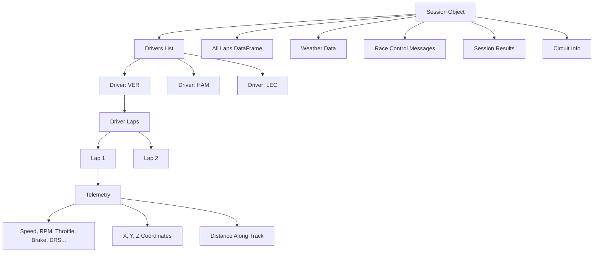
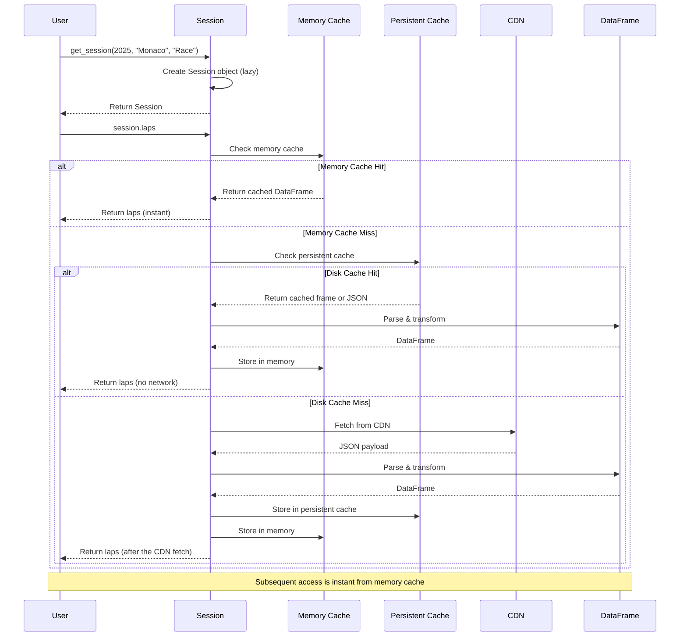

## What is a Session?

A **Session** is the fundamental data container in tif1, representing a single Formula 1 track session. Each session corresponds to one on-track activity during a Grand Prix weekend. Examples are Practice 1, Qualifying, Sprint, or the Race.

The Session object is the primary interface for access to all F1 data associated with that particular session. It provides a unified, high-performance API for data retrieval.

- **Driver information** - Complete roster of participating drivers with team affiliations, driver numbers, names, and metadata
- **Lap data** - Comprehensive lap-by-lap information for all drivers including lap times, sectors, tire compounds, track status, and more
- **Telemetry data** - High-frequency sensor data capturing speed, throttle, brake, RPM, gear, DRS, and 3D position coordinates
- **Weather conditions** - Time-series weather data including air temperature, track temperature, humidity, wind, and rainfall
- **Race control messages** - Official FIA communications including flags, penalties, safety car periods, and track status changes
- **Session results** - Final classification with driver and team details, finish status, and laps completed
- **Circuit information** - Track layout data including corner positions, angles, and circuit rotation

The Session object uses **lazy loading** and **intelligent caching** for maximum performance. Data is fetched from the CDN only on explicit access. Subsequent accesses are served instantly from cache. This architecture enables efficient work with large datasets and keeps the API simple and intuitive.

## Session Data Hierarchy

The Session data hierarchy supports efficient navigation and access to the required information.



### Data Organization

The Session object organizes data in a logical hierarchy:

1. **Session Level** - Top-level metadata, configuration, and session-wide data (weather, race control messages)
2. **Driver Level** - Individual driver information, complete lap history for each driver
3. **Lap Level** - Single lap data including lap time, sectors, tire compound, track status
4. **Telemetry Level** - Sensor data for a specific lap, sampled several times per second (about 7-8 Hz)

## Creating a Session

The primary way to create a Session object is through the `get_session()` function. This function accepts flexible parameters that identify the exact session for analysis.

### Basic Session Creation

```python
import tif1

# Create a session using event name and session type
session = tif1.get_session(2025, "Abu Dhabi Grand Prix", "Practice 1")

# You can also use round numbers instead of event names
session = tif1.get_session(2025, 1, "Race")  # Round 1 = First race of the season

# Session names are flexible - these all work:
session = tif1.get_session(2025, "Monaco", "FP1")  # Free Practice 1
session = tif1.get_session(2025, "Monaco", "Practice 1")
session = tif1.get_session(2025, "Monaco", "Qualifying")
session = tif1.get_session(2025, "Monaco", "Q")
session = tif1.get_session(2025, "Monaco", "Race")
session = tif1.get_session(2025, "Monaco", "R")
session = tif1.get_session(2025, "Monaco", "race")  # session names are case-insensitive

# Sprint sessions exist only on sprint weekends (Monaco has none)
session = tif1.get_session(2025, "Miami Grand Prix", "Sprint")
session = tif1.get_session(2025, "Miami Grand Prix", "Sprint Qualifying")
```

tif1 resolves the event name in three steps. First, it tries the exact event name. Next, it tries a table of circuit, city, and country aliases, such as `"Spa"`, `"Monza"`, and `"USA"`. Last, it uses fuzzy matching, so a typo such as `"Monacco"` resolves to Monaco. A fuzzy match needs a score of at least 70 out of 100. A name below that score raises `tif1.EventNotFoundError`, a subclass of `ValueError`. An alias for an event that is not on the calendar of that season raises `tif1.EventNotInSeasonError`, a subclass of `EventNotFoundError`.

### Performance Optimization with Polars

tif1 supports **Polars** as an alternative DataFrame backend.

```python
# Use the Polars backend for this session
session = tif1.get_session(
    2025,
    "Abu Dhabi Grand Prix",
    "Practice 1",
    lib="polars"
)

# The data properties of this session return Polars DataFrames
laps = session.laps  # Returns a Polars DataFrame
fastest = session.get_fastest_laps()  # Also Polars
```

<Note>
Polars (`polars>=2.0.0,<3`) is installed with `tif1`. If Polars is not importable, for example after a manual uninstall, tif1 automatically falls back to pandas with a warning.
</Note>

### Cache Control

By default, tif1 caches all fetched data to disk for instant subsequent access. Control the caching behavior for each session:

```python
# Disable caching for this session (always fetch fresh data)
session = tif1.get_session(
    2025,
    "Monaco Grand Prix",
    "Race",
    enable_cache=False
)

# Enable caching (default behavior)
session = tif1.get_session(
    2025,
    "Monaco Grand Prix",
    "Race",
    enable_cache=True
)
```

<Tip>
Disabling cache is useful when:
- Data pipeline changes are under test
- Cached data is possibly stale or corrupted
- A fresh fetch from the CDN is required
- Live or recent sessions may have updated data
</Tip>

### Global Configuration

Set default values for `lib` and `enable_cache` globally with the config system:

```python
import tif1

# Set global defaults
tif1.get_config().set("lib", "polars")
tif1.get_config().set("enable_cache", True)

# All subsequent sessions will use these defaults
polars_session = tif1.get_session(2025, "Silverstone", "Race")  # Uses polars + cache
print(polars_session.lib)  # 'polars'

# Restore the pandas default (the examples below use pandas)
tif1.get_config().set("lib", "pandas")
```

## Session Properties

Session properties provide read-only access to various data types. All properties use lazy loading. Data is fetched only on first access to the property.

### drivers

Returns a list of driver numbers as strings, in classification order (as in FastF1). `session.drivers[:10]` is the top ten. The 3-letter codes are in `session.drivers_df["Driver"]`, in the same order.

For seasons whose upstream driver file is sorted by car number only, tif1 rebuilds the order from the laps. That order can miss a post-race penalty.

```python
drivers = session.drivers
# 2025 Bahrain Grand Prix race:
# ['81', '63', '4', '16', '44', '1', '10', '31', '22', '87', ...]

# Iterate over all drivers
for driver_number in session.drivers:
    print(f"Driver #{driver_number}")
```

**Returns:** `list[str]` - List of driver numbers as strings

### driver_list

Alias for `drivers` property. Returns the same list of driver numbers.

```python
driver_list = session.driver_list
# ['81', '63', '4', '16', '44', '1', '10', '31', '22', '87', ...]
```

**Returns:** `list[str]` - List of driver numbers as strings

### drivers_df

Returns comprehensive driver information as a DataFrame. This is the most detailed driver data available, including names, teams, colors, and headshot URLs. The rows are in the same classification order as `session.drivers`.

```python
drivers_df = session.drivers_df

# Available columns:
# - Driver: 3-letter driver code (e.g., 'VER', 'HAM', 'LEC')
# - Team: Full team name (e.g., 'Red Bull Racing')
# - DriverNumber: Driver's racing number as string
# - FirstName: Driver's first name
# - LastName: Driver's last name
# - TeamColor: Hex color code for team without a leading '#' (e.g., '3671C6')
# - HeadshotUrl: URL to driver's official headshot image

# Example usage
print(drivers_df[["Driver", "Team", "DriverNumber"]])
# Output for the 2025 Bahrain Grand Prix race:
#   Driver      Team DriverNumber
# 0    PIA   McLaren           81
# 1    RUS  Mercedes           63
# 2    NOR   McLaren            4
# 3    LEC   Ferrari           16
# ...

# Filter by team
red_bull_drivers = drivers_df[drivers_df["Team"] == "Red Bull Racing"]

# Get specific driver info
verstappen = drivers_df[drivers_df["Driver"] == "VER"].iloc[0]
print(f"{verstappen['FirstName']} {verstappen['LastName']}")  # Max Verstappen
```

**Returns:** `pandas.DataFrame` - DataFrame with 7 columns (Driver, Team, DriverNumber, FirstName, LastName, TeamColor, HeadshotUrl)

### laps

Returns all laps for all drivers in the session. This is one of the most important properties, containing comprehensive lap-by-lap data.

**Key Features:**
- Includes the weather sample that the source data matched to each lap (`WeatherTime`, `AirTemp`, and the other weather columns). The match is misaligned for many laps, so use `laps.get_weather_data()` for the sample of a lap
- Contains sector times, lap times, tire compounds, track status
- Includes position data, pit stop information, and more
- Returns pandas or Polars DataFrame depending on session configuration

```python
laps = session.laps  # pandas or polars DataFrame

# Available columns (varies by session type). Time-like columns are
# timedelta64 on pandas and Duration on polars:
# - Time: Session time when the lap ended
# - Driver: 3-letter driver code
# - DriverNumber: Driver's racing number
# - LapTime: Lap time
# - LapTimeSeconds: Lap time as float seconds on both backends
# - LapNumber: Sequential lap number
# - Stint: Stint number
# - PitOutTime: Time exiting pit lane
# - PitInTime: Time entering pit lane
# - Sector1Time: Sector 1 time
# - Sector2Time: Sector 2 time
# - Sector3Time: Sector 3 time
# - Sector1SessionTime: Session time at sector 1
# - Sector2SessionTime: Session time at sector 2
# - Sector3SessionTime: Session time at sector 3
# - SpeedI1: Speed at intermediate 1 (km/h)
# - SpeedI2: Speed at intermediate 2 (km/h)
# - SpeedFL: Speed at finish line (km/h)
# - SpeedST: Speed at speed trap (km/h)
# - IsPersonalBest: Boolean indicating personal best lap
# - Compound: Tire compound (SOFT, MEDIUM, HARD, INTERMEDIATE, WET)
# - TyreLife: Age of tires in laps
# - FreshTyre: Boolean indicating new tires
# - LapStartTime: Session time when lap started
# - Team: Team name
# - LapStartDate: Absolute timestamp of lap start
# - TrackStatus: Track status code
# - Position: Driver's position
# - Deleted: Boolean indicating if lap was deleted
# - DeletedReason: Reason for lap deletion
# - FastF1Generated: Boolean indicating if lap was interpolated
# - IsAccurate: Boolean indicating data accuracy
# - WeatherTime: Time of the matched weather sample
# - AirTemp: Air temperature (°C) - from weather data
# - Humidity: Relative humidity (%) - from weather data
# - Pressure: Atmospheric pressure (mbar) - from weather data
# - Rainfall: Boolean indicating rain - from weather data
# - TrackTemp: Track surface temperature (°C) - from weather data
# - WindDirection: Wind direction (degrees) - from weather data
# - WindSpeed: Wind speed (m/s) - from weather data

# The examples below use pandas. On polars, laps[mask] selects columns,
# so filter rows with laps.filter(pl.col("Driver") == "VER") instead.

# Example: Get all laps for a specific driver
ver_laps = laps[laps["Driver"] == "VER"]

# Example: Filter by compound
soft_tire_laps = laps[laps["Compound"] == "SOFT"]

# Example: Get fastest lap per driver (drop laps without a time first:
# idxmin raises for a driver who has no timed lap)
timed = laps.dropna(subset=["LapTime"])
fastest_laps = timed.loc[timed.groupby("Driver", observed=True)["LapTime"].idxmin()]

# Example: Analyze sector times
print(laps[["Driver", "LapNumber", "Sector1Time", "Sector2Time", "Sector3Time"]].head())
```

**Returns:** `Laps` (a pandas DataFrame subclass) or a Polars DataFrame - All laps, with the weather columns

<Warning>
The `laps` property triggers a network fetch on first access if data is not cached. For sessions with many laps, such as race sessions, this may take a few seconds.
</Warning>

### weather

Returns time-series weather data recorded throughout the session. Weather data is sampled at regular intervals (about once per minute).

```python
weather = session.weather

# Available columns:
# - Time: Time offset from session start (timedelta)
# - AirTemp: Air temperature in Celsius
# - Humidity: Relative humidity (0-100%)
# - Pressure: Atmospheric pressure in millibars
# - Rainfall: Boolean indicating if it's raining
# - TrackTemp: Track surface temperature in Celsius
# - WindDirection: Wind direction in degrees (0-360)
# - WindSpeed: Wind speed in meters per second

# Example: Check if it rained during the session
if weather["Rainfall"].any():
    print("Rain detected during session!")

# Example: Plot temperature evolution (Time is a timedelta; plot minutes)
import matplotlib.pyplot as plt
minutes = weather["Time"].dt.total_seconds() / 60
plt.plot(minutes, weather["TrackTemp"], label="Track Temp")
plt.plot(minutes, weather["AirTemp"], label="Air Temp")
plt.xlabel("Session time (min)")
plt.legend()
plt.show()

# Example: Find maximum wind speed
max_wind = weather["WindSpeed"].max()
print(f"Maximum wind speed: {max_wind:.1f} m/s")
```

**Returns:** `DataFrame` (pandas or Polars) - Weather data time series

<Note>
Each row of `session.laps` carries a weather sample that the source data matched to the lap, but that match is misaligned for many laps. `laps.get_weather_data()` picks the sample of each lap from `session.weather` with the fastf1 rule. Use `session.weather` for the full weather time series.
</Note>

<Note>
`Time` is `timedelta64[ns]` on pandas and `Duration("ns")` on polars. `Rainfall` is a nullable boolean and `WindDirection` a nullable integer on both backends. When the weather payload cannot be converted, tif1 logs a warning and returns an empty DataFrame. See [Empty weather or race control tables](/concepts/backends#empty-weather-or-race-control-tables).
</Note>

### weather_data

Alias for the `weather` property. Provides FastF1 API compatibility.

```python
weather_data = session.weather_data  # Same as session.weather
```

**Returns:** `DataFrame` (pandas or Polars) - Weather data time series

### race_control_messages

Returns official FIA race control messages issued during the session. These messages include flags, penalties, investigations, safety car periods, and other official communications.

```python
messages = session.race_control_messages

# Available columns:
# - Time: Message timestamp (datetime)
# - Category: Message category (e.g., 'Flag', 'SafetyCar', 'Drs')
# - Message: Full message text
# - Status: Status indicator
# - Flag: Flag type (e.g., 'GREEN', 'CLEAR', 'DOUBLE YELLOW', 'CHEQUERED', 'BLACK AND WHITE')
# - Scope: Scope of message ('Track', 'Sector', 'Driver')
# - Sector: Affected sector number (if applicable)
# - RacingNumber: Affected driver number (if applicable)
# - Lap: Lap number when message was issued (0 when unknown on pandas, null on polars)

# Example: Find all yellow flag incidents
yellow_flags = messages[messages["Flag"].isin(["YELLOW", "DOUBLE YELLOW"])]
print(yellow_flags[["Time", "Message", "Sector"]])

# Example: Find all driver-specific messages (penalties, investigations, warnings)
driver_messages = messages[messages["RacingNumber"].notna()]
print(driver_messages[["Time", "RacingNumber", "Message"]])

# Example: Track safety car periods
safety_car = messages[messages["Category"] == "SafetyCar"]
print(safety_car[["Time", "Message"]])
```

**Returns:** `DataFrame` (pandas or Polars) - Race control messages

### results

Returns the final classification with driver information, one row per driver in classification order. This property provides a FastF1-compatible `SessionResults` object.

```python
results = session.results

# Available columns:
# - DriverNumber: Driver's racing number
# - Abbreviation: 3-letter driver code
# - TeamName: Full team name
# - TeamColor: Hex color code without a leading '#' (e.g., '3671C6')
# - FirstName: Driver's first name
# - LastName: Driver's last name
# - FullName: Full name (FirstName + LastName)
# - HeadshotUrl: URL to driver headshot
# - Position: Classified position as a float (1.0 to N)
# - ClassifiedPosition: The same position as a string ("1" to "N")
# - GridPosition: Grid position (float)
# - Status: Finish status (e.g., 'Finished', '+1 Lap', 'Retired')
# - Points: Points scored (float)
# - Laps: Number of laps completed (float)

# Example: Get podium finishers (the index is the driver number)
podium = results[results["Position"] <= 3]
print(podium[["Position", "Abbreviation", "TeamName"]])
# Output for the 2025 Bahrain Grand Prix race:
#     Position Abbreviation  TeamName
# 81       1.0          PIA   McLaren
# 63       2.0          RUS  Mercedes
# 4        3.0          NOR   McLaren

# Example: Find drivers with a status other than "Finished"
not_on_lead_lap = results[results["Status"] != "Finished"]
print(not_on_lead_lap[["Abbreviation", "Status", "Laps"]])
```

Race, Sprint, and Qualifying sessions take `Status` and the times from the official Ergast classification. In the 2025 Bahrain race, `Status` is `"Retired"` for SAI and `"Disqualified"` for HUL. Races and sprints also take `GridPosition` and `Points` from it. In every other session, and with `ergast=False`, `GridPosition` and `Points` are NaN (polars: null).

The other sessions are classified from the laps, as fastf1 does:
- Practice: `Position` by best lap, `Status` `"Finished"` for every driver, `Laps`, and `Time`, the best lap that is not deleted. `get_driver()` returns the same row.
- Sprint Qualifying and Sprint Shootout: the best accurate lap of each segment fills `Q1` to `Q3`. The order is by `Q3`, then `Q2`, then `Q1`. A driver out in Q1 outside 107% of the best Q1 time has `ClassifiedPosition` `"N"`. The knockout applies. A driver out in Q1 has no `Q2` or `Q3` time, and a driver out in Q2 has no `Q3` time. The Q1 cut is 15 of 20 cars or 16 of 22. For the 2024 Chinese Sprint Qualifying, the top three are NOR, HAM, and ALO.
- With `ergast=False`, qualifying follows the same segment rule, and races and sprints use the lap count for `Status`: `"Finished"`, `"+N Laps"`, or `"Did not start"`.

Practice and the sprint qualifying formats take `DriverId` and `TeamId` from the Ergast race results. `results.iloc[i].dnf` is `True` unless the status is `"Finished"`, `"Lapped"`, or `"+N Lap(s)"`.

**Returns:** `SessionResults` (pandas DataFrame subclass, indexed by driver number). On a polars session it is a `PolarsSessionResults`, with `DriverNumber` as a column - Session results

### car_data

Returns the telemetry of each driver for the whole session, as fastf1 does. The value is a lazy dict (`LazyTelemetryDict`) keyed by driver number. Driver abbreviations are accepted as keys too. Nothing is fetched until a key is read. `len()`, iteration, and `in` use the driver list only.

tif1 resolves the car numbers before it builds the keys. A session whose `drivers.json` has no numbers (the 2024 Belgian Grand Prix) still has number keys. The later drivers of a shared car have `number/Abbreviation` keys, as in `results`. Each frame lists every lap of the driver in session order, with each lap-boundary sample once. Its `Time` is the session clock, as in fastf1: it equals `SessionTime`.

```python
car_data = session.car_data  # nothing is fetched yet
print(len(car_data), list(car_data)[:3])  # 20 ['81', '63', '4'] for the 2025 Bahrain race

# Reading a key fetches every lap of that driver, joined in session order
ver = car_data["1"]  # car_data["VER"] gives the same frame

# Available columns (fastf1 order, then the tif1 extras):
# - Date, SessionTime: Wall-clock date and session time of the sample
# - DriverAhead, DistanceToDriverAhead: Number of the car ahead (string) and the gap (meters)
# - Time: Session time, equal to SessionTime (timedelta on pandas, Duration on polars)
# - RPM, Speed (km/h), nGear, Throttle (0-100%)
# - Brake: Brake applied (bool on pandas, Boolean on polars)
# - DRS: DRS flag (0 = closed, 1 = open)
# - Source, Status: "merged" and "OnTrack"
# - Distance, RelativeDistance: Distance along each lap (meters, fraction of lap)
# - X, Y, Z: Position on track
# - AccelerationX, AccelerationY, AccelerationZ: Acceleration components
# - Driver, LapNumber: Lap the sample belongs to

# Example: Analyze speed distribution
import matplotlib.pyplot as plt
plt.hist(ver["Speed"], bins=50)
plt.xlabel("Speed (km/h)")
plt.ylabel("Frequency")
plt.show()

# Example: Find maximum speed (pandas session)
max_speed = ver["Speed"].max()
top_speed_lap = ver[ver["Speed"] == max_speed]["LapNumber"].iloc[0]
print(f"Maximum speed: {max_speed:.1f} km/h on lap {top_speed_lap}")
```

**Returns:** `LazyTelemetryDict` - One `Telemetry` (a `PolarsTelemetry` on a polars session) per driver

<Warning>
Each key holds every lap of one driver (about 44,000 samples for a race). The first read of a key fetches one telemetry file per lap of that driver. Use `lap.telemetry` or `session.get_fastest_lap_tel()` when one lap is enough.
</Warning>

### pos_data

The same dict as `car_data`. `pos_data[n]` and `car_data[n]` hold the same merged frame, because tif1 telemetry carries the car channels and the position channels together.

```python
pos_data = session.pos_data  # the same dict as session.car_data
```

**Returns:** `LazyTelemetryDict` - The same object as `car_data`

### session_info

Returns the fastf1 `session_info` dict. tif1 builds it from the schedule row and a packaged circuit table, so reading it sends no request beyond the schedule lookup. `Key`, `Meeting.Key`, `Path`, and `ArchiveStatus` are always `None`. `EndDate` is `StartDate` plus a nominal duration (two hours for a race).

```python
info = session.session_info
# For the 2025 Bahrain Grand Prix race:
# {
#     'Meeting': {
#         'Key': None,
#         'Name': 'Bahrain Grand Prix',
#         'OfficialName': 'FORMULA 1 GULF AIR BAHRAIN GRAND PRIX 2025',
#         'Location': 'Sakhir',
#         'Country': {'Key': 36, 'Code': 'BRN', 'Name': 'Bahrain'},
#         'Circuit': {'Key': 63, 'ShortName': 'Sakhir'},
#     },
#     'ArchiveStatus': None,
#     'Key': None,
#     'Type': 'Race',
#     'Name': 'Race',
#     'StartDate': Timestamp('2025-04-13 18:00:00'),
#     'EndDate': Timestamp('2025-04-13 20:00:00'),
#     'GmtOffset': Timedelta('0 days 03:00:00'),
#     'Path': None,
# }

print(f"Analyzing {info['Meeting']['Name']} {info['Name']} ({info['Type']})")
```

**Returns:** `dict[str, Any]` - Session metadata in the fastf1 layout

### track_status and session_status

fastf1 reads these two tables from the live-timing streams. tif1 derives them from the race control messages, so the times are exact and the codes are inferred. The codes and messages are the fastf1 ones. `session_status` never contains `Finalised` or `Ends`.

```python
print(session.track_status.head(3))
# For the 2025 Bahrain Grand Prix race:
#                     Time Status     Message
# 0        0 days 00:00:00      1    AllClear
# 1 0 days 01:47:54.733000      4  SCDeployed
# 2 0 days 01:55:40.733000      1    AllClear

print(session.session_status)
#                     Time    Status
# 0 0 days 00:51:45.733000   Started
# 1 0 days 02:31:14.733000  Finished
```

`Time` is the session time: add `session.t0_date` to get the wall-clock date. Refer to the [Core API](/api-reference/core) for the status codes and `session_start_time`.

**Returns:** `DataFrame` (pandas or Polars) - `Time`, `Status`, and `Message` (`track_status`); `Time` and `Status` (`session_status`)

### name

Returns the human-readable session name (URL-decoded).

```python
name = session.name
# 'Practice 1' or 'Qualifying' or 'Race'
```

**Returns:** `str` - Session name

### event_name and session_name

Return the readable event and session names. `session.gp` and `session.session` keep the URL-encoded forms, because tif1 builds every CDN path from them.

```python
print(session.event_name)    # 'Monaco Grand Prix'
print(session.session_name)  # 'Race'
print(session.gp)            # 'Monaco%20Grand%20Prix' (URL-encoded)
```

**Returns:** `str` - Event name or session name

### date

Returns the session date as a pandas Timestamp.

```python
date = session.date
# Timestamp('2025-05-25 15:00:00') for the 2025 Monaco Grand Prix race (local start time)

print(f"Session held on: {date.strftime('%Y-%m-%d')}")
```

**Returns:** `pandas.Timestamp` or `pd.NaT` - Session date

### event

Returns the Event object for this session's Grand Prix. The Event object contains schedule information for all sessions in the weekend.

```python
event = session.event

# Access other sessions from the same weekend
print(event.Session1)  # 'Practice 1'
print(event.Session1Date)  # 2025-05-23 13:30:00+02:00 (local time with UTC offset)
print(event.Session2)  # 'Practice 2'
# ... etc
```

**Returns:** `Event` - Event object for the Grand Prix weekend

## Session Methods

Session methods provide powerful functionality for data analysis, filtering, and retrieval.

### load()

Explicitly load session data with fine-grained control over what gets fetched. This method is useful to pre-fetch data or to control exactly what data is loaded.

**Signature:**
```python
def load(
    self,
    laps: bool = True,
    telemetry: bool = True,
    weather: bool = True,
    messages: bool = True
) -> Session
```

**Parameters:**
- `laps` (bool): If True, fetch laps data. Default: True
- `telemetry` (bool): If True, fetch telemetry for all laps. Automatically sets laps=True. Default: True
- `weather` (bool): If True, fetch weather data. Default: True
- `messages` (bool): If True, fetch race control messages. Default: True

**Returns:** `Session` - Returns self for method chaining

**Examples:**

```python
# Load everything (default behavior)
session = tif1.get_session(2025, "Silverstone", "Race")
session.load()  # Fetches laps, telemetry, weather, and messages

# Load only laps and weather (skip telemetry and messages)
session.load(laps=True, telemetry=False, weather=True, messages=False)

# Load only laps (minimal data)
session.load(laps=True, telemetry=False, weather=False, messages=False)

# Method chaining
session = tif1.get_session(2025, "Monaco", "Qualifying").load()
fastest = session.get_fastest_laps()
```

<Note>
When `telemetry=True` is requested but `laps=False`, the method automatically sets `laps=True` because telemetry requires lap data to function properly.
</Note>

<Warning>
Loading telemetry for all laps (`telemetry=True`) can be time-consuming and memory-intensive for race sessions. Such sessions have 20 drivers and 50+ laps each. Consider loading telemetry selectively using driver-specific or lap-specific methods instead.
</Warning>

### get_driver()

Get a Driver object for a specific driver. The Driver object provides convenient access to that driver's laps and telemetry.

**Signature:**
```python
def get_driver(self, identifier: Any = None, *, driver: Any = None) -> Driver
```

**Parameters:**
- `identifier` (Any): 3-letter driver code (for example, 'VER', 'HAM', 'LEC') or the driver number as a string or an int ('1' or 1). The full name and the `number/Abbreviation` label of a shared car also work. FastF1-style driver objects with a `driver` or `Abbreviation` attribute also work. `driver=` is the earlier tif1 name of this argument

**Returns:** `Driver` - The `results` row of the driver, with laps and telemetry access. For a car that two drivers shared (before the 1960s), the car number gives the first driver and the `number/Abbreviation` label gives the other one.

**Raises:** `DriverNotFoundError`, also a `ValueError` as in fastf1, for an unknown identifier.

**Examples:**

```python
# Get a specific driver
ver = session.get_driver("VER")

# Access driver's laps
ver_laps = ver.laps
print(f"Verstappen completed {len(ver_laps)} laps")

# Get driver's fastest lap
fastest_lap = ver.laps.loc[ver.laps["LapTime"].idxmin()]
print(f"Fastest lap: {fastest_lap['LapTime']}")

# Access telemetry for a specific lap
lap_5_tel = ver.laps.iloc[4].telemetry  # 5th lap (0-indexed)
print(lap_5_tel[["Distance", "Speed", "Throttle"]].head())

# Compare multiple drivers
ham = session.get_driver("HAM")
lec = session.get_driver("LEC")

ver_fastest = ver.laps["LapTime"].min()
ham_fastest = ham.laps["LapTime"].min()
lec_fastest = lec.laps["LapTime"].min()

print(f"VER: {ver_fastest}, HAM: {ham_fastest}, LEC: {lec_fastest}")
```

<Tip>
The `get_driver()` method uses prefetching. On the first call, it fetches the driver list and the session lap table in parallel. This reduces the wait for the first driver lookup.
</Tip>

### get_fastest_laps()

Get the fastest lap(s) from the session. This method can return either the fastest lap per driver or the single overall fastest lap.

**Signature:**
```python
def get_fastest_laps(
    self,
    by_driver: bool = True,
    drivers: list[str] | None = None
) -> DataFrame
```

**Parameters:**
- `by_driver` (bool): If True, return fastest lap per driver. If False, return single overall fastest lap. Default: True
- `drivers` (list[str] | None): Optional list of driver codes to filter. If None, includes all drivers. Default: None

**Returns:** `Laps` (a `PolarsLaps` on polars) - Fastest lap(s) with all lap data columns, bound to the session whether `session.laps` was read first or not. A deleted lap is never a fastest lap

**Examples:**

```python
# Get fastest lap for each driver
fastest_by_driver = session.get_fastest_laps(by_driver=True)
print(fastest_by_driver[["Driver", "LapTime", "Compound"]])
# Output for the 2025 Bahrain Grand Prix race (sorted by LapTime):
#   Driver                LapTime Compound
# 0    PIA 0 days 00:01:35.140000   MEDIUM
# 1    RUS 0 days 00:01:35.518000     SOFT
# 2    NOR 0 days 00:01:35.728000   MEDIUM
# ...

# Get the single overall fastest lap
overall_fastest = session.get_fastest_laps(by_driver=False)
print(f"Fastest lap by {overall_fastest['Driver'].iloc[0]}: {overall_fastest['LapTime'].iloc[0]}")

# Get fastest laps for specific drivers only
top3_fastest = session.get_fastest_laps(by_driver=True, drivers=["VER", "HAM", "LEC"])

# Analyze fastest lap compounds
fastest_by_driver = session.get_fastest_laps()
compound_counts = fastest_by_driver["Compound"].value_counts()
print(f"Fastest laps by compound:\n{compound_counts}")

# Find who set fastest lap on which compound
for _, lap in fastest_by_driver.iterrows():
    print(f"{lap['Driver']}: {lap['LapTime']} on {lap['Compound']}")
```

<Note>
This method skips laps without a `LapTime` and deleted laps (`Deleted == True`). A driver whose timed laps were all deleted is not in the result.
</Note>

### get_fastest_lap_tel()

Get telemetry for the overall fastest lap in the session. This is a convenience method that combines finding the fastest lap and fetching its telemetry.

**Signature:**
```python
def get_fastest_lap_tel(self, ultra_cold: bool | None = None) -> DataFrame
```

**Parameters:**
- `ultra_cold` (bool | None): Force the ultra-cold fetch path on or off. `None` uses the `ultra_cold_start` config key. Default: None

**Returns:** `DataFrame` - Telemetry data for the fastest lap

**Examples:**

```python
# Get telemetry for the fastest lap
fastest_tel = session.get_fastest_lap_tel()

# Analyze speed profile
import matplotlib.pyplot as plt
plt.plot(fastest_tel["Distance"], fastest_tel["Speed"])
plt.xlabel("Distance (m)")
plt.ylabel("Speed (km/h)")
plt.title("Fastest Lap Speed Profile")
plt.show()

# Find maximum speed on fastest lap
max_speed = fastest_tel["Speed"].max()
print(f"Maximum speed on fastest lap: {max_speed:.1f} km/h")

# Analyze throttle application
full_throttle_pct = (fastest_tel["Throttle"] == 100).sum() / len(fastest_tel) * 100
print(f"Full throttle: {full_throttle_pct:.1f}% of lap")

# Find braking zones
braking = fastest_tel[fastest_tel["Brake"] > 0]
print(f"Braking points: {len(braking)} samples")
```

<Tip>
On a session without cached data, before any other data access, this method uses the ultra-cold path. It finds the fastest lap in the raw lap payloads and skips cache reads and validation. Then it fetches one telemetry file.
</Tip>

### get_fastest_laps_tels()

Fetch telemetry for multiple drivers' fastest laps in parallel. This is significantly faster than fetching telemetry sequentially.

**Signature:**
```python
def get_fastest_laps_tels(
    self,
    by_driver: bool = True,
    drivers: list[str] | None = None
) -> DataFrame
```

**Parameters:**
- `by_driver` (bool): If True, fetch telemetry for each driver's fastest lap. If False, fetch only the overall fastest lap. Default: True
- `drivers` (list[str] | None): Optional list of driver codes to filter. If None, includes all drivers. Default: None

**Returns:** `DataFrame` - One telemetry frame for all requested laps, with `Driver` and `LapNumber` columns. It is not a dict; group by `Driver` to get one frame per driver.

**Examples:**

```python
# Get telemetry for all drivers' fastest laps (parallel fetching)
fastest_tels = session.get_fastest_laps_tels(by_driver=True)

# Access specific driver's telemetry
ver_tel = fastest_tels[fastest_tels["Driver"] == "VER"]
ham_tel = fastest_tels[fastest_tels["Driver"] == "HAM"]

# Compare speed profiles
import matplotlib.pyplot as plt
plt.plot(ver_tel["Distance"], ver_tel["Speed"], label="VER")
plt.plot(ham_tel["Distance"], ham_tel["Speed"], label="HAM")
plt.legend()
plt.xlabel("Distance (m)")
plt.ylabel("Speed (km/h)")
plt.show()

# Get telemetry for specific drivers only
top3_tels = session.get_fastest_laps_tels(by_driver=True, drivers=["VER", "HAM", "LEC"])

# Analyze all drivers' maximum speeds (polars: for (driver,), tel in fastest_tels.group_by("Driver"))
for driver, tel in fastest_tels.groupby("Driver"):
    max_speed = tel["Speed"].max()
    print(f"{driver}: {max_speed:.1f} km/h")

# Find who had the highest top speed
max_speeds = fastest_tels.groupby("Driver")["Speed"].max()
fastest_driver = max_speeds.idxmax()
print(f"Highest top speed: {fastest_driver} at {max_speeds[fastest_driver]:.1f} km/h")
```

<Note>
This method uses asynchronous parallel fetching internally, which makes it much faster than calling `get_driver(driver).laps.pick_fastest().telemetry` for each driver sequentially.
</Note>

### laps_async()

Load all laps from async code. The `session.laps` property runs the same coroutine through `asyncio.run()`, so use this method inside an async application.

**Signature:**
```python
async def laps_async(self) -> DataFrame
```

**Returns:** `Laps` (a `PolarsLaps` on a polars session) - All laps, the same object that `session.laps` returns.

**Examples:**

```python
import asyncio
import tif1

async def analyze_session():
    session = tif1.get_session(2025, "Monaco", "Race")

    # Load laps asynchronously
    laps = await session.laps_async()

    # Analyze data (pandas): fastest timed lap per driver
    timed = laps.dropna(subset=["LapTime"])
    fastest = timed.loc[timed.groupby("Driver", observed=True)["LapTime"].idxmin()]
    return fastest

# Run the async function
fastest_laps = asyncio.run(analyze_session())
print(fastest_laps[["Driver", "LapTime"]])

# Use in an existing async context
async def main():
    session = tif1.get_session(2025, "Silverstone", "Qualifying")
    laps = await session.laps_async()
    print(f"Loaded {len(laps)} laps")

asyncio.run(main())
```

<Tip>
Outside an async context, use the `session.laps` property instead. It runs the same coroutine.
</Tip>

### get_circuit_info()

Get circuit layout information including corner positions, angles, and track rotation.

**Signature:**
```python
def get_circuit_info(self) -> CircuitInfo
```

**Returns:** `CircuitInfo` - Dataclass with circuit information

**CircuitInfo Attributes:**
- `corners` (DataFrame): Corner data with columns X, Y, Number, Letter, Angle, Distance
- `marshal_lights` (DataFrame): Marshal light positions, with the same columns
- `marshal_sectors` (DataFrame): Marshal sector positions, with the same columns
- `rotation` (float): Circuit rotation in degrees
- tif1 extras: `circuit_key`, `circuit_name`, `location`, `country`, `country_code`, `country_key`, `pit_loss`, `track`, `sections`, `mini_sector_index`, and `source`

The data comes from the `corners.json` file of the session. The files of the 2021-2024 seasons have no marshal data. For those seasons, and when the file is missing, the MultiViewer API fills the marshal frames and the corner letters. Seasons before 2018 have no file, so they get the earliest MultiViewer layout of the circuit. A circuit that MultiViewer does not know gets empty frames. `source` names the origin: `"corners.json"`, `"multiviewer"`, both joined by `+`, or `""` when neither source answered.

**Examples:**

```python
# Get circuit information
circuit_info = session.get_circuit_info()

# Access corner data
corners = circuit_info.corners
print(corners[["Number", "X", "Y", "Angle"]])
# Output for the 2025 Bahrain Grand Prix:
#    Number           X            Y       Angle
# 0       1   42.405939  8329.202564 -246.615311
# 1       2  820.781621  7879.043841 -101.177469
# ...

# Get circuit rotation (a float in degrees)
rotation = circuit_info.rotation
print(f"Circuit rotation: {rotation}°")

# Plot circuit layout
import matplotlib.pyplot as plt
plt.scatter(corners["X"], corners["Y"], c=corners["Number"], cmap="viridis")
plt.colorbar(label="Corner Number")
plt.xlabel("X (m)")
plt.ylabel("Y (m)")
plt.title("Circuit Layout")
plt.axis("equal")
plt.show()

# Find sharpest corner
sharpest = corners.loc[corners["Angle"].abs().idxmax()]
print(f"Sharpest corner: #{sharpest['Number']} at {sharpest['Angle']:.1f}°")
```

<Note>
Circuit information is cached after the first call, so subsequent calls are instant.
</Note>

### fetch_all_laps_telemetry()

Fetch telemetry for all laps of all drivers in parallel. `session.car_data[driver]` loads the same payloads for one driver and joins them into one DataFrame; this method returns one frame per lap.

**Signature:**
```python
def fetch_all_laps_telemetry(self, *, ultra_cold: bool | None = None) -> dict[tuple[str, int], DataFrame]
```

**Parameters:**
- `ultra_cold` (bool | None): Skip validation and persistent-cache reads for a faster cold start. Fetched payloads are still written to the cache. `None` turns it on when the session has no cached data yet. Default: None

**Returns:** `dict[tuple[str, int], DataFrame]` - Mapping of `(driver_code, lap_number)` to that lap's telemetry. Laps without telemetry are absent from the dict.

**Examples:**

```python
import pandas as pd

# Explicitly fetch all telemetry
all_laps_tel = session.fetch_all_laps_telemetry()
ver_lap_10 = all_laps_tel[("VER", 10)]

# Keep only one driver by filtering the keys
ver_tels = {key: tel for key, tel in all_laps_tel.items() if key[0] == "VER"}

# One frame for the whole session (pandas; polars: pl.concat(all_laps_tel.values()))
all_telemetry = pd.concat(all_laps_tel.values(), ignore_index=True)

# Analyze telemetry statistics
print(f"Total telemetry samples: {len(all_telemetry)}")
print(f"Average speed: {all_telemetry['Speed'].mean():.1f} km/h")
print(f"Maximum RPM: {all_telemetry['RPM'].max():.0f}")
```

<Warning>
This method fetches telemetry for ALL laps, which can be very slow and memory-intensive. Use sparingly and consider driver-specific or lap-specific methods instead.
</Warning>

## Session Types and Formats

tif1 supports all official Formula 1 session types across different weekend formats.

### Standard Race Weekend

A typical F1 race weekend consists of:

1. **Practice 1 (FP1)** - Friday morning, 60 minutes
2. **Practice 2 (FP2)** - Friday afternoon, 60 minutes
3. **Practice 3 (FP3)** - Saturday morning, 60 minutes
4. **Qualifying (Q)** - Saturday afternoon, ~60 minutes (Q1, Q2, Q3)
5. **Race (R)** - Sunday, up to 2 hours

```python
# Access all sessions from a standard weekend
fp1 = tif1.get_session(2025, "Silverstone", "Practice 1")
fp2 = tif1.get_session(2025, "Silverstone", "Practice 2")
fp3 = tif1.get_session(2025, "Silverstone", "Practice 3")
qualifying = tif1.get_session(2025, "Silverstone", "Qualifying")
race = tif1.get_session(2025, "Silverstone", "Race")
```

### Sprint Weekend

Sprint weekends have a modified format:

1. **Practice 1 (FP1)** - Friday, 60 minutes
2. **Sprint Qualifying (SQ)** - Friday, ~45 minutes (SQ1, SQ2, SQ3)
3. **Sprint (S)** - Saturday, ~30 minutes (~100km race)
4. **Qualifying (Q)** - Saturday, ~60 minutes (Q1, Q2, Q3)
5. **Race (R)** - Sunday, up to 2 hours

```python
# Access sprint weekend sessions (Spa was a 2025 sprint weekend)
fp1 = tif1.get_session(2025, "Spa", "Practice 1")
sprint_qualifying = tif1.get_session(2025, "Spa", "Sprint Qualifying")
sprint = tif1.get_session(2025, "Spa", "Sprint")
qualifying = tif1.get_session(2025, "Spa", "Qualifying")
race = tif1.get_session(2025, "Spa", "Race")
```

### Session Name Variations

tif1 accepts multiple variations of session names for convenience:

| Official Name | Accepted Variations |
|--------------|-------------------|
| Practice 1 | `"Practice 1"`, `"FP1"` |
| Practice 2 | `"Practice 2"`, `"FP2"` |
| Practice 3 | `"Practice 3"`, `"FP3"` |
| Qualifying | `"Qualifying"`, `"Q"` |
| Sprint Qualifying (2024 onward) | `"Sprint Qualifying"`, `"SQ"` |
| Sprint Shootout (2023) | `"Sprint Shootout"`, `"SS"` |
| Sprint | `"Sprint"`, `"S"` |
| Race | `"Race"`, `"R"` |

Matching is case-insensitive, so `"fp1"`, `"race"`, and `"r"` work as well. Other spellings, such as `"Free Practice 1"` or `"Quali"`, raise `ValueError`. A session that the event does not have also raises `ValueError`, for example `"Sprint"` on a weekend without a sprint.

```python
# All of these work:
session = tif1.get_session(2025, "Monaco", "Practice 1")
session = tif1.get_session(2025, "Monaco", "FP1")
session = tif1.get_session(2025, "Monaco", "fp1")

session = tif1.get_session(2025, "Monaco", "Qualifying")
session = tif1.get_session(2025, "Monaco", "Q")

session = tif1.get_session(2025, "Monaco", "Race")
session = tif1.get_session(2025, "Monaco", "R")
```

## Data Loading Architecture

Knowledge of the tif1 data loading process helps with performance optimization and troubleshooting.

### Lazy Loading

Sessions use **lazy loading** for optimal performance. When a Session object is created, no data is fetched immediately. Data is retrieved only on explicit access.

```python
# Create session - no session data is fetched yet
session = tif1.get_session(2025, "Bahrain Grand Prix", "Race")
print("Session created")  # Instant

# Access laps - triggers network fetch (if not cached)
laps = session.laps  # Data fetched now
print("Laps loaded")

# Subsequent access is instant from memory cache
laps_again = session.laps  # Instant - no network request
```

**Benefits of Lazy Loading:**
- **Fast initialization** - Session objects are created instantly
- **Efficient memory usage** - Only requested data is loaded
- **Flexible workflows** - Load only the data that the analysis requires
- **Reduced network traffic** - Avoid fetching unused data

### Caching Strategy

tif1 implements a **multi-tier caching system** for maximum performance:

#### 1. Memory Cache (L1)
- The session memo inside the Session object, plus process-wide LRU caches for lap tables and payloads
- No disk or network access
- The session memo is released with the Session object
- Automatic and transparent

#### 2. Persistent Cache (L2)
- SQLite-based disk cache in the tif1 OS-dependent cache directory (configurable via `TIF1_CACHE_DIR`)
- Survives across Python sessions
- Shared between all tif1 sessions
- Configurable via `enable_cache` parameter

#### 3. CDN (L3)
- Three-source CDN chain (jsDelivr, Hugging Face buckets, StaticDelivr) serving TracingInsights data repositories
- Fetched only on cache miss
- Automatic retry with exponential backoff
- Multiple CDN sources for redundancy

```python
# First access - fetches from CDN, stores in cache
session1 = tif1.get_session(2025, "Monaco", "Race")
laps1 = session1.laps  # CDN fetch on a cold cache

# Second access - instant from persistent cache
session2 = tif1.get_session(2025, "Monaco", "Race")
laps2 = session2.laps  # Cache hit, no network request

# Disable caching to always fetch fresh data
session3 = tif1.get_session(2025, "Monaco", "Race", enable_cache=False)
laps3 = session3.laps  # Always fetches from CDN
```

### Session Loading Flow



### Ultra-Cold Start Optimization

tif1 has an **ultra-cold start mode** for the first fetch of a session that is not in the cache yet. It is on by default (config key `ultra_cold_start`). It skips the persistent-cache reads and the validation on the critical path. Once a session is cached, tif1 reads the cache instead.

```python
# Ultra-cold start is on by default
config = tif1.get_config()
print(config.get("ultra_cold_start"))  # True

# Turn it off globally, or force it for one call with ultra_cold=True
config.set("ultra_cold_start", False)
session = tif1.get_session(2025, "Monaco", "Qualifying")
fastest_tel = session.get_fastest_lap_tel(ultra_cold=True)

# Optional: also write the ultra-cold payloads to the persistent cache from a background thread
config.set("ultra_cold_background_cache_fill", True)
```

**When to Use Ultra-Cold Start:**
- Real-time applications requiring minimum latency
- One-off queries where caching is not beneficial
- Benchmarking and performance testing

**Trade-offs:**
- Skips data validation (assumes CDN data is correct)
- One try per request when `ultra_cold_skip_retries` is on (the default)
- Skips persistent-cache reads. Fetched payloads are still written to the cache, so the next load is warm

### Parallel Fetching

tif1 automatically uses **parallel fetching** for operations that require multiple network requests:

```python
# Fetches telemetry for all drivers in parallel
fastest_tels = session.get_fastest_laps_tels()  # Parallel fetch

# Sequential equivalent (much slower - don't do this). session.drivers holds
# driver numbers; the codes are in session.drivers_df["Driver"]
fastest_tels_slow = {}
for code in session.drivers_df["Driver"]:
    drv = session.get_driver(code)
    fastest_tels_slow[code] = drv.laps.pick_fastest().telemetry
```

**Parallel Fetching Benefits:**
- Concurrent requests instead of one request after another
- Efficient use of network bandwidth
- Automatic connection pooling
- Configurable concurrency limits (`max_concurrent_requests`)

### Prefetching Strategies

tif1 implements intelligent **prefetching** to reduce latency:

#### Driver Lookup Prefetching
```python
# On the first driver lookup, tif1 fetches drivers.json and the session lap
# table in parallel (config key: prefetch_driver_laps_on_get_driver, default True)
driver = session.get_driver("VER")
```

#### Background Telemetry Prefetching
```python
# Background telemetry prefetch is off by default. With both keys on, a laps
# table built from the payloads starts a daemon thread. The thread fetches the
# telemetry of every lap into the session memo, not into the SQLite cache.
tif1.get_config().set("prefetch_all_telemetry_on_first_lap_request", True)
tif1.get_config().set("prefetch_all_telemetry_after_laps_load", True)

# Set both keys back to False to turn the prefetch off again
tif1.get_config().set("prefetch_all_telemetry_on_first_lap_request", False)
tif1.get_config().set("prefetch_all_telemetry_after_laps_load", False)
```

## Data Enrichment and Transformations

tif1 automatically enriches and transforms raw F1 data to make it more useful for analysis.

### Weather Columns on Every Lap

The lap payload carries a weather sample that the source data matched to each lap, so no manual join is necessary. The match is misaligned for many laps. In the 2025 Bahrain race, 435 of the 1,128 laps carry a sample other than the one that the fastf1 rule picks. For the exact sample of each lap, use `laps.get_weather_data()`.

```python
laps = session.laps

# Weather columns are already present in laps DataFrame:
# - AirTemp: Air temperature (°C)
# - TrackTemp: Track surface temperature (°C)
# - Humidity: Relative humidity (%)
# - Pressure: Atmospheric pressure (mbar)
# - Rainfall: Boolean indicating rain
# - WindDirection: Wind direction (degrees)
# - WindSpeed: Wind speed (m/s)

# Analyze lap times by track temperature
import matplotlib.pyplot as plt
plt.scatter(laps["TrackTemp"], laps["LapTime"].dt.total_seconds())
plt.xlabel("Track Temperature (°C)")
plt.ylabel("Lap Time (seconds)")
plt.show()

# Find laps completed in rain
rain_laps = laps[laps["Rainfall"] == True]
print(f"{len(rain_laps)} laps completed in rain")
```

### Computed Columns

tif1 adds computed columns for convenience:

#### LapTimeSeconds
Numeric representation of lap time for easier calculations:

```python
laps = session.laps

# LapTime is a timedelta, LapTimeSeconds is float
print(laps[["LapTime", "LapTimeSeconds"]].head())
# Output for the 2025 Bahrain Grand Prix race:
#                  LapTime  LapTimeSeconds
# 0 0 days 00:01:38.693000          98.693
# 1 0 days 00:01:37.492000          97.492

# Easy arithmetic with LapTimeSeconds
average_lap_time = laps["LapTimeSeconds"].mean()
print(f"Average lap time: {average_lap_time:.3f} seconds")

# Calculate lap time delta from fastest
fastest_time = laps["LapTimeSeconds"].min()
delta_to_fastest = laps["LapTimeSeconds"] - fastest_time
```

#### DriverAhead and DistanceToDriverAhead
Telemetry includes relative position data from the source payload:

```python
# Get telemetry for a lap
lap = session.get_driver("VER").laps.iloc[10]
tel = lap.telemetry

# DriverAhead: number of the car ahead as a string (missing when nobody is ahead)
# DistanceToDriverAhead: Gap in meters
print(tel[["Distance", "DriverAhead", "DistanceToDriverAhead"]].head())
# Output for the 2025 Bahrain Grand Prix race (the first samples of a lap
# can have no DriverAhead value):
#     Distance DriverAhead  DistanceToDriverAhead
# 0   0.000003         NaN               6.755556
# 1   1.377778         NaN               6.755556
# 2   1.466667         NaN               6.755556
# 3   5.911111          44               6.755556
# 4  12.000003          44              13.833892

# Analyze gap evolution
import matplotlib.pyplot as plt
plt.plot(tel["Distance"], tel["DistanceToDriverAhead"])
plt.xlabel("Distance (m)")
plt.ylabel("Gap to Car Ahead (m)")
plt.show()
```

### Column Renaming and Standardization

tif1 renames columns from the raw CDN format to more intuitive names:

| Raw CDN Column | tif1 Column | Description |
|---------------|-------------|-------------|
| `drv` | `Driver` | 3-letter driver code |
| `lap` | `LapNumber` | Sequential lap number |
| `time` | `LapTime` | Lap time |
| `session_time` | `Time` | Session time at the end of the lap |
| `s1` | `Sector1Time` | Sector 1 time |
| `s2` | `Sector2Time` | Sector 2 time |
| `s3` | `Sector3Time` | Sector 3 time |
| `compound` | `Compound` | Tire compound |
| `life` | `TyreLife` | Tire age in laps |
| `pos` | `Position` | Position at the end of the lap |
| `status` | `TrackStatus` | Track status code |
| `pb` | `IsPersonalBest` | Personal-best flag |
| `speed_i1` | `SpeedI1` | Speed at intermediate 1 |
| `speed_i2` | `SpeedI2` | Speed at intermediate 2 |
| `speed_fl` | `SpeedFL` | Speed at finish line |
| `speed_st` | `SpeedST` | Speed at speed trap |

The full map is `LAP_RENAME_MAP` in `src/tif1/core_utils/constants.py`.

### Type Conversions

tif1 automatically converts data types for optimal performance and usability:

```python
# Time columns → timedelta (pandas); Duration on polars
laps["LapTime"]  # timedelta64[ns]
laps["Sector1Time"]  # timedelta64[ns]
laps["LapTimeSeconds"]  # float64 on both backends

# Timestamp columns → datetime
messages["Time"]  # datetime64[ns]
laps["LapStartDate"]  # datetime64[ns] (Datetime on polars)

# Numeric columns (FastF1 convention: float64 on pandas)
laps["LapNumber"]  # float64 (Int64 on polars)
laps["Position"]  # float64 (Int64 on polars)
laps["SpeedI1"]  # float64 (Float64 on polars)

# Boolean columns
laps["IsPersonalBest"]  # bool
laps["Deleted"]  # boolean (nullable)
weather["Rainfall"]  # boolean (nullable)

# Categorical columns (for memory efficiency; String on polars)
laps["Compound"]  # category (SOFT, MEDIUM, HARD, etc.)
laps["Driver"]  # category (VER, HAM, LEC, etc.)
```

See [Column types by backend](/concepts/backends#column-types-by-backend) for the full contract.

### Data Validation

tif1 validates data integrity and handles edge cases:

- **Missing data** - Replaced with the backend's null values (NaN, NaT, None, `<NA>` on pandas; `null` on polars)
- **Sentinel strings** - The upstream tokens `"None"`, `"null"`, `"nan"`, and `""` become missing values
- **Payload structure** - A payload that is not a JSON object raises `InvalidDataError`. Schema validation with pydantic is off by default; turn it on with the `validate_data`, `validate_lap_times`, and `validate_telemetry` config keys
- **Deleted laps** - Kept in `laps` with `Deleted == True`. `get_fastest_laps()` and `pick_fastest()` skip them
- **Malformed telemetry** - Logged and skipped

```python
# tif1 handles missing data gracefully
laps = session.laps

# Check for missing lap times
missing_times = laps["LapTime"].isna().sum()
print(f"{missing_times} laps with missing lap times")

# Check for deleted laps (Deleted is a nullable boolean)
deleted = laps[laps["Deleted"].fillna(False)]
print(f"{len(deleted)} deleted laps")

# Filter to valid laps only
valid_laps = laps[~laps["Deleted"].fillna(False) & laps["LapTime"].notna()]
```

## Performance Optimization Tips

Maximize tif1 performance with these best practices:

### 1. Use Polars for Large Datasets

Polars is the alternative backend for large datasets:

```python
# Use Polars globally
tif1.get_config().set("lib", "polars")

# Or per-session
polars_session = tif1.get_session(2025, "Monaco", "Race", lib="polars")

# Restore the pandas default (the examples below use pandas)
tif1.get_config().set("lib", "pandas")
```

### 2. Load Only the Required Data

Use the `load()` method to control data fetching:

```python
# Load only laps (skip telemetry, weather, messages)
session.load(laps=True, telemetry=False, weather=False, messages=False)

# Load laps and weather only
session.load(laps=True, telemetry=False, weather=True, messages=False)
```

### 3. Use Driver-Specific Access

`get_driver()` builds the lap table of one driver only. Both forms below download the same session lap table:

```python
# Efficient - builds only the lap table of VER
ver = session.get_driver("VER")
ver_laps = ver.laps

# Less efficient - builds the lap table of every driver
all_laps = session.laps
ver_laps = all_laps[all_laps["Driver"] == "VER"]
```

### 4. Use Parallel Fetching

Use methods that fetch in parallel:

```python
# Parallel - fast
fastest_tels = session.get_fastest_laps_tels()

# Sequential - slow
fastest_tels = {}
for code in session.drivers_df["Driver"]:
    drv = session.get_driver(code)
    fastest_tels[code] = drv.laps.pick_fastest().telemetry
```

### 5. Enable Caching

Always use caching unless there is a specific reason not to:

```python
# Good - uses cache (default)
session = tif1.get_session(2025, "Monaco", "Race")

# Only disable when necessary
session = tif1.get_session(2025, "Monaco", "Race", enable_cache=False)
```

### 6. Reuse Session Objects

Create session objects once and reuse them:

```python
# Efficient
session = tif1.get_session(2025, "Monaco", "Race")
laps1 = session.laps  # Fetches data
laps2 = session.laps  # Instant from memory
laps3 = session.laps  # Instant from memory

# Less efficient - each new Session resolves the event again and starts
# with an empty session memo (the laps come from the process-wide lap cache)
laps1 = tif1.get_session(2025, "Monaco", "Race").laps
laps2 = tif1.get_session(2025, "Monaco", "Race").laps
laps3 = tif1.get_session(2025, "Monaco", "Race").laps
```

### 7. Filter Early

Filter DataFrames as early as possible:

```python
# Efficient - filter before expensive operations
laps = session.laps
ver_laps = laps[laps["Driver"] == "VER"]
fastest = ver_laps.loc[ver_laps["LapTime"].idxmin()]

# Less efficient - load every lap of the driver, then keep one lap
ver_tel = session.car_data["VER"]  # one telemetry file per lap of VER
fastest_tel = ver_tel[ver_tel["LapNumber"] == fastest["LapNumber"]]
```

### 8. Use Ultra-Cold Start for One-Off Queries

Ultra-cold start and single-try fetches are on by default. Keep them on for single-use queries:

```python
tif1.get_config().set("ultra_cold_start", True)  # the default
tif1.get_config().set("ultra_cold_skip_retries", True)  # the default

# Fastest possible fetch
session = tif1.get_session(2025, "Monaco", "Qualifying")
fastest_tel = session.get_fastest_lap_tel()
```

### 9. Avoid Repeated Telemetry Lookups

`lap.telemetry` fetches the telemetry once and keeps the frame in the session memo. Later reads return the memoized frame without a request. Assign it to a variable to skip the repeated lookups:

```python
# Efficient - one lookup, several analyses
tel = lap.telemetry
max_speed = tel["Speed"].max()
avg_throttle = tel["Throttle"].mean()
braking_points = tel[tel["Brake"] > 0]

# Works too, but repeats the memo lookup for every access
max_speed = lap.telemetry["Speed"].max()
avg_throttle = lap.telemetry["Throttle"].mean()
braking_points = lap.telemetry[lap.telemetry["Brake"] > 0]
```

### 10. Monitor Cache Size

Periodically clear cache if disk space is a concern:

```python
# Clear all cached data
tif1.get_cache().clear()

# Drop one tier only (there is no per-session clear)
tif1.get_cache().invalidate("telemetry")  # "memory", "json", "telemetry", or "all"
```

## Common Patterns and Examples

### Pattern: Compare Fastest Laps

```python
import tif1
import matplotlib.pyplot as plt

session = tif1.get_session(2025, "Monaco", "Qualifying")

# Get fastest lap telemetry for top 3 drivers (one frame with a Driver column)
fastest_tels = session.get_fastest_laps_tels(drivers=["VER", "HAM", "LEC"])

# Plot speed comparison
for driver, tel in fastest_tels.groupby("Driver"):
    plt.plot(tel["Distance"], tel["Speed"], label=driver)

plt.xlabel("Distance (m)")
plt.ylabel("Speed (km/h)")
plt.legend()
plt.title("Fastest Lap Speed Comparison")
plt.show()
```

### Pattern: Analyze Tire Degradation

```python
import matplotlib.pyplot as plt
import tif1

session = tif1.get_session(2025, "Monaco", "Race")
ver = session.get_driver("VER")
ver_laps = ver.laps

# Group by stint
for stint in ver_laps["Stint"].unique():
    stint_laps = ver_laps[ver_laps["Stint"] == stint]
    compound = stint_laps["Compound"].iloc[0]

    # Plot lap time vs tire age
    plt.plot(stint_laps["TyreLife"], stint_laps["LapTimeSeconds"],
             marker='o', label=f"Stint {stint} ({compound})")

plt.xlabel("Tire Age (laps)")
plt.ylabel("Lap Time (seconds)")
plt.legend()
plt.title("Tire Degradation - VER")
plt.show()
```

### Pattern: Weather Impact Analysis

```python
import tif1

session = tif1.get_session(2025, "Silverstone", "Race")
laps = session.laps

# Compare lap times in dry vs wet conditions
dry_laps = laps[laps["Rainfall"] == False]
wet_laps = laps[laps["Rainfall"] == True]

dry_avg = dry_laps["LapTimeSeconds"].mean()
wet_avg = wet_laps["LapTimeSeconds"].mean()

print(f"Average lap time (dry): {dry_avg:.3f}s")
print(f"Average lap time (wet): {wet_avg:.3f}s")
print(f"Difference: {wet_avg - dry_avg:.3f}s ({(wet_avg/dry_avg - 1)*100:.1f}% slower)")
```

### Pattern: Sector Analysis

```python
import tif1

session = tif1.get_session(2025, "Monaco", "Qualifying")
fastest_laps = session.get_fastest_laps()

# Find who was fastest in each sector
for sector in [1, 2, 3]:
    sector_col = f"Sector{sector}Time"
    fastest_sector = fastest_laps.loc[fastest_laps[sector_col].idxmin()]
    print(f"Sector {sector}: {fastest_sector['Driver']} - {fastest_sector[sector_col]}")

# Calculate theoretical best lap
theoretical_best = (
    fastest_laps["Sector1Time"].min() +
    fastest_laps["Sector2Time"].min() +
    fastest_laps["Sector3Time"].min()
)
print(f"Theoretical best lap: {theoretical_best}")
```

### Pattern: Overtaking Analysis

```python
import matplotlib.pyplot as plt
import tif1

session = tif1.get_session(2025, "Italian Grand Prix", "Race")
laps = session.laps

# Track position changes
for driver in ["VER", "HAM", "LEC"]:
    driver_laps = laps[laps["Driver"] == driver].sort_values("LapNumber")
    plt.plot(driver_laps["LapNumber"], driver_laps["Position"],
             marker='o', label=driver)

plt.xlabel("Lap Number")
plt.ylabel("Position")
plt.legend()
plt.title("Position Changes Throughout Race")
plt.gca().invert_yaxis()  # Position 1 at top
plt.show()
```

### Pattern: Telemetry Heatmap

```python
import matplotlib.pyplot as plt
import tif1

session = tif1.get_session(2025, "Belgian Grand Prix", "Qualifying")
fastest_tel = session.get_fastest_lap_tel()

# Create throttle/brake heatmap
fig, (ax1, ax2) = plt.subplots(2, 1, figsize=(12, 8), sharex=True)

# Throttle
ax1.fill_between(fastest_tel["Distance"], 0, fastest_tel["Throttle"],
                  color='green', alpha=0.6)
ax1.set_ylabel("Throttle (%)")
ax1.set_ylim(0, 100)

# Brake
ax2.fill_between(fastest_tel["Distance"], 0, fastest_tel["Brake"],
                  color='red', alpha=0.6)
ax2.set_ylabel("Brake")
ax2.set_xlabel("Distance (m)")

plt.suptitle("Throttle and Brake Application - Fastest Lap")
plt.show()
```

## Troubleshooting

### Issue: Slow Data Loading

**Symptoms:** First access to `session.laps` takes a long time

**Solutions:**
1. Check the internet connection
2. Enable logging with `tif1.setup_logging(logging.DEBUG)` to see which CDN source fails
3. Keep ultra-cold start on (the default) for a faster initial fetch
4. Use Polars backend for faster parsing

### Issue: Cache Not Working

**Symptoms:** Data is fetched from CDN every time

**Solutions:**
1. Verify caching is enabled: `session.enable_cache`
2. Check that the platform-specific cache directory exists
3. Verify disk space is available
4. Clear corrupted cache: `tif1.get_cache().clear()`

### Issue: Missing Data

**Symptoms:** Empty DataFrames or missing columns

**Solutions:**
1. Verify session exists: Check F1 calendar
2. Check for typos in event/session names
3. Some sessions do not have every data type
4. Use `session.drivers` to verify drivers are present

### Issue: Memory Usage

**Symptoms:** High memory consumption

**Solutions:**
1. Use the Polars backend
2. Load only required data with `session.load()`
3. Access driver-specific data instead of all laps
4. Avoid reading every key of `session.car_data` (each key holds every lap of one driver)
5. Process data in chunks

### Issue: Telemetry Not Available

**Symptoms:** Empty telemetry DataFrames

**Solutions:**
1. Verify telemetry exists for that session/driver
2. Some drivers may not have telemetry for all laps
3. Check logs for telemetry fetch failures

---

## Related Pages

<CardGroup cols={2}>
  <Card title="Core API" href="/api-reference/core">
    Complete Session class API reference.
  </Card>
  <Card title="Getting Started" href="/getting-started">
    Quick start guide and installation.
  </Card>
  <Card title="Data Flow" href="/concepts/data-flow">
    The tif1 data pipeline.
  </Card>
  <Card title="Caching Strategy" href="/concepts/caching-strategy">
    Details of the caching architecture.
  </Card>
  <Card title="Backends" href="/concepts/backends">
    Pandas vs Polars comparison.
  </Card>
  <Card title="Race Analysis Tutorial" href="/tutorials/race-analysis">
    Step-by-step race analysis guide.
  </Card>
</CardGroup>
