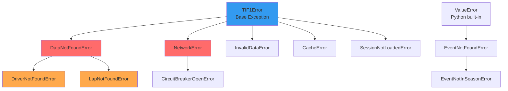

tif1 uses a structured exception hierarchy for graceful error handling. The tif1 exceptions inherit from `TIF1Error`, so one `except TIF1Error` clause catches them. `EventNotFoundError` and its subclass `EventNotInSeasonError` are not part of this tree. They are `ValueError` subclasses, raised when an event name does not resolve to an event of the season.

## Exception Hierarchy



## Common Exceptions

### DataNotFoundError

Raised when requested data does not exist in the archive.

```python
import tif1
from tif1 import DataNotFoundError

session = tif1.get_session(2025, "Monaco Grand Prix", "Race")

try:
    # Lap 999 does not exist, so get_lap raises LapNotFoundError
    lap = session.get_driver("VER").get_lap(999)
except DataNotFoundError as e:
    print(f"Data not found: {e}")
    print(f"Context: {e.context}")  # {'lap_number': 999, 'driver': 'VER', 'year': 2025, ...}
```

**Common causes:**
- A lap number or driver code that is not in the session
- The session has not started yet
- Data not yet available in archive

<Note>
  An unknown event name does not raise `DataNotFoundError`. It raises `EventNotFoundError`, a `ValueError` (see [EventNotFoundError](#eventnotfounderror)). An unknown session name raises `ValueError`.
</Note>

**Solution:**
```python
# Check available events first (get_events returns a DataFrame)
events = tif1.get_events(2025)
if "Monaco Grand Prix" in events["EventName"].values:
    session = tif1.get_session(2025, "Monaco Grand Prix", "Race")
```

### DriverNotFoundError

Raised when code accesses a driver that does not exist in the session.

```python
from tif1 import DriverNotFoundError

try:
    driver = session.get_driver("XXX")
except DriverNotFoundError as e:
    print(f"Driver not found: {e}")
```

**Solution:**
```python
# Check available drivers first
# session.drivers lists driver numbers; drivers_df lists their abbreviations
available_drivers = session.drivers_df["Driver"].tolist()
if "VER" in available_drivers:
    driver = session.get_driver("VER")
```

### EventNotFoundError

Raised by `get_session` and `get_event_by_name` when an event name matches no event of the season. `EventNotFoundError` is a `ValueError`, not a `TIF1Error`, so `except TIF1Error` does not catch it.

tif1 resolves an event name in three steps: the exact name, then a table of circuit, city, and country aliases, then fuzzy matching. A typo such as `"Monacco"` resolves to the Monaco Grand Prix and logs a `Correcting user input` warning. A fuzzy match needs a score of at least 70 out of 100. A name below that score, such as `"Moon GP"`, raises `EventNotFoundError`.

An alias for an event that is not on that season's calendar raises `EventNotInSeasonError`, a subclass of `EventNotFoundError`. An example is `"Suzuka"` in 2021.

```python
from tif1 import EventNotFoundError, EventNotInSeasonError

try:
    session = tif1.get_session(2025, "Moon GP", "Race")
except EventNotFoundError as e:
    print(e)  # No event matching 'Moon GP' in 2025

try:
    session = tif1.get_session(2021, "Suzuka", "Race")
except EventNotInSeasonError as e:  # also caught by except EventNotFoundError
    print(e)  # 'Suzuka' refers to the Japanese Grand Prix, which is not on the 2021 calendar
```

To catch every tif1 error, including an unknown event name, catch both base classes:

```python
try:
    session = tif1.get_session(2025, "Moon GP", "Race")
    laps = session.laps
except (tif1.TIF1Error, tif1.EventNotFoundError) as e:
    print(f"Could not load session: {e}")
```

### NetworkError

Raised when all CDN sources fail or time out. While the circuit breaker is open, loads also fail with `NetworkError`. `CircuitBreakerOpenError`, the breaker's own refusal, is a `NetworkError` subclass.

By default, the circuit breaker opens after 5 network failures in a row (`circuit_breaker_threshold`). It then refuses requests for 60 seconds (`circuit_breaker_timeout`). After that time, requests go through again, and the first success closes the breaker. A missing file (404), a refused file (403), or an `InvalidDataError` does not count as a failure.

```python
from tif1 import NetworkError

try:
    session = tif1.get_session(2025, "Monaco Grand Prix", "Race")
    laps = session.laps
except NetworkError as e:
    print(f"Network error: {e}")
    # Check circuit breaker status
    cb = tif1.get_circuit_breaker()
    if cb.state == "open":
        print("Circuit breaker is open, too many failures")
```

**Solutions:**
- Check internet connection
- Verify the CDN sources (jsDelivr, Hugging Face, StaticDelivr) are accessible
- Reset circuit breaker if needed
- Re-enable CDN sources with `tif1.get_cdn_manager().reset()`. A source that fails 3 times in a row stays off until this reset.
- Enable debug logging to see which CDN failed

### InvalidDataError

Raised when a fetched payload is not a JSON object, or fails the optional payload validation. The `validate_data`, `validate_lap_times`, and `validate_telemetry` options are off by default. tif1 does not retry an invalid payload.

```python
from tif1 import InvalidDataError

try:
    laps = session.laps
except InvalidDataError as e:
    print(f"Invalid data: {e}")
    # Drop cached payloads before a retry
    tif1.get_cache().clear()
```

### CacheError

tif1 exports `CacheError` but does not raise it. When SQLite cannot open or write the cache database, tif1 logs a warning. It then continues without the SQLite cache, so loads are slower but do not fail.

### SessionNotLoadedError

tif1 exports `SessionNotLoadedError` but does not raise it. Session data properties such as `session.laps` load their data on first access. Like every `TIF1Error`, it accepts keyword arguments as error context.

## Error handling patterns

### Graceful Degradation

Handle errors without stopping the analysis.

```python
def safe_load_session(year, gp, session_type):
    """Load session laps with fallback to None."""
    try:
        session = tif1.get_session(year, gp, session_type)
        session.laps  # Trigger the fetch so errors surface here
        return session
    except DataNotFoundError:
        print(f"No data for {year} {gp} {session_type}")
        return None
    except NetworkError:
        print(f"Network error loading {year} {gp} {session_type}")
        return None

# Use it
session = safe_load_session(2025, "Monaco Grand Prix", "Race")
if session:
    laps = session.laps
```

### Retry Logic

tif1 already sends each request up to `max_retries` times (default 3), with exponential backoff between tries. A value of `0` makes one attempt, the same as `1`. The first load of a session that is not in the cache makes one attempt per CDN source (`ultra_cold_skip_retries`). tif1 does not retry a 403, a 404, or an `InvalidDataError`, because a new attempt gets the same answer.

Add an application-level retry for network failures that last longer than the built-in retries.

```python
import time
from tif1 import NetworkError

def load_with_retry(year, gp, session_type, max_retries=3):
    """Load session with exponential backoff."""
    for attempt in range(max_retries):
        try:
            session = tif1.get_session(year, gp, session_type)
            session.laps  # get_session is lazy: the fetch (and its errors) happen here
            return session
        except NetworkError:
            if attempt == max_retries - 1:
                raise
            # Re-enable CDN sources that the failed attempts switched off
            tif1.get_cdn_manager().reset()
            wait_time = 2 ** attempt
            print(f"Retry {attempt + 1}/{max_retries} in {wait_time}s...")
            time.sleep(wait_time)
```

### Batch Processing

Handle errors when processing multiple sessions.

```python
def process_season(year, max_events=None):
    """Process all races with error handling."""
    # get_event_schedule() returns a DataFrame; iterate the EventName column
    events = tif1.get_event_schedule(year, include_testing=False)["EventName"]
    if max_events:
        events = events[:max_events]
    results = []
    errors = []

    for event in events:
        try:
            session = tif1.get_session(year, event, "Race")
            laps = session.laps

            # Process data
            result = {
                "event": event,
                "total_laps": len(laps),
                "fastest_lap": laps["LapTime"].min()
            }
            results.append(result)

        except Exception as e:
            errors.append({"event": event, "error": str(e)})
            continue

    return results, errors

# Use it (the first three rounds)
results, errors = process_season(2024, max_events=3)
print(f"Processed {len(results)} events, {len(errors)} errors")
```

### Context Managers

Use context managers for resource cleanup.

```python
class SessionContext:
    """Context manager for session loading."""

    def __init__(self, year, gp, session_type):
        self.year = year
        self.gp = gp
        self.session_type = session_type
        self.session = None

    def __enter__(self):
        try:
            self.session = tif1.get_session(
                self.year, self.gp, self.session_type
            )
            self.session.laps  # Fetch now so load errors surface here
            return self.session
        except Exception as e:
            print(f"Failed to load session: {e}")
            return None

    def __exit__(self, exc_type, exc_val, exc_tb):
        # Cleanup if needed
        if exc_type is not None:
            print(f"Error during processing: {exc_val}")
        return False

# Use it
with SessionContext(2025, "Monaco Grand Prix", "Race") as session:
    if session:
        laps = session.laps
```

## Debugging Errors

### Enable debug logging

See detailed information about the operations in progress.

```python
import tif1
import logging

# Enable debug logging
tif1.setup_logging(logging.DEBUG)

# Now all operations show detailed logs
session = tif1.get_session(2025, "Monaco Grand Prix", "Race")
```

### Inspect error context

Every `TIF1Error` carries a `context` dict with the keyword arguments it was raised with.

```python
try:
    lap = session.get_driver("VER").get_lap(999)
except tif1.DataNotFoundError as e:
    print(f"Error: {e}")
    print(f"Context: {e.context}")
    # Context includes: lap_number, driver, year, event, session
```

### Check circuit breaker

Monitor network health.

```python
cb = tif1.get_circuit_breaker()
print(f"State: {cb.state}")
print(f"Failures: {cb.failures}")
print(f"Last failure: {cb.last_failure_time}")

# Reset if needed
if cb.state == "open":
    tif1.reset_circuit_breaker()
```

## Best Practices

<Steps>
  <Step title="Validate Input">
    Check data availability before processing.
    ```python
    events = tif1.get_events(2025)
    if "Monaco Grand Prix" in events["EventName"].values:
        session = tif1.get_session(2025, "Monaco Grand Prix", "Race")
    ```
  </Step>
  <Step title="Use Specific Exceptions">
    Catch specific exceptions rather than broad `Exception`.
    ```python
    try:
        session = tif1.get_session(2025, "Monaco Grand Prix", "Race")
        laps = session.laps
    except tif1.DataNotFoundError:
        # Handle missing data
        pass
    except tif1.NetworkError:
        # Handle network issues
        pass
    ```
  </Step>
  <Step title="Log Errors">
    Always log errors for debugging.
    ```python
    import logging
    logger = logging.getLogger(__name__)

    try:
        session = tif1.get_session(2025, "Monaco Grand Prix", "Race")
        laps = session.laps
    except Exception as e:
        logger.error(f"Failed to load session: {e}", exc_info=True)
    ```
  </Step>
  <Step title="Fail Fast">
    Do not continue processing when critical data is missing.
    ```python
    session = tif1.get_session(2025, "Monaco Grand Prix", "Race")
    laps = session.laps
    if laps.empty:
        raise ValueError("Cannot proceed without lap data")
    ```
  </Step>
</Steps>

## Production Patterns

### Health Checks

Monitor tif1 health in production.

```python
def check_tif1_health():
    """Check if tif1 is operational."""
    try:
        # Try to get events (lightweight operation)
        events = tif1.get_events(2024)

        # Check circuit breaker
        cb = tif1.get_circuit_breaker()
        if cb.state == "open":
            return False, "Circuit breaker is open"

        # Check cache
        cache = tif1.get_cache()
        if not cache.cache_dir.exists():
            return False, "Cache directory missing"

        return True, "Healthy"
    except Exception as e:
        return False, str(e)
```

### Monitoring

Track errors and performance.

```python
import time
from collections import defaultdict

class TIF1Monitor:
    """Monitor tif1 operations."""

    def __init__(self):
        self.errors = defaultdict(int)
        self.timings = []

    def load_session(self, year, gp, session_type):
        """Load session with monitoring."""
        start = time.time()
        try:
            session = tif1.get_session(year, gp, session_type)
            session.laps  # get_session is lazy: time the laps fetch too
            duration = time.time() - start
            self.timings.append(duration)
            return session
        except Exception as e:
            self.errors[type(e).__name__] += 1
            raise

    def report(self):
        """Generate monitoring report."""
        return {
            "total_errors": sum(self.errors.values()),
            "errors_by_type": dict(self.errors),
            "avg_load_time": sum(self.timings) / len(self.timings) if self.timings else 0,
            "max_load_time": max(self.timings) if self.timings else 0
        }
```

## Summary

Proper error handling keeps tif1 applications stable and maintainable. Always use specific exceptions, validate input, and add retry logic for production use.

---

## Related Pages

<CardGroup cols={2}>
  <Card title="Exceptions API" href="/api-reference/exceptions">
    Exception reference
  </Card>
  <Card title="Troubleshooting" href="/reference/troubleshooting">
    Common issues
  </Card>
  <Card title="Best Practices" href="/guides/best-practices">
    Recommended patterns
  </Card>
</CardGroup>
