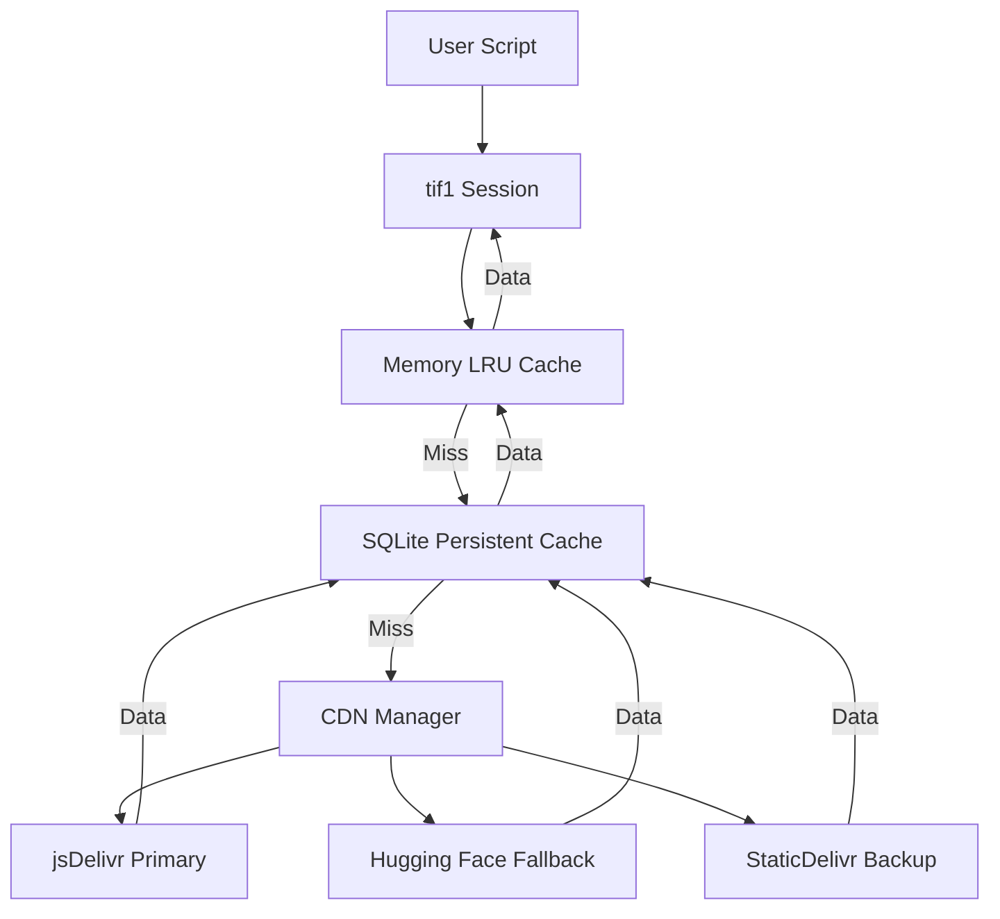

# Welcome to tif1

`tif1` is a Python library for Formula 1 data analysis. It provides access to timing, telemetry, and weather data from TracingInsights (2018-current).

`tif1` is an alternative to `fastf1` with a compatible API. It loads data lazily, fetches multi-file loads in parallel over HTTP/2, and supports pandas and polars backends.

## Why tif1?

<CardGroup cols={2}>
  <Card title="Parallel Loading" icon="bolt">
    Multi-file loads run as parallel requests over HTTP/2. The benchmark suite checks that a parallel batch finishes more than 3x faster than the same requests in sequence.
  </Card>
  <Card title="API Compatible" icon="code">
    The API follows `fastf1` conventions. Most scripts migrate with few code changes.
  </Card>
  <Card title="Flexible Backends" icon="database">
    Choose **Pandas** for compatibility, or **Polars** to get `polars.DataFrame` laps and telemetry.
  </Card>
  <Card title="Multi-tier Caching" icon="shield-check">
    Two cache tiers: an in-memory LRU cache and a SQLite cache for persistent storage.
  </Card>
</CardGroup>

## Why tif1 over fastf1?

`fastf1` is an established library at the center of the F1 data community. `tif1` started as a personal project with a different approach in a few areas:

1. **Fetch only the necessary data.** `session.load()` is not necessary. One lap of telemetry for one driver needs three small files. They hold the driver list, the lap table, and the telemetry of that lap.
2. **No API rate limits.** fastf1 raises `RateLimitExceededError` after **500 uncached requests in one hour**. The jolpica-f1 API behind it documents the same limit for unauthenticated use. `tif1` reads static CDN files and keeps no request quota.
3. **Charts included.** 22 optional one-call `plot_*()` functions turn raw data into finished charts: `tif1.plot_top_speeds(...)`, `tif1.plot_driver_laptimes(...)`, and more.
4. **Public CDN access.** `tif1` needs no API key, cookie, or account. Any network that can reach jsDelivr, Hugging Face, or StaticDelivr can load the data.
5. **More data.** Mini-sector color codes, weather columns on every lap row, and acceleration channels in telemetry. The `fastf1` laps and telemetry do not include these columns.

<Card title="Full comparison" icon="scale" href="/why-tif1">
  Read the "Why tif1 instead of fastf1?" page. It includes the verified 500 requests/hour rate-limit sources.
</Card>

## Key Features

- **Multi-CDN**: jsDelivr, Hugging Face buckets, and StaticDelivr with automatic fallback and SQLite caching
- **Complete**: Lap times, sectors, telemetry, tire compounds, weather, and race control messages
- **Historical**: Data from 2018-current
- **Reliable**: Automatic retry logic with circuit breaker and multi-CDN fallback
- **Async**: Parallel data fetching for multi-file loads
- **HTTP/2**: Uses niquests for multiplexed, connection-efficient network requests
- **Flexible**: Supports both pandas and polars backends
- **Type-Safe**: Type hints on the public API for IDE support
- **Jupyter-Ready**: `tif1.jupyter` adds HTML display for sessions, drivers, and laps in notebooks
- **Native Charts**: 22 one-call chart functions in `tif1.charts` for track maps, telemetry comparisons, and performance analysis

## Performance

`tif1` does not publish a timed comparison with `fastf1`. The benchmark suite in the repository measures `tif1` itself. One test sends 10 simulated requests of 0.1 s each. The parallel batch must finish more than 3x faster than the same requests in sequence. Results vary by machine and network. Run `uv run pytest tests/benchmarks/ -m benchmark` in a clone of the repository to measure them.

## Core Architecture

`tif1` uses an HTTP/2 networking stack with multi-CDN support and a multi-tier cache. This design decreases the time spent waiting for data.

## Data Available

- Lap times and sectors (S1, S2, S3). `LapTime` is a Timedelta on pandas and float seconds on polars. `LapTimeSeconds` is float seconds on both.
- Tire compounds and stint information
- Telemetry: speed, throttle, brake, RPM, gear, and DRS as a 0/1 flag
- Position data (X, Y, Z coordinates)
- Acceleration data (X, Y, Z axes)
- Weather data automatically included in laps
- Driver metadata with team colors and headshots
- Race control messages

## Next Steps

<CardGroup cols={2}>
  <Card title="Why tif1?" icon="scale" href="/why-tif1">
    Why choose tif1 instead of fastf1?
  </Card>
  <Card title="Installation" icon="download" href="/installation">
    Install tif1 and verify the installation.
  </Card>
  <Card title="Quickstart" icon="rocket" href="/quickstart">
    Load a first session and read laps and telemetry.
  </Card>
  <Card title="Examples" icon="code" href="/examples">
    Common patterns and code examples.
  </Card>
  <Card title="Charts" icon="chart-column" href="/api-reference/charts">
    Visualize F1 data with 22 one-call chart functions.
  </Card>
  <Card title="Data Reference" icon="file-json" href="/reference/data-reference">
    Every field in the raw TracingInsights data files, with explanations.
  </Card>
  <Card title="Migration Guide" icon="arrow-right-arrow-left" href="/migration-from-fastf1">
    Coming from fastf1? See the differences.
  </Card>
  <Card title="API Reference" icon="book" href="/api-reference/overview">
    Explore the complete tif1 API.
  </Card>
  <Card title="Tutorials" icon="graduation-cap" href="/tutorials/race-pace-analysis">
    Learn with detailed analysis examples.
  </Card>
</CardGroup>

---

## Related Pages

<CardGroup cols={2}>
  <Card title="Installation" href="/installation">
    Install tif1
  </Card>
  <Card title="Why tif1?" href="/why-tif1">
    Why tif1 instead of fastf1?
  </Card>
  <Card title="Quickstart" href="/quickstart">
    Load a first session
  </Card>
  <Card title="API Reference" href="/api-reference/overview">
    Explore the API
  </Card>
  <Card title="Charts API" href="/api-reference/charts">
    Native chart functions
  </Card>
  <Card title="Tutorials" href="/tutorials/race-analysis">
    Learn with examples
  </Card>
</CardGroup>
